# Reference image gallery

34 locally saved images, retrieved October 14, 2026. Open an image at its original size when judging pixel structure. These are published reference media, not captures of OpenLegend or proof of our rendering performance.

The strongest direction references are **Garbage Country** for environments and **The Last Night / REPLACED** for fine detail and cinematic light. **EthrA** contributes dimensional environment composition; Mike wants richer characters. Captions below are visual observations, not claims about unpublished shader code.

[Research index](README.md) · [Technical evidence](reference-techniques.md) · [Complete source/rights/hash manifest](image-manifest.json)

Creator rights are retained. Research/reference only; not licensed for use as OpenLegend game assets. Historical promotional images may not represent a released or current build. The two Last Night GIF frames cannot demonstrate their source animation in a still gallery.

## Garbage Country

### garbage-country-01

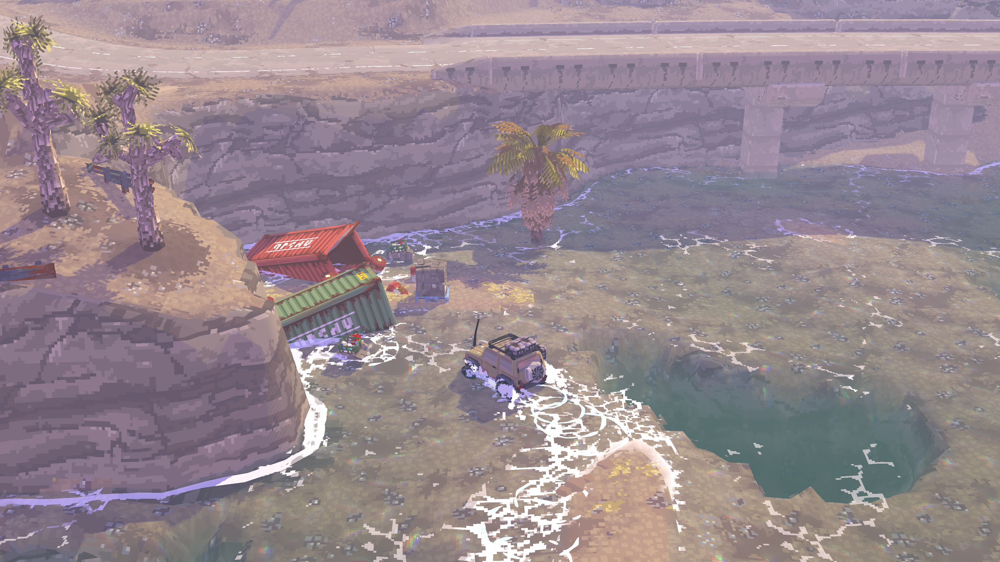

Coastal terrain and water: compare broad ground shapes with the carefully limited foam and vegetation detail.

**Credit:** Noio / Garbage Country art team. **Media:** published screenshot; 3840 × 2160 source. [Source page](https://www.noio.nl/garbage-country-presskit/) · [Published media](https://www.noio.nl/garbage-country-presskit/screenshots/screenshot-01.png).

### garbage-country-02

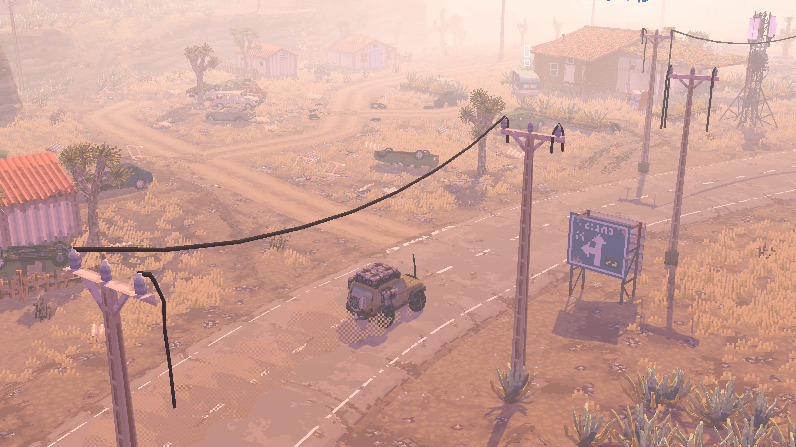

Road and overhead wires: small repeated details sit against much larger areas of quieter color.

**Credit:** Noio / Garbage Country art team. **Media:** published screenshot; 3840 × 2160 source. [Source page](https://www.noio.nl/garbage-country-presskit/) · [Published media](https://www.noio.nl/garbage-country-presskit/screenshots/screenshot-02.png).

### garbage-country-03

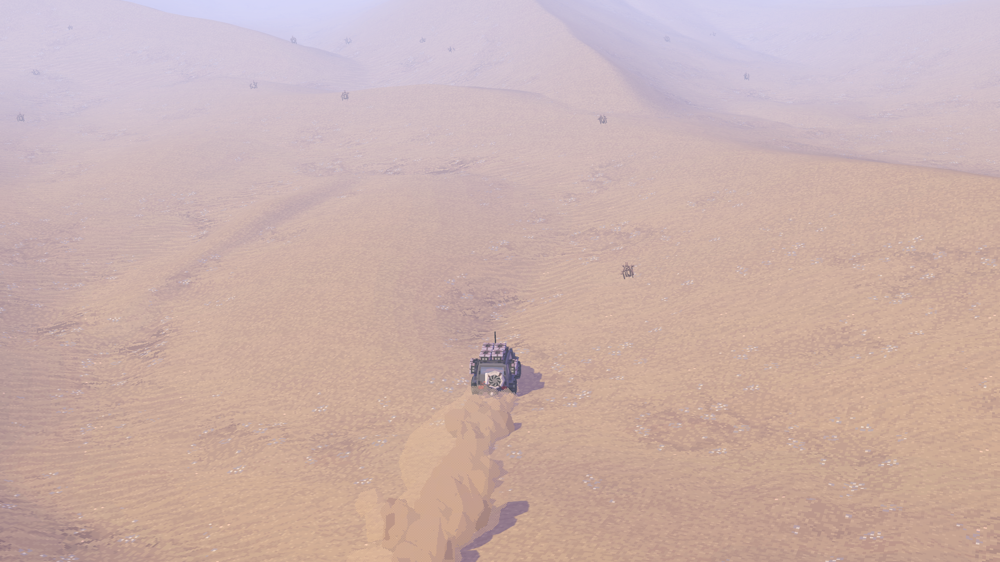

Open sandy terrain and haze: distance reduces contrast instead of filling every region with equally sharp detail.

**Credit:** Noio / Garbage Country art team. **Media:** published screenshot; 3840 × 2160 source. [Source page](https://www.noio.nl/garbage-country-presskit/) · [Published media](https://www.noio.nl/garbage-country-presskit/screenshots/screenshot-03.png).

### garbage-country-04

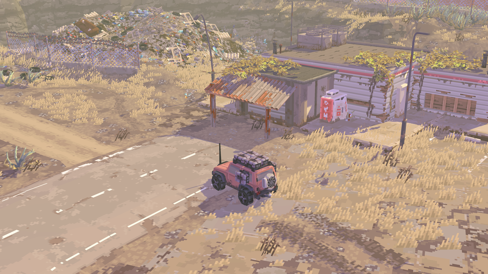

Roadside structures: weathered surfaces and scattered objects create history without obscuring the main forms.

**Credit:** Noio / Garbage Country art team. **Media:** published screenshot; 3840 × 2160 source. [Source page](https://www.noio.nl/garbage-country-presskit/) · [Published media](https://www.noio.nl/garbage-country-presskit/screenshots/screenshot-04.png).

### garbage-country-05

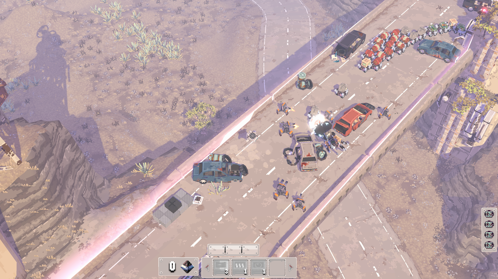

Bridge scene: construction, foliage and moving subjects retain distinct silhouettes.

**Credit:** Noio / Garbage Country art team. **Media:** published screenshot; 3840 × 2160 source. [Source page](https://www.noio.nl/garbage-country-presskit/) · [Published media](https://www.noio.nl/garbage-country-presskit/screenshots/screenshot-05.png).

### garbage-country-06

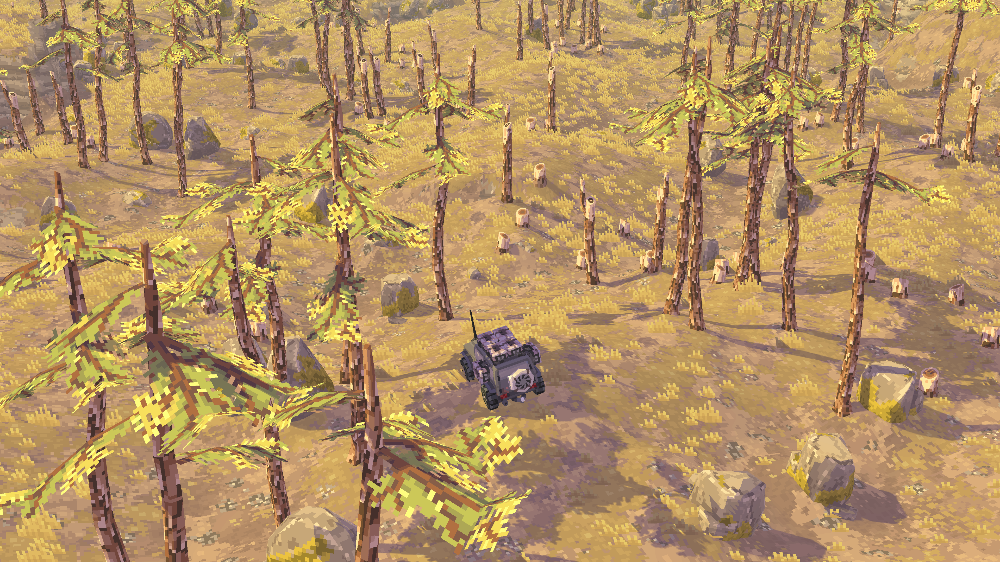

Woodland: clustered crowns, ground light and gaps between plants establish depth.

**Credit:** Noio / Garbage Country art team. **Media:** published screenshot; 3840 × 2160 source. [Source page](https://www.noio.nl/garbage-country-presskit/) · [Published media](https://www.noio.nl/garbage-country-presskit/screenshots/screenshot-06.png).

## EthrA

### ethra-01

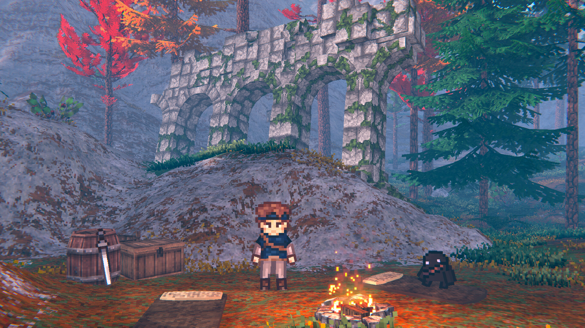

Camp and stone ruins: broken architecture, vegetation and small warm lights give the space dimension.

**Credit:** StoneLab Games. **Media:** published screenshot; 1920 × 1080 source. [Source page](https://store.steampowered.com/app/2177510/) · [Published media](https://shared.akamai.steamstatic.com/store_item_assets/steam/apps/2177510/ff80a597ad8cee0277530ceed8d3ed148cd6bd53/ss_ff80a597ad8cee0277530ceed8d3ed148cd6bd53.1920x1080.jpg?t=1791632579).

### ethra-02

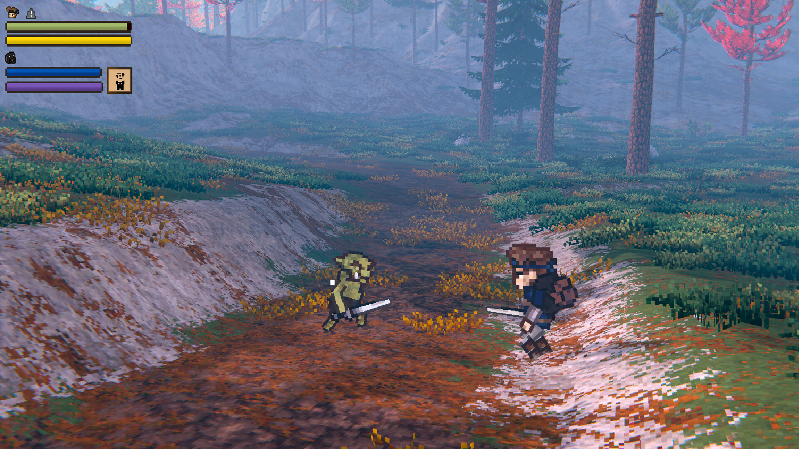

Forest combat: evaluate environmental richness separately from the relatively small character detail.

**Credit:** StoneLab Games. **Media:** published screenshot; 1920 × 1080 source. [Source page](https://store.steampowered.com/app/2177510/) · [Published media](https://shared.akamai.steamstatic.com/store_item_assets/steam/apps/2177510/b698900d3ee80dae836a60028770d7c95768c685/ss_b698900d3ee80dae836a60028770d7c95768c685.1920x1080.jpg?t=1791632579).

### ethra-03

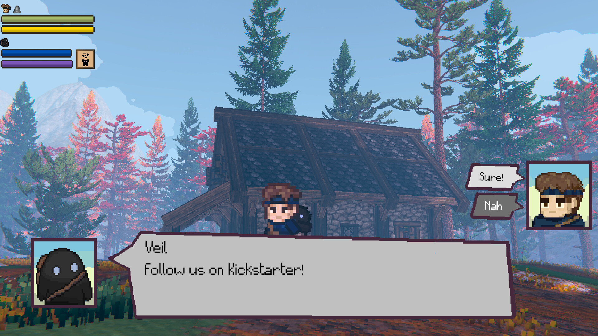

Conversation view: the large portrait and small world figure serve different levels of identity detail.

**Credit:** StoneLab Games. **Media:** published screenshot; 1920 × 1080 source. [Source page](https://store.steampowered.com/app/2177510/) · [Published media](https://shared.akamai.steamstatic.com/store_item_assets/steam/apps/2177510/266d368c7ecf3900f924f804b5f245891ed51265/ss_266d368c7ecf3900f924f804b5f245891ed51265.1920x1080.jpg?t=1791632579).

### ethra-04

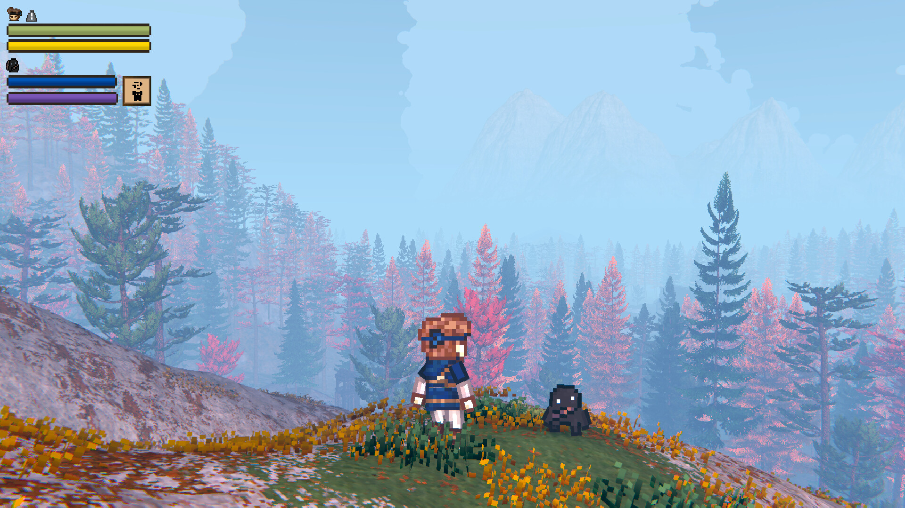

Elevated landscape view: layered terrain and atmospheric depth remain useful references for OpenLegend.

**Credit:** StoneLab Games. **Media:** published screenshot; 1920 × 1080 source. [Source page](https://store.steampowered.com/app/2177510/) · [Published media](https://shared.akamai.steamstatic.com/store_item_assets/steam/apps/2177510/53cddfaa5bc0abc980040a22f5a1792f4d716eb0/ss_53cddfaa5bc0abc980040a22f5a1792f4d716eb0.1920x1080.jpg?t=1791632579).

## The Last Night

### last-night-01

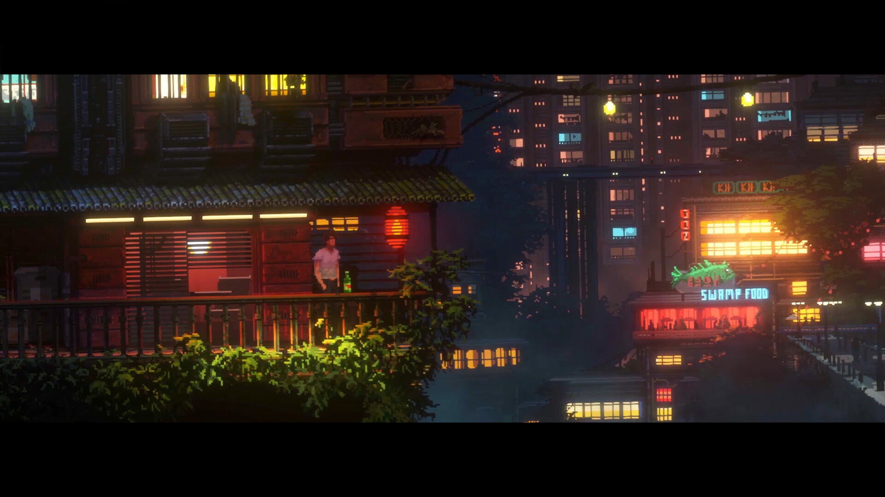

Balcony and city depth: foreground framing, distant lights and contrasting color temperatures guide the eye.

**Credit:** Odd Tales. **Media:** published screenshot; 1920 × 1080 source. [Source page](https://store.steampowered.com/app/612400/) · [Published media](https://shared.akamai.steamstatic.com/store_item_assets/steam/apps/612400/9c0713f3a6c5e756622e2f28d835e3fd5634fa0f/ss_9c0713f3a6c5e756622e2f28d835e3fd5634fa0f.1920x1080.jpg?t=1776477796).

### last-night-02

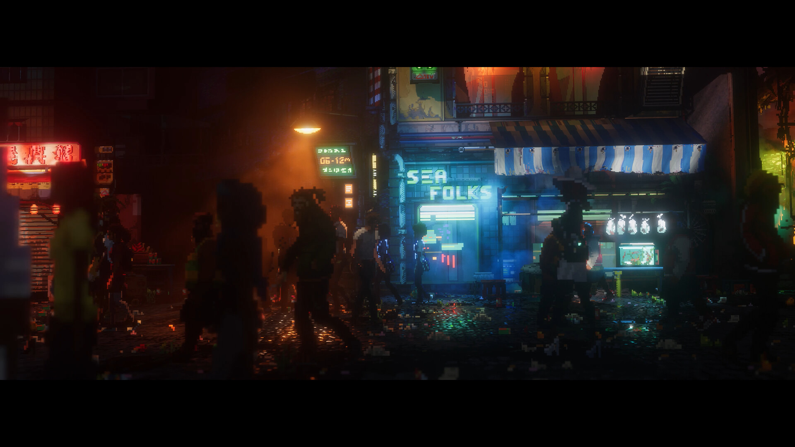

Wet street and crowd: reflected accents connect characters and architecture to the ground.

**Credit:** Odd Tales. **Media:** published screenshot; 1920 × 1080 source. [Source page](https://store.steampowered.com/app/612400/) · [Published media](https://shared.akamai.steamstatic.com/store_item_assets/steam/apps/612400/9c5e6faa66fc1f737567552877503e01a5b65ca0/ss_9c5e6faa66fc1f737567552877503e01a5b65ca0.1920x1080.jpg?t=1776477796).

### last-night-03

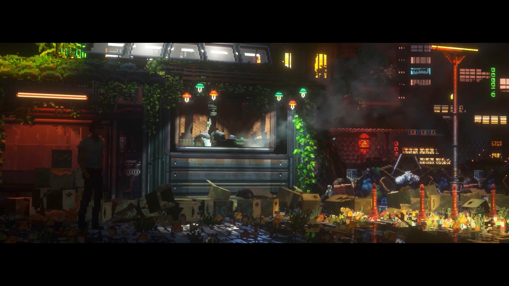

Dense shop/stair scene: detailed props are grouped around a readable focal area.

**Credit:** Odd Tales. **Media:** published screenshot; 1920 × 1080 source. [Source page](https://store.steampowered.com/app/612400/) · [Published media](https://shared.akamai.steamstatic.com/store_item_assets/steam/apps/612400/ff92928f56c58507255316ef5eac0d8851a4654e/ss_ff92928f56c58507255316ef5eac0d8851a4654e.1920x1080.jpg?t=1776477796).

### last-night-04

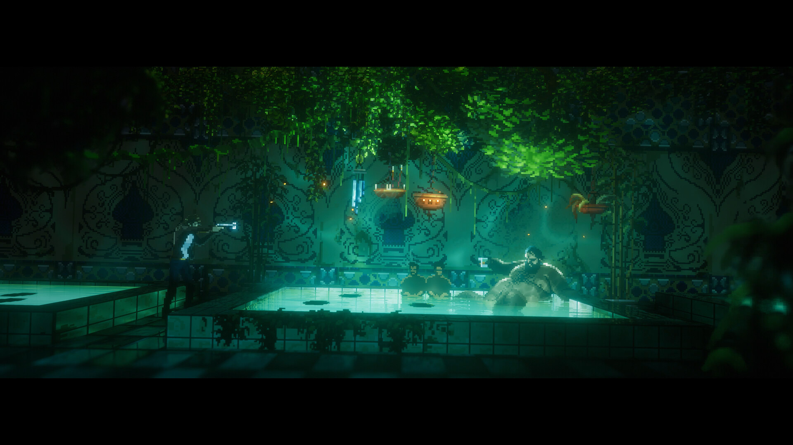

Teal-lit interior: color, light and overlapping surfaces create depth beyond flat sprite placement.

**Credit:** Odd Tales. **Media:** published screenshot; 1920 × 1080 source. [Source page](https://store.steampowered.com/app/612400/) · [Published media](https://shared.akamai.steamstatic.com/store_item_assets/steam/apps/612400/c4902c82884f8655d1ad746f12ed08d9eccd2310/ss_c4902c82884f8655d1ad746f12ed08d9eccd2310.1920x1080.jpg?t=1776477796).

### last-night-05

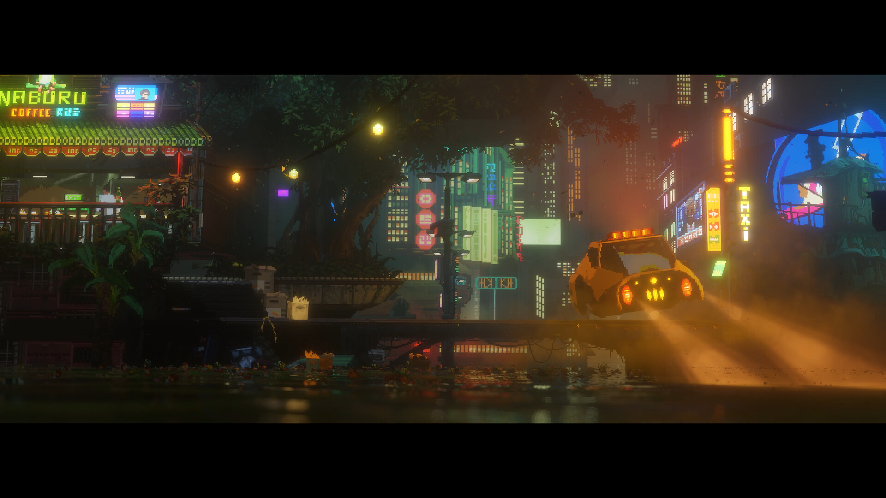

Street and vehicle: broad light/shadow groups support fine pixel detail.

**Credit:** Odd Tales. **Media:** published screenshot; 1920 × 1080 source. [Source page](https://store.steampowered.com/app/612400/) · [Published media](https://shared.akamai.steamstatic.com/store_item_assets/steam/apps/612400/5a1a9164ba2ef05e7ea1ab41c502f8faefa714d2/ss_5a1a9164ba2ef05e7ea1ab41c502f8faefa714d2.1920x1080.jpg?t=1776477796).

### last-night-bedroom

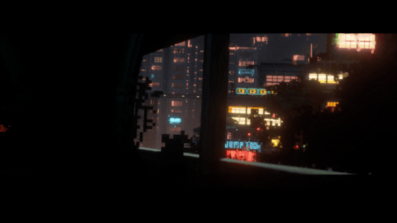

Official animated bedroom scene, one extracted frame: the figure reads against the illuminated window and distant city.

**Credit:** Odd Tales. **Media:** frame from official real-time GIF; 800 × 450 source. [Source page](https://oddtales.net/thelastnight/) · [Published media](https://oddtales.net/thelastnight/img/gifs/thelastnight_e32017_bedroom.gif).

Local PNG extracted from source GIF frame 91 of 183; the manifest records the transformation and original/source hashes.

### last-night-backalley

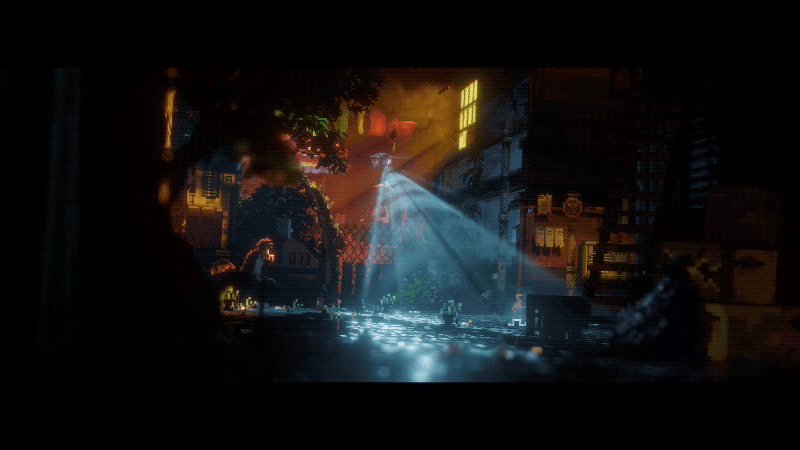

Official animated back-alley scene, one extracted frame: cool shafts of light and silhouettes establish layered depth.

**Credit:** Odd Tales. **Media:** frame from official real-time GIF; 800 × 450 source. [Source page](https://oddtales.net/thelastnight/) · [Published media](https://oddtales.net/thelastnight/img/gifs/thelastnight_e32017_backalley.gif).

Local PNG extracted from source GIF frame 26 of 53; the manifest records the transformation and original/source hashes.

## REPLACED

### replaced-01

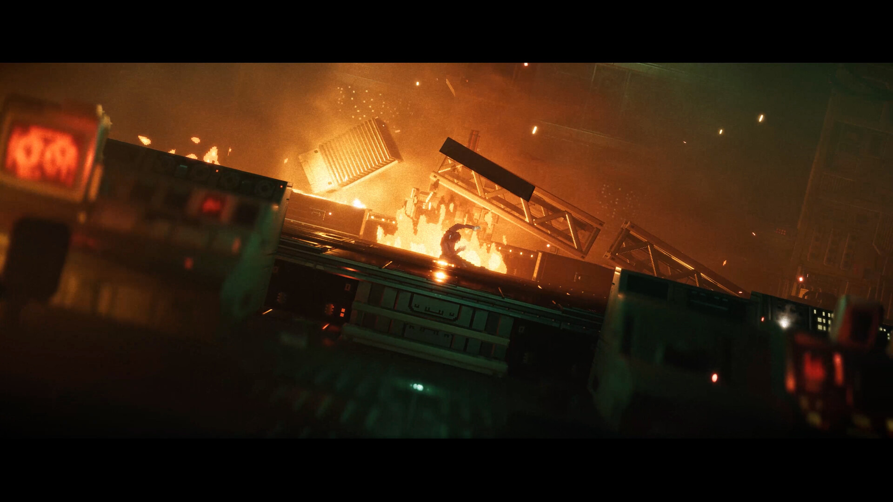

Vehicle and fire: warm high-intensity light is concentrated around the action.

**Credit:** Sad Cat Studios / Thunderful. **Media:** published screenshot; 1920 × 1080 source. [Source page](https://store.steampowered.com/app/1663850/) · [Published media](https://shared.akamai.steamstatic.com/store_item_assets/steam/apps/1663850/b6cd61c464ea2dfbd5ae1f306b986944911b21c6/ss_b6cd61c464ea2dfbd5ae1f306b986944911b21c6.1920x1080.jpg?t=1790232942).

### replaced-02

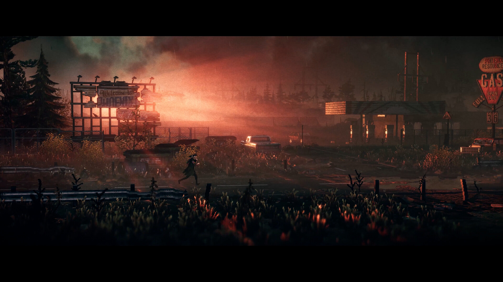

Field at dusk: a comparatively quiet environment gives the character and horizon room to read.

**Credit:** Sad Cat Studios / Thunderful. **Media:** published screenshot; 1920 × 1080 source. [Source page](https://store.steampowered.com/app/1663850/) · [Published media](https://shared.akamai.steamstatic.com/store_item_assets/steam/apps/1663850/46e00a91460058c709af281240cfe26385467438/ss_46e00a91460058c709af281240cfe26385467438.1920x1080.jpg?t=1790232942).

### replaced-03

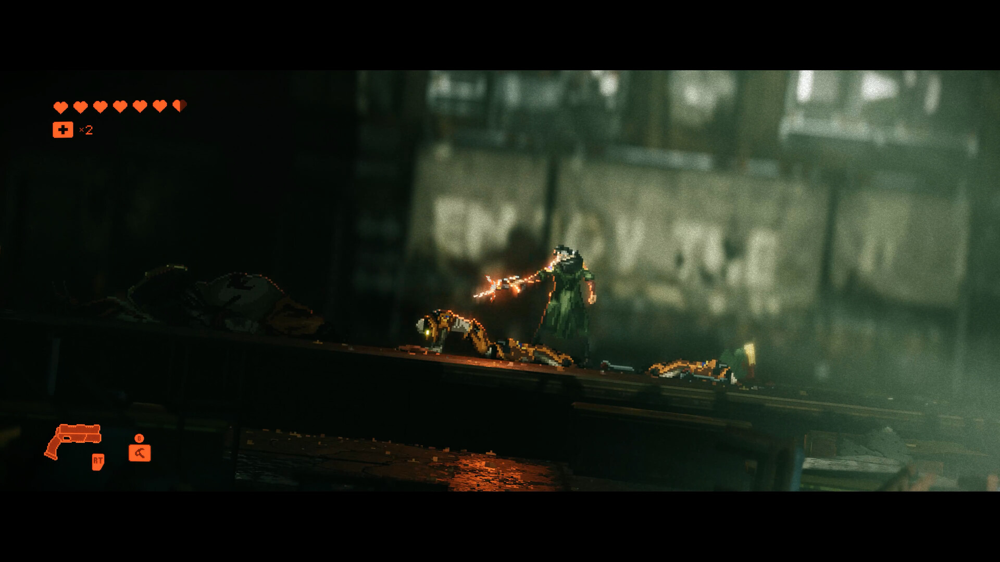

Interior action: strong local light and atmospheric layers separate action from architecture.

**Credit:** Sad Cat Studios / Thunderful. **Media:** published screenshot; 1920 × 1080 source. [Source page](https://store.steampowered.com/app/1663850/) · [Published media](https://shared.akamai.steamstatic.com/store_item_assets/steam/apps/1663850/2cf7357ca43429277c123033bce947365b81b6fa/ss_2cf7357ca43429277c123033bce947365b81b6fa.1920x1080.jpg?t=1790232942).

### replaced-04

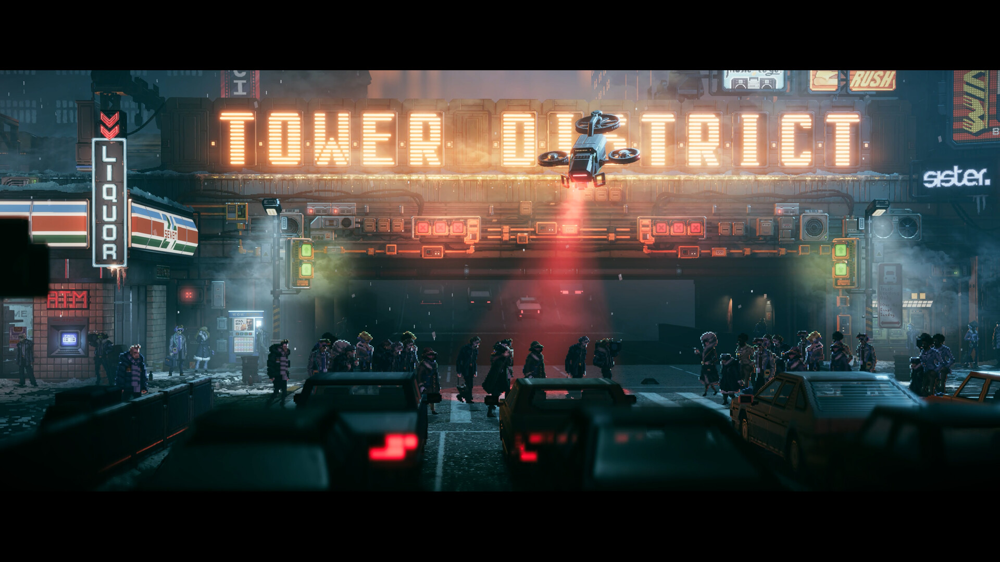

Dense city scene: fine detail is coordinated by large value and color groups.

**Credit:** Sad Cat Studios / Thunderful. **Media:** published screenshot; 1920 × 1080 source. [Source page](https://store.steampowered.com/app/1663850/) · [Published media](https://shared.akamai.steamstatic.com/store_item_assets/steam/apps/1663850/09f80de553bc4fc150dbf342305a6f341f0539ff/ss_09f80de553bc4fc150dbf342305a6f341f0539ff.1920x1080.jpg?t=1790232942).

## Kingdom: New Lands

### kingdom-01

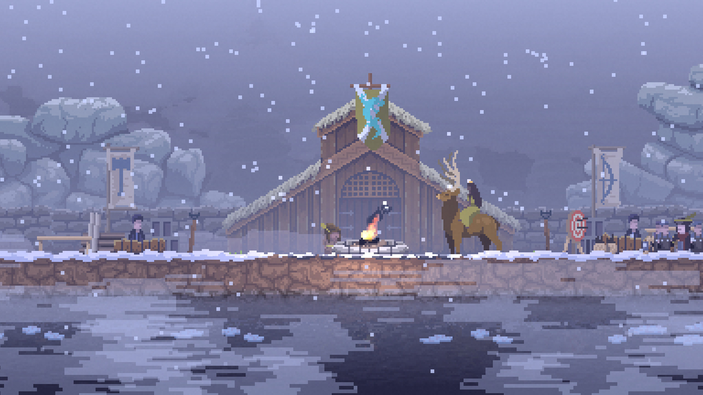

Snow scene: the rider and structures remain readable through restrained silhouettes and palette.

**Credit:** Noio / Raw Fury. **Media:** published screenshot; 1920 × 1080 source. [Source page](https://store.steampowered.com/app/496300/) · [Published media](https://shared.akamai.steamstatic.com/store_item_assets/steam/apps/496300/ss_a47feaf983b58fc4901d356015e86dc93b4a990b.1920x1080.jpg?t=1788873284).

### kingdom-02

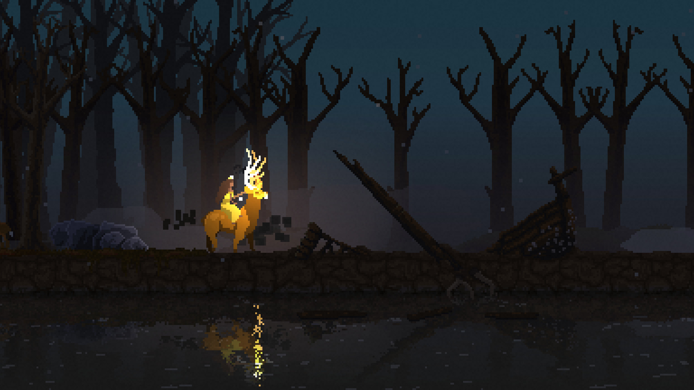

Night scene: limited bright accents and reflections organize a mostly dark image.

**Credit:** Noio / Raw Fury. **Media:** published screenshot; 1920 × 1080 source. [Source page](https://store.steampowered.com/app/496300/) · [Published media](https://shared.akamai.steamstatic.com/store_item_assets/steam/apps/496300/ss_12071cdc0e7088e2730681c573a4f6021127b09c.1920x1080.jpg?t=1788873284).

### kingdom-03

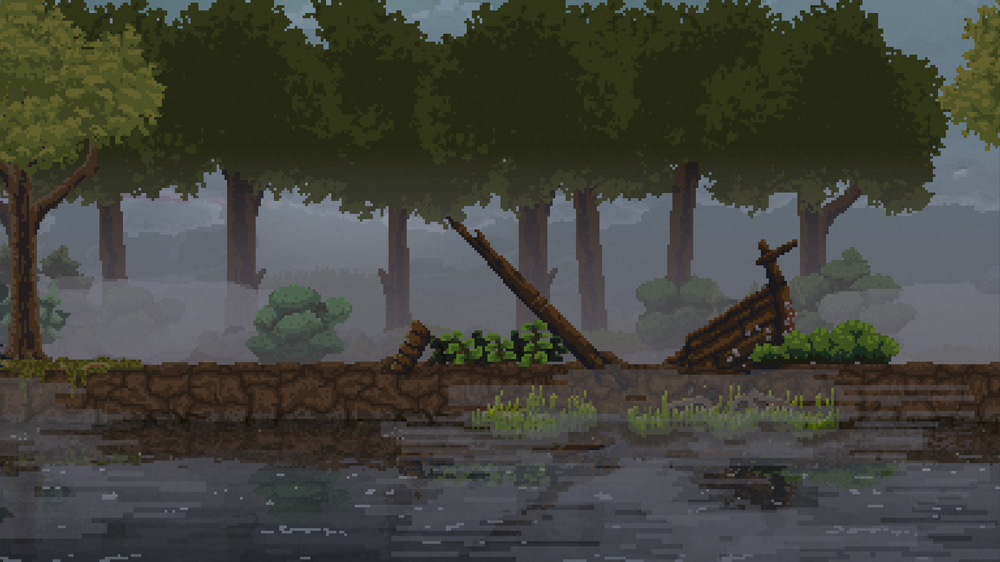

Woodland and water: reflected shapes add atmosphere without requiring dense surface noise.

**Credit:** Noio / Raw Fury. **Media:** published screenshot; 1920 × 1080 source. [Source page](https://store.steampowered.com/app/496300/) · [Published media](https://shared.akamai.steamstatic.com/store_item_assets/steam/apps/496300/ss_2accab99f642d3eb50a9886d32689d6fc65b0cc0.1920x1080.jpg?t=1788873284).

## BitGem dungeon

### bitgem-dungeon-01

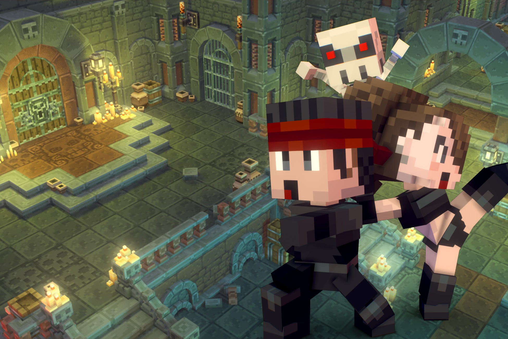

Dungeon overview: modular architecture and painted surface detail form an assembled 3D room; the blocky characters are not the selected human reference.

**Credit:** Matthias Andre / BitGem. **Media:** creator product preview; 1950 × 1300 source. [Source page](https://shop.bitgem3d.com/products/low-poly-3d-pixel-dungeon-set) · [Published media](https://cdn.shopify.com/s/files/1/0225/1115/products/demo_dungeon_preview.jpg?v=1628835123).

### bitgem-dungeon-02

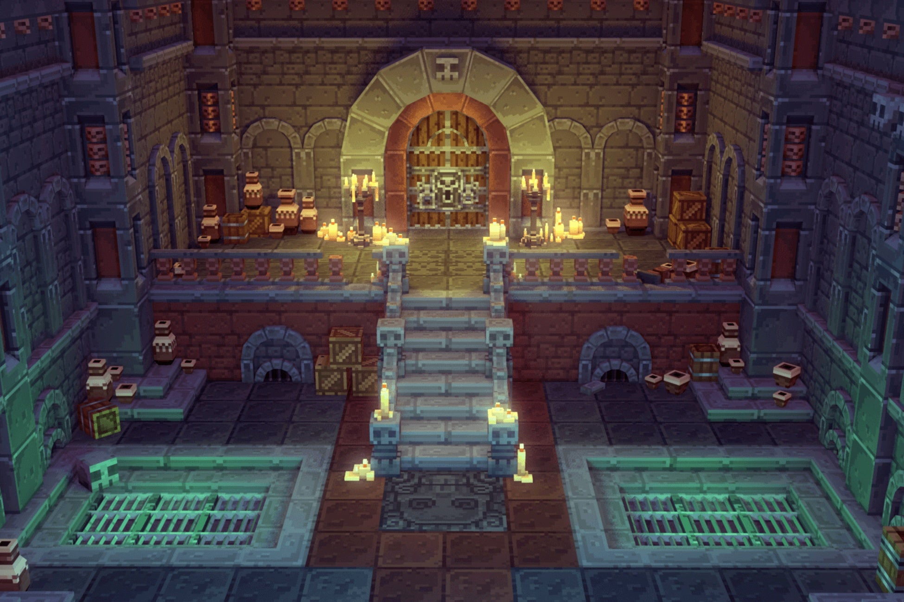

Dungeon room and altar: repeatable construction modules share a coherent material treatment.

**Credit:** Matthias Andre / BitGem. **Media:** creator product preview; 1950 × 1300 source. [Source page](https://shop.bitgem3d.com/products/low-poly-3d-pixel-dungeon-set) · [Published media](https://cdn.shopify.com/s/files/1/0225/1115/products/buildings-pixel-dungeon-set-1.jpeg?v=1628835123).

### bitgem-dungeon-03

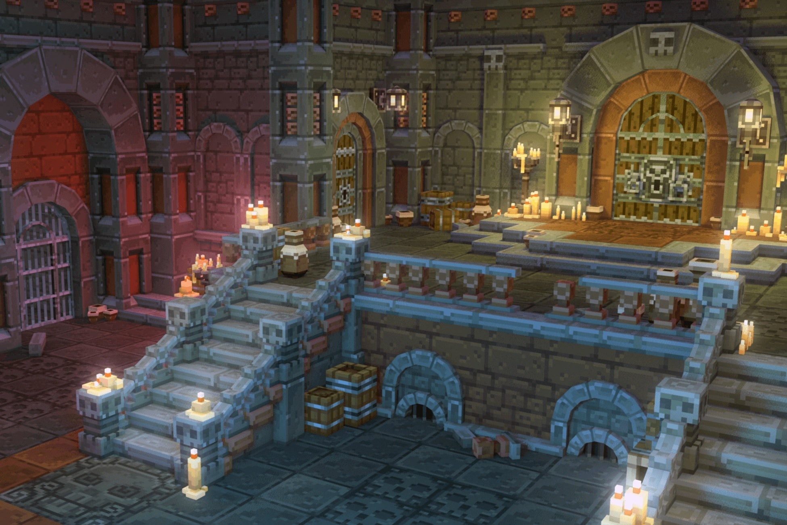

Stairs and angled walls: geometry provides real volume while texture pixels describe the surfaces.

**Credit:** Matthias Andre / BitGem. **Media:** creator product preview; 1950 × 1300 source. [Source page](https://shop.bitgem3d.com/products/low-poly-3d-pixel-dungeon-set) · [Published media](https://cdn.shopify.com/s/files/1/0225/1115/products/buildings-pixel-dungeon-set-2.jpeg?v=1628835123).

## Project Shadowglass

### shadowglass-01

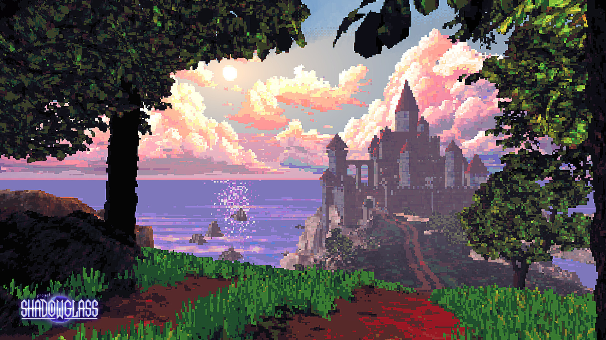

Castle and foliage: a dimensional world can retain a deliberately pixel-styled surface treatment.

**Credit:** Dominick John / Starhelm Studios. **Media:** published screenshot; 1920 × 1080 source. [Source page](https://store.steampowered.com/app/3970690/) · [Published media](https://shared.akamai.steamstatic.com/store_item_assets/steam/apps/3970690/5fe30c32070d53ca3cb0553be3c4ebc3cf0b3f85/ss_5fe30c32070d53ca3cb0553be3c4ebc3cf0b3f85.1920x1080.jpg?t=1774630965).

### shadowglass-02

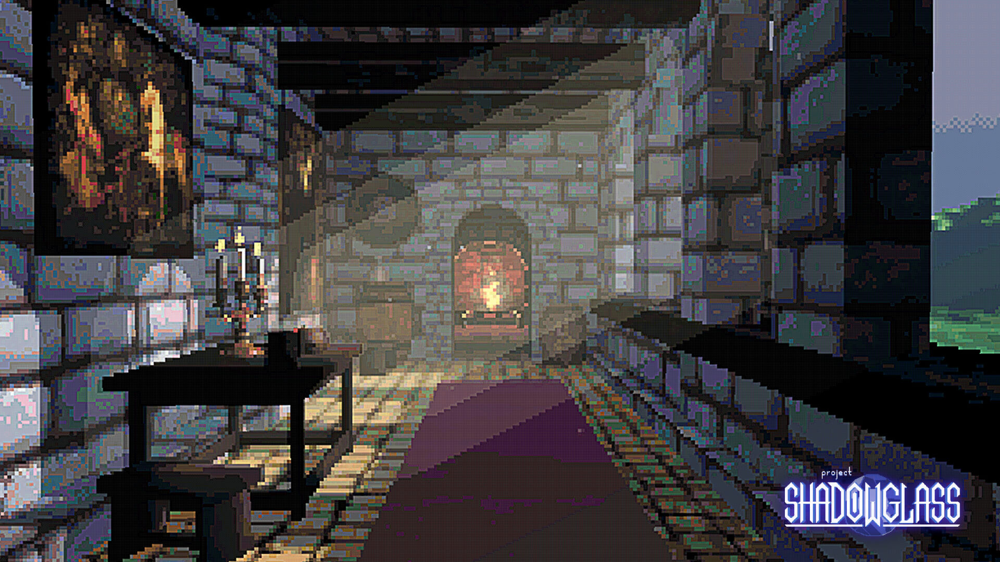

Interior light shafts: geometry, shadows and atmosphere combine into a coherent image.

**Credit:** Dominick John / Starhelm Studios. **Media:** published screenshot; 1920 × 1080 source. [Source page](https://store.steampowered.com/app/3970690/) · [Published media](https://shared.akamai.steamstatic.com/store_item_assets/steam/apps/3970690/b927ae5b53bac5f937e2882fbf79423d275a49a7/ss_b927ae5b53bac5f937e2882fbf79423d275a49a7.1920x1080.jpg?t=1774630965).

## Mark Knight

### mark-knight-01

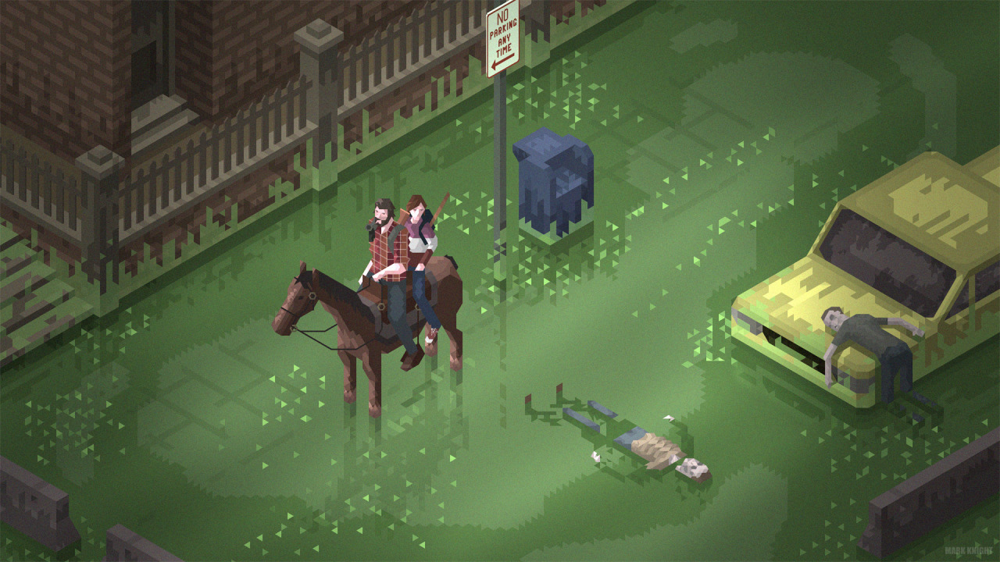

Horse and rider in a green-lit street: a constructed 2D illustration demonstrates light, depth and selective detail.

**Credit:** Mark Knight. **Media:** illustration reference; 1280 × 720 source. [Source page](https://80.lv/articles/exploring-games-and-films-through-pixelart) · [Published media](https://cdn.80.lv/api/upload/content/44/5d2cfed5538c1.jpg).

### mark-knight-02

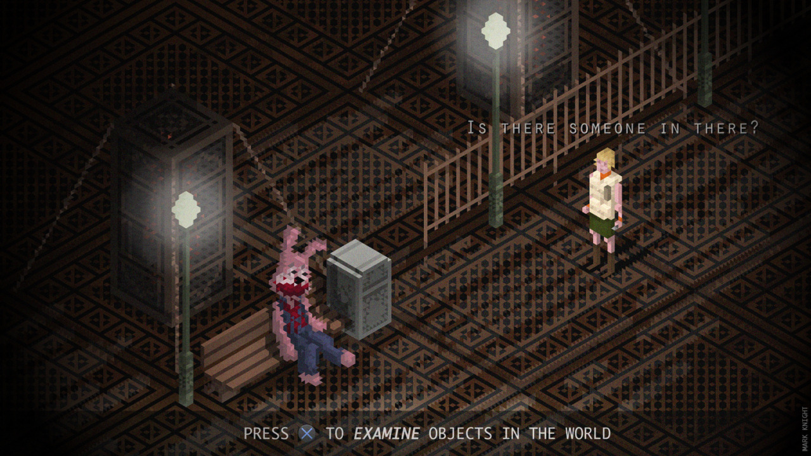

Interior illustration: the floor pattern, silhouettes and localized lights create volume without an orbitable scene.

**Credit:** Mark Knight. **Media:** illustration reference; 1280 × 720 source. [Source page](https://80.lv/articles/exploring-games-and-films-through-pixelart) · [Published media](https://cdn.80.lv/api/upload/content/97/5d2cfed654436.jpg).

## Tools and rendering

### pixelage-01

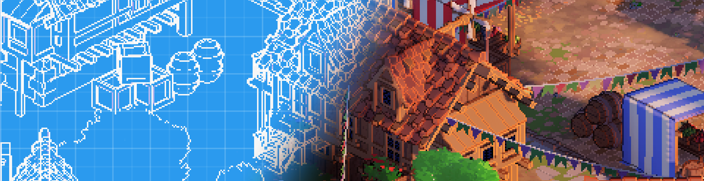

Published project comparison: the geometric scene and rendered pixel-art presentation are separate stages.

**Credit:** PixelageGames / Eduardo Schildt. **Media:** published technical comparison; 1920 × 495 source. [Source page](https://pixelagegames.itch.io/godot-3d-pixelart-demo) · [Published media](https://img.itch.zone/aW1nLzIxMjYxOTc1LnBuZw==/original/g9XLGo.png).

### noio-unwrapper-01

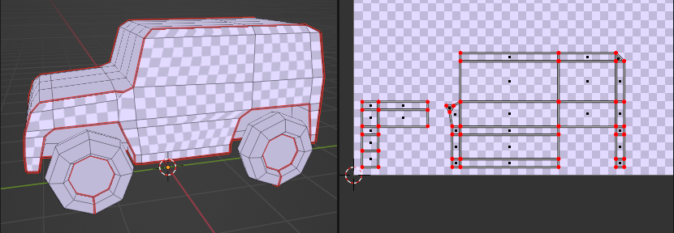

Creator tool illustration: a vehicle and UV layout demonstrate texture coordinates aligned for pixel painting.

**Credit:** Thomas van den Berg / Noio. **Media:** tool documentation screenshot; 830 × 288 source. [Source page](https://github.com/noio/Pixel-Unwrapper) · [Published media](https://raw.githubusercontent.com/noio/Pixel-Unwrapper/main/docs/unwrap_grid.png).

### noio-unwrapper-02

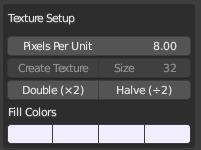

Creator tool interface: pixels per unit is an explicit authoring control, not an automatic art-quality setting.

**Credit:** Thomas van den Berg / Noio. **Media:** tool documentation screenshot; 201 × 150 source. [Source page](https://github.com/noio/Pixel-Unwrapper) · [Published media](https://raw.githubusercontent.com/noio/Pixel-Unwrapper/main/docs/texture_setup.png).
