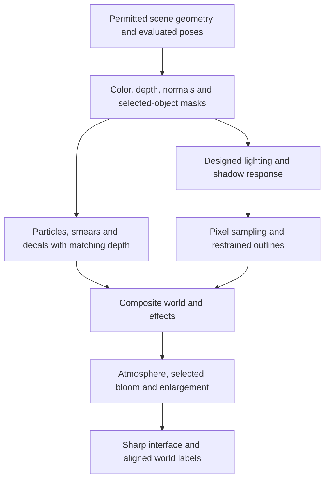

# Realtime pixel rendering, lighting and effects

October 14, 2026 follow-up. **The new references change the recommendation:** compare a renderer-driven, animated 3D scene first. Deliberately painted textures remain useful for faces, identity and particular materials, but do not need to supply every visible pixel. The earlier painted-texture emphasis was too narrow for the newly endorsed t3ssel8r character and scene workflow.

This is research and a proposed experiment sequence, not a delivered renderer. [Video library](video-library.md) records every supplied video and the available evidence. [Texel splatting](texel-splatting.md) covers the perspective-stability experiment; [animation](animation-tools-and-techniques.md) covers motion. Existing gameplay and renderer ownership remain in the [project technical design](../../../docs/projects/3d-pixel-art-tech-design.md).

## What is being authored, and what is computed

These examples still contain authored art: silhouettes, proportions, material colors, normals, vegetation shapes and motion. However, the renderer can calculate the final pixel colors, light bands, edges, highlights and effects each frame. An artist does not have to paint every lit view of a character.

The useful distinction is between **a carefully designed pixel renderer** and a generic resize filter. Both can sample 3D geometry into a coarse image; only the former deliberately coordinates lighting, edges, camera movement and animation to make the samples read as art. A shader can generate attractive pixel clusters from ordinary geometry. It still needs a character with intentional proportions and enough distinguishable face structure/color to survive the chosen resolution.

| Choice        | Renderer-driven candidate                                                  | Where authored textures can still help                                  |
| ------------- | -------------------------------------------------------------------------- | ----------------------------------------------------------------------- |
| Shape         | Complete polygon geometry, including hidden sides and garment interiors    | Surface decoration cannot replace a missing silhouette or opening.      |
| Surface color | Flat material regions, vertex colors, procedural variation, or textures    | Eyes, eyebrows, hairline, cloth motifs and distinctive markings.        |
| Light         | Realtime surface directions, light attenuation, shadows and selected bands | An optional ramp texture defines artistic light-to-color relationships. |
| Pixels        | Chosen scene sampling or an alternative stable sampling method             | Fixed texture details can coexist with either.                          |
| Motion        | Skinned poses, selective held poses, procedural adjustments and effects    | Small sprite textures are useful for smears, leaves and particles.      |

Thus “renderer-driven” does not mean texture-free, and “textured” does not mean all lighting is pre-painted. A material's base color, its response to light and the camera's sample grid are separate controls.

## What t3ssel8r has actually disclosed

The supplied [scene-building transcript](transcripts/t3ssel8r-scene-user-transcript.txt), associated with [Creating a Scene for my 3D Pixel Art Game](https://www.youtube.com/watch?v=ERA7-I5nPAU), describes simple Blender forms, procedural displacement, remeshing/decimation, edited foliage normals, and importing the result into Unity. Terrain and leaf/grass placement are then configured in the engine. This directly supports a geometry/material/rendering workflow. It does not establish that every asset is texture-free or disclose every shader.

For [Dynamic 3D Pixel Art Particle Lighting](https://www.youtube.com/watch?v=0xJqzUHJ2fI), the creator's published description says a light-volume pass reuses depth and normal information to approximate deferred lighting without redrawing geometry for each light. It also describes optional screen-space contact shadows by marching through depth. That supports many small light effects as a research direction; the description supplies no transferable OpenLegend light-count or frame-time guarantee.

The creator's [public comments](https://www.reddit.com/user/t3ssel8r/) explain orthographic camera snapping, small stable perturbations to soften large cel-shading transitions, and outline tests that compare a neighboring depth with the depth predicted by the local surface plane. The complete renderer is not published by these comments. Keep its exact implementation separate from our proposed reconstruction.

## A proposed OpenLegend rendering sequence

This diagram describes responsibilities to test, not a mandatory new rendering framework. A pass is one stage that draws or computes an image used by later stages.

Start from the existing scene/material owner. Do not introduce a full deferred renderer just because one reference uses a deferred-like light pass. First establish whether the current lighting path plus an authored material response can achieve the selected scene. Add a special light pass only for a demonstrated visual or performance need.

For an initial low-resolution candidate, color, depth, normals and object masks must describe the same camera, pose and sample locations. Averaging normals or object identifiers across unrelated surfaces can create false edges. Low-resolution work is not automatically cheap: extra geometry passes, transparency overlap, shadows and full-screen effects still contribute.

## Lighting that creates deliberate pixels

Begin with material color, surface direction and coherent direct/ambient light. A simple diffuse term varies with how directly a surface faces the light. Then map that continuous result into a small number of intentionally chosen bands or a color ramp. Preserve enough ambient fill for the face to remain readable. Select the light colors and material palette together; independently rounding every RGB channel can create unwanted hue shifts.

The [Flexible Toon Shader](https://godotshaders.com/shader/flexible-toon-shader-godot-4/) exposes diffuse bands, ramps, attenuation, specular and rim-light choices. It also offers different ways to combine lights. These are examples to evaluate, not settings to transfer verbatim. In particular, preserving the strongest light and adding lights together produce different images. The code is MIT; the site's demonstration artwork has separate rights.

Hard light thresholds can make a broad surface change color at once. Compare narrow smooth transitions near each threshold, or a small, stable variation tied to the surface. Avoid fresh random noise every frame. A transition that looks good on a broad rock may be too noisy on a face or leaf.

Particle illumination and particle appearance are different. A bright flame sprite does not automatically light a nearby face. Conversely, many visible sparks need not each own a shadow-casting light. Test a small number of lights representing the effect's energy, then evaluate a depth/normal light-volume approach only if needed. Screen-space contact shadows supplement other shadows; they cannot account for blockers absent from the available depth image.

## Outlines and normals must agree with the visible surface

The attached outline transcript is **Robin Seibold's [Outlines — Devlog 2](https://www.youtube.com/watch?v=LMqio9NsqmM)**, linked from the creator's [MIT repository](https://github.com/Robinseibold/Unity-URP-Outlines). It is a separate tutorial from Eduardo Schildt's [Godot showcase](https://www.youtube.com/watch?v=NNr7_fcJqWQ).

The supplied tutorial describes a normal-image pass followed by depth/normal edge detection, object masks, angle-dependent depth thresholds and a pass for objects that block outlines. Its important lesson is that a masked character must not draw its outline through an occluding object. Avoid reading and writing the same texture in an unsupported feedback loop; use separate targets when the graphics API requires them.

The repository also documents limitations involving displaced geometry and antialiasing. For OpenLegend, the normal/depth pass must evaluate the same skinning, grass motion, cutout texture and cloth pose as the color pass. Otherwise the outline will describe an earlier or undeformed surface. This agreement matters more than selecting a fashionable edge detector.

Use outlines selectively. A dark rim on every grass blade can make the scene excessively busy, and a thick face outline can consume the space reserved for eyes. Outline visibility must follow the same permitted scene and reveal rules as ordinary drawing.

## Camera stability is a separate problem

The supplied [Red Giraffe camera transcript](transcripts/red-giraffe-camera-user-transcript.txt) describes rounding the render camera to the coarse grid, preserving the rounding error, then offsetting the enlarged result to recover smooth translation. The creator explicitly acknowledges remaining rotation artifacts and treats blur, dithering and resolution changes as masking strategies. This is not a universal shimmer solution.

For a fixed-orientation orthographic camera, the [earlier camera explanation](rendering-techniques.md#camera-snapping-and-compensation) remains useful. Perspective motion and arbitrary rotation change sample coverage differently across the scene. Evaluate [texel splatting](texel-splatting.md) as a distinct sampling experiment. Do not silently restrict OpenLegend's camera to make a shader look stable.

When diagnosing shimmer, freeze one cause at a time: camera, pose, light and procedural texture motion. Moving shadows or intentional light-band transitions are different from a stationary material's samples crawling under the camera. The user identified a relevant symptom; this research has not reproduced the mercenary defect or proved that one algorithm repairs it.

## Dylearn's grass: useful principles and adaptation

The supplied [grass transcript](transcripts/dylearn-grass-user-transcript.txt) and [source project](https://github.com/DylearnDev/Dylearn-3D-Pixel-Art-Grass-Demo) provide unusually concrete guidance:

- Use many small instanced cards and a small set of grass silhouettes. Give the ground and blades consistent color patches so they belong together.
- Anchor wind in world coordinates so a gust travels coherently through plants. Combine differently scaled/directed noise samples to reduce obvious repetition; finite numerical noise should not be described as mathematically nonrepeating.
- Account for billboard orientation and the chosen lighting direction. Evaluating blade lighting near its base can avoid inconsistent highlights along a flat card.
- Hold animation samples at a deliberate cadence, but offset each blade's phase. Updating every blade on exactly the same frame can look like a stalled scene.
- Bend plants around nearby characters and use slightly softened shading thresholds to avoid distracting band popping.
- Project a cloud pattern along the light direction to a chosen cloud height, rather than requiring a giant shadow-casting card above the scene.

**OpenLegend adaptation:** start with instanced clusters and shared wind/color inputs. Keep the wind tied to the permitted world presentation. The demonstration's fixed list of 64 characters is an implementation choice, not our population limit. Its per-blade interaction loop can grow with blades × submitted characters. Select nearby relevant contributors per patch, or compare a bounded interaction field when measured density justifies it. Do not scan every world character for every blade.

Cloud projection needs deliberate behavior when the light is almost parallel to the cloud plane, where the intersection calculation becomes poorly conditioned. Phase seeds should remain stable when instances are reordered. Keep a billboard's base planted while its top moves, and inspect pitch/rotation rather than judging one camera view. These are proposed adaptation checks, not defects measured in OpenLegend.

The source's use of Godot's `LIGHT_VERTEX` replaces an older custom-engine approach. In PlayCanvas the equivalent result needs explicit control of the material's lighting/shadow sample position; a renamed variable alone is not a port. [Tool/license notes](tool-and-license-notes.md) distinguish the code from the artwork.

## Fire, sparks, smears and scorch marks

tristangamedev's [Fire Particle System](https://www.youtube.com/watch?v=HyRB-02cYFc) description explicitly confirms a separate effects image composited into the scene. The [Explosion/Fireworks video](https://www.youtube.com/watch?v=On5Jt7-G4ac) identifies the related effect but does not publish its implementation. The following is therefore a **proposed reconstruction**, not a claim about hidden source code.

Render effects into their own color/transparency target using the same camera and correctly mapped scene depth. This allows a different sampling or treatment for flames and smoke, and avoids automatically applying opaque-surface outlines to every particle. Composite using the appropriate transparency rule: luminous sparks often add light, whereas smoke must obscure what is behind it. Depth testing must still hide both behind the correct wall.

Anchor scorch decals to the receiving surface and give them an intentional lifetime; they should not slide with the screen. A visible scorch mark cannot independently declare that a gameplay object has burned. Use authoritative permitted events for consequential effects. Smear meshes should follow the visible weapon pose, share its depth and disappear on interruption or replacement. The [animation guide](animation-tools-and-techniques.md#smears-and-action-readability) covers timing.

A separate effects target introduces alignment risks during camera compensation, resizing and depth compositing. Verify premultiplied/straight alpha conventions, color space and empty background pixels. Pixel art does not exempt transparency from those rules.

## Proposed implementation order and measurement

1. **One well-designed animated character and simple scene:** flat/controlled materials, readable face, restrained lighting bands and optional outlines. Establish whether the reference's finish is achievable before adding many effects.
2. **Matched camera comparison:** identical geometry, pose, light and paths across ordinary rendering, compensated low-resolution rendering, and the separate static texel-splatting experiment. Keep the earlier painted-material candidate as a control and the sprite alternative available.
3. **Selective effects:** add one coherent grass patch and one fire/smear example, each switchable for attribution. Then combine them and inspect the complete frame.
4. **Real application qualification:** camera/picking/reveal, transparency, animated silhouettes, replacement/teardown, device/backend differences and measured moving populations under the existing project gates.

Cost grows with visible geometry and skinning work, pixels in each target, shadowed lights, overlapping particles, vegetation density and nearby interaction contributors. Prepare immutable geometry/materials once; share scene inputs and stable wind data. Reuse becomes invalid when the contributing geometry, pose, light, camera mapping or permission changes. Measure whole-frame CPU/GPU time, tail latency, memory, draws and allocations with effects both isolated and combined. No benchmark or new numerical production cap is supplied by this research.
