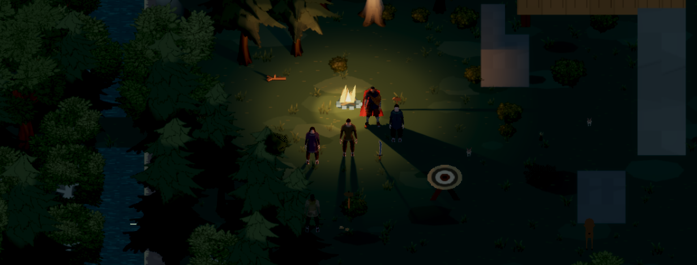
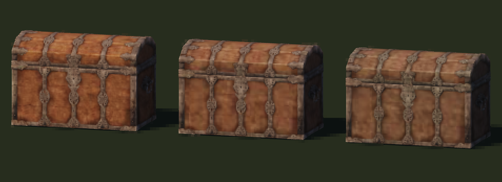

# Detail and atmosphere comparison

Recorded October 17, 2026 UTC. Earlier baseline: `c30bf2758`. The selected treatment gives small subjects finer pixels while retaining adult proportions, with deeper readable shade and quieter color. [Implementation, measured cost and source-access limits](../../../docs/verification/small-subject-art-and-atmosphere.md) · [All earlier iterations](../README.md).

## Light and mood

The actual camp uses the same layout and camera: orthographic zoom 5.5 / pitch 0.68, 1231×468 canvas, Economy shadows. Clear daylight remains sunny; low sun and dusk emphasize warm firelight against cold shade. The first dusk attempt was too dark and is retained below.

| Before | Selected iteration |
| --- | --- |
| [Earlier daylight](before-camp-day.png) | [Grounded daylight](after-camp-day.png) |
| [Earlier dusk](before-camp-dusk.png) | [Readable dusk](after-camp-dusk.png) |
| | [Low sun](after-camp-low-sun.png) |

[Lookout at dusk](lookout-dusk.png) · [Moving camp, 8-second capture](camp-motion.webm) · [Rejected first dusk](dusk-first-too-dark.png).

## Small subjects and sources

The bird comparison holds the actual model, body size, light and 1233×450 inspection canvas constant. Ordinary subjects retain 40 samples/metre; small imported subjects use 120, capped by display resolution. The close view shows much more anatomy; the game view honestly exposes the remaining few-pixel screen footprint. No enlarged head or body is used.

| Earlier | Current |
| --- | --- |
| [Bird close, shared density](before-bird.png) | [Bird close, finer density](after-bird-close.png) |
| [Existing angular bear](before-bear.png) | Bear replacement still awaiting download access |
| | [Bird at actual game framing](bird-gameplay-size.png) |

[Bird rotation, 8-second capture](bird-rotation.webm). Sampled edges and coarse shadows still change with viewing angle; these clips are evidence for review, not a blanket no-shimmer claim.

Each new Poly Haven family keeps clear, quiet and weathered finishes plus its normalized original and editable Blender source. The review UI offers them under the corresponding subject names in `/art-study.html`.

- [Chest: all three finishes](chest-three-finishes.png). **Clear** is selected for the existing crate: readable metalwork and convincing wood construction.
- [Boulder: all three finishes](boulder-three-finishes.png). **Quiet** is selected in the inspector: less orange surface noise and a natural irregular silhouette. [Earlier denser geometry](boulder-three-finishes-first.png) is preserved.
- [Fern: all three finishes](fern-three-finishes.png). **Clear** retains the most leaf detail, but broad planar leaves remain a weakness; it is not adopted into the game scenery.
- [Fallen log: all three finishes](fallen-log-three-finishes.png). **Clear** retains the best bark detail. This is a narrow fallen trunk, not a standing tree, and remains an inspector candidate.

[Original normalized source control](chest-source-control.png). Same chest, same close camera: [previous shared density](chest-shared-density.png) → [finer item density](chest-fine-density.png).

The commercially reusable bear candidate requires a Sketchfab sign-in before download; the current angular bear remains unchanged. A different realistic animated demo is noncommercial and was excluded. See the linked implementation report for exact candidates and rights. The new nature studies do not claim to replace every older source in the starting world.

## Revisit and preserve

Run `pnpm exec vite --config apps/client/vite.config.ts --host 127.0.0.1 --port 4175 --strictPort`, then open `/art-study.html` or `/scene-study.html` on that local port. Another free port is fine. The studies do not need a game server or modify saved progress. All old densities, bright woodland lighting and source/asset alternatives remain accessible.

Every meaningful captured candidate from this round is retained here. Browser downloads now carry settings and UTC timestamps; copy subsequent captures into a new dated archive rather than replacing these files. [Capture checksums](capture-manifest.json) identify the retained bytes.
