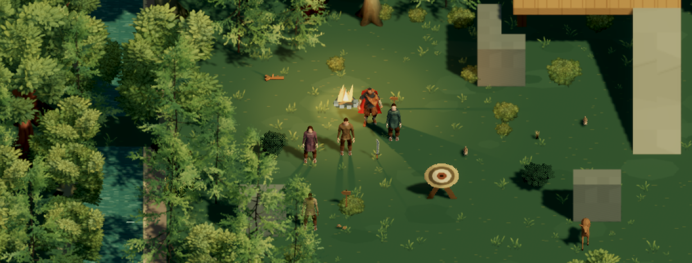
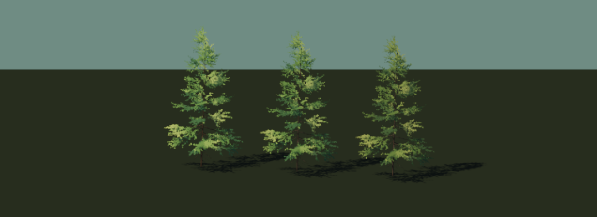

# Coarser detail and open foliage

Recorded October 17, 2026 UTC. This round responds to excessive fine detail, pale patches and opaque, flat tree crowns. The current selection uses **30 samples/metre for ordinary subjects and 60 for small subjects**, the **quiet Poly Haven fir**, more diffuse leaf lighting, fixed green variation and subdued ground/birch paint. These are working art choices; the broader motion/device and creator-acceptance gates remain open. [Implementation and measured cost](../../../docs/verification/small-subject-art-and-atmosphere.md#coarser-detail-and-open-foliage--october-17-2026) distinguish evidence from limitations.

## Compare the results

| Capture | What it shows |
| --- | --- |
| [Previous camp](before-camp-day.png), [matched old control](matched-old-camp.png) | Previous 40/120 density, solid pine sheets and original foliage lighting. The two captures are identical; both capture events are retained. |
| [Softer light on old trees](soft-light-old-crowns.png) | Intermediate B comparison: improved light cannot create gaps in solid leaf geometry. |
| [Final daylight](final-camp-day.png), [low sun](final-camp-low-sun.png), [dusk](final-lookout-dusk.png) | Final source preparation, merged compatible bark parts, 30/60 density, C open-fir treatment and survival atmosphere. Ordinary framing, orthographic camera. |
| [Moving camp](final-camp-motion.webm) | Eight-second low-sun orbit with staged walking. Preserved for temporal review; sampled silhouettes and shadow edges can still change. |
| [Closer woodland](final-woodland-close-perspective.png) | Perspective and close framing after renderer reload; overlapping scenery and existing camera-obstruction presentation. |
| [Three fir finishes](fir-three-finishes.png) | Clear / quiet / weathered, left to right, under matching daylight and pixel treatment. Quiet is selected. |
| [Fir rear perspective](fir-rear-perspective.png), [original source control](fir-original-source-control.png) | Prepared branches/green groups and the normalized original source from the same rear inspection direction. |
| [Balanced chest](chest-balanced.png), [previous fine chest](chest-previous-fine.png), [coarse control](chest-coarse-control.png) | 30/60, 40/120 and shared 20 density at close framing; retain construction and latch while reducing fine noise. |
| [Balanced bird](bird-balanced.png) | Small-subject allowance at close inspection. Body/head/beak remain identifiable; eye detail and normal-game screen coverage remain limited. |

## Retained attempts

- [First rejected tree](fir-first-rejected-thinned-needles.png): reducing individual triangles removed too much crown coverage.
- [Second rejected tree](fir-second-rejected-dark-atlas.png): retained needle groups still sampled black margins in the source texture atlas.
- [Intermediate day](after-camp-day.png), [intermediate dusk](after-lookout-dusk.png), [earlier three-way view](fir-three-finishes-before-final-export.png): fixed-green preparation before the final needle-material guard and compatible bark grouping. They are not the final performance sample.

All 20 PNG/WebM captures (10,825,078 bytes) are preserved with sizes, dimensions where applicable and SHA-256 hashes in [the manifest](capture-manifest.json). No earlier archive was overwritten. Unsaved intermediate browser views are not represented as captured history.

## Source and review controls

The fir is [Poly Haven Fir Sapling Medium](https://polyhaven.com/a/fir_sapling_medium), photographed by Rob Tuytel and modeled by Rico Cilliers, CC0. Source specimen B supplies the branch structure. Offline preparation keeps distributed whole needle groups, broadens them, paints fixed greens and reduces each finish to 30,000 triangles. The original 420,822-triangle control and editable Blender source are retained. [Acquisition manifest](../../assets/source-study/polyhaven-fir-sources.json) and [reproduction instructions](../../assets/source-study/README.md#open-fir-and-grouped-foliage--october-17-2026-utc) record the exact inputs.

Run the client on a free port and use `/scene-study.html`: **Trees A** retains the previous geometry/light, **B** softens the previous geometry, and **C** selects the open fir, varied greens and quieter ground. The separate detail controls retain the preceding finer density. `/art-study.html` includes the fir's three finishes and original source. This is still sampled dimensional artwork with prepared source geometry, not a claim that every visible pixel is a permanent cube.
