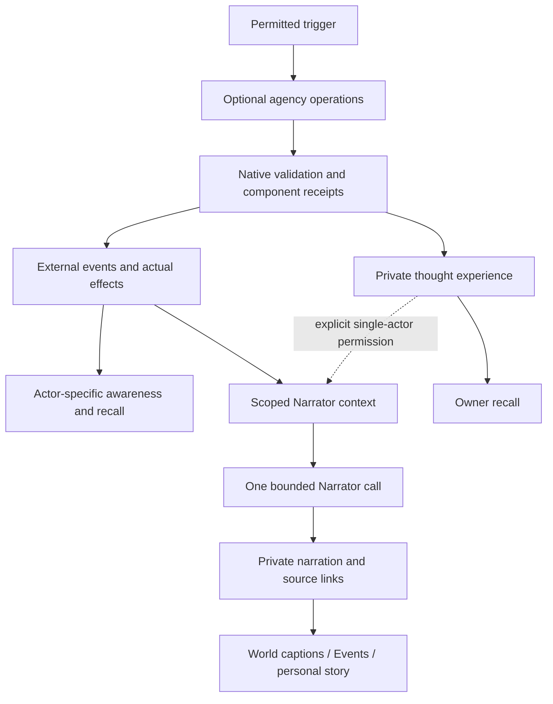

# Narration, agent responses and conversations

Conversation speech-window eligibility follows the [linguistic speech pool](memory-architecture.md#conversation-speech-pool); that owner distinguishes dialogue turns from ordinary no-word perceptual cues.

## Spatial evidence

[Spatial queries](../archive/07-technical-architecture/spatial-world-runtime.md) supply current sensory geometry and emission-time XYZ origins. The sensory projection still determines the actual audience; narration cannot infer hidden positions from technical geometry or camera changes. Cutaways, sprite interpolation and model animation are presentation, not new world occurrences or proof of an action’s result.

Conversation, source-history and narration storage must respect the [save/load design](save-and-load.md), including coherent timeline restoration and external-work fencing.

Current implementation and delivery limits are recorded in [Architecture](architecture.md#durable-conversations-and-private-history).

This specification owns accepted narration, speech delivery and ordinary social exchange. Existing narration delivery gates remain in [NC](maintainers/narration-and-conversations.md). The accepted [speech and social-perception design](projects/speech-and-social-perception-feature-spec.md), its [technical design](projects/speech-and-social-perception-tech-design.md) and [SPK implementation work](maintainers/speech-and-social-perception.md) supersede ordinary Conversation enrollment and sight-dependent addressing. These changes are design-complete targets; current code still has the prior membership, recognition and response-routing behavior recorded in Architecture.

This document owns ordinary exchange, its permitted history and Narrator contracts. [Agent agency](agent-agency.md) owns universal decision composition and operational goals/plans, with encoding and admission in its [runtime contract](../archive/07-technical-architecture/agent-agency-runtime.md). [Memory architecture](memory-architecture.md) owns recall/privacy/consolidation; the [production data model](../archive/07-technical-architecture/production-data-model.md) owns shared storage conventions; [declaration admission](../archive/07-technical-architecture/declarations-and-evolution.md) owns mechanical invention. Feature UX lives in [agents](narration-and-conversations.md#3-talk-act-and-think-response-contract), [world/player experience](../archive/03-design-proposals/world-and-player-experience.md#the-narrator-and-personal-story) and the [UI brief](ui-design-brief.md#narration-and-perceived-history).

Story-policy registration shares [module metadata](../archive/07-technical-architecture/world-module-runtime.md#3-definition-envelope-and-composition); NC retains communication/selection ownership. Future [mental/disclosure families](../archive/07-technical-architecture/world-module-runtime.md#shared-minds-fictional-memory-and-evidence-separation) need scoped appearance/disclosure projections; physical truth, altered perception and platform erasure remain distinct. This enables no telepathy, cutaways or private-thought disclosure.

## 1. Scope and current gap

Speech, expressions and private thoughts participate in the agency decision contract. Speaker and optional addressee, actual listener evidence, self-talk, interruption, exchange context and narration remain governed here. An utterance addresses one exact entity or nobody in particular; multiple addressees are a later extension. Addressing neither demands an answer nor establishes consent or a group relationship. Known actions retain their actual effects. Missing mechanics use the separately gated INV/NC13 path; unsupported proposals never become invented success. Current response limits and delivered conversation/Narrator behavior are recorded in [Architecture](architecture.md#durable-conversations-and-private-history).

### Explicit triggers and readable context

Action relevance asks whether each candidate is a reasonable action for the actor to consider now given the trigger, current situation and goals. Keep uncertain plausible choices; this is a shortlist judgment, not selection or execution authority. Memory/context relevance retains its separate inclusion question.

The server derives triggers from committed events and the recipient's event-time awareness, never from the wording of a player's message. Each awareness row stores the stable event type, source, target, trigger kind and permitted content needed to preserve the trigger after the bounded recent-event feed rotates. Preserve source metadata through same-version restore; genuinely unavailable historical detail remains unavailable. Incompatible development formats are rejected under the save/load policy. Distinguish **addressed speech**, **overheard speech**, **an action directed at me**, **an observed event**, and **a change in my needs or current situation**. Preserve event handles and simulation times internally. For intelligible addressed speech with a known name, write `Mike said to me: "Hello" (Day 1, 08:00)`. State explicitly that I am being addressed. For overhearing state that the speaker addressed someone else or spoke nearby; hearing alone does not imply engagement. A recognized speaker may still have an unknown name, so use the observer's permitted descriptive label and exact scoped reference. Under the accepted bundled-world linguistic policy, audible voice exposure establishes or reuses the stable speaker identity even on first contact, without sight, intelligible words or a known name. Other supported policies may leave source identity unavailable; direction and source identity remain separate fields. Derive this wording from the structured roles rather than storing it as their replacement.

Present bounded English sections: **Me**, **Trigger**, **Task**, **Conversation so far**, **Current time**, **Recent memories**, optional **Actions**, **Nearby actors and objects**, **Inventory**, **Knowledge**, and **Response format**. Include the complete accepted inner world and current body/activity/goal. Put permitted IDs and mappings in a final **References** section, following the [identity contract](identity-and-references.md). Current conversation context uses durable group association and actor-permitted event-time awareness. SPK replaces the group association with bounded pre-hydration selection of the actor's structured speech evidence: exact mandatory causes, an existing valid actor summary and recent exact suffix, with older relevant history available through scoped recall. It does not make all retained or overheard speech required context. Missing required evidence stays explicit and incompatible input is rejected under the [development compatibility policy](../AGENTS.md#development-save-policy). No later engagement grants earlier speech. Preserve the newest 512 speech experiences per actor as a bounded verbatim retrieval pool, distinct from automatic context selection. After ordinary admission, store speech before scheduling its best-effort asynchronous embedding; a later embedding failure cannot undo or delay the committed event. The accepted player-composition availability gate below is checked before admission and does not turn embedding availability into a second prerequisite. The [canonical context policy](memory-architecture.md#4-jev-attention-before-context-inclusion) owns required and optional source selection; source identity, order and full permitted meaning survive selection. An unavailable optional recall or compaction step must not block an otherwise valid response with complete mandatory evidence. Preserve uncertainty and acquisition labels in memories, without requiring spoken replies to recite those labels. Dialogue is natural in-character speech, ambient or addressed; acquisition labels remain context and need not be recited aloud.

The task permits the optional operations defined by [agency](agent-agency.md#2-a-decision-may-produce-nothing-one-thing-or-several-things), including no new response. Injury, resting and an empty action shortlist do not mean the character can only speak. Actual capability and urgency checks decide what can commit. An existing task may continue during speech or thought.

For speech triggers, ask Jev alongside route and reflection whether there is any plausible chance the actor may want to act or visibly react. Record that result as the semantic trigger's `checkActionSelection` property in routing diagnostics and the persisted job result. This is a preliminary context gate, not the action choice: only a confident `no` (at least 0.8 probability) closes it, while missing or uncertain judgment opens it. When closed, skip suggestion construction and omit the Actions section; open attempts and goal/plan operations remain available under ordinary admission. Context gating does not determine per-response optionality. When open, prepare bounded native-feasible candidates under the shared [level-1 selection and routing contract](../archive/07-technical-architecture/agent-agency-runtime.md#24-level-1-selection-without-generative-escalation). Generative responses may use a separate batched relevance filter to present useful options with exact handles; relevance filtering is not a prerequisite for every direct level-1 selection. Non-speech semantic decisions open the gate. A failure in this optional action-relevance request conservatively presents the fresh bounded candidates, so helper availability cannot silently remove agency. The shortlist is assistance, not an instruction to perform work or a preference against an unlisted action. A freeform proposal cannot grant new mechanics: resolve existing actions through AG05, or return an honest component outcome; missing definitions use INV/NC13.

When generation is needed, use one immediate generation for the composed response. If newer actor awareness reaches both the importance and urgency interruption thresholds, abort the active provider stage, rescan from the original attempt watermark, rebuild context with every qualifying event received before retry and retry at most once under distinct attempt identities. Ordinary world changes do not discard speech or thought, and later qualifying events cannot create another paid retry. Before commit, validate action-specific targets, range, possession, costs and plan prerequisites; an invalid action can fail independently while valid speech or thought survives. The agency runtime owns component receipts and private-experience admission; reuse existing stores without a per-candidate database query or foreign-key graph. The normalized story tables and indexes in section 7 remain prerequisites for durable multi-party narration, not for rendering this prompt. Same-version recovery and future production storage changes must preserve response identity and owner scope; development compatibility follows the [root policy](../AGENTS.md#development-save-policy).

## 2. Three kinds of truth

| Record             | What it means                                                                                               | Who can use it                                                                                                         |
| ------------------ | ----------------------------------------------------------------------------------------------------------- | ---------------------------------------------------------------------------------------------------------------------- |
| World event        | An accepted external occurrence: speech, expression, action stage/outcome, animal behavior or natural event | Actors receive only event-time awareness projections; authorized story modes may select retained notable unseen events |
| Private experience | An actor's intentionally authored in-character thought, or other legitimate personal memory                 | Its owner for recall; explicitly authorized inspection or single-actor narration                                       |
| Narration          | A player's prose rendering of permitted facts, linked to its sources                                        | That player; never automatically another actor's perception or memory                                                  |

Narration cannot cause injury, create items, reveal a hidden cause, or establish an emotion as objective truth. “Ada frowns” may be observed; “Ada secretly despises you” requires private access and is excluded from shared conversation narration. Embellishment changes rhythm, imagery and tone, not identities, outcomes, causal links or knowledge. Narrator output is not a new semantic trigger: only committed underlying occurrences can elicit another agent response.

## 3. Talk, act and think response contract

Universal decision composition and operational goal/plan behavior are defined in [Agent agency](agent-agency.md), with encoding, admission and execution in the [runtime contract](../archive/07-technical-architecture/agent-agency-runtime.md#2-decision-envelope-and-translation). Speech remains an external communicative act with the conversation, audience and narration rules in this document. Private thought remains owner-only experience. Multiple requests do not imply simultaneous or completed physical actions. A thought-only or empty decision must finish the response indicator without an empty speech bubble.

### Admission, ordering and memory

The [agency admission and receipts contract](../archive/07-technical-architecture/agent-agency-runtime.md#4-admission-ordering-and-physical-execution) owns independent rejection, cancellation, exactly-once experience, action-stage identity and recovery. Conversation generation and event-time speech audiences remain additional speech-specific bindings. Reflection presentation stays separate from recallable intentional thought; this section is a forwarding anchor, not a second response schema.

## 4. Expressive and mechanical actions

| Mode                             | Admission and result                                                                                                                                     |
| -------------------------------- | -------------------------------------------------------------------------------------------------------------------------------------------------------- |
| Known mechanical action          | Select a server-offered action/version and validated arguments. Execute trusted rules; record actual resource/stat/condition changes and outcomes.       |
| Expressive action, first slice   | Record a bounded observable gesture/reaction with actor/targets. No physical state, numerical relationship, injury, inventory or new definition effects. |
| Missing mechanical action, later | Submit an invention candidate through policy, budget, validation and activation; execute only after admission and fresh prerequisite checks.             |

The implemented expressions are nod, smile, frown, wave, shrug, shake_head and slap, rendered by trusted templates with no model-authored outcome clauses. A slap requires contact range and line of sight. Other unlisted NPC expression proposals receive an unsupported-action receipt. The player’s separate descriptive Act path is described below; mechanical invention remains separately admitted. Expressive actions allow a frown or a slap as enacted fiction without pretending a damage mechanic exists. The event explicitly has `mechanical=false`; no `-1 Health` is displayed. It can still be witnessed, remembered and influence a later character decision. That cognitive consequence is distinct from directly changing a relationship score or bodily state. The presentation uses a subtle “Expression · no mechanical effects” affordance, outside the prose, when the distinction matters.

Freeform expression cannot become a bypass for known costs or consequential claims: “I transfer my gold,” “I kill Ada,” or “I teleport” cannot be admitted as completed physical outcomes. Native scope checks govern contact/reach and available participants; rejected or unresolved contact can be described as an attempt only when that attempt itself was accepted. Known actions use their authoritative route, not an expressive duplicate. The initial expression contract permits gestures/contact fiction but forbids unsupported result clauses such as injury, forced movement, possession transfer or another character's private feelings. Constrain output to an action description; strict validation plus grounded rendering remains necessary, with semantic overclaiming an explicit acceptance risk.

The later slap example might resolve an existing head injury under an admitted conditional rule and emit a health change plus bleeding condition. Only then may narration read:

> Ada slaps you. Your eye wound from yesterday starts bleeding.

Below it, smaller distinct text: **−1 Health**. “From yesterday” requires permitted evidence of that injury's age; “starts bleeding” requires a committed condition change; attribution to the slap requires a causal link. Without the mechanics, the first slice says only “Ada slaps you” and shows no impact. A generic head-injury predicate does not itself prove the injured part is an eye.

Voice speech carries audible linguistic content and optional addressing. Native sound reactions do not require conversation membership or linguistic understanding; [sensory evidence](../archive/07-technical-architecture/perception-and-attention.md) and [EPR scope/intake](events-perception-and-reactions.md) own their projection. Private thoughts and invention results do not enter the external event feed by default.

### Player Speak and descriptive Act

**Accepted SPK target, not current UI behavior:** offer the same speech composition as ambient Speak or Speak to one exact perceived/recognized subject. All player Speak, Speak-to and descriptive freeform Act submissions are unavailable while the shared character-AI service is unavailable, even though ambient words themselves need no generation. Keep drafts editable/retained, explain the unavailable service at the action, recheck before commitment and send nothing automatically when service returns. This is the selected player interaction policy, not a universal law of sound; ongoing native actions and already committed events retain their owners. Targeted speech does not require the listener to be capable of replying. Source speech capability, actual acoustic reception and other current action prerequisites remain independent.

Show a quiet recipient cue such as `to Ada`, `to you` or a permitted descriptive label, separate from the spoken words. Derive the cue from the observer's stored speech evidence and event-time label, not the current composer selection, hidden global names or unpermitted positions. Ambient speech has no invented recipient. Use no middle-dot separator in new presentation. Retain the explicit selected identity through drafting and submission; never silently retarget a stale draft. [SSP-N01–SSP-N04](limits/narration.md#ssp-n01--one-optional-addressee) record these choices.

The following paragraphs describe the current delivered UI pending the SPK change.

Right-clicking the controlled character offers **Speak** and **Act**, without self-conversation or self-inspection. Both open a horizontally centered text bar near the bottom of the game. Speak has a speech-bubble icon and a horizontal draggable volume control snapping to Whisper, Normal and Shout. It commits the exact words through ordinary native speech with no language-model call. Event-time acoustic perception, spatial captions and World Events remain the existing speech owners; no intended recipient is inferred from a nearby character.

Act has a hand icon and an explicitly descriptive-only message. On another object, it binds that exact clicked entity or accessible inventory item; on self, it has no target. A single generation uses the configured nano cleanup model and existing AI admission, allowance, cancellation and receipt accounting. It returns a past-tense verb phrase of at most 240 characters; participant identities are rendered by native narration rather than supplied by the model. A selected target must appear through the exact structured target token. The input is at most 500 characters, and the generation ceiling is 512 tokens including reasoning; an invalid or failed result is not repaired or retried automatically.

The admitted result is an observable `expression` event marked `mechanical=false` and `descriptive=true`. It is shown above the acting character to permitted viewers and retained in their normal perceived history. It never enters action grounding or executes a physical command: no health, inventory, position, definitions or other mechanical effects change. Witnessing it can inform a later character decision. Consequential wording asks the model for a gesture or attempt rather than an unsupported outcome; live prose quality is separate from native enforcement of zero mechanical effects. Native NPC expressions retain their existing vocabulary and admission.

The bar preserves unsent drafts by mode, selected object and mentioned item while hidden or temporarily disconnected. Pending and failed reply controls belong to that same draft while the composer remains mounted; switching recipients cannot replace another person's result. A lost acknowledgement offers a read-only check of the exact original submission, avoiding another speech event or paid dispatch. The original world timeline and command epoch remain attached to the attempt. A same-owner control renewal permits checking under current authorization; changing the account, character, world or timeline clears the old private controls. An absent saved request stays explicitly unconfirmed, without resubmitting it. Failures restore the submitted Act text only if the player has not replaced it. The server rechecks the acting character, current control, world/timeline and target perception before recording a result. Restart/restore never regenerates accepted expressions. [Implementation plan](projects/completed/speak-and-act-plan.md) and [NC03](maintainers/narration-and-conversations.md) track this slice and distinguish broader expression work.

## 5. External world events and awareness

Use the existing proposed `journal.world_events` as the single logical master table of external event categories. Every external occurrence passes through the same emission/retention policy: people and animals acting, speech, trees falling, weather and other natural events. This is a semantic event catalogue, not a promise to log every component tick forever. Only speech/action occurrences admitted as real or explicitly expressive enter it; private thoughts and narrator prose do not.

Retain an experiential row when at least one actor perceived it **or** its trusted importance score meets a configured notable-event threshold. Store score, reasons and scoring-policy version at commit time. Native event families supply bounded deterministic scoring initially; a model cannot mark its own unsupported claim important to gain persistence or disclosure. Exact weights/thresholds are tuning settings, not hard-coded plot events. Zero-witness, non-notable experiential rows are discarded after audience/importance determination; authoritative state, spending, recovery receipts and required causal evidence still persist independently.

Store urgency separately from importance. Importance describes lasting significance and retention eligibility; urgency describes whether newly perceived evidence is time-sensitive enough to supersede an in-flight immediate response. A high-importance, low-urgency event can shape later attention or reflection without interrupting current speech. A response refresh requires that the recipient's new awareness meet both thresholds, currently server constants of 8/10 for importance and 8/10 for urgency, and may happen only once for that response ([LA232](limits/cognition.md#la232)). These are not currently configurable installed-world fields. Urgency does not widen an event's audience, reveal an unseen event, or make it notable for retention.

`mind.event_awareness` remains the one actor/event join: modality, permitted detail, recognized identities, attribution, observation time, importance and urgency. Self-awareness records the actor's accepted speech/action. Hearing is independent of participation. No audience is reconstructed from current positions or a conversation's current member list. Partial hearing cannot expose full quotes; unknown causes stay unknown. Retained notable unseen events have zero awareness rows until a separate later discovery/testimony event creates new knowledge.

Notability is retention eligibility, not disclosure permission. An optional dramatic world-narration mode can expose a policy-approved distant event (“Far away, a demon awakens”) privately to a human player. Label it as a story cutaway, keep it out of actor recall and shared conversation, and do not expose hidden names/locations beyond the approved teaser. Ordinary actor-perspective narration cannot use it. Cross-player fairness and spoiler policy must be chosen before enabling cutaways in a shared world.

## 6. Durable conversation lifecycle

**Accepted target: ordinary speech has no mandatory Conversation membership.** A person speaks, may address one entity, hears whatever the world's senses permit, and chooses whether to engage. Opening, hiding or changing the Speak bar or Events reader creates no world action. Ambient speech, directed speech, a gesture, continuing work and deliberate silence do not require joining, leaving or merging a group. Explicit consent for an outing, trade, institution or private remote channel stays with that activity's own owner.

Each actual utterance retains its immutable occurrence identity, speaker, optional addressee, simulated time/order and observer-specific evidence. It does not require a non-null global conversation ID. No semantic `replyTo` relation is added: conversation interpretation uses the permitted sequence and current context. Existing request/attempt IDs, source-event causes, operation dependencies and duplicate-response protection remain operational provenance, not a declaration of which earlier sentence a character meant to answer.

### Joining, leaving and awareness

Remove ordinary social enrollment, one-active-conversation restrictions, automatic membership on being addressed, and expiry/disconnect rules whose only purpose is maintaining that membership. Departing changes current sensory exposure and available action targets; it does not erase already perceived history or automatically invalidate a thought based on that history. Hearing a new utterance does not reveal an older one. Private thoughts and other observers' memories stay outside ordinary speech history.

Events renders permitted actions, expressions and speech in one saved chronological order. There is no separate player Talk transcript. The retained person-scoped server read contract remains available for internal consumers; private thoughts never enter either projection.

The existing context/history owners still preserve coherent multi-person exchange, questions after digressions, corrections and independently protected commitments. Select actor-permitted sources before hydration under bounded request work: exact mandatory causes, an existing valid summary and recent exact suffix, with relevant older sources available through scoped recall. Full retained history remains available through its ordinary owners; it is not all required on each turn. Optional compaction or older recall unavailability does not block an otherwise valid response, while missing or oversized mandatory evidence still fails explicitly. Do not replace the removed membership model with per-person chat rooms, a semantic conversation graph, full-world history scans or a mandatory summarization call for every utterance. Any internal grouping is a rebuildable reading/context aid and grants no knowledge, participation or response obligation.

Events, permitted person-scoped server history, response-linked actions and private narration retain stable chronology, source references and pagination. The player uses the world composer, captions and Events, not a separate Talk transcript. Character plans and cooperation retain their own lifetimes. Current reply admission, retained backend preview lifecycle and retained history use their real dependencies: current control/timeline, source validity, bodily capability and the separately permitted presentation/sensory conditions.

### Merging conversations

Automatic ordinary-conversation merging is removed from the accepted target. A speaker addressing someone who was talking to another person does not move all three people into a new shared state or relabel their earlier history. Suppress new “Joined conversation” lifecycle notices when the replacement ships. Existing generated/narrated source history is not another participant's knowledge.

**Current implementation boundary:** the runtime still creates a Conversation for each utterance, enrolls eligible addressed actors, keeps participant intervals and one active membership per actor, and merges active groups. Its context selection, summary cache, retained person-scoped server history, narration grouping and backend preview eligibility consume those records. The world-first player UI no longer mounts a separate transcript or provisional preview. [SPK](maintainers/speech-and-social-perception.md) owns their coordinated replacement; simply deleting the records would lose context guarantees. The earlier rationale and delivered evidence remain in the [completed compaction design](projects/completed/conversation-compaction-tech-design.md) and [NC delivery record](maintainers/narration-and-conversations.md). World Agent authoring sessions, provider sessions and deliberately private remote channels are separate identities and are not removed by this decision.

## 7. Proposed persistence and indexes

Reuse the existing event-awareness, permitted history and narration families rather than create competing stores. The SPK replacement removes ordinary Conversation records without adding a persisted exchange/group identifier. Reading filters and prepared context derive from exact source identities, permitted participants and chronology. Names below describe target storage, not a claim that these exact tables are deployed. All references include world scope; `EventRef` includes the journal partition key under the production model. Keep composite foreign keys or explicit retention tombstones consistent with that model.

| Record                             | Essential fields and invariant                                                                                                                                                                                                                                         |
| ---------------------------------- | ---------------------------------------------------------------------------------------------------------------------------------------------------------------------------------------------------------------------------------------------------------------------- |
| `journal.world_events` additions   | Response/component/action execution links, mechanical/expressive kind, separate bounded importance and urgency scores, scoring reason/policy, causal parent refs                              |
| Existing speech/history projection | Source-linked utterance views with stable occurrence order, observer-permitted roles and actual awareness; no new writable speech store or membership-derived ACL                                                                                                      |
| `mind.memory_entries` additions    | `self_thought` acquisition and unique response/component source for private accepted thoughts; entity links use `mind.memory_entities`                                                                                                                                 |
| `story.narrations`                 | World/id, authenticated owner player, perspective actor(s), mode, text, status/revision, voice/template versions, input digest, trigger/dedup key, job receipt, display anchor/order, covered simulation range, created UTC time |
| `story.narration_world_events`     | World/narration/EventRef, source role and permitted-source revision; many-to-many and unique per source binding                                                                                                                                                        |
| `story.narration_entities`         | World/narration/entity/role for participants, targets and place; pointers never grant visibility                                                                                                                                                                       |
| `story.narration_actions`          | World/narration/committed action receipt or process reference; never references a model proposal as a completed deed                                                                                                                                                   |
| `story.narration_private_sources`  | Optional actor-scoped memory/accepted-text revision refs, only for explicitly permitted single-actor mode; inaccessible to public provenance routes                                                                                                                    |
| `story.narration_impacts`          | Narration/effect receipt/affected entity/stat or condition, actual delta/unit and event source; derived display records, never applied effects                                                                                                                         |
| Player preference extension        | Narrator voice/version and presentation/cutaway preferences on the existing player profile, scoped by authenticated owner                                                                                                                                              |

Index permitted history by actor/source, optional speech peer and authoritative event order; narration by owner and authoritative display order, plus mode/time for supported reading filters. Bound prepared context and derived cache coverage by the selected exact source keys. Existing conversation-keyed queries are a coordinated SPK replacement dependency, not a requirement for a new social group. Index source joins in both directions for audit/correction and deduplicate response components, effect receipts and narration trigger keys. Use typed joins for source kinds instead of an unchecked polymorphic `object_id` blob. The server sets player ownership; neither prompts nor client-supplied IDs confer access.

For a selected-person speech filter, include a retained viewer-owned speech experience exactly when its permitted sourceId or permitted targetId matches that person. This includes actually overheard speech involving the person, with its original roles. Mere mentions inside words, raw-event-only targets and another observer's evidence do not match. Later naming or recognition cannot retroactively bind a previously unknown recipient. A matching seen-only speaking cue remains explicitly seen-only. This is a reading filter, not a persisted group or proof of social participation.

Accepted world effects/events/awareness and a narration delivery trigger commit together through the existing outbox pattern. Generating prose happens afterward. Publishing text, source links, impact projections and its completed receipt is atomic. Every normal narrative must have at least one authorized event source. New ordinary-conversation lifecycle notices are outside the accepted target; other genuine activity lifecycle records retain their own source identity. A source may support many narrations and a narration may summarize many sources. Pin compact authorized source capsules/tombstones when raw event retention expires; expose unavailable/redacted source status, and invalidate derived text if its disclosure is revoked. Narration must not keep otherwise forbidden raw evidence secretly accessible.

## 8. The Narrator and context assembly

Runtime wakeups, causal-batch deadlines and durable-job recovery follow the [performance scheduling contract](performance.md#narrator). This specification retains ownership of which evidence merits narration and what may be disclosed.

The Narrator is a presentation role executed as one bounded LLM call, not an autonomous world controller or a persistent omniscient conversation. No action tools or reflection workspace are required. Reuse provider execution, durable spending, cancellation and receipts. Reuse actor-scoped source selection, sentence projection and vector retrieval behind a parameterized context builder; do not copy the entire NPC context and merely remove an action field.

Proposed server-only request: authenticated owner, world, mode (`conversation`, `world`, `single_actor`, optional `cutaway`), perspective actor IDs, optional bounded reading/context filter, trigger EventRefs or an independently supported activity source, source boundary, type/time filters, relevance query, voice version, context/output budgets and explicit private-source grant. These are bindings. Under the accepted SPK source contract, model-facing inputs carry the complete selected permitted experience plus optional shared prose and local source handles; a display sentence is not the sole semantic input.

Selection order:

1. Resolve viewer authorization and perspective from the server; bind a consistent source boundary and effective permissions. A set of perspective actors does not grant a human the union of their private knowledge.
2. Load mandatory trigger events and committed consequences, using the complete recipient-permitted awareness experience and its shared presentation. For conversation mode, include scoped participant speech plus relevant aware external events. Ordinary shared-group prose can use the intersection of participants' permitted facts; player-private variants may use that player's own actor awareness. Never use the unredacted union. Explicit authorized ensemble/creator modes may combine perspectives with clear attribution, and must not be sent to ordinary participants.
3. Retrieve optional recent/related evidence with actor/purpose/type filters before semantic/vector ranking. Reuse the attention/relevance service where useful, with finite budgets and mandatory causal sources surviving optional search failure. The Narrator itself needs one generation call; retrieval may reuse admitted embeddings/Jev and its costs must be counted separately.
4. Include private thoughts only with a specific single-actor grant and a permitted recipient. Ordinary conversation always excludes them. Include notable unseen events only in the separately admitted cutaway mode, never because an event scored highly in retrieval.
5. Render source facts, observed uncertainty, causally supported order and supplied impacts separately from trusted voice/style instructions. Do not automatically include an NPC's complete About me, all conversation history or other actors' inner worlds. Record omissions and input/source revisions outside the prose prompt.

The implemented response contains bounded `sentences`, each containing `text` and local `source_handles`. The server resolves handles, checks their admitted subset and assembles prose. The model does not choose ownership, conversation association, effects or stat deltas. Sentence grounding does not prove entailment: fixtures validate shape/scope; held-out/live review must assess invented causal claims and style drift. A rejected, unavailable or interrupted generation displays exactly “Narration failed.” in place of narration. Do not substitute event descriptions, previous prose or another generated description, and do not automatically retry. Retain source evidence, impacts and diagnostic failure reasons independently.

Voice is a player setting (for example restrained, lyrical or wry), implemented as bounded versioned style choices. It never changes source scope, action outcomes or other players' text. Store the voice version on each narration; changing it affects future entries and does not silently regenerate history or spend money. Freeform custom voices, if later added, remain untrusted style input.

## 9. Triggers, ordering and transcript reconstruction

Conversation and standalone prose both require a decision from the active world story-selection mechanism. Ordinary encounters, named entities, movement, routine actions, event retention importance, urgency and semantic cognition triggers do not independently qualify. The current runtime retains deterministic conversation lifecycle notices; SPK emits no new ordinary membership notices. Independently supported activity notices retain their source owner. See [replaceable story selection](#replaceable-story-selection).

For a meteor, commit one global event. Find eligible players through event-time awareness and the installed story selector, not a shared Conversation membership or an omniscient group scan. Enqueue their separately private narration variants and associate them with the appropriate permitted reading context; every row links to the same EventRef. A player who only heard a crash gets that account, not a secretly known meteor identity. The personal-story reader needs the stored scoped narration and impacts, not a raw meteor payload query.

Allocate a stable timeline anchor when narration is scheduled. Use simulation time plus authoritative sequence and component ordinal, with a stable ID tie-breaker; wall-clock timestamp alone is insufficient when several events occur in one tick or the world is paused. Store generation time separately. Anchor a combined narrative after its latest covered event, and retain observer-scoped timeline ordering. The saved occurrence sequence and source anchors remain the ordering authority; removing social membership does not replace them with provider completion time.

Transcript query: select the viewer's permitted event evidence and owner-private narrations using the chosen person/time/context filter, merge into the stable display order and paginate at a fixed watermark. The current optional conversation-ID filter is a SPK replacement dependency, not a future admission or disclosure requirement. Speech renders as speech; action events normally render through their linked narration or its explicit failure entry, not twice. Suppression depends on covered source IDs for that viewer, never text matching. Return item type/ID, speaker if applicable, scoped content, time/order and supported impact metadata. Never include private thoughts or inaccessible provenance.

Narration pending slots may resolve in place without moving speech or stealing scroll/focus. A source/history revision and new-entry marker makes late insertion visible. Hiding or closing a reading view does not end physical speech or erase already acquired knowledge. An already authorized historical narration may finish at its original anchor while current read permission remains valid; new unheard events cannot be pulled into it. The accepted target adds no merged-thread terminal notice. On outages, use the authored observed description for admitted place/item introductions under [Replaceable story selection](#replaceable-story-selection); other failed passages show “Narration failed.” Record the detailed cause in diagnostics; no automatic paid retry, restart dispatch or hidden regeneration. The player UI has no Regenerate narration control. Older generated fallback entries display the same failure message; retained historical lifecycle notices and other real activity notices keep their actual source identity. The retained explicit regeneration API revises the same logical entry and cannot reapply impacts.

## 10. Presentation and privacy

Retained conversation narration is distinct prose in the character’s personal story, with no fake speaker. Committed speech and actions share the separate Events reader; the player no longer opens a conversation transcript. Private thoughts do not appear in either reader, including when the agent selected all three response components. Put actual impacts underneath in smaller, readable, visually distinct text; derive sign, quantity and unit from committed receipts. A narration of an effect is never a second stat mutation. Multiple causes and delayed effects keep causal references and timestamps; only explicitly narrated changes appear as impacts, not all unrelated stat drift during the call.

Standalone world narration appears across the top of the screen with book-like typography and a restrained entrance; it remains privately accessible in the character’s selected personal story. Respect UI scale, contrast, reduced motion, keyboard dismissal and accessible live-region announcements. Do not block controls, force camera movement or interrupt reading. Use one logical narration across the banner and personal-story reader; rendering it twice is not duplicate generation or duplicate memory. Coalesce simultaneous toasts and preserve a discoverable unread entry.

Existing overhead “Hmm” concepts should become optional short presentations of an accepted speech/expression. They may fade visually but their underlying accepted occurrence remains remembered under normal retention. Loading dots remain technical status with no event or memory. This replaces the earlier proposal that a real contextual character reaction could be observable yet never remembered.

**Current delivered interface, October 16, 2026:** the world-first interface replaces the player transcript with committed world captions and Events. The compact Speak bar retains the recipient, volume, exact-send recovery and explicit retry of a failed reply without repeating the player’s already committed words. General speech uses native `say`; directed speech to an available responding NPC uses the existing interactive-response owner so there is one reply admission. When reply configuration, allowance or the recipient’s current ability is unavailable, the player can still commit native directed speech with the same recipient and acoustic rules. This is a choice made before sending, never an automatic retry of refused or uncertain speech; no reply is fabricated or purchased. No uncommitted provider preview is presented as speech. The earlier NP05/NC19 preview service and evidence describe a prior transcript presentation, not a reason to synthesize a caption before native commitment. SPK preserves this world-composer, committed-caption, Events and exact-recovery presentation. Its accepted availability rule replaces the current ability to submit player speech without a usable shared AI service; that admission change remains unimplemented.

Player narration privacy applies to API reads, streams, indexes, backups/exports and provenance inspection. An administrator's separately granted inspection does not become NPC or ordinary-player knowledge. Explicit single-actor inner-thought narration is a special permissioned mode; targeting another NPC or changing voice does not enable it. A cutaway is audience knowledge, not character knowledge, unless a later legitimate experience establishes it.

## 11. Delivery boundaries and deferred invention

Use existing module responsibilities: domain validates response components, expressive events, mechanical rules and source-linked speech; server assembles awareness, persists projections, schedules/narrates, authorizes queries and owns spending; AI executes generic typed requests; protocol carries scoped intentions/results; React renders the world composer, committed captions, Events and personal-story/impact UI. PostgreSQL owns durable normalized story records. Keep the repository boundary and PostgreSQL current-format contracts; storage availability alone does not establish query/publication acceptance.

Preserve known speech, event-time audiences, source order and separately scoped reflection presentation through same-version capture/restore. Missing associations remain explicit gaps; never infer participants, private thoughts or unseen speech. Verify atomic restoration, rollback and current revocation/forgetting without model dispatch or lost accounting. Development compatibility follows the [root policy](../AGENTS.md#development-save-policy).

Later on-the-spot invention reuses compatible admitted definitions before generating a missing action/effect candidate. Carry actor/player origin, independent invention locks, world profile, learned capability policy, spending cap, definition versions and provenance through the normal declaration workflow. A generated “−1 health if a head injury exists” is data for supported predicates/effects; it cannot install arbitrary code, invent an unsupported body system or create new stats outside the existing god-mode rule. If admission is unavailable/forbidden/unsupported, retain an honest expressive outcome where allowed; do not claim physical success.

New mechanics take effect only after explicit activation and rechecking the current target, injury, resources and range. Never retrospectively damage someone for an old expressive slap when a rule later becomes available. The Narrator describes final committed outcomes and cannot perform invention or decide damage itself. Conditional action/effect invention remains deferred to the [declaration design](../archive/07-technical-architecture/declarations-and-evolution.md) and [invention tracker](maintainers/inventions-and-world-evolution.md).

## 12. Acceptance and open tuning choices

AG11 owns the broader operation/goal/plan matrix. NC fixtures must cover speech/expression/thought integration and no response under that contract; first-person memory and target attribution; all supported trigger classes; thought privacy; rejected/partial/stale responses; action starts versus completion; known effects versus expressive zero-effects; restart/idempotency; pause/cancellation; multi-person exchanges without enrollment; ambient speech and self-talk; return after missed speech; concurrent speakers without group merges; one meteor with several scoped narrations; retention of notable unseen events without awareness; denied cutaway/private modes; source correction/expiry; ordering, pagination and delayed prose; no double rendering/damage; narrator failure and zero budget; settings and accessibility. Use synthetic fixtures with no external requests.

Held-out, separately authorized capped live checks assess whether a silent frown fits context, memories influence later behavior, narration grounds each claim, unseen/private details stay hidden, voices remain distinct without inventing effects, and latency/cost remain acceptable. Record actual provider receipts separately from fixture evidence. Keep optional observability vendor choice out of this feature; existing diagnostics can link trigger, scoped context, component admissions, generation and publication.

Current finite response/text limits, importance scoring, narration batching, disconnect/inactivity timing and voice controls are implemented to the extent recorded by [NC01–NC11](maintainers/narration-and-conversations.md); unmet acceptance remains open. Tune their values from observed play and the [narration limits inventory](limits/narration.md), rather than restarting their implementation. Automatic historical story expiry remains disabled until its retention and revocation requirements are satisfied. The historical first-slice response envelope is superseded by [current optional multi-operation agency](agent-agency.md#2-a-decision-may-produce-nothing-one-thing-or-several-things), not a second one-component-per-kind limit. Retained conversation policies are one active conversation per actor, actor-scoped private prose, cutaways disabled until disclosure policy is configured, and no new mechanical invention through narration. Exact values belong to admitted configuration with documented acceptance evidence.

## 13. Implementation tracker

Delivery state, dependencies and exit criteria live in the [Narration and conversations implementation tracker](maintainers/narration-and-conversations.md).

## Explicit failed-response retry

Cancelled or stale replies end the waiting indicator and show their permitted ending reason in the addressed Speak draft, such as a play-session change or leaving hearing range. They remain distinct from a technical failure and do not offer the failed-request Retry action. The player can send new words through ordinary admission. The retained person-scoped live/history projection also exposes optional `replyReason` metadata; the normal player interface now uses the world composer and Events rather than a separate transcript.

A failed chat response offers **Retry their reply** in its addressed Speak draft. Retry keeps the original speech event in Events and never restores already-spoken words into the input. It creates a new paid workflow with a new request ID linked through `retryOf` and the original speech event ID. The server retrieves text and recipient from the saved request, validates the player's ownership and permits only the latest failed attempt without accepted effects. Duplicate submissions of the same retry ID return its existing status. A second retry of an already superseded failure is rejected. Response generation uses current permitted context; original speech is not emitted again. Pending UI replaces the failure control, and completion/failure updates that same draft without replacing newer typed words. All attempts and accounting remain retained. Uncertain provider charges keep their reservations but do not block an explicit retry of a terminal failed workflow. Active workflows remain protected by serialized admission; a currently sleeping, incapacitated or dead recipient is rejected before dispatch. This operation does not retry invention or world-agent requests.

The recent AI activity list is not proof that an earlier reply is still running. If the original request is absent there, **Check reply status** reads one exact saved request through `POST /api/chat/receipt`. The read binds the current account, actor, world, original timeline and chat kind, rechecks authority after storage, and returns the original terminal status without new generation or spending. Descriptive Act uses the existing action receipt reader with its expression identity. Both lookups use the existing job primary-key index and run outside the world mutation lane. Unknown or unavailable results remain distinct from confirmed failure.

## Replaceable story selection

The proposed [EPR consumer contract](events-perception-and-reactions.md#10-transactions-subscriptions-and-secondary-consumers) may supply scoped candidate notifications, but the existing story selector remains the sole Narrator admission policy. Generic cognition importance, ordinary encounters and private internal stimuli do not automatically create story jobs. Existing durable story jobs remain the queue.

Story selection follows committed occurrence → audience/perspective filtering → pure trusted evaluator → candidate admission, grouping and frequency → durable job → grounded prose, a useful authored introduction, or an explicit failure entry. Story importance grants no awareness, cognition trigger, memory-retention change or physical effect. The Narrator does not decide whether raw events deserve generation.

A world pins one mechanism ID, version and trusted evaluator with validated numeric field declarations, introduction settings, finite event rules and delivery settings. Missing fields resolve to declared defaults. The default `story_importance` namespace declares actor/object/place importance from 0 to 10, default zero, and introduction threshold 7. Its event rules are empty. A declared field never gains executable meaning unless a trusted evaluator consumes it. Disabled or unavailable evaluators are silent; unknown or invalid configuration is rejected visibly at admission. Static named places refer to supported physical points and visible landmarks under the [place contract](spatial-world.md#static-named-places-and-known-places). Actual arrival and permitted inventory inspection record private observations before story selection; generated wording never creates discovery.

A qualifying introduction requires the viewer's own perceived encounter, sufficient permitted text and a designated target meeting the threshold. An observer-private visual acquisition is eligible only for its sole recipient/observer; it is not a grant to narrate private thoughts, other observers' evidence or an unseen target to a witness. Stable `encounter:<entity-id>` milestones deduplicate privately across policy/version replacement, reentry, reconnect and restart. Place introductions use `place:<place-id>`; inspected individual objects use `inventory-item:<object-id>`, while homogeneous items use `inventory-definition:<definition-id>`. Exact object and definition identity remain in every inspected observation, regardless of the introduction key. A repeated visit can refresh last-known facts without repeating a story; forgetting evidence does not reset an admitted story milestone. Other consequential events require explicit rules over supported committed types, roles and structured facts; an ordinary entity may qualify through such a rule. Routine activity involving a designated entity remains silent. Neither names nor arbitrary prose imply a consequential mechanic.

Selection returns silence or bounded candidate significance, reason, evidence IDs, a semantic milestone and grouping identity. The server supplies only relevant entities and permitted source evidence. Evaluation performs no I/O, mutation or provider call. Configuration and field edits use one validating mutation that increments a saved policy revision; edits affect future selection and invalidate pending work without rewriting published history.

Delivery defaults are eight mandatory sources per passage, 300 game seconds between admissions and 600 game seconds maximum waiting age. Related events share an explicit response or body-effect identity; unrelated same-tick events do not automatically merge. Competing candidates are ranked by significance, then stable event order. A viewer has at most one queued/running passage; candidates blocked by cooldown or capacity are dropped, without consuming introduction milestones. There is no critical-event bypass or secondary candidate queue. This simulation-time policy is separate from the short wall-time generation batching delay. Milestones, frequency state and jobs commit atomically with source projection.

Jobs record selecting mechanism, version, policy revision and configuration digest. Dispatch rechecks selection, age and source authorization; revoked work cancels silently. Configuration changes cancel pending work conservatively. Already dispatched paid work is never resent automatically, and its accounting/receipts survive cancellation. Failure entries may only publish for admitted candidates. An admitted place/item introduction retains its mandatory observed text as a useful authored fallback when generation is unavailable or fails. Other generation failures retain the explicit failure policy. Source-revision and mandatory-event reads are batched within the existing passage bounds. Selection/access checks read the latest world after storage awaits, including its authoritative forgetting/correction ledger. The last check and publication share the existing world mutation queue, so a changed destination or inspection permission cancels delayed prose; the billing ledger preserves settled receipts even if private story records are revoked. Pending raw evidence stays out of the top-screen surface.

Top-screen delivery uses an indexed owner-scoped projection of completed eligible standalone passages and their failure entries. The first client snapshot establishes history rather than replaying a banner; new passages support dismissal. Conversation notices and conversational actions do not enter that projection. Initialize zero-default configuration with ordinary entities unmarked. Current-format recovery cancels pending work whose selection authority is missing and preserves scoped retained history; it cannot regenerate historical stories, dispatch providers or reset awareness, memories or accounting. Incompatible development formats are rejected; earlier conversion behavior is documented only in Architecture.

## Speech intent and audience

**Accepted SPK target:** the speech event's speaker is its source and its optional `targetId` is solely the intended addressee. Do not overload that target as admitted engagement, receipt, accepted membership or successful delivery, and do not retain a second independently editable intended-recipient field. Actual listeners and their permitted roles live in event-time observer evidence. A valid intended addressee can fail to hear the words without becoming ambient speech; target loss/invalidity follows explicit admission rather than silent retargeting. Native sound-reaction eligibility includes hearing animals independently of memory acquisition. The [technical design](projects/speech-and-social-perception-tech-design.md) owns exact record/caller changes.

The speaker retains its own intended-address evidence. An addressee that actually detects the utterance unambiguously records being addressed without sight; a bystander receives only permitted source/addressee information under the [hearing contract](hearing-and-speech.md#received-direct-addressing--accepted-target). Current or later visibility must not refill deliberately absent historical roles, unknown names or missing fragments. Persist the full permitted structured record through the [memory owner](memory-architecture.md#structured-permitted-experience).

**Current runtime before cutover:** speech has a separate `intendedRecipientId`, while `targetId` also reflects admitted directed engagement; recognition/role projection and audience recording still use their older visual/memory eligibility gates. Preserve this distinction when interpreting current code and historical verification. SPK replaces it rather than claiming the current schema already has the accepted single-field meaning.

## Model-facing conversation compaction

**Accepted SPK integration:** preserve the one context owner, exact mandatory causes and protected evidence, full meaning of selected sources and bounded honest preparation. Automatic context selects before hydration from an existing valid actor summary and recent exact suffix; older relevant history remains available through scoped recall. It does not require every retained utterance or an all-history compaction rebuild. Optional compaction/recall failure cannot block an otherwise valid response whose mandatory evidence is complete; keep the actual coverage explicit. Missing, stale or oversized mandatory evidence still refuses safely. Replace mandatory Conversation selector/cache dependence with actor/source scope. Optional derived grouping remains rebuildable and never grants hearing or obliges a response; no new semantic graph, `replyTo` or mandatory per-utterance summarization is selected. The following paragraphs retain the current implementation and historical qualification; their compulsory full-group preparation behavior is superseded by this selected target.

**Current delivered implementation, before the SPK membership cutover:** `apps/server/src/conversation-context.ts` owns the dialogue projection shared by immediate cognition and reflection. It resolves the active conversation (or the trigger-associated conversation when inactive) through actor-permitted event-time awareness, in awareness order through the decision snapshot. Short conversations remain verbatim without a model call. Longer conversations use one rolling summary of the older prefix plus a contiguous recent verbatim tail. The exact current trigger and required commitments/corrections remain independently supplied by their existing owners. Verbatim turns retain their existing evidence bindings; summary prose grants no individual source capability. Recent-memory selection and duplicate groups cannot reintroduce raw speech already covered by this projection; genuinely required trigger, commitment and correction evidence still uses its independent path. Durable speech and awareness are unchanged; compaction is context management, not fictional forgetting or a source of permissions.

The prose rubric preserves established conversational context, active issues/focus and explicit updates/repairs. Attribution, uncertainty and temporal/spatial/comparative references matter across all three. Silence is not agreement, contradiction is not automatically a correction, and unheard detail stays unknown. Summaries use attributed third person, with “the memory owner” explicitly bound to the responding actor. The compactor is a reporter; its output remains untrusted derived evidence.

Conversation selection shares the [heard-word rule](memory-architecture.md#conversation-speech-pool): saved clear/partial speech and self-expression can supply dialogue; visual-only and unintelligible cues remain ordinary evidence outside the dialogue projection. Compaction consumes the actor's stored fragments, never the original unheard words. SQL and resident-store selection apply the same rule.

The owner hydrates only speech beyond valid cached coverage. One row in existing server integration storage records coverage, source revisions, perspective, model-rubric version and restore generation per world/actor/conversation. Same-version restart reuses valid state. Corrections, forgetting and awareness edits invalidate actor caches; disclosure/perspective/source changes reject prepared context. Restore discards caches without dispatching a model. Normal speech appends remain outside the captured snapshot and can extend the next projection.

Generation uses the configured complex reasoning model with low effort through existing spending, cancellation and stable attempt/chunk identity. Validated output installs atomically against both the captured source boundary and expected cache value; competing publication fails explicitly. Sources are revalidated before downstream generation and response/reflection publication. Validation fences actor-source publications across asynchronous metadata reads, so an old read cannot hide a concurrent awareness edit; ordinary appends preserve the captured prefix. Custom stores without the SQL memory repository also honor forgetting and reject edited resident sources. Failure preserves the previous valid cache and fails the response without truncating old speech or automatically retrying paid work. Authorized cognition inspection shows full/compacted mode, sizes, coverage, version and exact model-facing text; generation failures retain their existing workflow diagnostics.

[LA236](limits/narration.md#la236) owns byte and preparation policies. [Implementation evidence](verification/conversation-compaction.md#conversation-compaction) distinguishes native lifecycle checks from live continuity qualification. The [project design](projects/completed/conversation-compaction-tech-design.md#14-extension-seam) retains the replaceable strategy seam for measured recursive drift or missing old-topic detail.

## Selected optional story-perspective proposal

[DG15's After you left specification](projects/story-perspectives-feature-spec.md) selects a new, narrow external craft-completion perspective for a private world with one human account in its participation history. It distinguishes an authorized human's historical story from character awareness, and expressly excludes private thoughts, speech and other-human material. This new permission, voluntary candidate buffer and stronger cancellation behavior must be adopted and qualified through [NC20](maintainers/narration-and-conversations.md#nc20--optional-after-you-left-perspective), consuming NC07–NC12, before enabling the mode. Current cutaways remain disabled; ordinary source scope, NR01 failure and full actor-evidence rules remain unchanged. The [SP inventory](limits/narration.md#sp01--selected-external-perspective) records proposed bounds; [base-world content](worlds/base/story-perspectives.md) owns the first camp/activity selection. This paragraph is a consumer link, not a second permission or story-selection implementation.

## Selected personal Journal edition proposal

[DG16's personal edition](projects/personal-journal-feature-spec.md) proposes a selected private PDF/text copy of eligible existing Journal narrations, with personal notes and saved resumption selected only for their wanted authorship/convenience benefit. The first exact in-session copy can be delivered independently; source-use, privacy, correction and accessibility remain necessary for every offered capability. [NC21](maintainers/narration-and-conversations.md#nc21--personal-journal-edition) owns delivery and [JP01–JP06](limits/narration.md#jp01--selected-personal-export-profile) owns its proposed limits. The personal-story reader remains the reading foundation; no export, new content license, other-human sharing, illustration, private-thought access or runtime implementation is established by the proposal.

## Selected optional private correspondence proposal

[Keep in touch across an outing](projects/world-text-messages-feature-spec.md) selects DG24's asynchronous text product, with [personal message slates](worlds/base/text-messages.md) as a later explicitly authored world affordance. It is a proposed consumer of existing identity, evidence, action and privacy contracts, not an implemented extension of local hearing. [NC22](maintainers/narration-and-conversations.md#nc22--authored-world-asynchronous-text) owns delivery and [TX-L01–TX-L10](limits/narration.md#tx-l01--selected-affordance-and-correspondents) owns its envelope.

A sender's **Submitted** receipt confirms only their own durable exact submission; recipient delivery, reading, availability and blocking remain private. Eligible inbox arrival is not perception. First explicit permitted presentation supplies a written-message reading experience with original writing and actual acquisition times. Remote threads retain their explicitly consented private-channel identity; they do not create ordinary local membership, merge private history or turn failed private output into local speech.

The first complete journey connects two consenting humans through actual devices and a useful later meeting. A separately qualified human–NPC consumer uses ordinary cognition and no automatic reply, new paid allowance or autonomous NPC-to-NPC chain. Human-private text and derived context remain participant-restricted across thoughts, outward language, inspection and control changes; observing an actual action does not expose its private motive. A new human controller cannot inherit an NPC's earlier private correspondence. D48, current access and source erasure govern every supported save/export before the family can be enabled; optional shared rewind consumes DG25 without blocking the simpler journey.

## Maintained records

The [DG18 crowd/scene proposal](projects/attention-and-scenes-feature-spec.md) is a prospective consumer of actor-permitted speech, retained exchange context and the world-composer/Events presentation. Its prior ordinary-group membership assumptions are superseded by SPK; scene attendance and explicit activity consent retain their own meanings. Current Events already reads permitted multi-person occurrences, while the broader scene/focus and NPC pair-gist behavior still needs its own qualification. Existing exact speech and rolling compaction retain their current meanings; NP05/NC19 player-transcript preview evidence is historical and does not reintroduce provisional words into captions or Events. [PS04](maintainers/product-scalability.md#ps04--coherent-scenes-and-limited-attention) and [SPK](maintainers/speech-and-social-perception.md) own the selected scene/speech integrations through retained NC history owners; the proposal does not create a second conversation store or grant past speech to a newcomer.

- Implementation: retained [NC feature tasks](maintainers/narration-and-conversations.md) and selected [SPK replacement](maintainers/speech-and-social-perception.md).
- Related design: [speech and social perception feature specification](projects/speech-and-social-perception-feature-spec.md) and [technical design](projects/speech-and-social-perception-tech-design.md).
- Limits and constraints: [Narration and conversations inventory](limits/narration.md).
