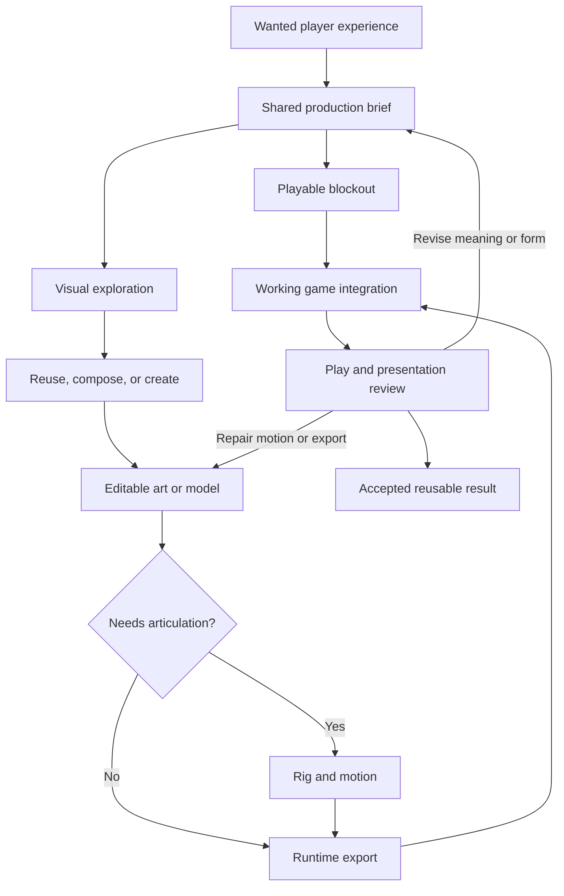

# OpenLegend production workflows

**Status:** proposed, reusable development procedures derived from the [AI game-development research](../../archive/02-research/ai-game-development/README.md). They organize production work; they do not claim that every route or tool has been qualified in OpenLegend. Existing art decisions, gameplay contracts, implementation trackers and task authorization retain their owners.

Use this handbook to turn an idea into something a player can recognize, use, respond to and remember. The aim is a compelling game whose content can be revised and expanded economically. A beautiful isolated image, a technically valid export and a complete playable encounter are different intermediate results.

The route is chosen for the wanted experience. Improving the weight of a carried tool, making a person recognizable, revealing a mysterious path, or making an inventory satisfying to use can call for different combinations of art, geometry, animation, sound and native behavior. Begin with the smallest complete production path that can answer the actual question, while preserving the game's distinctive invention and independent-character ambitions in the early playable experience. [Gameplay priorities](../repertoires/gameplay-priorities.md) owns project selection; this handbook does not place inventory, graphics or any new pipeline ahead of already selected work.

## The common route

**Idea → brief → concept or playable blockout → editable source → usable export → working game integration → play and presentation review → reusable result.**

For an animated entity, this can become **idea → art → 3D asset → rig and motion → working game entity**. Native behavior develops alongside the visual work: an attractive asset must meet an actual object or character that can participate in play. For other cases, existing art, direct modeling, procedural composition or a final sprite can remove unnecessary stages.

The diagram shows useful dependencies, not a mandatory waterfall. A rough mesh can enter the game before final material work. A blockout can reveal that an opening, reach cue or silhouette needs revision before animation begins. A licensed existing model can enter at source inspection; a pure sound improvement uses the [feedback route](audio-and-feedback.md). Revisit only the affected outputs when a decision changes.

## Choose the route

| Wanted result                                                                                      | Production route                                                                                                                       | Existing behavior and progress owners                                                                                                                                                                                |
| -------------------------------------------------------------------------------------------------- | -------------------------------------------------------------------------------------------------------------------------------------- | -------------------------------------------------------------------------------------------------------------------------------------------------------------------------------------------------------------------- |
| A recognizable object, tool, container, furnishing or equipped item                                | [Assets and animation: rigid objects](assets-and-animation.md#rigid-objects-and-equipment)                                             | [World presentation](../world-presentation.md), [persistent objects](../maintainers/persistent-objects.md), [V3D04](../maintainers/3d-pixel-art.md#v3d04--rigid-parts-materials-and-construction-visuals)            |
| An expressive person or creature that moves and uses compatible equipment                          | [Assets and animation: articulated entities](assets-and-animation.md#articulated-people-and-creatures)                                 | [Art studies](../maintainers/art-direction.md), [V3D05–V3D06](../maintainers/3d-pixel-art.md#v3d05--rigged-character-and-equipment-family), [character direction](../projects/compelling-characters-feature-spec.md) |
| A distinctive, readable place with related surfaces, vegetation and purposeful light               | [Scenes and interfaces: places](scenes-and-interfaces.md#places-materials-and-lighting)                                                | [Creative brief](../../art-direction/final-board/creative-brief.md), [spatial world](../spatial-world.md), [world presentation](../world-presentation.md)                                                            |
| A coherent game interface around a real player decision                                            | [Scenes and interfaces: UI](scenes-and-interfaces.md#art-directed-working-interfaces)                                                  | [UI brief](../ui-design-brief.md), [interaction handbook](../ui-ux/README.md), [UIUX](../maintainers/ui-ux.md)                                                                                                       |
| A person, situation or encounter that offers meaningful choices and later consequences             | [Characters and play](characters-and-play.md)                                                                                          | [Gameplay priorities](../repertoires/gameplay-priorities.md), current character, action, invention and authored-world owners                                                                                         |
| An action that feels clear, responsive and consequential through motion, sound and visual feedback | [Audio and feedback](audio-and-feedback.md)                                                                                            | [World presentation](../world-presentation.md), [hearing](../hearing-and-speech.md), [narration](../narration-and-conversations.md)                                                                                  |
| A player invention whose appearance improves during play                                           | [Runtime invention art](../invention-art-pipeline.md) and its [proposed production design](../projects/3d-pixel-art-asset-pipeline.md) | [INV-12](../maintainers/inventions-and-world-evolution.md#inv-12--progressive-in-game-art-and-compatible-publication), [V3D07–V3D10](../maintainers/3d-pixel-art.md#v3d07--durable-2d-art-during-play)               |

Offline production creates the source assets and reviewed families that a runtime system can reuse. Runtime generation additionally needs the existing accounting, cancellation, permitted reference, compatibility and publication machinery. This handbook supplies no substitute for those contracts. A successful offline study does not establish live generation or arbitrary asset intake.

## Start with a brief that makes decisions possible

Place the brief in the existing art-study record, project design or task record that already owns the work. Small improvements need only the relevant fields; do not create a second tracking system or a form for every edit.

| Brief field       | Useful content                                                                                                          |
| ----------------- | ----------------------------------------------------------------------------------------------------------------------- |
| Player experience | What the player should notice, feel, decide or do; why the result matters in the current game                           |
| Existing facts    | Current object/person/place identity, supported behavior, permitted knowledge and the specification that owns each      |
| Creative intent   | Distinctive shape, material, personality, atmosphere or interaction; approved references and features to preserve       |
| Delivery context  | Normal camera/view distance, lighting, UI size, poses, interactions and representations actually needed                 |
| Starting assets   | Exact reusable sources, compatible parts, rigs, materials, clips and known limitations                                  |
| Selected route    | Why reuse, procedural work, generation, manual authoring or a combination fits this case                                |
| Working evidence  | Reproducible scene or UI state; the actual build, export and source revisions being compared                            |
| Useful completion | What works in play, what makes the result appealing, and the specific variation or revision needed to demonstrate reuse |

The brief should be concrete enough for independent contributors to produce compatible work. It does not need to settle every brushstroke. For a hypothetical new lantern appearance, it might pin the silhouette, handle, scale and supported carrying state while leaving surface wear open. Whether it emits game light is a separate native fact; a painted glow cannot decide that behavior.

Use the [creative brief](../../art-direction/final-board/creative-brief.md), [recorded art decisions](../../art-direction/decisions.md) and [UI brief](../ui-design-brief.md) as existing inputs. Reference art communicates a target; source ownership and production-use rights are recorded separately in the existing asset records.

## Explore before expanding a family

Allow cheap alternatives when the visual idea, interaction or emotional purpose is unresolved. Compare distinct choices: a recognizable broad silhouette against a detail-heavy one, a warm inhabited camp against a visually empty one, or two ways to communicate an item's use. Favor alternatives that answer a decision over a large batch of nearly identical generations.

Choose a coherent direction before expensive dependent work or broad duplication. An approved example should show the complete relevant context: the object beside a person, the animated body at game scale, the interface over the world, or the place with its actual paths and light. A final portrait is not the visual target for every tiny world figure.

The task owner resolves ordinary refinements using the accepted direction. Material changes to character identity, overall style, supported mechanics or agreed scope follow their existing decision owners. A dislike of one result is a reason to identify and revise the offending choice, not to erase useful source work or reopen the entire game direction.

This process applies the evidence from [procedural production](../../archive/02-research/ai-game-development/03-procedural-art-and-animation.md) and [UI production](../../archive/02-research/ai-game-development/08-ui-quality-and-production.md): consistent inputs and editable sources make iteration useful, while early exploration prevents efficient repetition of a weak idea.

## Make each handoff inspectable

Each stage delivers enough for the next contributor to act without guessing. The output may be a concept sheet, editable scene, material graph, rig, animation clip, component, world-content change or reviewed runtime asset. It should identify:

- The input revision and intended meaning it preserves.
- The source file or existing repository owner that can be edited.
- The produced export and how to inspect it in the relevant environment.
- The required supported parts, poses, states or interactions actually covered.
- The tool/model and meaningful settings used, when these affect repeatability.
- The remaining specific defect or uncertainty and who owns it.

For example, “model complete” is insufficient when the consumer needs a movable lid. A useful handoff says whether the lid is separated, where it pivots, which opening is present, what the export contains and which gameplay behavior remains to be integrated. Name illustrative or fixture behavior explicitly; do not present it as current world content.

Keep the editable sources in the established art workspace or repository location appropriate to the asset. The [art-direction tracker](../maintainers/art-direction.md) owns source locations and study milestones. Keep approved runtime artifacts in the actual game-delivery path. Provider URLs, temporary execution directories and a remembered prompt are not durable substitutes for accepted source and output files.

## Revise the responsible source

| Observed problem                                         | Return to                                                                    | Recheck affected dependents                                                               |
| -------------------------------------------------------- | ---------------------------------------------------------------------------- | ----------------------------------------------------------------------------------------- |
| The thing offers no worthwhile choice or feels redundant | Player purpose, encounter or gameplay design                                 | Brief, behavior, cues, art emphasis and associated rewards                                |
| Shape or identity is wrong                               | Concept and source geometry/art                                              | Dependent textures, attachments, rig fit, icons and other identity views                  |
| Appearance implies the wrong function                    | Brief and existing mechanic/appearance owner                                 | Geometry cues, animations, labels and supported interactions                              |
| Materials look noisy or wrong under light                | Material source, UVs or lighting setup according to the observed cause       | Exported maps and relevant scene-light comparisons                                        |
| Feet slide or a held item jumps                          | Clip, rig, attachment or transition source                                   | Affected actions, body/equipment combinations and export                                  |
| Art looks right in the editor but fails in the game      | Export profile and actual renderer consumption                               | Final runtime bytes, loading, scale, materials and resource behavior                      |
| An interface is attractive but confusing                 | Information hierarchy or interaction owner                                   | Whole task, keyboard/focus, live state and surrounding world control                      |
| A resident gives a weak or false reply                   | Character intent, supplied evidence, model behavior or delivery as diagnosed | The affected interaction and later consequences, rather than indiscriminate extra history |

Distinguish a new creative direction from a repair that preserves the current one. Preserve useful earlier accepted results. If a material adjustment leaves identity and geometry unchanged, there is no reason to regenerate the body. If geometry does change, do not pretend old skinning, collision fit or thumbnails remain valid without checking the actual impact.

## Parallel work with shared inputs

Parallelize independent exploration, asset variants, bounded component work or review after establishing shared inputs. A native blockout and visual concepts can develop together when both describe the same object. An icon family and UI layout can develop together after item identity, slot use and visual direction are clear. Sound variants can be prepared while the action owner provides actual event and interruption behavior.

Keep dependent work sequential when concurrent changes would invalidate it. Final skinning depends on sufficiently stable geometry; fitted clothing depends on the body and rig convention; a downstream export should not silently consume whichever source an agent last overwrote. Give one contributor ownership of each shared source and one integrator responsibility for the complete player result. Stateful application operations also follow the selected tool's concurrency limitations.

Use a shared baseline and explicit output locations. Review each handoff as it arrives instead of waiting for every discipline to finish. Additional agents can improve independent exploration, review or delivery; assess those benefits alongside reconciliation and correction effort. [Research principles](../../archive/02-research/ai-game-development/09-openlegend-principles.md) retain the supporting evidence.

## Select tools by the stage they improve

The language agent, image generator, mesh generator, rigging tool, authoring application and runtime renderer can be different tools. Record the complete route when comparing results. Use the [inspected skills and tooling](../../archive/02-research/ai-game-development/04-skills-and-tooling.md), [asset and audio assessment](../../archive/02-research/ai-game-development/07-image-3d-and-audio-models.md), and [character-model assessment](../../archive/02-research/ai-game-development/06-models-for-stories-and-characters.md) for dated candidates and compatibility details.

Prefer a saved graph, editable material, export preset or narrow script when a repeated transformation is understood. A hosted service or local tool may execute that transformation; neither needs to become a universal workflow platform. Inspect unfamiliar skills and use the exact selected application/model version. A skill's example world laws or editor defaults do not become OpenLegend policy.

When comparing candidate routes, retain equivalent briefs, reference quality and delivery requirements. Measure useful output, manual correction, elapsed time, actual charges and the cost of a meaningful revision. Stop broadening a comparison when it has resolved the decision. [Evaluation and adoption](../../archive/02-research/ai-game-development/11-evaluation-and-adoption.md) owns the proposed comparison method; its trials remain unrun unless actual evidence says otherwise.

## Judge the complete result

Review technical usability and the intended experience separately. A correct object may still be forgettable. A faithful action can still lack weight. A character can obey every knowledge boundary and still have little personality. The production route is valuable when it helps improve both.

Ask what the player can recognize at the offered scale, what invites action, what changes after their choice, what distinguishes this result from other content, and why they would want to return. Preserve purposeful contrast and surprise within a coherent world. Use automated checks and agent play to find reproducible defects; use the existing human playtest process to learn about enjoyment and unprompted behavior. No extra mandatory study precedes ordinary useful prototyping.

Keep observations, judgments and unperformed qualification distinct. The [verification policy](../../.agents/rules/verification.md), [verification index](../verification.md), [art studies](../maintainers/art-direction.md) and focused feature trackers determine what evidence is needed for the actual changed scope.

## Maintained records

- **Implementation and studies:** existing [art direction](../maintainers/art-direction.md), [3D appearances](../maintainers/3d-pixel-art.md), [UIUX](../maintainers/ui-ux.md), [character experience](../maintainers/character-experience.md), and affected feature trackers. This handbook creates no competing task register.
- **Limits and constraints:** existing [3D art](../limits/3d-pixel-art.md), [UI](../limits/ui-ux.md), [interface](../limits/interface.md), [AI execution](../limits/ai-execution.md), and feature-specific inventories. Workflow examples create no new numerical runtime or production quotas.
- **Evidence and interpretation:** the [research collection](../../archive/02-research/ai-game-development/README.md). Source-specific claims and current tool details remain there; accepted game behavior stays in its existing specifications.
