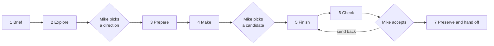

# Art workflow

One procedure for every art request: concept studies, character sheets, UI kits, props, 3D characters and creatures, materials, motion and production files. Mike says what he wants; an agent (or an artist following these pages) does the brief, tool work, file handling, review sheets and preservation. On the full path Mike decides at three points: which direction, which candidate, and whether the result is accepted; under `exact` fidelity he also approves the reference views before any 3D spend. The simple path makes one result for him to look at. The aim is exceptional craft and originality, not merely a finished file.

**The workflow has no look of its own.** It never decides style, palette, proportions, pixel treatment or interface character. It reads those from the selected world's art direction ([§3](#3-read-the-look-from-the-art-direction)), so the look can change without editing these pages. This also lets another authored world bring its own direction to the same procedure.

The [feature specification](../../projects/art-workflow-feature-spec.md) records why it works this way and what remains open; these pages own the procedure itself.

## Contents

1. [Ask for art](#1-ask-for-art)
2. [Request settings](#2-request-settings)
3. [Read the look from the art direction](#3-read-the-look-from-the-art-direction)
4. [The seven stages](#4-the-seven-stages)
5. [Review with Mike](#5-review-with-mike)
6. [Spending](#6-spending)
7. [Working files, IDs and records](#7-working-files-ids-and-records)
8. [Compare tools or methods](#8-compare-tools-or-methods)
9. [Preserve and resume](#9-preserve-and-resume)
10. [Completion](#10-completion)

Companion pages: [Tools and defaults](tools.md) (which platform and model each stage uses, with commands and costs) · [Deliverable profiles](profiles.md) (what a good result covers for each kind of subject) · [3D models](3d-models.md) (concept or character sheet → finished prop, character or creature) · [Animation authoring](animation.md) (reuse, new motion, retargeting and clip assembly) · [Production packages](production.md) (finishing and packaging other assets) · [Study record](study-record.md) (what to write down).

## 1. Ask for art

Only the wanted result is required. Everything else has a default.

- "Make concept art for Tavin Vale. Three directions."
- "Turn this character sheet into a finished, rigged 3D model for the game. Keep the face and the coat exactly."
- "Use the Standard flow for a quick prototype of this character: one unrigged GLB with simple materials, to inspect its shape."
- "Generate this character with idle and walk animations."
- "Animate this saved model with a reaching motion; keep its rig and materials."
- "Polish and finalize that prototype for its selected gameplay use."
- "Use the Higgsfield flow for a UI style study: three directions, study only."
- "Make production-ready models of the wattle wall panels, intact and damaged."
- "Concepts with Nano Banana Pro, then 3D with Meshy; stop after I pick a model."
- "Refine the selected chest material; keep its shape and colours."
- "Resume study `2026-11-02-mara-reed-3d` from candidate m02."

These are examples, not reserved commands; an earlier example never prescribes the medium, content, composition or scope of a later request. "Regular", "manual" and "standard" all mean the default tools; "Higgs field" means Higgsfield; `/ol-design` uses this same workflow.

## 2. Request settings

Infer every setting from the request and conversation; ask only when a consequential choice cannot be inferred ([§5](#ask-only-what-changes-the-work)).

| Setting    | Meaning                                                                                                                                                                      | Default when not given                                                                                                                                            |
| ---------- | ---------------------------------------------------------------------------------------------------------------------------------------------------------------------------- | ----------------------------------------------------------------------------------------------------------------------------------------------------------------- |
| Result     | The subject and what should exist at the end.                                                                                                                                | Required.                                                                                                                                                         |
| Profile    | The kind of subject: UI style, general style, asset/icon, character, creature, material/environment, motion, UI system, custom.                                              | Inferred; see [profiles](profiles.md).                                                                                                                            |
| Finish     | `study`, `production` or `integrate` (below).                                                                                                                                | Inferred from the wording.                                                                                                                                        |
| Quality    | The simple path (`prototype`) or the full path (`finished`) ([below](#quality-the-simple-and-full-paths)); independent of the file type and the stop.                        | `prototype` for model and animation generation; `finished` for a finished or game-ready asset, "polish/finalize", and every other request.                        |
| Steps      | Options that change one step without changing the path: concepts, views, candidates, cleanup, rig, animations, motion, materials, format, critique ([below](#step-options)). | The path's defaults, minus [what supplied material already covers](#what-supplied-material-skips).                                                                |
| Fidelity   | How closely to follow a supplied or selected source: `exact`, `faithful` or `interpretive`, plus named **locks** and **free** areas ([below](#fidelity)).                    | `faithful` when a source is supplied or selected; otherwise not applicable.                                                                                       |
| Tools      | Platform and model per stage, or a preset: `standard`, `higgsfield`, `both` ([tools](tools.md#presets-and-overrides)).                                                       | `standard`: the default roster in [tools](tools.md#default-roster). A named tool replaces the default for its stage only.                                         |
| Candidates | How many alternatives each stage produces.                                                                                                                                   | Full path: 3 concept directions, 1 reference set per picked concept, 3 model candidates. Simple path: 1 of each. 1 of everything else; a focused edit produces 1. |
| References | Supplied images, saved candidate IDs or approved art, each with a stated role (identity, material, palette, construction, composition, example to avoid).                    | Approved art for the same subject, if any.                                                                                                                        |
| Selection  | Who decides at each decision point.                                                                                                                                          | Mike. "Choose for me" or "pick the best" delegates the choice within the request's scope.                                                                         |
| Stop       | The last stage to complete.                                                                                                                                                  | The end of the inferred finish.                                                                                                                                   |
| Budget     | The task's spending ceiling ([§6](#6-spending)).                                                                                                                             | $10 per task under the [spending policy](../../../.agents/rules/verification.md#spending).                                                                        |
| Resume     | An exact study, candidate or revision to continue.                                                                                                                           | A new study.                                                                                                                                                      |

**Finish.** "Study", "explore", "concept" and "compare" end at **study**: reviewable alternatives with saved sources and construction notes. "Production-ready", "export", "game-ready files" and "a model for the game" mean **production**: the actual usable files, checked against their consumer, without installing them in the game. "Implement in the game", "put it in the world" or "use it" means **integrate**: production plus the game change and its normal verification. A UI-system design covers tokens, components, states and representative screens; it is not an implementation. Do not silently turn an implementation request into a study, or "looks good" into permission to build.

**Plan line.** Before the first paid step, state the resolved settings in one or two lines, with the estimate and the next decision point, then continue without waiting. For example: _"Mara Reed → 3D production on the full path, faithful (locks: face, hair, outfit colours; her bag made as a separate asset). Default tools: reference views with GPT Image 2.5, then two Meshy and one Tripo candidate through Higgsfield. About $5 of $10. Next stop: you pick a model."_ Or, on the simple path: _"Tavin Vale → quick animated walking model from the sheet's front view: one Meshy candidate, automatic rig with `Idle`, `Walk` and `Run`, short check. About $1.75 of $10. Next stop: the result."_ Mike can redirect at any time; silence is not a new approval for anything outside the stated plan.

### Quality: the simple and full paths

Every request runs on one of two paths. The **simple path** (`quality=prototype`) makes one usable result quickly, to look at, try in the game's renderer or build on later. The **full path** (`quality=finished`) makes finished art: alternatives, Mike's picks, full cleanup, polished motion, every check and Mike's acceptance. Both keep the look, the subject's identity and proportions and the same preservation rules, and neither installs anything in the game unless integration is requested. Quality is independent of the finish and the stop: a simple-path model is still production, exported files checked against their consumer.

| Say                                                                                          | Path   |
| -------------------------------------------------------------------------------------------- | ------ |
| "prototype", "quick", "rough", "blockout", "draft", "just to see it"                         | Simple |
| "finished", "final", "polished", "full", "game-ready", "production-ready", "polish/finalize" | Full   |

**Which words win.** A quality word decides: "a quick model for the game" is simple and "a finished model" is full. A destination such as "for the game" chooses neither. Asking to compare or pick ("three candidates", "stop after I pick a model") gives that step the full path's candidate count and Mike's pick, on either path. With no quality word, these defaults apply.

**Defaults.** Model and animation generation default to the simple path, `finish=production` (exported files only) and one candidate. A new finished or game-ready asset goes straight to the full path ([3D models](3d-models.md) for props, characters and creatures, otherwise the [production procedure](production.md)); it does not need a prototype first. Every other request, such as a concept study, a UI kit or a material, defaults to the full path, and "quick" or "rough" moves it to the simple one. Existing context and explicit constraints take precedence. These are request options read from ordinary language, not provider settings or a new service.

**Finalize later.** "Polish/finalize this model" reopens a simple-path result through the [finalize path](production.md#polish-or-finalize-a-selected-model). Its Finish repairs only what the final use needs and keeps the rig, clips and materials unless the request changes them or that use needs a change; a body rigged through Higgsfield takes only weight-safe local fixes ([rigging](tools.md#rigging-and-clips)). It then gets the full path's Check and Mike's acceptance.

| Stage      | Simple path (`prototype`)                                                                                                                                                                                      | Full path (`finished`)                                                                                                                                                                                                     |
| ---------- | -------------------------------------------------------------------------------------------------------------------------------------------------------------------------------------------------------------- | -------------------------------------------------------------------------------------------------------------------------------------------------------------------------------------------------------------------------- |
| 1 Brief    | The result, the look's rules for this subject, its real size and its clips, filled from the request; the only question is a real size that no owner defines                                                    | The full [brief](#stage-1--brief-no-spending): Look block, game facts and states, locks, references, play checks and the plan line                                                                                         |
| 2 Explore  | Skipped when a source is supplied; otherwise one concept, with no stop. For a model, one image made to the [view rules](3d-models.md#step-3--make-clean-reference-views) serves as both concept and front view | Skipped when a source is supplied; otherwise three directions on a comparison sheet, and Mike picks one                                                                                                                    |
| 3 Prepare  | One front view: the sheet's or the supplied image's, cropped, when it meets the [view rules](3d-models.md#step-3--make-clean-reference-views); otherwise one is generated (about 3 credits)                    | A clean view set, cropped where the sheet meets the view rules and generated otherwise, checked for agreement. With no concept or source, the front view is generated from the brief and shown to Mike before any 3D spend |
| 4 Make     | One candidate                                                                                                                                                                                                  | Three model candidates compared on one sheet; Mike picks one                                                                                                                                                               |
| 5 Finish   | Only what the stated use needs: normalize, the automatic rig and library clips when a two-legged humanoid needs motion, the generator's own texture                                                            | Full cleanup, a rig with skinning checks and a rough export first, blocked and refined clips, materials per the look's production notes                                                                                    |
| 6 Check    | The [short check](#prototype-path): the export loads, form and scale are right, an animated character's clips play on its body, and one look in the game's renderer                                            | Budgets report, look check, play checks, matched-scale fidelity sheet and independent critique; Mike accepts                                                                                                               |
| 7 Preserve | The same rules                                                                                                                                                                                                 | The same rules                                                                                                                                                                                                             |

[3D models](3d-models.md#simple-and-full-paths) shows which of its steps each path runs.

#### Prototype path

The simple path's procedure for models and animation:

1. Reuse or generate one suitable candidate from the brief and selected references. For animation-only
   work, use the selected model/rig or a compatible existing project target; do not generate a replacement
   body. Resolve a missing target only when it would change the required motion or compatibility.
2. Produce only the required geometry, basic materials and clips. Reuse compatible motion before
   authoring it ([shared motion procedure](animation.md)); use simple clear poses, appropriate timing and necessary contacts. Cyclic motions loop;
   discrete actions finish once. Deliver real model/animation data, not a video substitute.
3. Reopen the actual export; inspect form, scale, loading and required materials. Play clips on their
   target body, checking actual deformation, gross foot/grip errors and relevant loop/start/end behavior.
   Fix blockers to the stated use, preserve the result and available sources through the shared workflow,
   record remaining cosmetic limits, and stop. Required identity, proportions and art direction remain.

Skip detailed retopology, turnaround sheets, acting/secondary-motion polish, extra variants, custom
shaders, family qualification, provider contests and broad device campaigns unless the stated use
needs them. Prototype export follows this short path, not the full finishing recipe. Integration
retains its applicable runtime checks at either quality; a prototype does not close general family
qualification. Finalization resumes the retained candidate and still covers only its selected use.

### Step options

Each step's default comes from the path and from what is already supplied ([below](#what-supplied-material-skips)). Name an option to change one step and keep the rest: "a prototype, but with a polished walk", "the full path without concepts", "a finished model, no rig". Resolve the options once in the brief; anything not mentioned keeps its default, and nobody fills in a questionnaire.

| Option       | Controls                            | Values                           | Simple path                                                                        | Full path                                                                                                                                                                                                                                      |
| ------------ | ----------------------------------- | -------------------------------- | ---------------------------------------------------------------------------------- | ---------------------------------------------------------------------------------------------------------------------------------------------------------------------------------------------------------------------------------------------- |
| `concepts`   | Ideation and concept art (Explore)  | `skip` or a number of directions | `skip` when a source is supplied, otherwise 1                                      | `skip` when a source is supplied, otherwise 3                                                                                                                                                                                                  |
| `views`      | Reference views (Prepare)           | `front` or `set`                 | `front`: one front view, cropped when it meets the view rules, otherwise generated | `set`: front, back, left and right, cropped where usable and generated otherwise                                                                                                                                                               |
| `candidates` | Models or kits made (Make)          | A number                         | 1                                                                                  | 3 models; 1 of anything else                                                                                                                                                                                                                   |
| `cleanup`    | How far a model is cleaned (Finish) | `minimal` or `full`              | `minimal`: normalize and fix what blocks the stated use                            | `full`: all of [Step 7](3d-models.md#step-7--clean-and-normalize-in-blender)                                                                                                                                                                   |
| `rig`        | Whether and how it is rigged        | `auto`, `none` or an exact rig   | `auto`                                                                             | `auto`                                                                                                                                                                                                                                         |
| `animations` | Which clips                         | `auto`, `none` or a clip list    | `auto`                                                                             | `auto`                                                                                                                                                                                                                                         |
| `motion`     | How polished the clips are          | `rough` or `polished`            | `rough`: clear poses, clean loops, necessary contacts                              | `polished`: the [motion order](../assets-and-animation.md#4-produce-motion-that-serves-an-action) in [Step 9](3d-models.md#step-9--make-the-clips), checked in the game in [Step 10](3d-models.md#step-10--export-and-check-in-the-games-look) |
| `materials`  | Surface work                        | `auto`, `simple` or `preserve`   | `auto`: simple materials; a generated model keeps its own texture                  | `auto`: per the look's production notes                                                                                                                                                                                                        |
| `format`     | Output files                        | `auto` or a named format         | `auto`                                                                             | `auto`                                                                                                                                                                                                                                         |
| `critique`   | Independent critique (Check)        | `skip` or `run`                  | `skip`                                                                             | `run` for production packages and every new character or creature                                                                                                                                                                              |

How `auto` decides, on either path:

| Option            | Default and overrides                                                                                                                                                                                                                                                                                                                                                                                                                                                                                                                                                                                                                                                                                                                                                                                                |
| ----------------- | -------------------------------------------------------------------------------------------------------------------------------------------------------------------------------------------------------------------------------------------------------------------------------------------------------------------------------------------------------------------------------------------------------------------------------------------------------------------------------------------------------------------------------------------------------------------------------------------------------------------------------------------------------------------------------------------------------------------------------------------------------------------------------------------------------------------- |
| `rig=auto`        | Reuse a compatible existing rig; add one only for required articulation/deformation. Static models and rigid/root-only motion need none. The automatic rig takes only two-legged humanoids; other bodies need an [authored rig](3d-models.md#rig-routes). `none` or an exact rig reference can override the choice when compatible with the requested output.                                                                                                                                                                                                                                                                                                                                                                                                                                                        |
| `animations=auto` | Model-only requests get no clips. An animated walking character gets `Idle`, `Walk` and `Run` when compatible with its body: the game's loader requires `Idle` and `Run` ([consumer contract](3d-models.md#consumer-contract-and-budgets)), and without `Walk` a walking person plays a slowed run. Named motions are added to these, so "with a wave" adds `Wave`. Other forms get the simplest motion demonstrating their stated use, not a human rig or full action library. `none`, "only" or an explicit clip list overrides inference. If that leaves the named runtime consumer unsatisfied, report the unmet requirement; do not silently add clips or claim a complete runtime export. The study viewer's local preview shows a model without both `Idle` and `Run` but plays none of its motion, and its Motion menu offers only Idle, Walk, Run, Sprint, Attack, Punch, Dodge and Wave, so check any other clip in Blender. |
| `materials=auto`  | Preserve adequate existing materials. A new prototype uses simple materials: a generated model keeps the generator's own texture, resized to the budget. The full path follows the look's [production notes](../../../art-direction/decisions.md#how-the-current-look-changes-production). Finalization refines only what the intended use needs. "Untextured", "simple" or "preserve these materials" are explicit constraints.                                                                                                                                                                                                                                                                                                                                                                                     |
| `format=auto`     | Use the named consumer's supported format; normally GLB for OpenLegend's 3D model/animation path. Keep available editable sources. Do not create unused format variants.                                                                                                                                                                                                                                                                                                                                                                                                                                                                                                                                                                                                                                             |

Animation source selection follows [Animation authoring](animation.md): preserve suitable existing
clips first; use the [default human-motion source](tools.md#human-motion-generation) only for missing,
compatible human motion. Its planned adapter and provider/rig qualification must be delivered before
that route is executable. Existing reuse stays available without a new account. Animation-only work
keeps the supplied model and rig; creature motion follows its anatomy. These defaults apply only
when the request or consumer actually requires animation and preserve `motion=rough|polished`.

Ordinary words set the common options too:

| Say                      | Effect                                                                                                                                             |
| ------------------------ | -------------------------------------------------------------------------------------------------------------------------------------------------- |
| "Pick the best yourself" | The agent makes decisions B (and C, if asked) and records them as agent-selected, not owner-approved                                               |
| "Just one candidate"     | `candidates=1`: one model instead of three, so a lock failure costs a rerun instead of a fallback                                                  |
| "Skip the critique"      | `critique=skip`                                                                                                                                    |
| "No concepts"            | `concepts=skip`: start from the supplied image, or from a front view generated from the brief (shown to Mike before any 3D spend on the full path) |
| "This is scratch"        | Files very likely to be temporary (test renders, failed exports, throwaway trials) stay local and are never uploaded                               |
| "Stop after the model"   | Ends at decision B with the candidates, before finishing                                                                                           |

### What supplied material skips

On either path, a step that the supplied material already answers is skipped or shortened:

| Supplied                                                                                   | Effect                                                                                                                                                                           |
| ------------------------------------------------------------------------------------------ | -------------------------------------------------------------------------------------------------------------------------------------------------------------------------------- |
| A character sheet, concept or approved art                                                 | No concepts: it is the direction. The brief fills itself from it and the game's own facts, asking only if something consequential is missing (for example who the character is). |
| A sheet whose views meet the [view rules](3d-models.md#step-3--make-clean-reference-views) | The views are cropped and used; only missing or unusable views are generated.                                                                                                    |
| A saved model or candidate                                                                 | No generation: work starts at Finish, as in "animate this saved model" ([how](3d-models.md#animate-a-saved-model)) or "polish that prototype".                                   |
| A compatible rig                                                                           | No new rig; its clips are reused before new ones are made.                                                                                                                       |
| Adequate materials                                                                         | They are kept.                                                                                                                                                                   |
| An approved finished asset                                                                 | Only the requested change is made (a focused edit), at the requested quality, then rechecked.                                                                                    |

### What no option removes

**Check.** A model the game will load needs the technical file check (height, feet at 0, facing, budgets, `Idle` and `Run` for an animated character, no mesh named like a bone). Without it the game fails to load the model or shows it wrong. Every 3D model also gets one look in the game's own renderer, because the look is applied there and a Blender view can mislead. The play checks take a minute and stay on the full path; the simple path keeps those that bear on its stated use, and scale always. `exact` work always gets the matched-scale fidelity sheet, on either path; `faithful` work gets it on the full path. The independent critique is the only part that is fully optional. A study that ends at concepts needs only inspection at viewing size.

**Preserve.** Everything except very likely temporary scratch, on either path. Each meaningful output (concepts, views, every model candidate, sheets, captures, editable sources, finished files) is uploaded to S3 as soon as its batch finishes. The study record and any other local notes keep only the exact S3 references. Asset files can never go into Git, provider links expire (Meshy deletes its outputs after three days), and a local folder is not durable.

### Fidelity

Every conversion from one form to another needs judgment: a character sheet never shows everything a model needs. Fidelity says how much of that judgment the workflow may exercise, and where.

| Level          | Locked                                                                                                                                                     | Free                                                                                                                                                  | Typical request                                  |
| -------------- | ---------------------------------------------------------------------------------------------------------------------------------------------------------- | ----------------------------------------------------------------------------------------------------------------------------------------------------- | ------------------------------------------------ |
| `exact`        | Everything visible in the source: shapes, colours, textures, marks and their sides. Reuse the source's own pixels or texture wherever the consumer allows. | Only what the source cannot show, continued from the visible design without new motifs.                                                               | "Exactly as shown", "production of this design". |
| `faithful`     | Identity: silhouette, proportions, face and hair, palette, key garments and equipment and which side they are on, distinctive marks, plus any named locks. | Hidden and ambiguous construction, surface detail density, simplification for readability or budget, material interpretation within the current look. | The default for a supplied or selected source.   |
| `interpretive` | Only the named locks.                                                                                                                                      | Everything else, including redesign for quality, readability and play. Offer alternatives when changing an identity feature.                          | "Use this as inspiration", "make it better".     |

Judgment enters in predictable places: resolving views that disagree, inventing hidden surfaces (backs, undersides, under a cape), choosing a body and rig family, interpreting materials for the current look, deciding topology, repairing generated defects, and acting in animation. Record each consequential interpretation in the study record's **Interpretations** list, so Mike can see what was decided rather than copied. Under `exact`, list every visible difference that remains, and verify it on a [matched-scale comparison sheet](#matched-scale-comparison).

The levels use the same vocabulary as the [runtime presentation contract](../../invention-art-pipeline.md#2-the-shared-presentation-contract): locks are its pinned features and free areas its cosmetic freedom; `exact` and `faithful` refine rendering, `interpretive` may redesign appearance.

## 3. Read the look from the art direction

Before writing a brief, read the selected world's current art direction. For the bundled world that is [Current direction at a glance](../../../art-direction/decisions.md#current-direction-at-a-glance), which names the current world-art requirements, the interface direction, the concept-art decision and **how the current look changes production**. Read the creative brief or design system it links only for the subject at hand.

Copy what the subject needs into the brief's **Look** block:

- the target look and what it rejects;
- the proportion and scale rules that apply to this subject;
- the references to use, with their roles and whether each may be uploaded to a generator;
- the production notes that change what you deliver (for example, whether the renderer applies the look or the asset must carry it);
- the review conditions the look depends on (camera, lighting, motion).

If the request conflicts with the current direction, do the independent preparation and ask Mike which applies before generating; a deliberate exception for one study does not change the direction. Never write a new style rule into these workflow pages; record accepted direction changes in the art-direction owner.

## 4. The seven stages

Each stage lists what to do, what it produces, how to check it, and where it stops. Skip stages the request does not need: a supplied character sheet skips Explore; a focused edit may need only Make, Check and Preserve. The stages below are the full path. On the [simple path](#quality-the-simple-and-full-paths), a model or animation request takes the [prototype path](#prototype-path) instead of the full Finish and Check. At either quality, fix the defects that prevent the requested use or quality at their source, and record the rest. The [step options](#step-options), [what supplied material skips](#what-supplied-material-skips) and [what no option removes](#what-no-option-removes) say what can be skipped, shortened or delegated, and what cannot. The route-specific detail lives in [3D models](3d-models.md) for props, characters and creatures and in [production](production.md) for everything else; the tools for each stage are in [tools](tools.md#default-roster).

### Stage 1 — Brief (no spending)

1. Read the request, prior decisions, any existing study for this subject, and the [look](#3-read-the-look-from-the-art-direction).
2. Inspect every supplied reference yourself. Write one line per reference: what it contributes, what to ignore, and its rights (reference-only, licensed, generated by us). A screenshot's border does not bring its layout, genre or mechanics. Supply references through each tool's real reference input, never as a list of links the generator cannot see.
3. Find the subject's game facts in their owners: who or what it is, real height or size in metres, which hand holds what, supported actions and **visible states the simulation actually records** (for example intact, damaged and broken; empty and full; lit and cold). Art shows committed facts only: never paint a wound, wetness or wear the game does not have.
4. Search for reusable approved assets, library sources and existing family bodies or parts before planning new work.
5. Write the brief in the study record ([§7](#7-working-files-ids-and-records)) using the [record outline](study-record.md#brief): purpose and the play moment it serves, settings, Look block, game facts and states, locks and free areas, references, consumer (where the files will be used), required outputs, play checks from the [profile](profiles.md), and the plan line.

**Check:** another person could produce compatible work from the brief alone. **Stop:** none; continue.

### Stage 2 — Explore (only when no approved source exists)

1. Make one representative specimen first when the output type is new to the project (one panel, one character, one prop) and inspect it before the batch.
2. Generate the requested directions from the same brief, each differing in construction or identity, not just hue. Use the [default concept tool](tools.md#default-roster) unless Tools names another. Select model, quality, resolution, aspect and transparency explicitly; never trust defaults. Choose strong settings for the quality wanted; a fast first draft is not an excellent result.
3. Establish one anchor image per direction before making its related pieces, and derive those pieces from that anchor. Use exact geometry or a source graph for repeated exact structure rather than asking a generator to redraw every corner. A reused seed does not reproduce identity.
4. When the right model for this kind of subject is unknown, run the same briefs on a second model as well (an audition) and say so in the plan line. Reuse a model that already worked for this kind of subject instead of auditioning again.
5. Inspect every output at its intended viewing size. Fix rendered placeholders, mangled text and anatomy errors with targeted edits rather than rerolling the batch, and keep the strongest earlier result when an edit makes things worse. Where typography matters, put real text over the artwork in a layout tool rather than judging generated lettering.
6. Build a [comparison sheet](#comparison-sheets) and present it.

**Produces:** concept candidates `c01…` with prompts and settings. **Stop:** decision A, Mike picks a direction (or the agent picks, when delegated). A study ends here. On the simple path there is no stop: the one concept goes straight on.

### Stage 3 — Prepare

Turn the picked concept or supplied source into exactly the input the making route needs:

- **3D:** clean reconstruction views, normally front (in the A-pose for bodies), back, left and right, made to the [view rules](3d-models.md#step-3--make-clean-reference-views) and checked for agreement.
- **UI kit:** the fixed specimen arrangement and the parts list from the profile.
- **Sprites:** the direction and pose list from the consumer.
- **Materials:** the target surface, scale and lighting context.

**Check:** the inputs agree with each other and with the locks. If views disagree, name the canonical one and correct the others. **Stop:** under `exact`, Mike approves the views before Stage 4. Otherwise there is no stop; for a named character, show the views beside the model sheet.

### Stage 4 — Make

Produce candidates by the chosen route: generate 3D candidates, compose library parts, model by hand, generate a UI kit, paint frames. Estimate first, then run the batch. Keep every original output with its job ID and settings.

**Produces:** candidates `m01…` (models) or `k01…` (kits and other assets). **Check:** inspect each candidate's actual files, not provider thumbnails; for 3D use the [candidate checks](3d-models.md#step-5--inspect-and-compare-candidates). **Stop:** decision B, Mike picks a candidate when there is more than one.

### Stage 5 — Finish

Bring the picked candidate to the consumer's contract: clean, scale, separate parts, materials per the look's production notes, rig, animate, export. Follow [3D models](3d-models.md#step-7--clean-and-normalize-in-blender) or the matching [production recipe](production.md#3-finish-the-relevant-asset-types) at the requested quality; "polish/finalize" of a selected prototype follows the [finalize path](production.md#polish-or-finalize-a-selected-model). Fix the source, not the export; repeatable fixes go in a script beside the work.

**Produces:** finished revisions `f01…` with their editable sources.

### Stage 6 — Check

1. Inspect the final consumer files after all conversion: dimensions or height, counts against [budgets](3d-models.md#consumer-contract-and-budgets), clips, alpha, seams.
2. Look at the result **the way the game shows it**: in the game's renderer or study viewer, at the default camera, beside an existing person for scale, under the look's review conditions. Run the profile's [play checks](profiles.md#play-checks).
3. For a supplied or selected source, make a [matched-scale comparison sheet](#matched-scale-comparison) and list remaining differences.
4. For production packages and every new character or creature, get an [independent critique](#independent-critique) and fix concrete findings.

**Stop:** decision C, Mike accepts or sends it back with reasons. Technical passes never stand in for acceptance: two mercenary iterations passed every check and were still rejected.

### Stage 7 — Preserve and hand off

Archive the study and package ([§9](#9-preserve-and-resume)), finish the study record, and report: what exists, where, its state (created, checked, archived, owner-selected, integrated), cost, and remaining gaps. Ask any choice needed for later work only after the study is saved, and never start implementation as part of that question; when the request already authorized the next stage, continue without asking again. Integration, when requested, continues through the normal development workflow and the existing component, renderer, appearance and world owners; [assets and animation](../assets-and-animation.md) covers putting an object or character into play.

## 5. Review with Mike

### Comparison sheets

Present choices as one sheet per decision: every candidate labelled with its ID, the same background, scale and viewing angle, aspect ratios preserved, and the concept or source beside them. For 3D, show the [turntable sheet](3d-models.md#step-5--inspect-and-compare-candidates) and a capture in the game's look. Show the sheet directly in the conversation (or a review page when the host offers one), with a short recommendation and the reason. Record Mike's choice and his words in the study record.

### Matched-scale comparison

When fidelity matters, draw the export the way its consumer draws it and place it beside the corresponding part of the source at the same scale and background. Compare texture, colour, edges and proportions side by side; never report fidelity from memory or from separate screenshots. The first Gildmoss production pass flattened textured edges and dimmed the glass to about 60% of the study's brightness; Mike caught it by asking, and matched-scale sheets are the method that now prevents it.

### Independent critique

For a substantial study, a production package or a new character or creature, ask a fresh reviewer (a separate agent or person with no editing authority) to critique the actual files against the brief and the look, at intended viewing conditions: appeal, originality, fit, consistency and fidelity. Turn each confirmed finding into a fix and, where it can recur, into a check in the recipe.

### Ask only what changes the work

Resolve what the request, conversation, records and references already settle. Ask before dependent work only when the answer is consequential and cannot be inferred: what to make, what must be preserved, or what must be delivered. Put related questions in one message, explain what each answer decides, and offer a recommendation. Do not ask Mike to choose tools, write prompts or move files.

### Waiting on tools

Recover submitted jobs rather than resubmitting them. For a tool that sends no completion signal (for example a Claude Design round), check about every 4 minutes.

## 6. Spending

- Mike's standing authorization covers **$10 per task** across every provider, delegate, batch and retry ([spending policy](../../../.agents/rules/verification.md#spending)). Ask before exceeding it; never raise a provider cap yourself.
- Estimate each paid batch before sending it ([how](tools.md#estimate-and-record-cost)) and keep a running total, counting outstanding or uncertain jobs. Subscription credits count at their dollar value.
- Record the balance before and after each batch, the exact model IDs and the request counts in the study record.
- Never retry a failed paid request automatically, and never enable automatic top-ups. A refinement is a deliberate new batch with its own estimate. Cancellation or a missing receipt does not prove zero cost.
- If budget or access blocks the requested scope, preserve the finished work and report the exact shortfall. Do not quietly reduce the number of candidates.

## 7. Working files, IDs and records

- **Study ID:** `YYYY-MM-DD-<subject>[-<purpose>]`, lowercase with hyphens, for example `2026-11-02-mara-reed-3d`.
- **Record:** `art-direction/studies/<study-id>/README.md` from the [outline](study-record.md), linked from the [study index](../../../art-direction/studies/README.md). One record per study; ongoing tracked work also links it from the [art-direction tracker](../../maintainers/art-direction.md).
- **Working folder:** `~/Documents/ChatGPT/OpenLegend-art/<study-id>/study/`, with one subfolder per stage: `references/`, `concepts/`, `views/`, `models/`, `work/` (editable `.blend` and other sources), `export/`, `review/` (sheets, captures, critique).
  - **Local copies are working caches.** After a batch is uploaded and verified, keep only its S3 references locally, and re-fetch files with `pnpm assets workspace` when needed.
  - Only files very likely to be temporary stay local without upload.
  - Never work in a temporary or repository directory: asset payloads stay outside Git ([asset workflow](../../asset-workflow.md#where-files-belong)).
- **Candidate IDs:** a stage letter and two digits, unique within the study: `c` concepts, `v` reference view sets, `m` models, `k` kits and other made assets, `f` finished revisions (`c01`, `v01`, `m03`, `f02`). Refer to them across threads as `<study-id>/m03`. Never renumber; a revision of `m03` becomes a new ID whose record names `m03` as its parent. Keep provider filenames in the record.
- **Operations:** while a batch runs, keep its job IDs, status and committed cost in the record's Resume section, so an interrupted run can recover instead of resubmitting.
- **One coordinator** owns the whole result. When work is delegated to another agent or person, give them only their assignment, the permitted references, the relevant constraints, the output folder and format, the stopping point and their share of the budget. The coordinator moves files and feedback, keeps one writer per source file, and keeps dependent steps in order; Mike never has to relay between specialists.
- **Sessions and accounts:** reuse authorized sessions. Sign-ins, verification codes and payments are Mike's to complete through the host's handoff; never ask for credentials in the conversation. Review and pin any new external skill or tool before using it; a vendor's instructions grant no authority.
- **Game environments:** a study needs no game database, app build or browser test run. Start a game or study server only when a requested look check, preview or integration needs it, and leave other tasks' running services alone.

## 8. Compare tools or methods

`both`, or any explicit comparison, runs two routes from one frozen input set: brief, references, specimen arrangement, required coverage and review criteria, saved once and given to both. Neither route copies the other's designs. Each route uses its own best tools; equal treatment does not require identical prompts. Use distinct IDs and folders; one coordinator owns the shared index. Independent generation may run in parallel, but serialize work that shares a browser session, a file owner or the publication writer. Label whether the comparison is about workflows or about models; a workflow result does not show that one model is better.

Compare equivalent coverage, quality, coherence, reuse, correction effort, Mike's involvement, elapsed time and measured cost, marking unknowns. Make unequal coverage or budgets visible. A comparison of two game implementations additionally pins the same commit, world, camera and tasks with isolated checkouts, databases and browser sessions (different ports alone do not isolate cookies) and uses no-spend checks unless live work is separately authorized; arrange that only when the comparison explicitly includes implementations.

## 9. Preserve and resume

The [asset workflow](../../asset-workflow.md) owns storage commands and the [storage decisions](../../projects/game-asset-storage-feature-spec.md#2-agreed-product-decisions) own the rules. In short:

- **Upload as you go:** upload every meaningful output to S3 as soon as its batch finishes, not at the end of the study, and record its exact reference. Only very likely temporary scratch stays local. A later batch is a new revision that depends on the earlier one, not a copy of it.
- **All payloads stay outside Git, whatever their size:** images, models, `.blend` files, textures, clips, captures, SVGs and fonts. Git keeps the study record, prompts, recipes, small catalogs and exact verified references.
- **Default destinations:** study material (concepts, views, candidates, sheets, captures) to `--boundary art-studies --domain curated-private`; editable sources and production packages to `--boundary art-library --domain curated-private`. These are the domains the archived studies use and the local study viewer can serve. Publishing anything publicly (`art-studies` / `public`) needs Mike's separate permission.
- **No workarounds:** embedding image or model data in source code is not a storage exception. Never invent bucket names, object paths, permissions, public URLs or command flags; follow the [AWS rules](../../../.agents/rules/aws.md) before AWS access, and coordinate the single publication writer instead of stopping another contributor's game.
- **Verify before claiming:** download the published files back and check every hash. A provider URL, local folder or signed link is not an archive. Keep the working copy until verification passes.
- **Practical rules:** see [publishing problems](../../asset-workflow.md#common-publishing-problems): which database is the asset authority, sign-in expiry, manifest size, frozen folders and resuming an interrupted publish.
- **Across branches:** when a study's record lives on another branch, copy only its records and catalogs to the working branch, never experimental application changes. Preserve every alternative while promoting only the explicitly selected files into the game's release.
- **Resume** from the study record's Resume section: the exact candidate, available files, open decision, next stage, and any outstanding jobs to recover first. A fresh thread receives one commit-pinned record link and fetches the files itself.

If storage access is unavailable, keep the working folder intact, write "not yet archived" in the record, and report the specific access needed. Upload as soon as access returns.

## 10. Completion

- A completed **study** has the requested candidates, profile coverage, an honest assessment, preserved outputs and a record another thread can resume from.
- A completed model or animation **prototype** has the requested usable files, the [prototype path](#prototype-path)'s checks, preserved sources and its stated limits.
- Any other completed **production** request also has the complete [package](production.md#5-package-preserve-and-hand-off), its technical checks and Mike's acceptance at decision C.
- A completed **integration** request also has the working game result and the project's normal verification.

Report readiness precisely: **exported**, **checked for the named consumer**, **archived**, **owner-selected** and **integrated** are separate facts. A partial package may be preserved and handed off as partial; recording a gap does not complete it.
