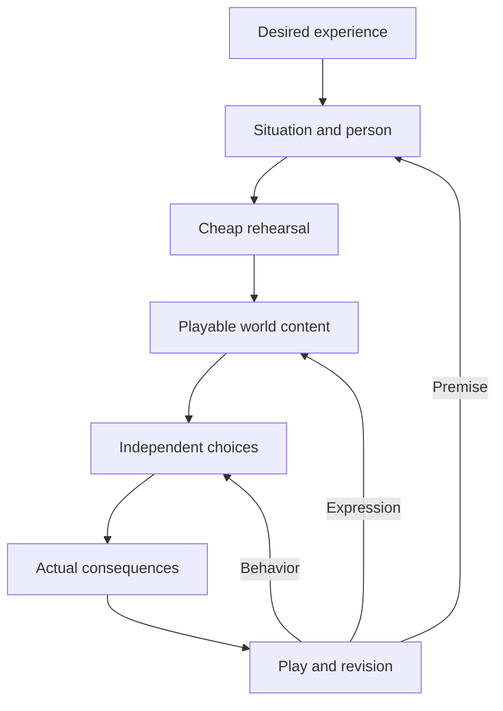

# Characters, situations and playable consequences

**Status:** recommended production route, reviewed 17 October 2026. This guide connects existing design, authoring and evaluation owners. It introduces no world mechanic, character controller, provider choice or paid-test authorization.

[Production workflows](README.md) · [Research principles](../../archive/02-research/ai-game-development/09-openlegend-principles.md) · [Task-specific research examples](../../archive/02-research/ai-game-development/10-openlegend-workflows.md)

[Narrative and writing](../narrative/README.md) supplies complementary craft guidance for specific people, creative situations, humor, voice and consequence. This workflow owns turning that creative intention into playable content and evaluating the result.

Use this route to turn an idea into a place, person or situation that somebody wants to engage with, then follow their choices into consequences worth discovering. It applies to a new authored encounter, an improvement to an existing resident, a supported invented object used in play, or a comparison between creative models. It also applies when the intended pleasure is quiet company, curiosity, observation or making something beautiful.

The work can begin with a mechanical idea, a striking image, a person, a location or a player observation. Creative exploration can move between them. The final result still has to join actual world behavior, permitted knowledge and appropriate presentation. The [gameplay priorities](../repertoires/gameplay-priorities.md) choose the worthwhile activity; this route explains how to develop it.

## Selected laboratory consumer

The [Cognition Lab](../projects/cognition-lab-feature-spec.md) supplies the designed isolated rehearsal workspace for this route. Start from a worthwhile person/situation, use ordinary native speech and actions, inspect exact personal evidence and actual outcomes, then change one relevant factor. Its [repertoire map](../projects/cognition-lab-repertoire-review.md) supplies optional recipes for memory, independent help/refusal, humor, ordinary pleasure, invention, threat and interrupted work. Keep the intended experience and human review notes outside model input; let the character make the choice. A saved starting scenario, continuation checkpoint and retained evidence run have different purposes. [CL](../maintainers/cognition-lab.md) retains pending tool delivery; CE/IS/CTR/FPV retain actual character and player evidence.

## The route

Each step should preserve something useful for the next: a clear intention, editable content, actual supported behavior or evidence of what happened. A concept rehearsal may finish with a decision to simplify or abandon an idea. A production task finishes at the complete delivery scope selected for it; a successful rehearsal does not satisfy an agreed live-game requirement.

| What moves between steps         | Useful content                                                                         | Existing home                                                                                                                                 |
| -------------------------------- | -------------------------------------------------------------------------------------- | --------------------------------------------------------------------------------------------------------------------------------------------- |
| Experience and premise           | What becomes worth doing; relevant people, possibilities and stakes                    | Selected project scope; [repertoire foundation](../repertoires/design-foundation.md)                                                          |
| Editable person and situation    | Authored identity, world facts, permitted knowledge, clues and supported opportunities | World/content owners; [character authorship](../projects/compelling-characters-feature-spec.md#character-authorship-and-changing-personality) |
| Working content and presentation | Actual objects, places and available actions, with fitting appearance and feedback     | Native feature owners; [assets](assets-and-animation.md), [scenes](scenes-and-interfaces.md), [audio](audio-and-feedback.md)                  |
| Chosen actions and consequences  | What participants actually attempted, did, perceived and later recalled                | Action, agency, [memory](../memory-architecture.md) and [conversation](../narration-and-conversations.md) owners                              |
| Review and next revision         | Observations, technical defects, creative strengths, burdens and remaining uncertainty | Existing project/tracker and [verification](../verification.md) records                                                                       |

These are handoff contents, not a new runtime schema, mandatory database or parallel task register. Reuse the records already maintained by the selected project.

## 1. Begin with something worth experiencing

Name who should value the result and why: a player discovering a clever alternative, a creator making an inviting opening, or an observer becoming interested in a particular resident. Use the [existing motive and experience foundation](../repertoires/design-foundation.md#motives-and-experiences-to-make-possible) to develop a specific intention. An AI-generated biography or a simulation of daily chores does not supply that intention by itself.

For a prospective encounter, describe what someone can want, what may help or resist them, and what reaching an outcome changes. A worthwhile activity can offer challenge, treasure, expression, companionship, beauty or another selected attraction. It need not manufacture an emergency. The [situation-authoring questions](../repertoires/design-foundation.md#how-systems-produce-a-situation) provide the maintained structure.

Compare the idea with an ordinary supported approach. Does invention provide a useful alternative or personal expression? Does a resident's own purpose make a choice more interesting? Does returning reveal something worth noticing? Preserve good known methods and the player's ability to decline an optional activity. A feature does not become compelling by making the rest of the game unnecessarily inconvenient.

Read current scope and evidence before choosing work. The [coverage guide](../repertoires/coverage.md) identifies connected experiences; it is not an implementation inventory. The existing threat, discovery, exchange and character owners may already provide the situation the production task needs.

## 2. Develop a situation and a particular person

Use AI to propose alternatives, expose assumptions and revise content. Give it relevant world facts, the intended experience and the current authoring possibilities. Compare different sources of value or different meaningful approaches. Cosmetic renaming of the same premise is weak exploration.

Create a concise person with formative history, values, pleasures, attachments, knowledge and unresolved interests that can affect present choices. A character can be generous and proud, competent and lonely, competitive and funny, or content to be alone. Their biography should remain an intelligible person when the location or immediate supplies change.

Follow [character authorship and changing personality](../projects/compelling-characters-feature-spec.md#character-authorship-and-changing-personality). Keep the person's tendencies distinct from present world conditions, revisable beliefs and chosen intentions. An explicitly seeded opening goal is legitimate authoring when that is the selected scenario; label it as setup. It cannot establish independently formed motivation. Do not hide instructions to thank, confess, stop work or invite someone in a personality description to obtain the hoped-for scene.

When two authored people already know one another, use their existing personal knowledge and recognition owners as well as the prose. A name mentioned in a biography does not itself bind a perceived person. Preserve each participant's separate view of the relationship.

For a situation involving an authored past, use [discoverable history](../narrative/authoring-discoverable-history.md) to give each surviving trace an immediate value, connect several possible entry orders, and develop what present action can change for later visitors. Its worked example remains hypothetical; this workflow still owns rehearsal and playable delivery.

An author may inspect permitted design and world information that a resident should not receive. Supply runtime cognition with that resident's own allowed evidence. Shared [agent-content requirements](../agent-content-and-companion-safety.md) continue to govern generated characters and player-facing expression; a new persona or model does not replace them.

**Useful output:** a concise, editable situation and person, with genuine current facts separated from possible responses. Keep illustrative dialogue as an authoring aid; it is not a script of what an autonomous character must say.

## 3. Rehearse the uncertain premise cheaply

Use the least expensive representation that answers the actual uncertainty: a text walkthrough, a paper spatial arrangement, rough assets, an existing scene with revised content, or a small authorized playable exercise. The [game-first playability guidance](../projects/five-product-feature-specs.md#playability-gates) already explains the value and limits of these methods, informed by the retained production research.

A rehearsal can reveal that a supposed choice has no payoff, an important clue is unavailable, a reward is no improvement, or a person has nothing interesting to do. It can also reveal an unexpectedly appealing interaction worth developing. Record that positive possibility instead of using the exercise solely to find defects.

Allow art, interaction and character ideas to influence one another. A distinctive possession might suggest a person's interest; a meaningful action may require a clearer silhouette or gesture. Refine the premise before multiplying polished variants. Then reconcile the selected behavior and appearance through their actual owners.

Keep simulated responses and evaluator interventions explicit. A human pretending to be a resident can help examine an authored situation, but cannot qualify independent model choices. A supplied recipe can test physical use, but cannot prove live non-canned invention. Cheap exploration reduces uncertainty; the eventual delivery retains the selected game's real requirements.

## 4. Make the content playable through existing owners

Translate the selected situation into actual places, objects, people, knowledge and supported opportunities using the current world-authoring path. Reuse an already delivered setting where it serves the experience. Keep the world's rules and content with their [authored-world owners](../engine-and-world-boundaries.md), and follow the existing [action-capability contract](../action-capabilities.md) for what participants can attempt.

For an invention, distinguish the player's idea, an admitted definition or method, the actual produced object and its useful effect. Use the existing [invention scenarios](../invention-scenarios.md), [foundation](../invention-foundation.md) and [appearance pipeline](../invention-art-pipeline.md). An attractive mesh does not create a mechanical capability; an accepted mechanical object can remain usable through its current truthful appearance fallback.

The [asset route](assets-and-animation.md) develops the object's form and motion. The [scene/interface route](scenes-and-interfaces.md) makes opportunities discoverable. The [audio/feedback route](audio-and-feedback.md) helps the player understand and feel an actual action. Preserve one coherent identity across the world, belongings, equipment and relevant character presentation.

If a promising experience needs a missing capability, identify that gap and its value through the existing feature-design owner. Exploration is allowed to reveal worthwhile new work. Complete the design questions that work depends on before implementing it; an agent must not invent an undocumented executor or silently choose a new world rule.

**Useful output:** content the player and resident can actually interact with, with its current limits clear. General population simulation, arbitrary anatomy or a universal narrative system need not become prerequisites for a selected small experience.

## 5. Let participants choose and follow through

Run the situation through ordinary supported player controls and resident decisions when that work is authorized. Give participants their own evidence, available means and actual consequences. The [agency owner](../agent-agency.md), [AI-provider owner](../ai-providers.md), [speech/conversation owner](../narration-and-conversations.md) and [memory owner](../memory-architecture.md) retain their existing responsibilities.

A resident can accept, refuse, misunderstand, compromise, continue a purpose, rest or pursue another opportunity when that fits their circumstances. The author should not secretly make the decisive choice to ensure that the scene reaches a preferred dramatic beat. A motive can matter even when two different people choose the same action for different reasons.

Use the [complete compelling-character flows](../projects/compelling-characters-feature-spec.md#complete-behavioral-flows) and [existing episode evaluation](../projects/intelligent-simulation-evaluation-feature-spec.md#the-episode-not-the-preferred-answer). Select the flows relevant to the task: an ordinary afternoon, an invitation and refusal, solitary enjoyment, hunger within a larger life, purposeful repetition, interruption and return, or an experience understood differently by two people. They already connect personality, body, attention, activity and memory; this route does not create a competing evaluation suite.

For a model comparison, fixed permitted inputs can isolate differences in writing or decisions. Complete episodes then expose how those choices compound. Keep model preference, independent behavior, technical validity and full operating cost distinct. The [current model inventory and experience questions](../../research/ai-models/README.md#choose-candidates-for-a-worthwhile-encounter) supply a small candidate panel and a broader source-linked catalogue. The earlier [model dossier](../../archive/02-research/ai-game-development/06-models-for-stories-and-characters.md) and [comparison examples](../../archive/02-research/ai-game-development/11-evaluation-and-adoption.md) retain methodological background. Record the distinctive contribution worth keeping as well as failures; none of these sources establishes a universal winning provider.

## 6. Carry actual consequences into another opportunity

Use committed world results and each person's permitted experience. Preserve the distinctions between a proposal, an attempt, a success, a refusal and an unfinished action. A later account must not convert a rejected invention, missed attack or promised favor into a completed event.

Make consequences encounterable through the world where appropriate: an object remains useful, supplies are different, a path is safer, a resident is occupied, or a conversation reveals an attributed experience. The [continuing-life return account](../projects/continuing-lives-feature-spec.md#63-a-useful-return-account) already distinguishes observation, personal experience and somebody else's report. A summary can help the player orient themselves; it does not replace the underlying situation or grant unseen facts.

Provide a genuine later opportunity for a relevant consequence to matter. A resident mentioning a remembered event is only one possible expression. A changed choice, tentative trust, specific disagreement, shared humor or continued refusal may be more meaningful when supported by what happened. Do not require personality change after every encounter or fabricate a reason for change.

Let satisfying outcomes remain settled. Victory, quiet company, a useful creation or a chosen ending can be worthwhile without another emergency. The player should be free to return because the result invites them, and to leave without manufactured guilt or compulsory upkeep.

## 7. Play, judge and revise the right part

Apply the [existing playability questions](../projects/five-product-feature-specs.md#playability-gates) to the selected situation. The following are applications of that owner, not new mandatory acceptance categories:

- What did the player choose to try, and what made that possibility attractive?
- Did the invention or approach make a useful difference the player recognized?
- What about this particular person made the player curious, amused, attached, wary or challenged?
- Could the player connect an earlier choice to a later result without reading private thoughts?
- Which difficulty, deliberation or quiet interval added value, and which waiting or repeated instruction displaced it?
- At a natural stopping point, what did the player want to try, revisit, preserve or finish contentedly?

Observe real behavior and ask for the player's interpretation without coaching them toward the intended answer. A technically new object may feel like ordinary crafting; a precise callback may feel like a generic quest line. Record those gaps as design evidence. Conversely, a familiar reliable action or a contented quiet moment is not a failure of novelty.

| Observed issue or opportunity                              | Revise through the relevant owner                                                                         |
| ---------------------------------------------------------- | --------------------------------------------------------------------------------------------------------- |
| The situation is coherent but nobody wants to engage       | Reconsider attraction, possibilities, stakes or payoff in the selected content/design                     |
| The player has an intention but cannot discover how to act | Improve current interaction presentation, context and action discovery                                    |
| A supported action works but feels weak or unclear         | Coordinate animation, sound, visual response and controls around the actual action                        |
| A resident sounds generic or exists only to help           | Review the person's present life, interests and authored identity; inspect actual available opportunities |
| A resident repeats work or misremembers an outcome         | Inspect actual knowledge, chosen activity, result selection and continuation before adding more biography |
| An unexpected lawful approach is enjoyable                 | Preserve its useful behavior and investigate how to make that possibility discoverable                    |
| A consequence exists only in records                       | Improve how the permitted result becomes encounterable in the world or later interaction                  |
| A candidate is better but more expensive                   | Record the experience gain and complete cost; select the supported tradeoff for this task                 |

Keep evidence proportional to the claim. A script can verify an action path; a fixture cannot prove independent choice; a short player session cannot establish long-term retention. Record complete episode cost and scope alongside the separate experience judgment. Reuse the relevant [verification report](../verification.md) and focused tracker rather than creating a new scoring system or committing generated logs and captures by default.

## Applications already available to develop

**An existing threat and its aftermath.** The [completed first-threat specification](../projects/completed/first-threat-encounter-feature-spec.md) supplies a territorial stag, an optional cache, a longer safe route and persistent consequences. It can provide a real setting for evaluating useful equipment, alternative approaches, action feedback and return value. Its current simple deer presentation does not qualify a new rig or bespoke charge animation. The stag's selected native behavior also does not become an AI-character assignment merely because this route includes character work. Preserve the encounter's current rules and evidence limits.

**A person with an ordinary afternoon.** The [compelling-character design](../projects/compelling-characters-feature-spec.md) already describes identity, social contact, enjoyment, meaningful repetition and chosen solitude. Use its relevant complete episode to connect the authored person to actual action and later conduct. The [character-experience tracker](../maintainers/character-experience.md) retains open integrated quality; do not reset delivered foundations or claim a whole life from one successful exchange.

**A useful invented object with a personal consequence.** The [existing invention scenarios](../invention-scenarios.md) and [gameplay priorities](../repertoires/gameplay-priorities.md) provide the starting scope. A selected exercise can connect a accepted invention to practical use and a person's informed response. The ordinary method stays available, the resident keeps their own choice, and the specific object or reaction is not preordained by this guide.

## Research rationale and maintained ownership

The [developer case studies](../../archive/02-research/ai-game-development/02-developer-case-studies.md) support editable production, deliberate situation structure, iterative character authoring and complete-game inspection at different levels of evidence. The [procedural dossier](../../archive/02-research/ai-game-development/03-procedural-art-and-animation.md) explains how coherent reusable art can make revision affordable. The specific player-value applications here are OpenLegend design judgments grounded in its existing ambitions; the research does not empirically prove their enjoyment.

Use [the shared production index](README.md) for route selection and cross-route work. Keep current behavior in its feature owner, project-specific decisions in the selected project, unfinished work in its focused tracker and actual play evidence in its existing verification report. The [needs-design register](../maintainers/needs-design.md) already routes character integration, useful demonstrations and creation/reuse. A new tool candidate does not by itself require another design group.
