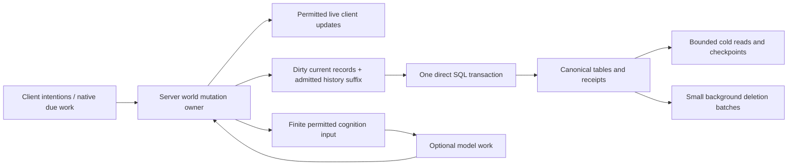

# Simpler saving and personal evidence — technical design

| Status      | Current progress                                                                          | Last updated |
| ----------- | ----------------------------------------------------------------------------------------- | ------------ |
| In progress | BK26–BK27 source is installed; isolated adoption and operating qualification remain open. | 2026-11-06   |

**Design selected 2026-10-31, 05:10 UTC. Architecture inspected at Macrofold/OpenLegend `7a197980a6d65909fd185244c2631b8055faadf0`, local `codex/stealth-runtime-01-evidence`.** The [feature specification](bookkeeping-simplification-feature-spec.md) owns intended play, preserved behavior and consequential choices. Architecture used and implementation reconciled 2026-10-31 10:59 UTC on `codex/bookkeeping-runtime-01`, based on `39aa9775a5cf48e4318227410d0ab5625f92db9d`. [BK](../maintainers/production-data.md#bookkeeping-simplification) owns remaining qualification; concurrent unrelated work is outside this project. The [integration contract](attention-and-scenes-runtime-design.md#14-integration-contract-for-the-completed-bk-ru-and-vw-branches) coordinates BK with RU consumers and VW tooling without duplicating this implementation.

**Architecture used for BK09–BK15 November 2, 2026, 06:49 UTC.** The [runtime companion](bookkeeping-simplification-runtime-design.md) is the current BK09–BK15 contract for live acceptance, independent support, due/pressure retention, precise row writes and captured pending reads. Connected semantic/storage checks and certified source-removal integration pass. The [completed-source AWS standard gate](../verification/performance/2026-10/bookkeeping-simplification.md#aws-operating-qualification) has no runtime/storage failure or pause but fails normal-speed acceptance; BK12/BK16 retain cleanup sustainability and operating acceptance. Architecture used for these repairs November 3, 2026, 08:45 UTC. The sections below retain the direct-writer and evidence semantics, with execution following that companion.

## 1. Selected architecture and current baseline

Use one authoritative in-memory world and one ordered direct PostgreSQL writer. Record only admitted experience. Keep immutable shared **substantial/stable** received values, inline small changing values, append personal history in explicit batches, and delete obsolete storage asynchronously. Keep existing semantic owners, command receipts, snapshot isolation, private-read fencing and paid-operation records. Remove the custom second durable application stage and storage layout state hidden on domain objects.

The installed [contact/group model](attention-and-scenes-runtime-design.md#13-proposed-structural-replacement-contacts-and-grouped-receipts) supplies native contact ownership, grouped checks and derived attention preparation. Adopt that model, not its minimal bulk-only or log-only alternatives. SR08/SR09 own those native conversions and SR10 their derived-state removal; BK integrates their storage once. The earlier segmented shared-value store, journal and accepted/applied fences are removed; the current writer and captured read projection are the sole persistence path. Its reception, selection, correction and current-default guarantees remain unchanged.



Ordinary native/player/NPC gameplay publishes its complete in-memory transition before the scheduled save. Protected effects retain their durable barrier. Cognition runs outside mutation ownership, waits for the fixed evidence cut required by paid dispatch and returns a proposal.

### Original replacement responsibilities

| Original mechanism                                                                                   | Reason it exists                                                                         | Target disposition                                                                                                       |
| ---------------------------------------------------------------------------------------------------- | ---------------------------------------------------------------------------------------- | ------------------------------------------------------------------------------------------------------------------------ |
| `WorldService.saveProgress` and `backgroundSave`                                                     | Save native progress while simulation continues                                          | Keep the responsibility and current cadence; use direct table writes                                                     |
| `WorldService.commit`, `store.commit`, canonical/history writers                                     | Atomic effects, history, receipt and revision                                            | Keep one shared direct transactional path                                                                                |
| `world-journal*`, `journal-*`, accepted/applied heads and query fences                               | Acknowledge a durable change package before ordinary tables catch up                     | Remove; PostgreSQL’s transaction log handles database crash recovery                                                     |
| `evidence-segments` layout/encoding weak maps and `world-records` placement previews                 | Preserve append suffixes and avoid repeat preparation                                    | Replace with explicit append batches and pure preparation; no dry-run side effects                                       |
| `retention-metadata`                                                                                 | Complete accepted/applied/pending ownership and membership while cold records are absent | Remove those global mirrors; retain only actual owner counters and scoped indexed SQL selection                          |
| `retention-record-metadata`, `received-record-references`                                            | Extract compact facts and exact references from real owners                              | Consolidate the useful pure extraction into the owning record codec; do not discard needed fields merely to delete files |
| `received-value-retirement`, partial block clearing, generations, application fences, temporary pins | Reclaim shared slots safely across several storage stages                                | Whole immutable value rows, one SQL reference projection, one serialized background collector                            |
| Source-version, account-retention and private retrieval owners                                       | Exact historical revisions, forgetting, source dependencies and disclosure               | Keep semantic responsibilities; remove redundant storage-stage bookkeeping through their common writer                   |

The preview defect was an internal incomplete-save inspection, not a player-facing preview: preparing candidate records could bind physical segment boundaries or positions to live objects before completeness was refused. For example, a previously saved two-entry prefix plus one appended entry could be regrouped as a single three-entry segment; the later real save reused that dry-run layout. The existing narrow fix makes that path read-only. The target removes the underlying hidden placement dependency, so an inspection has nothing to install. This describes a demonstrated coupling, not evidence that players lost data.

## 2. Ownership and contracts

| Owner                                        | Responsibility                                                                              | Must not acquire                                                                             |
| -------------------------------------------- | ------------------------------------------------------------------------------------------- | -------------------------------------------------------------------------------------------- |
| Domain perception/current evidence           | Received fields, exact variants, freshness/support and observer-local correspondence        | SQL state, physical row placement or a hidden live-world lookup during historical reads      |
| Domain experience/retention                  | Attention admission, personal frames, logical chunks, necessary support and expiry          | A second sensory pipeline, narrated episode classifier or model job on every expiry          |
| Domain knowledge/recognition                 | Actual learned people, names, places, methods and their minimal proof                       | Automatic identification from a private payload/source ID                                    |
| Server world service                         | Ordered mutation, immutable finite cuts, live publication and durability barriers           | Multiple writable copies of the world or independent per-feature commit queues               |
| Server store and existing typed repositories | Current-format rows, bounded batch execution, references and coherent read transactions     | Fictional retention policy, attention scoring or world-specific object categories            |
| Existing memory/model projection             | Select and render permitted facts; revalidate delayed results                               | Raw whole-world state, unfiltered storage records or access merely because bytes still exist |
| Installed world                              | Sampling, attention allocation, recognition, meaningful retention, supported senses/actions | Database layout or permission to bypass application privacy/spending                         |

Preserve existing typed source families and exact revisions. Ordinary neutral source revision, received variant, actor/local-contact identity, physical life, acquisition identity and current body grant are different meanings. No new universal revision number replaces them. IDs come from the existing allocation/identity owner; composite keys preserve field boundaries. Shared IDs remain server-private and world/timeline scoped.

## 3. Runtime representation

### 3.1 Current truth and current personal state

[PP08’s common receiving procedure](perspective-perception-runtime-design.md) owns channel-neutral sample/confirmation/availability/occurrence mutation through these contacts. BK executes the same SR08/SR09 representation and lifecycle conversion; it does not add a parallel sensor or receipt store.

The actual entity owns its latest physical position. A personal contact owns the last actually received pose, original measurement times, current availability and sparse field exceptions. The existing two compatible samples suffice for immediate motion queries; longer paths belong only to admitted recent history. An appearance observation can remain older than pose. Availability can change without changing the last measured value. One support change can affect several fields without writing separate loss events.

Use contact-owned received groups with immutable `received` content and typed part-partition metadata. Successful checks, recording and availability change metadata without replacing content. Partial coverage splits only affected metadata; a body's original acquisition pose remains evidence while independently acquired location owns its newer pose. The current codec saves content independently of clock partitions. Native correspondence, body, recognition and attention borrow selected values synchronously; explicit evidence consumers materialize proof through that same owner. [BK17 mechanics](bookkeeping-simplification-reception-design.md#31-stable-content-clocks-and-member-identity) define identity, masks and codec guarantees.

Keep minimal meaningful attention state—selection order, discovery progress, acknowledged versions, displacement anchors, cue expiry and partial scan cursors—but rebuild scores, candidate views, formatted descriptions and relation-dirty work at activation. Optional descriptive novelty uses a compact non-security content label; exact evidence, identity, permissions and correction never use that label. Producers supply actually received geometry changes to relation invalidation, so a numeric detail update need not restart spatial work. Those derived candidates are not persisted mirrors. Recovery preserves the same selection without taking a new sample or crediting familiarity again. Existing changed-key persistent collections prevent one contact update from copying every contact of an observer.

Continue existing isolated native drafts and structural sharing. Change only touched contact/feature records and seal completed values once at the owning transition. Do not copy every actor’s field map, iterate old history, or rebuild root entity lists to discover these changes. Exact maintained membership/count queries and established dirty-key lineage remain useful derived tooling. This project removes hidden **storage placement** caches, not every immutable memoization or spatial index.

### 3.2 Inline values and shared values

The native value owner supplies the representation for supported facets:

- **Inline:** pose/location scalars, small support/availability states and small numeric/categorical changes; one receiver frame in the personal frame header. Keep exact representation/precision, not rounded text. A differently received uncertain location remains different from an exact pose.
- **Shared immutable value:** stable body/detail bundles, descriptions, larger received geometry and similarly substantial typed values. Different clipping, field availability or precision creates a distinct variant. Reuse only a compatible value still owned by current or retained evidence; a process cache of old addresses is insufficient.
- **Existing occurrence source:** exact received speech, interactions and action-result families continue using their existing event/account source owners. Do not copy them into a second universal event store or replace a personal account with the global event.

Replace block-plus-slot addresses with stable value IDs in the shared-value owner. No mutable array of mixed live/dead payload slots, reused ordinal, per-slot reclamation generation or compaction address rewrite remains. A new variant allocates a new immutable value; an unchanged stable variant can be shared for as long as some real owner retains it. Preparation may cache a neutral value, but an unowned cached value gets a new ID when legitimately acquired again.

Sharing is an optimization of **values**, not occurrences. Two independent observations of an equal body can share bytes while preserving separate actual acquisition/confirmation times. Later recognition does not rename formerly anonymous evidence as if the observer knew the name then. Pose history stays in personal frames even though the same pose can also occur in current state; those have different lifetimes and purposes.

The native value owner always inlines validated body-pose, location, observation-frame and observation-header fragments, even above the ordinary 192-byte small-fragment threshold. Suitable rich stable content remains shared. This single representation policy prevents a valid coordinate sample or its changing proof header from allocating a pooled SQL row; it does not grant reception or retention permission.

### 3.3 Personal frames and chunks

The temporal owner stores ordered **received batches** containing sparse baselines, actual samples, availability/admission boundaries and discrete occurrences. Observer/life/epoch, batch order, entry and stable member indices identify evidence independently of physical placement. Current freshness partitions remain separate from recording admission. Attention entry dates an acquired baseline; subsequent actual changes retain their own clocks and frames. Equal checks update current freshness only. Bounded admission reserves coverage-terminal space; no late-closed value span or predecessor proof chain is stored.

A detached save packs only its new mixed actor suffix into immutable preferred 64 KiB physical blocks. Complete bounded native blocks remain indivisible; compact owner/clock/source/frame metadata makes each received record independently decodable without predecessor seeds. Packing and sparse correction preserve logical addresses and physical predecessor checks. Shared substantial values grant neither another observer's receipt nor private knowledge.

The pending save owns native suffix intent and one immutable in-flight cut. Failure preserves that cut and newer accepted work. Acknowledgement rebases placement onto the existing native tail without rebuilding logical eligibility. Ordered tuple bounds select candidate raw receipts; the actual owned entry/member proves source existence. Current state and finite permitted captures have their separate owners; historical readers do not replay expired events or reconstruct arbitrary old scenes. [Section 15](#15-compact-native-evidence-and-change-history) owns the current layout and lifetimes.

### 3.4 Lasting accounts and exact support

Promoting knowledge or retaining an account creates an independent minimal support record through the existing owner. Examples: the actually understood introduction supporting a learned name; the received position/extent and permitted label supporting a Known place; exact terms of an unresolved promise. Copy small necessary facts and their original provenance, or reference an already shared substantial value. Do not retain the entire recent chunk merely because one fact mattered.

An impression copies its selected claims and bounded provenance spans, explicitly without exact-coordinate/quotation authority. Existing exact summaries retain the complete exact sources they actually need, including transitive correction dependencies; this project does not quietly turn them into impressions. Existing native learned-method/identity rules still decide what constitutes sufficient support. No promotion occurs merely because a chunk is about to expire.

Correction metadata identifies source kind/ID/revision, observer scope and covered acquisition/claim ranges; it need not preserve every discarded raw body. Source-version bodies remain only for real exact consumers. Active obligations retain their admitted support until their owning completion/cancellation rules permit retirement. Required support is not an unlimited pool, and arbitrary `remember` output cannot claim its protection.

## 4. Direct transactional saving

### 4.1 One pending change buffer and one writer

Extend the existing dirty-record and append-intent owners. Keep one accumulating buffer and at most one immutable in-flight batch. A buffer holds changed current records keyed by canonical row identity, explicit removals, ordered admitted history suffixes and required operation receipts. It holds compact record values/changes, not a sequence of complete world roots.

For current state, a later unsaved update to the same row replaces its prior pending value. For history and discrete effects, preserve every admitted occurrence/order; only explicitly supersedable operational input may coalesce under its existing contract. A transient current value that was never durable and has no admitted receipt need not be inserted. Deleting a row that exists in the durable baseline remains an explicit delete. Required source corrections and receipt-dependent operations keep their barrier; do not treat them as an ordinary last-write-wins overwrite.

Capture swaps the accumulating buffer, so later changes enter the next buffer. A successful commit advances the durable mark and releases only the captured buffer. Failure never clears newer dirty work. If a newly captured baseline does not match the writer’s predecessor, refuse rather than rediscovering it from arbitrary latest rows. These are ordinary ordered saves, not a second durable journal.

Use one-second save opportunities, one accumulating live prefix and one immutable in-flight save. Five seconds since the oldest unsaved acceptance stops further ordinary admission. The combined pending-work ceiling is 64 MiB, with a 64 KiB emergency-Pause margin inside it; these are operational limits, not world retention policy. The former journal’s 32 MiB debt threshold is removed with that queue, rather than introducing another per-step encoded-debt census. SQL groups retain their encoded byte/row bounds, and an operation that cannot fit its finite pending allowance is refused before ordinary publication or uses its existing explicit durable path. Measure actual prepared bytes and decoded retained buffers separately; one in-flight save is not a universal heap bound. Do not queue multiple full captures or let pending history grow silently.

### 4.2 Routine native progress

1. Apply a coherent native transition and record its actual received evidence through existing semantic owners.
2. Publish its permitted state from server memory at the existing delivery cadence. Queue exact changed records and admitted history for the next save.
3. At the due save opportunity, capture the finite change buffer and release mutation ownership.
4. The ordered writer inserts new shared values, writes current records, appends frame batches/accounts and their reference projections, updates derived durable counters, and advances the single database head in one transaction.
5. After commit, publish the durable mark to existing paid-work/cold-read/checkpoint consumers. Evict only committed inactive records; the in-flight buffer retains unsaved evidence even if it leaves the hot simulation tail.

No ownership query, value cleanup, whole-world record walk or complete retention scan runs before ordinary movement admission. Validation of a newly received value happens at its producer/owner boundary; formatting and SQL preparation use that trusted result.

### 4.3 Ordinary commands and protected results

1. Admit current authority/request identity and recover an identical accepted or durable outcome before preparing another action. Active receipt-reader pins prevent a concurrent cold miss from losing an accepted result to cache eviction.
2. Prepare required cold evidence outside mutation, then recheck exact sources, control and native preconditions in one short turn.
3. Accept and publish the complete ordinary transition and receipt in memory. Fold changed current rows into the pending buffer while retaining ordered admitted occurrences and exact source-version plans.
4. Save one detached prefix with the existing writer. Its final storage checks concern expected revision, writer ownership and current-format integrity; an expired originating session cannot undo already accepted gameplay.

Spending, access/control, explicit privacy settlement, authoring/installation, checkpoints and restore retain their own durable barriers, ordering after preceding accepted play. Correction/editor factories prepare cold dependency/source-version closure outside mutation, then rerun the native operation against the current world; they merge only selected cold residency, reject changed dependencies and commit the complete privacy result. Ordinary publication and protected success are distinct. No automatic paid retry or new model cadence is introduced.

### 4.4 Database authority and recovery

Keep one database world head with current timeline/generation and revision, updated by compare-and-swap in the same transaction as its rows and receipts. Remove accepted/applied dual heads, journal table classification, replay eligibility proofs, journal-alignment overlays, application workers and alignment drains. Captured live reads project RAM deltas onto a recognized durable snapshot; that projection is ephemeral and cannot mutate authority. Derived search coverage has its own legitimate source/index revision and is not removed merely because it also uses revisions.

Use normal durable PostgreSQL commits; do not disable `synchronous_commit`, WAL or filesystem durability to improve timing. If a connection fails around COMMIT, do not execute gameplay again. Stop further writes, establish that the previous writer can no longer commit, then inspect the existing head and exact receipt using the normal store owner. A proved committed batch adopts its recorded outcome; a proved rollback preserves the earlier baseline; uncertainty stays a storage hold. This small recovery distinction prevents duplicate effects and is still needed with zero players. Reuse existing receipt/connection ownership, not a new replay service.

Paid reservations, uncertain provider attempts, authentication/control grants and operational restore records retain their existing durability and non-rewindable owners. A background save or manual gameplay restore cannot refund real spending or restore revoked authority. PostgreSQL handles interrupted **database** transactions; filesystem checkpoint publication and external paid outcomes still require their existing explicit protocols.

## 5. Physical rows, indexes and queries

Reuse current canonical table families and the typed record writer; names below specify required row meanings, not a new generic repository layer. A current-format cutover may rename obsolete tables coherently. No old reader or dual schema remains.

| Row meaning                       | Identity / essential fields                                                                                          | Required access path                                                          |
| --------------------------------- | -------------------------------------------------------------------------------------------------------------------- | ----------------------------------------------------------------------------- |
| Shared received value             | World/timeline + immutable value ID; typed payload; encoded bytes; nullable GC-candidate sequence                    | Primary key; partial candidate index                                          |
| Current contact/feature           | Observer/life + local subject/feature; compact current fields and inline pose; shared IDs; independent times/support | Exact actor/local key; actor owner scan at restore                            |
| Immutable recent block            | Actor/life/epoch + physical ID; mixed batches, used-part seeds and exact charge directory                            | Actor/received tuple, actor/time and bounded-bucket GIN with exact postchecks |
| Shared-value use                  | World/timeline + owner kind/ID + value ID                                                                            | Unique owner/value key; reverse value-ID index; FK to value                   |
| Personal lasting/required account | Existing source/account identity, permitted body and minimum support                                                 | Existing actor/source, eligibility and correction indexes                     |
| Source dependency                 | Existing exact source/derived owner relationship                                                                     | Source-kind/ID/revision + actor-scoped reverse lookup                         |

The shared-value use table is a **derived transactional projection of real owner fields**, not separately writable knowledge. Closed owner kinds are current contact/feature, recent page and retained exact-support/account owners. Reuse the canonical reference extractor for writes, current-format validation and capture. A polymorphic owner link needs exact owner-kind validation; do not pretend a foreign key to the value proves the owner exists. Delete owner links in the same transaction as owner removal. Startup/capture integrity verifies both directions once, not on every tick.

For a current contact, update use rows only when its shared IDs change; pose/freshness-only updates leave them alone. A recent page owns each distinct direct value once, inserted in bounded bulk with a unique owner/value key. Independently retained support owns its own closure, so retiring a page releases only that page's uses. Keep the selected/resident reference closure rather than mirroring cold ownership into JavaScript. Occurrence-survival queries reuse the 16,384-bucket GIN candidate index and exact source/person postchecks under actor/live-parent/removal fences; hash collisions grant no survival proof.

New values and their first owners commit together. Writes insert values before uses; removes delete/repoint uses before deleting a value. Ordinary updates use the existing bounded typed SQL grouping, parameter limits and one atomic transaction, not one statement per observer. Stable explicit keys eliminate list renumbering where order has no meaning. Ordered personal evidence retains its original order.

Cold queries select actor, lifetime, time/order, subject and eligible source metadata **before** loading JSON or expanding reference arrays. Existing candidate filters may be reused if their exact postcheck and measured plans remain sound; do not add redundant full-value GIN indexes. A page containing one desired source must not expand all unrelated sources before filtering. Query projections need only fields consumed by the caller. Current truth uses active indexes/counts rather than rebuilding entity arrays merely to count them.

Do not require every observation to be a SQL row. Immutable pages amortize exact samples across each save suffix without rewriting prior pages. Scalar and selection projections come from the same encoder; canonical payloads omit duplicate derived membership/reference arrays. SQL row/index/TOAST costs are measured separately from personal logical charges.

## 6. Expiry, forgetting and physical cleanup

### 6.1 Logical eligibility and accounting

The native temporal actor enforces world-owned age/count/byte rules by retiring whole optional native blocks at their oldest-record age boundary or prefix pressure. Its bounded directory holds block totals and derived individual membership, rebuilt from complete eligible metadata at activation/restore. No per-member closure ledger remains. Ordinary expiry reads no SQL, writes no per-page retirement marker and never expires current knowledge. Increasing an allowance cannot revive retired blocks; younger optional neighbors can disappear early.

Raw, pending, story, player/model, editor and cold readers apply eligibility before disclosure. A block-range or dependency-alias match only selects candidates; exact source existence requires its actual owned entry/member. Sparse correction/forgetting may remove individual fields without renumbering unrelated acquisitions, independently of whole-block expiry. Save/load compare complete current-format counters. Finite already permitted copies survive ordinary expiry, while explicit source/privacy withdrawal still fences affected output and current actions recheck current authority.

Expiry releases block charges and returns only affected local-individual candidates for pruning. Wholly ineligible physical blocks are collected behind the durable frontier with their value-use and story-access projections; a partly live physical block retains bounded inaccessible slack. Pending/in-flight references remain protected. Lasting-account maintenance stays separate: one query family per account table batches selected actors, deduplicates before hydration and preserves each actor's 64-account/4 MiB preparation limits and world-owned ranking. [Section 15](#bounded-saving-and-ownership) owns current accounting and failure handling.

### 6.2 One background collector

Reuse the existing maintenance scheduler and ordered database writer. There is no collector on command admission, no per-field database check, and no second writer allowed to race canonical ownership.

1. Wake when expiry is due or an owner releases values. Coalesce ordinary notifications over five real seconds; after a nonempty bounded slice, wait at least 250 ms before another opportunity while debt remains. One SQL transaction handles both candidate kinds, alternating priority so oversized pages cannot starve values. Startup can reconstruct outstanding work from persisted cutoffs and candidate rows.
2. Select the oldest wholly ineligible block/account rows using durable frontier metadata. Delete a bounded group and its use rows in one short transaction. Retain currently eligible partial pages.
3. When use rows disappear, mark their distinct value IDs with a nullable **candidate sequence**, in the same transaction. This is only an indexed hint that a whole value might now be unowned, not a pending-delete state machine or reference count. Repeated hints coalesce.
4. Select a bounded set of marked values. One indexed `NOT EXISTS` check against the reverse use index determines which have no owner. Delete those whole rows; clear the hint on still-owned values. No payload decode, slot compaction or traversal of every containing page is needed.
5. Release committed cold payloads from process caches independently of physical deletion. Only actual resident current/tail owners and in-flight writes require RAM; cold SQL ownership does not require resident bodies.

Examine at most 128 candidates of each kind; select at most 256 combined owner/value candidates and 256 KiB of selected encoded bodies per slice, reusing smaller applicable repository/statement limits. Count dependent use-row work too. Whole oversized admitted records/pages are processed alone. Never load a huge body just to decide whether its ID has a use. At most one cleanup slice is queued; give overdue cleanup one turn between foreground write batches through the existing fair scheduler, rather than waiting for complete idleness or draining an unlimited backlog ahead of a command. End each slice before scheduling another.

Keep physical storage/backlog metrics and existing operational storage-failure/backpressure controls. There is no separate gameplay admission check over all candidate bytes per movement command. These bounds limit each pass, not total physical debt: if cleanup cannot keep up, disk can grow despite bounded logical memory. Sustained debt and physical/index reuse are required operating acceptance, and failure blocks release; it is not permission to hide the growth by deleting required records. Storage exhaustion/failure stops authority explicitly. Do not claim a universal disk bound from an age window.

### 6.3 Why unsaved work and reads are safe without pins

The required invariant is: **every reference admitted after a durable cut either names a newly allocated value retained by that pending write, or derives from a still-eligible real owner.** Payload-address caches alone are never owners. This removes the need for a second pending/cold ownership census.

- If the owner exists in the durable cut, its use row protects the value while new pending owners are created. If a captured save releases that last durable use before a newer accepted owner reaches disk, the collector excludes live/pending legitimate owners until their own ordered settlement. No payload cache gains ownership from this exclusion.
- If the value was created after the durable cut, it has a new ID and is held in the pending buffer; cleanup cannot select an uncommitted row. Its first database insertion includes its real owners.
- If the last owner has actually expired/been removed, neither a held ID nor a weak cache can create a new reference. A new physical acquisition creates a new value/owner; a stale recall or promotion fails current eligibility.
- A cold reader selects the owner and its values in one bounded repeatable-read transaction, then copies the permitted finite closure and releases the transaction. PostgreSQL preserves that snapshot while concurrent deletion completes. There is no later fetch by naked payload ID outside the read scope. Publication still rechecks current expiry, correction and authority.

A temporary model/capture copy is independent bytes, not a storage pin or a retention extension. Future code must use the existing owning read/receipt admission API, never a raw `getValue(id)` that grants evidence or a cleanup exemption. Verify release/reacquisition, delayed cold read and in-flight save cases explicitly before removing the old guards.

### 6.4 Correction, explicit forgetting and source versions

Semantic correction/forgetting keeps the existing strict atomic owner. Select affected owner IDs through the source dependency index, load only their bounded records, and revoke/rewrite actual affected facts and derived sources together. For rare edits inside a page, replace that bounded page while preserving stable surviving acquisition identities; recompute its uses from the selected contents. Do not repack the entire history or weaken source-specific deletion into “drop everything nearby.” The correction owner’s existing whole affected-operation admission remains controlling when the transitive dependency set is large.

The existing operational privacy ledger retains actor-scoped forgotten IDs and correction links across gameplay and operational restoration. Reapply exclusions through the native experience owner without importing unavailable later correcting text; ordinary expiry is not explicit erasure. Old source-version bodies and derived vectors/text leave access immediately, then physical cleanup follows their current privacy obligations. For a shared value still needed by another observer, remove the requesting observer’s uses/accounts rather than deleting the other person’s evidence. Correction of the source itself reaches all actually affected owners through existing exact dependencies. Current operational privacy overlays continue to constrain checkpoints and provider-context reuse.

## 7. Reads, cognition, capture and restore

### Live and cold reads

Current gameplay/projection reads use the captured server state and existing permitted selectors. Ordinary display does not force persistence. For a history request spanning hot and cold evidence, select the bounded pending/hot suffix at the request’s acquisition cut, read eligible durable history up to that same cut, and merge by stable actor/life/acquisition identity. Duplicate overlap is removed; no generic whole-database pending overlay is introduced. Correction/forgetting and timeline/authority changes fence the entire read after waits. Expiry is checked again at publication, not only when selecting rows.

A request requiring a fully durable cut uses the existing `WorldService.whenDurable()`/durable-mark boundary, outside the mutation turn where possible. A paid decision may wait for its required trigger to be durable without delaying native movement or requiring a private evidence save of its own. Optional indexes can lag; their existing source/coverage checks remain. Search index coverage is distinct from the removed query-table application stage.

### Finite model inputs

Build context from selected current facts, relevant chronological changes, independent physical context, required evidence and selected memories. Reuse the existing materializer and `experience-context` projection; no internal artwork ID, storage use row, physical batch position or full raw body goes into the prompt merely because it exists in SQL. Labels, exact understood words, relative geometry and useful appearance remain when selected and permitted.

Keep current broad/static/discovery allowances and legitimate familiarity, rather than sorting an unbounded whole-world set first. No background sixteen-source sampler, personality/object whitelist, per-step semantic call or hidden global trajectory query is introduced. Source-fragment sharing does not replace exact observer receipts. A request holds a bounded selected copy, no old world root or database transaction during provider work. Late acceptance follows existing source, authority, spending and action-precondition owners.

### Pure capture and validation

Separate three operations: **describe/capture** returns explicit records from a selected complete cut; **validate** returns a result without mutation; **commit** installs rows and advances durable state. Reuse field codecs and validators across them, not a mutating save planner with flags such as “don’t bind this time.” Pure memoization is allowed only where it cannot change later write placement or authority.

A manual checkpoint first saves the required live prefix, then establishes one read-only database snapshot and streams all current/cold canonical owners plus exact dependencies through the existing checkpoint owner. This is an occasional complete operation, not a per-step full scan. Invalid/incomplete candidates fail without touching the live world, cursor, dirty buffer, cache layout or baseline. Check both refusal and subsequent ordinary save.

Same-format loading reconstructs IDs before links, validates references and complete counters once at the owning boundary, rebuilds transient indexes and resumes under existing pause/control policy. It never regenerates past model outcomes. Restore preserves current operational permissions/accounting/erasure, abandons stale work and gives clients a new baseline. Restoration replaces the complete recent-history rows, including physically retained retired chunks, inside its atomic transaction; it cannot leave newer batches attached to a restored prefix. Manual save files retain atomic publication and their existing catalog/retention; a checkpoint is self-contained, so deleting active database history does not break an existing complete file. Existing privacy transforms still govern loading that file.

Under the [development policy](../../AGENTS.md#development-save-policy), implementation updates one current format and replaces incompatible disposable gameplay data through existing setup. Preserve the union of useful authored opening content and separate assets, credentials, grants and real accounting. No migration tool, journal importer, compatibility alias or previous-layout reader is delivered.

## 8. Performance model and extension rules

The important dimensions are active entities, actual observer/source pairs, acquired changes, unique shared variants, retained personal history, and concurrent readers/commands. Hundreds of real observers receiving a changed source entails real receiver work; no index makes their distinct receipts free. Ten years of encounters must not become a ten-year hot ownership map or a per-tick scan.

An object existing or moving does not require a new autobiographical/world-history row for every possible observer. Preserve the existing common recording admission before constructing optional occurrence wrappers. Shared received history contains only real retained uses, not a permanent objective trajectory archive. Independently retained world events, checkpoint files, exact command receipts and operational accounting have their own retention owners; bounded personal memory does not prove those totals bounded. Remove obsolete optional sensory source closure through those owners, but never delete required receipts/accounting or silently reduce their retention to make this project look small.

| Path                 | Work allowed                                                                                   | Work removed                                                                                   |
| -------------------- | ---------------------------------------------------------------------------------------------- | ---------------------------------------------------------------------------------------------- |
| Native update        | Changed/due physical scopes and real recipients; cheap current updates; admitted frame appends | SQL ownership reads, all-history traversal, eager rich materialization and layout planning     |
| Routine save         | Distinct dirty current rows + new retained frames/values/uses; one direct commit               | Journal encode/write/apply, duplicate heads, full-prefix rewrite, separate ownership mirrors   |
| Cold recall          | Actor/source/time-index selection, bounded chosen batches and closure                          | Payload-first filtering, per-source sequential queries, global source-history reconstruction   |
| Expiry               | Due actor/chunk metadata and bounded deletion slices                                           | Per-facet loss/retirement records, command-path cleanup, partial shared-block compaction       |
| Full checkpoint/load | Complete canonical state streamed or validated once                                            | Codec mutation by preview, replay of effects, duplicate validation of unchanged installed data |

Keep only indexes with real readers: exact identity, actor/time/order, source correction and reverse shared-value uses. Measure their write cost and repeated delete/vacuum reuse. Batching reduces statement and row overhead but does not remove bytes, WAL, CPU or database contention. Native and SQL work are asynchronous only where the ownership contract permits; `async` syntax does not offload CPU. No extra worker or service is selected. Reconsider CPU offload only after measurements isolate substantial remaining encoding work and account for transfer/queue cost.

New sense/mechanic adapters provide exact typed value, original source/reception metadata, stable facet equality and required support through existing owners. The common value owner supplies its inline/shared representation rule. New retained record owners expose reference/metadata extraction once to the same writer and validator. They do not add a parallel retention service, branch on named game situations or expand raw shared values directly into prompts.

## 9. Delivery sequence and removal checklist

One focused tracker, [BK00–BK07](../maintainers/production-data.md#bookkeeping-simplification), owns implementation status. Complete the whole conversion; an intermediate direct-write benchmark does not finish the project.

1. **BK01: direct saving.** Reuse the existing synchronous writer for all supported world batches. Preserve ordered saves, exact command outcomes, protected barriers, checkpoints, paid durable-mark consumers and failure recovery under the current runtime companion. Remove journal initialization, admission/classifier proxies, application worker, replay/head fields and drain callers. Keep current layout temporarily within this coherent stage; no new legacy reader.
2. **BK02: explicit compact evidence.** Integrate SR08/SR09’s contact/group conversion once, with stable shared value IDs, inline small fields and explicit immutable frame batches from domain producers through current/captured/cold materializers, canonical schema, checkpoint streams and validators. Replace layout/ordinal weak maps for these owners. Preserve actual fact handles, timing, uncertainty and selected model/public projection. Run one complete deer/unknown-person continuation through PostgreSQL before broadening verification.
3. **BK03: simple ownership and minimal support.** Add the one transactional use projection and reverse index through existing codecs. Convert knowledge, recognition, names, places, exact summaries/obligations and source-version users to independent minimum support. Replace complete cold metadata mirrors with scoped SQL and actor counters. Include account/temporal/feature readers, not only sight.
4. **BK04: cleanup and residency.** Install whole-value collection and due chunk retirement on the existing writer/maintenance lanes; remove partial-block retirement, application-generation states, temporary assembly pins and cleanup from ordinary commands. Implement pure finite read/capture closure and the no-unowned-address reuse rule before deleting the old protection. Exercise concurrent source release, capture, save and correction.
5. **BK05: all callers and current-format readiness.** Coordinate SR10’s derived-candidate removal; finish service/HTTP/protocol/client, native-animal/knowledge, thought/reflection/recall, index/editing, checkpoint/startup and operational recovery integration. Remove obsolete utilities, flags, schema entries, diagnostics and tests tied only to old mechanisms. Update current-format initialization; replace incompatible development gameplay only through its owner. No fallback path or stub remains.
6. **BK06: correctness and review.** Complete the focused scenarios below, source review, static/build checks affected by implementation and canonical documentation reconciliation. Preserve separately owned vision/acoustic/combat and shared-restore scope.
7. **BK07: complete-game qualification.** Run the complete matched operating workloads after all removals. Fix obvious attributable residual waste; if normal play still fails, produce a fresh step-by-step diagnosis and concrete next design, preserving failed results. Do not claim completion from microbenchmarks or repeatedly run unchanged failing profiles.

After BK05, repository search should find no executable dependency on `WorldJournal`, journal table application, accepted/applied ownership mirrors, block-slot retirement, storage placement binding during preview, or mutating evidence-layout caches. Historical verification documents may retain those names. Pure shared reference extraction, immutable memoization, current-format validation, paid-attempt journals and operational restore recovery are not blanket deletion targets.

## 10. Acceptance and measurement

### Required correctness passes

Use existing focused checks and disposable real-consumer scenarios; this design does not request a new maintained test suite or a full unit-suite run. Group cases into connected journeys instead of testing every helper independently.

| Case                                    | Pass condition                                                                                                                                                                                                     |
| --------------------------------------- | ------------------------------------------------------------------------------------------------------------------------------------------------------------------------------------------------------------------ |
| Shared walk and slow background save    | Two actual connected clients receive continuing permitted motion while the routine save is held; direct commands retain their promised durability; saved native state and personal evidence restore together       |
| Strict effects and uncertain completion | Transfer/action/speech records and receipts commit atomically; duplicate identity executes once; conflicting identity refuses; disconnect around commit resolves the stored outcome without replay                 |
| Unknown person and deer sequence        | Intermediate attended generic facet changes, received interactions, independent detail times and contact transition survive current/hot/cold/save paths; no pre-attention or unseen route appears                  |
| Crowd/static context and interpretation | Existing daughter/cliff and broad-over-capacity cases preserve permitted bodies/features and exact semantic input; no extra model calls or all-pairs stored graph                                                  |
| Sharing and correction                  | Compatible body details share one value; different variants remain separate; forgetting one observer does not erase another; source correction withdraws affected derivatives and stale replies                    |
| Minimal retained support                | Name, recognition, Known place, learned-method and active exact terms remain usable after unrelated recent chunks retire; deliberately forgetting their exact support revokes the appropriate dependent capability |
| Capture and collector races             | A read gets one permitted complete closure or explicit stale/missing outcome; delete/reacquire and pending append cannot create dangling references; no temporary reader grants lasting access                     |
| Read-only refused preview               | Repeated valid and incomplete inspections leave dirty state, storage layout, pending removals and later saved meaning unchanged                                                                                    |
| Expiry and physical reuse               | With providers disabled, multiple fill/expiry cycles keep logical pools bounded, delete obsolete batches/values/versions/indexes, retain required support and make cleanup progress under foreground traffic       |
| Restart and restore                     | Actual process interruption before/after commit recovers a coherent cut; current-format reopening and manual checkpoint restore retain useful starting content and current external authority/spending             |

Mechanical forcing can establish native input/data behavior, not natural model quality. Reuse applicable live semantic evidence where unchanged. If changed projection alters what the model receives, run only the affected admitted semantic examples under the standing budget and report uncertainty; provider spending is not part of a native throughput test.

### Complete performance evidence

Retain [SR07’s existing workload/gate definition](attention-and-scenes-runtime-design.md#10-acceptance-and-reporting): standard five-minute ordinary play and the substantial active scene must meet their existing normal-clock pass; 300 active actors, faster clocks and mature/ten-year history distributions are required measurements rather than new unsupported capacity promises. Do not waive an existing gate here. Compare the same actual movement, population, observations, attention/retention settings, clients and provider policy. Verify the workload did the intended work before interpreting timing.

Attribute each step: native movement and due sensing; received current-field/temporal construction; draft sealing; save preparation/encoding; mutation queue waits; SQL execution/commit/WAL/index writes; client projection/delivery; maintenance/cold reads. Report elapsed time and completed game time, actual counts/bytes, p50/p95 command and first-motion latency, heap and process RSS, pending-save age/bytes and physical cleanup debt. Separate active SQL work from waiting and physical cleanup from logical expiry. No opaque percentage-only diagnosis.

Compare fresh, sustained ordinary play and retained-history-heavy cases. Include a dense first exposure, because stable-history savings do not eliminate initial recipient fan-out. Compare total value/use/current/batch/index/WAL bytes, not only shared JSON size. Grow lifetime encounters independently of currently active subjects. Measure cold retrieval and repeated storage/index reuse after deletion; do not label a warmed cache cold. Use existing diagnostic and setup tools rather than a new benchmark framework.

**Structural pass:** no ordinary command/step scans all historical owners, no save rewrites earlier immutable batches, no pose-only write churns stable value-use rows, no preview changes future writes, and no separate journal/application stage remains. **Operating pass:** required ordinary/substantial gates plus sustainable saving/cleanup; a queue that merely hides growing debt fails. **Reported measurements:** wider capacities and tradeoffs with all failures retained. **Human evidence:** interesting remembered consequences and responsive connected play remain distinct from correctness or CPU measurements.

Design completion supplies none of these runtime passes. Broader hosted failure recovery, new region ownership and unimplemented social/vision features retain their existing trackers rather than becoming prerequisites through incidental mentions.

## 11. Alternatives, evidence and maintained records

PostgreSQL already writes a recovery log before reporting a durable commit and restores table changes after a crash. That supports removing an additional application replay stage; it does not prove a particular batching strategy faster. [PostgreSQL WAL](https://www.postgresql.org/docs/current/wal-intro.html). Its foreign keys/constraints protect relational references, but owner eligibility and private perception remain application semantics. [PostgreSQL constraints](https://www.postgresql.org/docs/current/ddl-constraints.html).

Unreal’s selected `SaveGame` data and asynchronous save API illustrate separating gameplay state from save work; Unity’s [persistence guidance](https://unity.com/blog/games/persistent-data-how-to-save-your-game-states-and-settings) likewise leaves game-state selection to the application. Neither engine prescribes OpenLegend’s server database or guarantees multiplayer durability. [Unreal saving](https://dev.epicgames.com/documentation/en-us/unreal-engine/saving-and-loading-your-game-in-unreal-engine). The existing OpenLegend server already separates live native advancement from background saves; reuse it rather than invent a client simulation or new actor framework.

Rejected for this project: universal append-only world truth (latest state would require replay or a second projection); copying every rich observation (wastes stable sharing); sharing every scalar (unnecessary joins/lifetimes); rewriting open chunks each save (repeats prefix bytes); one row per coordinate/facet (excess row/index work); a global in-memory ownership mirror (history-sized hot state); arbitrary TTL deletion of still-owned values (broken evidence); and moving the existing journal into another worker (retains its stages and accounting).

No blocking product question remains. The selected hybrid and direct writer are implementation targets; actual throughput, appropriate cleanup batch tuning and player enjoyment remain evidence obligations. Future expansion must earn a separate mechanism through an actual consuming need, not the possibility that richer mechanics might exist.

- Behavior and journeys: [feature specification](bookkeeping-simplification-feature-spec.md).
- Tasks and dependencies: [BK00–BK07](../maintainers/production-data.md#bookkeeping-simplification), [BK24 lifecycle/qualification](../maintainers/production-data.md#bk24--reception-cost-removal) and [BK25 proposed experiments](../maintainers/production-data.md#bk25--native-execution-and-current-read-reduction-proposed).
- Limits: [BKS-L01–BKS-L05](../limits/persistence.md#bks-l01--direct-transactional-saving-target); current world retention: [attention profile](../worlds/base/attention.md).
- Preserved contracts: [save/load](../save-and-load.md), [memory](../memory-architecture.md), [identity](../identity-and-references.md), [storage performance](../performance/storage.md), [engine/world boundaries](../engine-and-world-boundaries.md).
- Earlier architecture and measured limits: [attention runtime](attention-and-scenes-runtime-design.md), [journal experiment](performance-overhaul/journal-contract.md), [complete-game diagnosis](../verification/performance/2026-10/attention-runtime.md).

## 12. Database-work reduction target

[The runtime companion](bookkeeping-simplification-runtime-design.md) is the detailed owner of installed database-work reduction: typed mutation intent, metadata-only current writes, independently retained support, background quota/cleanup, owner-held authority checks, exact banner reuse and ordinary acceptance before saving. These extend BK/RU/PP08 owners; [BK08–BK16](../maintainers/production-data.md#database-work-reduction) distinguishes source completion from unmet operating gates. [BKS-L06–BKS-L08](../limits/persistence.md#bks-l06--maintenance-headroom-target) owns constraints. The later representation/lifetime companions below own their specific replacements; no new journal/application stage or legacy API is selected.

## 13. Compact representation

The [compact reception companion](bookkeeping-simplification-reception-design.md) records the BK17–BK19 foundation; the batch companion below supersedes its span/check storage and expiry mechanics. That predecessor batch format was schema 54. Section 15 now owns current-format schema 55’s sparse native blocks, with no old reader, second timeline, writer or model maintenance loop. Semantic and operating evidence are tracked separately by [BK17–BK19 and BK12/BK16](../maintainers/production-data.md#received-state-and-history-representation). Source implementation does not establish normal-speed or population qualification.

## 14. Received batches

The [batch and lifetime companion](bookkeeping-simplification-batch-design.md) records the November 4 BK20–BK23 foundation: one receiving transition, stable logical addresses, mixed save suffixes and retirement outside ordinary SQL commands. Its exact-check encoding used first-use descriptors and predecessor support so retained historical checks could decode independently. Those representation and accounting mechanics are superseded by [Section 15](#15-compact-native-evidence-and-change-history); they are not another supported format or reader.

The receiving/current/attention/retention/direct-writer owners remain shared. Current schema 55 retains independently timed personal knowledge, ordered meaningful changes and occurrences, shared substantial values, exact sparse correction and independent required support. It removes unchanged-check history, held-state carrier replay and per-member closure accounting. [BK20–BK23](../maintainers/production-data.md#received-batches-and-lifetime) retains the foundation's evidence; [BK24](../maintainers/production-data.md#bk24--reception-cost-removal) owns the coordinated current conversion and pending operating qualification.

## 15. Compact native evidence and change history

**Implemented November 5, 2026; operating qualification remains open.** Architecture used **2026-11-05 05:39 UTC**, Macrofold/OpenLegend `codex/stealth-runtime-01-evidence`, design `348a9fb965e6e1e7a8810060e30e5c6e36685a9b`. This section owns current schema 55's coordinated sparse-change conversion. The [feature contract](bookkeeping-simplification-feature-spec.md#12-playable-personal-knowledge-and-sparse-recent-history) owns intended play and deliberate fidelity losses; [connected evidence](../verification/performance/bookkeeping/2026/2026-11-05-sparse-reception.md) covers native and PostgreSQL semantics. AWS comparisons and operating gates remain separate from source completion; no unmeasured speedup or capacity is claimed.

### Alternatives and selection

| Candidate                                                     | Removes                                                                                                                                                                              | Retains / tradeoff                                                                                                                                                                                |
| ------------------------------------------------------------- | ------------------------------------------------------------------------------------------------------------------------------------------------------------------------------------ | ------------------------------------------------------------------------------------------------------------------------------------------------------------------------------------------------- |
| A: compact native representation with exact historical checks | Expanded native proof graphs, recursive remeasurement of those graphs, repeated conversion before saving                                                                             | Exact check chronology, masks, predecessor reconstruction, exact closure accounting and partial-member pressure remain. Smallest fidelity change, but substantial recurring bookkeeping survives. |
| B: compact current state and change-only history              | A's graph overhead plus historical unchanged checks, second recording scans, predecessor-proof replay, per-member byte/closure ledgers and recent locators inside learned identities | Current independent freshness, received changes, meaningful events and independent learned support remain. Historical continuity becomes explicitly sparse; optional expiry retires whole blocks. |

B is selected and implemented after the matched experiments and source review. A records the alternative fidelity tradeoff; reconsidering exact historical checks requires a demonstrated worthwhile player experience. Do not revive the old journal, keep parallel native formats or equate an experimental feature cut with implementation.

The remainder specifies B unless explicitly labeled shared. Alternative A would retain BKS-L10's exact confirmation/retention branch with compact native records; it is not installed and does not meet B's no-history-on-unchanged-check contract.

### Scope, ownership and cost decisions

The [expanded removal matrix](../verification/performance/bookkeeping/2026/2026-11-05-subsystem-ranking.md) supports reducing the work that reception creates, not deleting attention or wildlife. Current perception and history account for about 47% of the sampled wall-time partition; freezing selection also removes downstream detail/history, so its gain is not selector CPU alone. Animal freezing improves progress in two pairs but worsens command latency and removes real activity. Sight-only 60/30 nearly matches changing all sight/context/relation periods; slowing relation work has no demonstrated additional benefit. Snapshot failure is a separate correctness/size problem, not the main steady slowdown. These are overlapping effects, not additive savings or forecasts.

Keep current native intervals, collision/contact, routes, action effects, saved randomness, required speech/outcomes, familiar-person knowledge and world-owned animal behavior. Remove intermediate representation and redundant work before changing sampling. No sleeping offscreen bodies, route prediction from private truth, group mind, new model-call loop, worker per observer, second scheduler or replacement mutable-world engine is selected. Reuse the already delivered source/observer spatial indexes, dirty sight scopes, animal work queue, ordered writer and read lane. Candidate A remains the documented comparison, not a parallel implementation to maintain.

| Responsibility                     | Semantic owner to extend                                                                        | Removed work                                                                                                                                       |
| ---------------------------------- | ----------------------------------------------------------------------------------------------- | -------------------------------------------------------------------------------------------------------------------------------------------------- |
| Physical change → due sensory work | `perception-timing.ts`, `encounter-cache.ts:prepareExposure`, `kernel.ts:updateEncounters`      | Boolean escalation of targeted obligations into full sight; unrelated selected-target detail work where complete dependencies prove it unnecessary |
| Personal current knowledge         | `perception-evidence.ts`, `perception-current.ts`                                               | Per-field proof expansion, repeated group search, timestamp-driven semantic changes                                                                |
| Selection and native relations     | Existing `attention.ts` / relation owners and shared body-read scope                            | Outgoing plus entrant inspections, duplicate ranking, full preparation just to find a deadline                                                     |
| Recent chronology / support        | `temporal-evidence.ts`, existing experience/knowledge owners                                    | Eager empty history builders, current-to-history rescans, repeated confirmation records, recursive proof sizing and prefix rescans                 |
| Animal decisions / movement        | `AnimalWorkQueue`, `reconcileAnimalWander`, existing controller, route and flight owners        | Keep canonical eligibility; the E2 witness was measured and removed. Reduce observer fan-out upstream without changing movement/reactions          |
| Save / export                      | Existing canonical codec, writer, checkpoint, temporal-page and received-value ownership owners | Re-encoding unchanged content; exporting or auditing collectible-only payload closure                                                              |

### One receiving owner and compact native state

Extend `perception-evidence.ts` / `perception-current.ts`, rather than putting another adapter after the expensive existing graph. The actual receiving result supplies stable channel/exposure/body-life ownership, typed fields or existing immutable rich-value IDs, exact acquisition/measurement times and successful coverage. Shapes, uncertainty and acquisition roles remain typed data; compact does not mean converting every meaningful value to a number.

Fields that were actually co-checked refer to one current check-scope stamp. Preserve independent measurement dates; establish or split coverage only when it actually differs. A later broad position check cannot advance face/detail support. An unchanged successful result updates that scope's current stamp once, without creating historical tokens, bindings, proofs or admission calculations for every field. Unknown/partial coverage must retain separate scopes; an observer-wide timestamp cannot imply every visible source was checked. There is one writable freshness representation, not group clocks plus per-field mirrors.

Make this distinction before constructing history. The receiving adapter compares supplied typed values and uncertainty with its existing current fields, using an exact stable content revision only where that producer owns the complete relevant dependencies. A new sample ID, receiver frame ID or global world revision cannot stand in for a changed value. Compare small coordinates directly; retain/reuse rich content through its existing immutable value owner. Do not serialize/hash a whole scene or build the old proof graph to discover that it was unchanged. The receiving result separates checked scopes, changed fields, availability transitions and distinct occurrences. Current freshness consumes checked scopes; optional recording consumes only admitted changes/occurrences and explicit track boundaries. A new receipt time does not become a new semantic source revision. Separate current-content generation, an immutable dated received acquisition/change, and explicit revocation: moving from P to Q invalidates prepared current reads but does not falsify P at its original time or cancel a thought that captured it. New values/exposures get their actual received identities; only explicit correction/withdrawal, privacy and timeline rules revoke the older fact. Claims requiring current presence and physical proposals still recheck current support.

Use the following minimum contracts within those existing types; the names describe responsibilities, not a new package or public protocol:

| Data                           | Canonical contents and lifetime                                                                                                                                                                                                                                                                                                                                                     |
| ------------------------------ | ----------------------------------------------------------------------------------------------------------------------------------------------------------------------------------------------------------------------------------------------------------------------------------------------------------------------------------------------------------------------------------- |
| Current exposure / typed field | Parent observer/life; local subject routing and physical-life binding; complete channel pin and exposure; typed field/part → inline value or shared rich-value ID, original measurement/acquisition tuple, direct semantic source and one check-scope ID. Internal routing never grants recognized identity.                                                                        |
| Current check scope            | Latest successful check time and actual availability/unchecked/input-dependency guard for its member field parts. A full-scope confirmation updates one stamp. Partial coverage splits only affected members; delete empty scopes. There are at most as many scopes as live field parts, not one scope per check. Different value measurement dates can share a confirmation stamp. |
| Synchronous received delta     | Checked-scope IDs; ordered actual typed value/uncertainty changes with address, times and direct source; availability transitions; distinct occurrence references; changed local correspondence. It is consumed in this native phase, never saved as another scene or retained across an await.                                                                                     |
| Current read scope             | Observer/life/channel and current dependencies plus lazily prepared body eligibility. Owns no sensory truth or history. Mutation ends affected reuse; immutable captured requests own their finite copies separately.                                                                                                                                                               |

Validate source families and received payloads at their existing admission boundary. Domain consumers pass typed addresses, not parsed display keys. Stable semantic dependencies preserve their source family's identity/revision; a new current check is not a new source occurrence. Add no universal numeric source-version convention. An authored source edit or explicit correction/revocation changes its appropriate semantic dependency even if displayed text stays equal; ordinary received-value supersession preserves the older dated observation.

For example, one observer receives position P and appearance A at time 10. A position-only check at 20 sees P again: only position's current check stamp changes, appearance remains dated 10, and history gains nothing. At 30 the position is Q: current position becomes Q and, if attended, one compact dated position change is appended. Save/restore retains Q checked at 30 and A checked at 10. This is deliberately insufficient to enumerate every old successful check, while retaining the useful movement and current uncertainty. The same rule applies to any supported typed detail; it is not a movement-specific exception.

Apply acquired changed values and current availability through that owner, then pass its already-known changed fields/subjects to attention, relations and recording. An actual history change is a changed received value, uncertainty, availability or exposure, or a new meaningful occurrence. Confirmation dates, new check revisions/source-header IDs and bookkeeping object identity alone are not changes. Classify from the producer's known content/coverage deltas and typed value semantics; do not deep-compare or serialize every unchanged field. For geometry, compare the received position/bearing/region and uncertainty in its meaningful coordinate frame, not a new frame ID. Store only frame components needed to interpret that type, shared once at the receiving/block boundary; the observer moving must not fabricate movement of every stationary point. A changed bearing origin/uncertainty can be a real changed observation. Equal values on a new exposure/admission still require a dated baseline, and two separate equal utterances remain distinct occurrences. Native reactions still use actual acquired current geometry/positions. Do not rebuild a scene for deadline selection or rescan current contacts to discover the same changes. Reads validate requested observer scope at their boundary and consume trusted owned values; they do not recursively prove every field's acquisition again. Source/grant, schema, privacy and actual action boundaries remain validated.

Current reads use a direct typed address (subject, channel/exposure and field) plus its shared check scope. Make the canonical exposure's typed fields directly addressable; replace `currentContactNativeFacet`'s repeated group search and `currentNativeFacet`'s address parsing in typed internal callers. An underspecified lookup may use a derived field-to-exposure index, with zero/one/multiple eligible matches producing unavailable/value/ambiguous respectively. It stores addresses only, never copied values or private cross-observer identity associations. Maintain affected keys at acquisition, loss, correction and exposure replacement; rebuild once on restore. Repeated known-address reads do not rediscover all contact groups.

Extend `prepareCurrentBodyReadScope` as the single synchronous preparation owner. The caller creates one scope after the relevant receiving stage, then passes it explicitly to attention candidate/selection readers, relation preparation and any compatible selected presentation. Prepare observer/channel eligibility once and lazily memoize each requested body's eligibility, including unavailable results. Field access reads the canonical value and its check stamp directly; it does not build an acquisition-proof wrapper. A subsequent current/body/sensory/permission mutation ends the affected scope; the post-detail stage gets a new scope. Do not carry a mutable scope across an await or reuse it for another observer, life or exposure. Independently captured immutable input retains its existing bounded contract and grants no future action authority.

| Caller family                                   | Shared work / boundary                                                                                                                                                                              |
| ----------------------------------------------- | --------------------------------------------------------------------------------------------------------------------------------------------------------------------------------------------------- |
| Attention candidate scoring and final selection | Same permitted body/position/description references and body admission; no second preparation or lookup for the same subject in that cut.                                                           |
| Relation anchors and deadlines                  | Reuse eligible anchor keys/scalar deadlines; actual evaluation shares current geometry inputs within its cut. No rich proof construction merely to ask when work is due.                            |
| Player/context formatting                       | Materialize only selected already-permitted values; reuse input when the captured observer/cut matches, otherwise prepare a new scoped read. Public or model egress keeps its own permission check. |
| Recording and recognition                       | Consume the receiving owner's typed changes; do not reread the whole current scene to reconstruct them. Learned support remains independently owned.                                                |

Preserve the current motion owner's existing single previous point plus canonical latest location. Replace `CurrentMotionSample`'s rich earlier proof with its minimal actually received value/time/source/correspondence data; `currentMotionValue` / `currentMotionFacet` derive selected motion context through the same direct read scope. Do not add a second paired-position or trajectory store. These two samples support native relative-motion cues only under their actual continuity and uncertainty; they do not reconstruct the unseen path or require a recent-history lookup.

These mechanisms remove repeated work as well as repeated code. Calling one common helper repeatedly is insufficient when it repeats a group scan, eligibility preparation or wrapper allocation each time. Delete superseded preparation in callers instead of adding a cache around every existing helper. No new general cache service, saved prepared scene or mutable evidence authority is introduced.

The residual CPU trace includes capability/status preparation under native readers, but the isolated component cuts show no large gain. Reuse `NativeStatusPreparation` only within its already valid coherent native cut; do not add a cross-cut status cache to this conversion. A proposed longer reuse witness would be a separate before/after experiment requiring complete active-effect, lifetime, authored-condition, foreign-source and deadline dependencies; uncertain coverage retains current evaluation. Preserve elapsed-time integration and native deadlines. Reduce the objects and wrappers inside the existing transaction/publication system rather than replace the mutable-world framework.

### Attention and native relation work

Feed the existing attention owner a compact received delta, not another reconstructed evidence scene: semantic content changes, current availability/exposure transitions, position changes, and explicit salience/goal/familiarity changes. Freshness-only reception does not dirty candidate descriptions, selection entries, presented-change revisions or learned identity rows. Current measurement dates remain available to consumers independently. Presenting a newer timestamp is not presenting a new event. The installed `changeRevision` source/ordinal/acquisition tuple currently causes entry replacement on equal remeasurement; replace that dependency with actual received content/availability revision. Discovery still uses meaningful unconsidered description changes, and the existing stability/displacement/familiarity rules remain world-owned.

Maintain the existing candidate preparation from those deltas, updating affected score inputs once; a knowledge-owner familiarity change dirties the corresponding local individuals explicitly rather than polling every candidate's knowledge on every sight pass. Policy replacement may rebuild once. Reuse one prepared selection for native consumers and the finite context cut. Keep actual selection changes and their entry baselines; do not freeze attention or suppress genuine new subjects to achieve a timing result.

For **one observer**, attention priority means how strongly each eligible received subject competes for that observer's detail places. Existing world rules combine physical urgency/change, unfamiliar descriptions, explicit focus/current action, familiarity, incumbent stability and the reserved discovery opportunity. Another observer computes its own selection from its own evidence and knowledge. No AI call is needed for this selection; no other character's private priorities or unknown identity may be borrowed.

Use the existing received-phase owner to run one optional selection/detail opportunity for that observer:

1. Apply actual loss/unchecked boundaries and receive due broad presence, placement and permitted outward cues. Actual broad changes received while a detailed track is still active remain recordable under that admission before its later selection exit; choosing a replacement cannot erase the broad observation that triggered the switch. Broad-only candidates do not acquire rich descriptions, public-attribute expansion or movement history merely to compete for attention. Detail-only due work uses eligible current broad state without forcing another broad scan.
2. Update only changed candidate inputs, also handling expired cue/stability/discovery deadlines and explicit focus/action/familiarity changes. If no relevant input/deadline changed, reuse the previous selection. Otherwise invoke the existing selector once using broad cues and **previously received** detail with its original dates. A scalar candidate scan is allowed; rebuilding rich evidence for every candidate is not.
3. Install the final eligible selection and its entry/exit boundaries, then acquire due optional detail once per selected subject. Even when all ten places change, no outgoing subject receives a fresh detailed inspection just because it occupied a place on entry. An entry baseline uses only already-permitted values; a subsequent actual sample produces its own ordered change.
4. Apply acquired detail through the same receiving owner; deliver its changes to current knowledge, recognition, recent recording and native relations. Detail-derived salience marks the next selection opportunity dirty. It cannot recursively rank or request another same-opportunity optional inspection. A later selection change waits for the next existing world detail opportunity, within that interval, with unchanged clocks until actual reception.

For an observer whose ten places contain A–J, broad cues may cause K to replace J. The only detailed inspections that opportunity are the selected A–I and K, at most ten. J's earlier observations remain eligible history, and its track ends at its actual last observation; no fresh J detail is invented. If K's new detail suggests another shift, it affects the next opportunity. This deliberately gives up the installed extra inspection of outgoing subjects and immediate reranking after new detail. Required speech/contact/outcomes, actual loss and native reactions retain their own boundaries; memoryless physical detectors do not acquire an autobiographical attention system.

Assign the phase split to `kernel.ts:updateEncounters`, which currently prepares sight geometry before selection inside `reconcileVisualEvidence`: prepare/apply due broad reception → select final detail subjects once → prepare remaining geometry for those subjects through the existing bounded round-robin/batch owner → apply detail → complete independently due context, native relations and recording before publication. A detail-only opportunity selects from held broad facts before ray preparation. Reuse same-instant broad visibility results; new entrants cannot trigger duplicate or unmetered synchronous fallback rays. The physical instant and existing native mutation ownership remain fixed through geometry-worker/cooperative yields. Only detached IDs/scalars and owned preparation survive an await; create a fresh synchronous body-read scope afterward. Split the existing phase functions rather than introduce a service or scheduler.

Replace the `beforeAttention` detail predicate and entrant second pass in `reconcileVisualEvidence`; remove `reconcileAttendedTemporalEvidence`'s second `updateAttention` call and its same-opportunity `requestSightWork` feedback. That reconciliation consumes the already selected tracks and received changes instead. Reuse the existing phase/deadline state to prevent duplicate entry at the same opportunity, rather than adding another scheduler. Shared physical preparation may span compatible observers, but their receipt, scoring, selection and private read scopes remain separate. The held-member experiments do not predict the exact gain because those diagnostic cuts also leave vacancies empty.

The same mutation owners maintain eligible relation-anchor keys and the next scalar deadline on contact, selection, target/direct-cue, latch and policy transitions. Reuse existing admission/sensory invalidation for observer/subject physical life and participation, perception capability/channel-pin changes and dirty sensory scopes; cached eligibility cannot outlive those guards. Asking when work is due must not repeat current-body admission/metadata reads and annotation scans. The installed deadline helper does not build full proofs; full geometry/proof materialization occurs later in relation evaluation. Due relation evaluation consumes changed permitted positions/features or changed availability/support/freshness eligibility, explicit withdrawals, unfinished scan continuation and actual latch-clear deadlines under the existing bounded candidate/scanning policy. Unchanged coordinates alone cannot suppress these meaningful transitions. It does not construct and validate a full rich scene separately for each anchor or retain an all-pairs relationship graph. Share an immutable per-observer geometry projection within that actual evaluation cut, with independent freshness and uncertainty. Native meaningful cues still arrive before optional AI interpretation; saving, prose preparation and cleanup remain outside that dependency. Narrow relation/ranking experiments determine priority within this conversion; the broad attention cut alone cannot allocate its gain among ranking, relations and changed detail acquisition.

### Due sight and moving animals

**Installed baseline:** ordinary sight is already change-fed. `queueSightChange` coalesces source scopes; `prepareExposure` selects observers using old/new spatial neighborhoods; `sightScopeDue` supplies aligned opportunities. Clean completed scopes do not need periodic sensing. Extend this path instead of introducing a dirty-region service, per-pair notification graph or visibility-crossing predictor.

**Experiment E1a — route due work by cause.** Replace the boolean `measurementDue` escalation from `nextPerceptionMeasurementAt` through `takeRoutineObservation` with the existing owner’s typed due reasons and affected keys. The same earliest deadline bounds the native interval; it does not authorize all kinds of sensing. Geometry continuation finishes geometry; recognition/dwell and missing-current repair inspect their affected subjects/channels; selection/relations can consume held evidence without buying a fresh sample. Initialization, changed physical life/channel or unknown dependency coverage retain their required full acquisition. An empty completed continuation must retire its deadline; incomplete computation waits for its actual next eligible continuation and never fabricates absence. Do not create new recurring clocks to represent these reasons. Incidental broad samples formerly caused only by unrelated geometry/recognition deadlines deliberately disappear; other bodies wait for their next legitimate opportunity, retaining older truthful dates. This changes accidental over-sampling, not a required event-time recipient.

**Experiment E1b — narrower detail acquisition.** At a detail-only opportunity, derive requested IDs from the final selected subjects intersected with the existing complete dirty-target set, then add selected entrants lacking the relevant current detail and independently due recognition/repair targets. Required targets outside selection use their own admission; they do not silently consume optional detail slots or gain long-route recording. Broad changes received before selection still follow the earlier ordering contract. Keep requested IDs separate from returned spatial candidates so a dead, departed, occluded or out-of-range target produces the appropriate checked availability transition instead of vanishing from the work list.

| Input change                                                                                | Scope that must be reconsidered                                                                                                                                                                           |
| ------------------------------------------------------------------------------------------- | --------------------------------------------------------------------------------------------------------------------------------------------------------------------------------------------------------- |
| Known target movement, final stop, outward detail or participation change                   | That target for affected observers, including old/new neighborhoods and previously held exposure; retain the final stopped sample                                                                         |
| Selected object/remains change                                                              | Include object/remains dirty IDs; `changedPeople` and its visible-person reverse membership alone are incomplete. Until coverage is extended, conservatively inspect selected objects when `objectsDirty` |
| Observer pose/heading/body/sense/range/capability/life, occluder/map or unclassified change | All affected final selected targets; preserve broad acquisition/loss and invalidation obligations                                                                                                         |
| Recognition/dwell, explicit source repair or selected entry                                 | Named subject/channel work; full only when the owning producer cannot establish narrower coverage                                                                                                         |
| Geometry scan continuation, relation latch or priority/discovery deadline                   | Its own geometry/interpretation work, not an automatic full physical sight pass                                                                                                                           |
| Unknown/overflowed change coverage, fork, restore or definition replacement                 | Rebuild from current authority and use the conservative complete scope                                                                                                                                    |

An unchecked source is not confirmed merely because its unchanged value was reused. Skipped clean subjects receive no new measurement/check stamp or history. Finishing covered revision R clears only R's requested scopes; later R+1 dirtiness and pending broad work survive. Do not postpone dirty work by resetting its due time on each movement. A stationary observer may benefit greatly; a moving observer legitimately invalidates many rays and must still receive the complete required broad scene. This is an uncertain query/invalidation change: compare equivalent received results at unchanged cadence before integrating it. Count routine, detail and forced work separately by reason; lower configured frequency alone does not prove fewer acquisitions.

**Animal movement uses the same rule, not a special recording exception.** An animal advances through the existing physical route/controller. Its changed pose updates the existing spatial/sensory owners once. Each affected observer may acquire a broad current position; only actually admitted detail/required evidence becomes history, through the same typed delta as a person or object. Stop/turn/contact/flight/arrival/outcome boundaries keep their real order and support. An animal's own native detector continues through its existing evidence path; lack of human-style memory is not blindness. Existing idle animal observer retirement remains in place.

**E2 — tested and rejected; no witness is installed.** The [matched comparison](../verification/performance/bookkeeping/2026/2026-11-05-sparse-reception.md#matched-structural-comparison) found no CPU benefit sufficient to keep the added dependency machinery. Canonical queue reconciliation and all wildlife rules remain. The conditions below describe any future reconsideration, not remaining BK24 implementation. `AnimalWorkQueue` already owns due clocks and feed cursors. Do not rebuild it or add another timer. The remaining broad `participants.ambientMovers` and forecast/endpoint eligibility passes can revisit `advanceFlight(..., 0)` / `reconcileAnimalWander` after position-only changes. Extend existing dirty reasons to distinguish movement execution from controller eligibility only where the owner proves its complete inputs. Eligibility must wake for alive/participation/controller/body/profile/capability changes, action/route/flight transitions, needs/food/territorial/threat inputs, due clocks and changed supported targets. Unknown or foreign dependencies retain the current path. Narrow each existing pass against its own predicate/deadline; a wander-eligibility witness cannot gate foraging, refuge or time-zero takeoff. Do not make one animal-wide cache whose dependency set either rechecks on every need update or suppresses another owner. Actual flight/movement integration, feeding, escape review and saved RNG draws cannot be skipped. No changed wander distance, pause, speed, reaction period or animal count is selected. First isolate avoided eligibility work with equal controller decisions/routes/events/RNG at fixed game-time endpoints; reject the shortcut if wake coverage cannot be demonstrated. The animal-freeze result is not evidence that controller caching itself will help.

**E1c — existing-cut shared rich-source preparation retained.** The matched comparison removes duplicate construction without a new cache; an isolated throughput benefit remains unproved. `captureExposure` / `withPublicAttributes` prepare animation, status presentation and public-attribute dependencies before selection; `prepareVisualSourceValues` can prepare some of the same content again. Extend the existing immutable source/detail-token preparation so a compatible content revision is materialized once when actually consumed, and released with that preparation's existing lifetime. Preserve cheap broad outward cues and complete dependencies needed for salience, masking and public change detection. This is not a general cache or permission reuse across observers. First compare first-arrival and moving-source preparation counts, allocations and full-call cost: some of this content is needed by broad reception, so lazy scheduling alone may save nothing. Leave the eager branch if simpler and no measured cost is eliminated; do not make this conditional experiment a prerequisite for the core conversion.

### Recent records and their lifetime

Reuse the existing temporal/experience owner with a compact native record: stable observer/life/timeline ownership at block scope; local subject or existing non-entity subject type; received time/order; kind; typed changed values with their actual measurement dates and flat typed semantic source identities (family, ID, observer scope and meaningful revision where applicable). Equal raw IDs from different source families or witnesses never collapse. Small moving points stay inline; stable descriptions/geometry may reuse existing shared values. Use one compact authoritative RAM record/block shape through production, append and storage. Remove rich `ReceivedBinding`/`TemporalFacetReference` shadow graphs from those producers; selected proof/context formatting is a read projection only. Adding another save-only codec does not implement this design.

Create recording machinery **lazily**: current-only scope/delta work precedes the acquisition builder and its frame/order capture. On the first admitted change, occurrence, entry baseline, terminal boundary or independent required-support request, allocate the compact append builder and the necessary immutable frame/order. Freshness-only work allocates no history builder, frame, receipt ID, binding, ownership set or byte-admission graph. Existing current check ordering may advance; history identity must not advance solely to encode a confirmation.

A newly admitted baseline/change has the current recording time and order, even when it retains an older held observation after capacity recovers. Original acquisition/measurement dates remain on its fields; required occurrences keep their actual receiving chronology. The record constructor consumes the already computed typed delta and copies only values that actually survive the synchronous transition. `captureTemporalCurrent` must not repartition every checked field to discover history, and `flushReceivedBatch` must not snapshot a rich native graph, recursively size it, or rescan the sizes of every earlier batch. Maintain the existing actor's append count/reservation and block aggregate incrementally; actual encoding runs once per sealed block. Current, recording and required effects finish atomically before publication; optional formatting, SQL and AI remain outside. Making history asynchronous would require a queue of the same captured data and is not selected as a work reduction.

| Transition                             | Required behavior                                                                                                                                                                                                                                                                                                                                                                                                                                |
| -------------------------------------- | ------------------------------------------------------------------------------------------------------------------------------------------------------------------------------------------------------------------------------------------------------------------------------------------------------------------------------------------------------------------------------------------------------------------------------------------------ |
| First reception                        | Establish current contact/local correspondence. Broad reception alone does not start an unlimited route or prose memory.                                                                                                                                                                                                                                                                                                                         |
| Detail admission                       | Record a bounded baseline of then-permitted details with their original dates. No earlier route is acquired.                                                                                                                                                                                                                                                                                                                                     |
| Unchanged check                        | Update current check scope only. No recent record, identity locator, pooled-value use mutation or history save work.                                                                                                                                                                                                                                                                                                                             |
| Actual change or occurrence            | Append the received changed values or existing permitted event reference once in order. Same-time intermediate changes remain distinct. Speech/outcomes retain their meaningful exact content.                                                                                                                                                                                                                                                   |
| Loss, detail exit or recording refusal | Record one transition/gap for each independently timed ending scope of an existing admitted track; coalesce equal subject/time/reason/coverage boundaries. Keep last actual values/dates. Repeated absence appends nothing. Admission reserves one terminal marker within the bounded history/control accounting; a full payload buffer cannot suppress the already reserved close. Resume with a dated baseline, never bridge omitted movement. |
| Recent expiry                          | Stop access when the oldest record in a block reaches the age horizon, or when block pressure advances the prefix frontier; reclaim behind the durable cut. Younger neighbors may disappear early. Reads apply this eligibility even before cleanup. Current knowledge and independent support survive.                                                                                                                                          |
| Correction/forgetting                  | Revoke selected semantic evidence/fields and dependent claims, preserving unrelated witnesses/acquisitions. Rewrite only affected bounded blocks when necessary for erasure.                                                                                                                                                                                                                                                                     |
| Restore                                | Restore current values with original independent dates and sparse records/capsules; rebuild disposable indexes once. No resensing credit, fabricated missing route or arbitrary historical-scene reconstruction.                                                                                                                                                                                                                                 |

Use the existing per-track recording continuation for a finite terminal reservation, not a separate gap log. Admitting a baseline reserves its payload plus the constructor's bounded closing-marker bytes/slot; if either cannot fit, keep current perception/attention but decline optional recording. At most the configured active tracks and their supported field parts hold reservations. A split transfers its per-part units instead of duplicating the original budget. The first loss, exit or payload refusal consumes the ending scope’s reservation into an ordinary terminal record in the same blocks; repeated refused/absent checks append nothing. Ending a track does not uncharge that saved marker. A new baseline needs newly available capacity and begins a new explicit recording segment for its fields; pressure retirement can free whole old optional blocks. While refused, retry only on an actual recording opportunity after capacity or required inputs change, not through a tight retry loop. Expiry of the old baseline does not pin its block; an eventual terminal marker can remain a partial record with no invented predecessor. Account reservations, open blocks and pending-save bytes together. Required support retains its separate complete admission and may not be replaced with an optional gap.

A terminal marker describes **recording coverage**, not necessarily a perceived event. Carry reason (unchecked, confirmed unavailable, detail exit or optional refusal), affected field parts, boundary time and last actual received time separately. Geometry baselines and terminals use the already allocated observer-local observation ID as their subject; the shared exposure episode remains in their origin. Several terrain fragments from one exposure therefore close independently. Empty geometry terminals retain the spatial-context marker so body-scoped `includeGeometry` reads find them without inventing body associations. Coalesce only matching subject/time/reason and coverage cutoffs; independent freshness boundaries remain distinct. Leaving attention does not mean the observer saw disappearance; a scheduler/coverage gap does not prove physical loss. Missing old baseline/context remains explicitly partial. Every selected history/player/model reader consumes these distinctions rather than rendering all terminals as a departure.

Each cold record has its typed changed value, local subject identity/minimum descriptor and required direct semantic references; decoding it must not require replaying a predecessor proof chain. A missing older baseline means partial descriptive context, not permission to synthesize it or copy the whole current scene into every block. History APIs return actual sparse observations/changes. They must not manufacture a complete scene at an arbitrary old timestamp. Current-context and pending-capture callers use their finite captured state; historical movement readers consume the ordered samples and gaps. Independently dated body and position baselines can join within their supported scope; a field baseline alone does not end the whole track. Endpoint comparisons depend on the participating tracks and actual geometry gaps, not proof-list length or an unrelated companion. Truncated reads retain supported points but omit endpoint comparisons when a separating terminal may be missing. An outgoing changed/lost track may retain its last actual confirmation date as one terminal fact, without preserving every earlier repeated check or asserting uninterrupted observation.

### Meaningful knowledge, identity and delayed interpretation

Keep names, recognition profiles, places, methods, familiarity and promises in their existing knowledge owners with independently retained minimum support. A claim has direct semantic evidence/claim dependencies, including claim-to-claim edges when a summary depends on another summary. This is not a recursive sensory proof graph copied into every field. Contrary testimony remains attributed new evidence; explicit correction/forgetting uses the existing protected revocation owner.

Learning may not depend on optional history being created. Replace `currentRecordedCarrier` → `retainTemporalCurrentSupport` → `selectedCreditAttentionContact` coupling: first ask the existing world knowledge policy whether this actual permitted current/check/occurrence supports a due learning mutation, then atomically admit its minimum exact capsule and that mutation. No recent-carrier lookup, route pin or capsule on a mere check without a learning effect. If complete support admission fails, install neither learning nor its capsule; current reception and independently admitted history remain valid. Keep name/language sources, cross-channel association and original correction dependencies explicit. Familiarity changes notify only their actual current local candidates. Incidental contact credit retains its existing finite optional support/retirement policy; giving credit does not make every first-seen individual or capsule required/permanent. Independently qualifying recognition, names, notes or work keep their own support. Unsupported incidental individuals can still disappear when current/recent/eligible support ends.

Remove `ObserverIdentity.recentReference` and its per-entry updates/whole-row encoding. Recent availability belongs to the existing bounded recent owner: derive individual membership from current contacts, optional blocks and independent support. Each block carries one unique-individual set; the existing actor recent owner maintains counts only on block add/drop, sparse edit and actual contact/support changes. Readers never scan recent/cold bodies for individual liveness. Rebuild from complete eligible block metadata plus the recognized pending cut at startup/restore. Source-existence reads instead select the actual entry/member: range and dependency aliases alone are not proof. Deletion-only familiarity pruning treats cold or bounded selected residency as unknown, retaining an eligible root until block retirement or explicit revocation; that uncertainty grants no evidence or action. For candidate A, existing projection first/last-use transitions can provide the same derived membership without altering exact retention. Neither candidate adds a lifetime identity ledger. Actual learning/familiarity changes still write through the world knowledge owner; temporary observation bookkeeping cannot dirty those records.

At thought admission, retain one finite immutable permitted input and its direct semantic dependencies under existing request byte/deadline bounds. Ordinary freshness updates or optional expiry do not revoke that already captured information. Ordinary retention removes history eligibility/ownership without issuing the semantic-withdrawal fence used by pending thoughts. Explicit source withdrawal, forgetting, privacy/control change and timeline replacement still fence affected output through the existing pending-dependency owner, including a captured source whose optional storage has already expired. Use the bounded active request dependencies; do not add lifetime tombstones or a second revocation registry. A missing expired source row is not a changed semantic revision: the captured dated fact stays usable, while explicit correction/forgetting must still match the active dependency after that row expires. Normal later movement or a different shirt invalidates a current read, not the older truthful observation. Recheck current body/life/action prerequisites before effects. No saved-history pin, paid retry or recurring model loop is introduced.

### Bounded saving and ownership

Keep the current ordered writer, atomic accepted prefix, one-second target saves, backpressure and protected spending/access/privacy barriers. Current check stamps coalesce to their latest values at the save cut. Current records contain compact received state, never the history recording machinery or repeated proof graphs. Seal every nonempty open block included in the scheduled save cut, even when below its preferred target; later arrivals begin the next block. This preserves the one-second save target without rewriting a growing saved prefix. Batch these small rows through the existing writer. Encode each new immutable block once; no full saved prefix, arbitrary scene baseline or repeated rich-body serialization per save.

Replace exact per-append deduplicated closure-byte accounting with the [bounded ingress/block contract](../limits/persistence.md#bks-l11--sparse-history-and-bounded-capture-proposal). Count admitted small records/slots and bounded rich payloads cheaply before retaining them; enforce actual encoded limits when sealing a block. A large incoming value is bounded before copying. A pending-save byte ceiling still protects the server. Actual encoded sizes and the cached sizes of each block's unique owned rich values are charged once and reused; short references cannot hide retained payload. Conservative repeat charging across blocks replaces exact per-entry deduplication. Do not rediscover sizes by walking unchanged graphs.

Current contacts, sealed optional blocks and independent capsules each own their actual rich-value references. Mutations supply added/removed ownership at those boundaries. Freshness-only updates perform no reference-diff tree walk. Whole-block retirement releases its unique ownership list once; rare sparse correction recomputes only the affected block. Keep current/durable pending protection and transactional deletion. No new reference store or second mutable knowledge authority is needed. Block retirement uses the oldest-record age boundary, preserving the age maximum while deliberately accepting bounded early loss of neighbors; it never waits for the youngest record and discloses already-expired observations.

### Retained-state checkpoint and recovery

A snapshot represents eligible logical state at one captured durable revision, not all physical rows awaiting deletion. Extend the existing `writeCheckpoint` repeatable-read worker, expected-revision check, short capture barrier and streamed atomic publication. Establish one trusted internal retained-selection contract at that cut, shared by the following callers. It is SQL/read preparation from canonical state, not a saved index, cleanup job or second retention authority.

| Family                        | Exact selection                                                                                                                                                                                                                                                                                                                 |
| ----------------------------- | ------------------------------------------------------------------------------------------------------------------------------------------------------------------------------------------------------------------------------------------------------------------------------------------------------------------------------- |
| Optional temporal blocks      | Omit only blocks positively proven collectible by the owner's committed frontier and whole-block eligibility predicate. Keep a partially eligible block whole with its required decoding metadata; missing/corrupt ownership is an error, not expiry. B's final block predicate replaces old charge-directory logic everywhere. |
| Temporal history perspectives | Omit only the perspectives associated with omitted blocks through the existing actor/life/epoch/received-coordinate relation used by physical collection. Preserve surviving occurrence perspectives and non-temporal accounts.                                                                                                 |
| Shared received values        | Keep the union referenced by retained current/motion owners and retained blocks. Values owned only by omitted blocks or no canonical owner need not export. Inline independent minimum support remains with its canonical account.                                                                                              |
| Other data                    | Keep learned knowledge, private/cold history, source versions/annotations, events and retained-event total, clocks/frontiers, definitions and native continuation unchanged. Operational accounts, grants and spending are not gameplay retention data.                                                                         |

Implement the selection in the existing temporal-page/received-value ownership SQL helpers; the checkpoint owner supplies it explicitly to `checkpointLines` / `tableRows`. Filter scalar metadata before reading/detoasting bodies. Do not change `liveEvidenceRowSql` globally and assume dependent families follow it. Do not decode expired blocks to decide eligibility, build world-sized JavaScript ID sets, or rematerialize every retained ID for each 64-row page. Start with indexed owner/metadata joins under the captured snapshot; shared predicates must use the same retention meaning as reads and collection.

Scope `ReceivedValueOwnership.validate` to the **same retained canonical owners and relevant derived uses** before capture/full recovery. Its installed all-physical audit unnests even collectible pages; leaving that audit unchanged would do much of the discarded work before filtering output. Preserve positive validation of every selected reference and relevant projection, including a value shared with an omitted owner. `received_value_uses` remains derived, omitted from saves and rebuilt once on restoration from selected canonical owners. Missing selected values or inconsistent selected ownership refuse capture/restore. Never disable current-format validation to make export fit.

Convert `checkpoint.ts:writeCheckpoint/checkpointLines`, `record-pages.ts:tableRows`, full `WorldRecords.load(false)` / `store.ts:load`, and `GameSaves.read`/payload validation together. Each caller retains its existing capture/validation scope and applies this selection only to the families it consumes: full repository recovery reads canonical world rows and audits event count, while checkpoint payload validation also covers captured history. Do not add an all-history-perspective pass to repository loading. Publish the accepted baseline only after its required coherent validation; normal bounded resident recovery keeps its existing tail behavior. Operational backup's gameplay portion already calls `GameSaves.create` and uses the same selection; its separate `OPERATION_TABLES` stream stays complete and unfiltered. Manual save, automatic checkpoint and pre-load recovery all go through the same owner. Restore still applies current privacy, timeline and authority rules; a formerly valid checkpoint cannot revive subsequently forgotten private facts.

Split `SaveFiles.writeStream`'s combined allowance guard into safe typed failures: `recordBytes`, `totalBytes`, then `records`, preserving its check order and limits. For the already encoded next line of size S, check `recordBytes = S`, `totalBytes = acceptedBytes + S`, then `records = acceptedLines + 1`, advancing accepted counters only after all pass. Report the rejected candidate and accepted-before-failure bytes/lines separately, with observed/allowed numbers but no payload text, JSON reparse or second encoding. The line count includes manifest/table markers, not just database rows. Preserve 1 MiB per record, 256 MiB per package, two million lines, existing capture deadlines/watchdog, concurrency, retries and previous-file preservation. The measured failures do not identify the first exceeded allowance. A successful stream must retain exact revision, checksum and row metadata; a settled/exit-zero worker with failed capture is not success.

**Experiment E3 — live export query work.** A smaller output alone does not establish faster selection. At one fixed logical world, compare negligible versus large collectible physical debt and mixed live/dead ownership; inspect actual SQL visits, loops, buffers, ownership-audit expansion, payload bytes, memory, snapshot age and concurrent command tails. Reject a query that repeats whole-history work per page or loses selected closure. If the unchanged size limit still fails, diagnose the exact remaining record/table/limit before choosing another representation; do not raise caps or silently truncate meaningful accounts. No claim is made that this export change alone reaches normal speed.

### Work and lifetime growth

A crowded first encounter still needs observer-specific acquisition for each genuinely received subject; shared descriptions do not share private grants. Prepare compatible immutable content once, establish compact current contacts, and create historical baselines only for admitted detailed tracks. Broad visibility outside those tracks remains usable. Repeated unchanged reception scales with actual checked scopes, not every field multiplied by history/proof/storage representations. Ranking scales with eligible candidates when meaningful inputs change; detailed recording scales with admitted actual changes and occurrences. These are target work counts, not measured CPU predictions.

Optional storage/resident work is bounded by current contacts, active detail tracks, bounded open/sealed blocks and their unique rich-value ownership. Current contacts include temporary unchecked support awaiting the existing sensing opportunity. Preserve the existing availability-ended → field/group removal → empty-contact removal contract on actual loss, departure or channel/body-life invalidation; the current-contact map is not a lifetime last-seen ledger. Do not age-delete still-perceived subjects. Last-seen information survives only through eligible recent records or independently retained support, not a second current-contact quota. Ordinary expiry visits retiring blocks and their owned-value lists, not all lifetime encounters. Prune an unrecognized local individual when current, eligible-recent and independent-support ownership all disappear. Existing world memory/support quotas and meaningful consolidation still govern learned material; the engine does not preserve a permanent ID or locator for every object ever encountered. Cold selected reads use existing actor/time/source indexes and bounded block expansion; corrections may visit the genuinely affected retained blocks. No ten-year replay or full historical-scene reconstruction is a routine operation.

### Delivery and removal checks

Implement in independently reviewable stages; current-format producers/readers switch together at each coherent boundary. Intermediate branches may be incomplete, but no parallel legacy reader or codec is a delivered result.

1. **Current reception and lazy recording entry:** establish the typed current/check/delta contract and direct scoped reads. Convert all supported visual, auditory, tactile, occurrence, inspection, self/outcome and native consumers through their existing adapters. Remove unchanged-field proof construction, empty recording builders and semantic revisions driven by confirmation. Preserve current-format round trips and existing private cuts before proceeding.
2. **One selection and sparse history:** convert entry/exit/change/gap recording, finite terminal reservations, required support, history queries and context formatting. Remove `beforeAttention` outgoing inspections, entrant resampling, second `updateAttention`, current-to-recording rescans, `ReceivedBinding.parts` / predecessor carriers and arbitrary historical-scene reconstruction. Convert quotas, identity liveness, explicit correction/forgetting and pending-request fences, then current SQL codecs/exports/restore together. Remove per-member charge/closure directories and saved recent locators. E0 below measures this complete semantic conversion at unchanged cadence.
3. **Targeted due work and moving-source fan-out:** implement and qualify E1a due-reason routing and E1b dirty-target narrowing separately, then E2 only against the accepted baseline. E1c is a conditional source-preparation experiment only if its remaining cost warrants it. No new sensor, speculative path predictor, animal policy slowdown or additional controller scheduler. Keep conservative scope when complete coverage is unavailable; a rejected experiment leaves that path unchanged and its outcome documented.
4. **Checkpoint closure:** implement the retained export and explicit allowance outcomes; qualify E3 and actual successful manual/automatic/recovery/operational captures. Do not retain removed charge machinery for export. SL08 owns the failure fix, PF00 the profiler outcome fields.
5. **Ordinary admission:** complete the [existing service-owned boundary](bookkeeping-simplification-runtime-design.md#53-sessions-controls-and-story-display) independently, with protected SQL fences and bounded ready-command fairness. The removal matrix found no throughput gain from merely moving that await; E4 must check responsiveness as well as progress.
6. **World timing and integrated acceptance:** run E5 at the final structural baseline before selecting the new default; reconcile world definitions, limits and selected-world consumers together. Exercise the scenarios below and the complete [caller conversion inventory](bookkeeping-simplification-batch-design.md#caller-conversion-and-removal-checklist). Use BK12/BK16/BK23's existing normal-speed, retirement and scaling gates; no new parallel qualification queue.

Use the actual producer/consumer paths to demonstrate these work-removal checks before a speed claim:

| Scenario                                                             | Required result                                                                                                                                                                                                                                             |
| -------------------------------------------------------------------- | ----------------------------------------------------------------------------------------------------------------------------------------------------------------------------------------------------------------------------------------------------------- |
| Repeat an unchanged admitted observation                             | Current checked-scope stamp advances; zero new optional records, recording bindings/proof graphs, rich-content encodings or reference-owner mutations. Older unchecked fields retain their dates.                                                           |
| Replace one or all ten selected subjects                             | At most one optional selection pass and one due detailed inspection per final selected subject; no outgoing-only detail pass, empty-slot shortcut or same-opportunity resample. Required event reception is measured separately.                            |
| Ask for the same body/position from several readers                  | One body-eligibility preparation in the matching synchronous scope; repeated known field accesses neither scan groups nor reconstruct proofs. An intervening loss/correction invalidates reuse, including a previously cached unavailable result.           |
| Two observers receive different views of one person                  | Sharing immutable content does not share detail, freshness, local identity, attention score or permissions. Restore preserves the distinction.                                                                                                              |
| Delay command preparation, then change control or repeat the request | Native advancement remains eligible during preparation without starving ready commands; stale commands refuse before effects, duplicates produce one effect, and protected operations retain SQL checks. Measure command latency/skips with clock progress. |

For C eligible coarse candidates, K selected detail subjects and D actually changed received fields, the target is coarse sensing plus selection over compact candidate inputs when needed, at most K optional detailed acquisitions per opportunity, and history work proportional to admitted D/occurrences/boundaries. Current checks still cost work per actually checked scope; attention does not make the whole scene O(K). Zero changed values must not incur field × confirmation × history-representation expansion. Keep candidate maps bounded to current eligible/continuing exposures under existing owners; no lifetime ranking index or new priority-queue framework is required.

### Gameplay and lifecycle walkthroughs

These use normal producer/consumer paths, not named situation handlers. They exercise reusable OBS/ANI/CARE/SOC repertoire meanings without adding new hunting, rescue or conversation mechanics.

| Scenario                                                | Required behavior through current → history → consumption                                                                                                                                                                                                                                                                                                                                                                                                                                                                                                             |
| ------------------------------------------------------- | --------------------------------------------------------------------------------------------------------------------------------------------------------------------------------------------------------------------------------------------------------------------------------------------------------------------------------------------------------------------------------------------------------------------------------------------------------------------------------------------------------------------------------------------------------------------- |
| Ordinary walk past trees and animals                    | Physics moves actual bodies. Dirty sensory work acquires only due permitted scopes; broad subjects remain visible, but no route/identity record is written merely because each was checked. Equal acquired values advance current scopes only. Known labels stay in independent knowledge.                                                                                                                                                                                                                                                                            |
| Crowded first arrival                                   | One compatible source preparation can serve multiple receivers, but each receiver gets its own actual grants/local identities. One broad acquisition and final selection; at most K optional subject-detail acquisitions. Only selected baselines/changes and independently required facts enter recent history. Required event recipients are never capped at K. Report first-exposure allocations separately from steady work.                                                                                                                                      |
| Person passes anvil, kitchen and observer               | Retain each admitted changed sample and actual interaction in order, including same-time distinct operations. No nearest-object destination inference, motion-only episode boundary or endpoint-only simplification. A kitchen label needs supported observation/interpretation, not a sign; actual naming/interpretation stays with existing owners.                                                                                                                                                                                                                 |
| Stale face, fresh position; unknown reappearance        | Partial scope updates preserve the old face date; same-channel address and cross-channel ambiguity remain exact. Unknown local subjects cannot borrow a canonical name or familiarity. A lost/reappearing exposure has a new admission baseline and no invented intervening route.                                                                                                                                                                                                                                                                                    |
| Daughter, cliff and fifteen pursuers                    | Broad received bodies and independently acquired feature context remain available beyond ten detail slots. World familiarity/focus/cues choose detail; generic relation queries use received positions/bounds and explicit incomplete coverage, never all pairs or hidden daughter/enemy meanings. Native effects and already-supported cues precede optional AI. Faster context/relation deadlines do not fabricate fresher body positions. No guaranteed warning or rescue when the needed geometry/identity is unreceived; missed short opportunities stay honest. |
| Attended deer, focus exit, full buffer, later return    | Keep last actual position/date and the distinct coverage terminal; selecting it again admits only a current dated baseline and later changes. Required support never disappears to make optional room. Whole-block expiry may erase optional neighbors, not an independently learned fact.                                                                                                                                                                                                                                                                            |
| Correction during pending thought / after source expiry | Explicit correction/forgetting fences the affected captured dependency, including after ordinary optional expiry. Unrelated new movement or another observer's correction does not revoke the dated evidence. A delayed action validates current body, permission and game conditions.                                                                                                                                                                                                                                                                                |
| Cold restore, pause or branch of state                  | Rebuild scopes, candidate/identity membership and due plans from current-format authority once. Preserve clocks, life/epoch, RNG, gaps, original detail dates and current privacy overlay. Pause freezes game-age expiry; restore grants no new acquisition or old-track replay.                                                                                                                                                                                                                                                                                      |

The distinctive play being protected is a lively world with fallible, persistent witnesses: the hunter retains a deer's selected recent path, the passerby sees it without accumulating a diary, a quiet portrait gets its fair discovery turn, and two witnesses can give different truthful accounts. These are capabilities of the existing observation/knowledge design, not extra automatic narration or model spending. Connected checks prove mechanics; uncoached play still must establish useful noticing, readable uncertainty and enjoyment under the selected cadence.

### Isolated experiments and adoption gates

Uncertain changes must remain independently attributable, not combined with a policy slowdown and reported as one speedup. These are implementation-time measurements, not work executed by this design. Disposable comparisons do not require shipping permanent flags or duplicate formats. Use the [standard AWS worker](../../.agents/rules/verification-workers.md#standard-speed-test-worker), frozen source/seed and matched setup; never compare a failed warmup/capture or CPU-instrumented case as an ordinary speed pass.

| Experiment                                       | Comparison and required correctness                                                                                                                                                                                                                                                                                                                                                                                                                                                                       | Benefit to establish / stop condition                                                                                                                                                                                                                                                                                                               |
| ------------------------------------------------ | --------------------------------------------------------------------------------------------------------------------------------------------------------------------------------------------------------------------------------------------------------------------------------------------------------------------------------------------------------------------------------------------------------------------------------------------------------------------------------------------------------- | --------------------------------------------------------------------------------------------------------------------------------------------------------------------------------------------------------------------------------------------------------------------------------------------------------------------------------------------------- |
| E0: compact current/sparse recording             | Complete stages 1–2 versus installed source at **20/10 sight, 20 context/relation**. Same actual physical activity, independent freshness/identity, required evidence, ordering of retained acquisitions and explicit gaps; the outgoing-detail/same-opportunity extra inspections and historical confirmation diary are deliberate removed fidelity, not required matching output.                                                                                                                       | Zero history builders/records/encodings/owner mutations on unchanged checks; no prefix sizing or second selection/detail pass. Measure allocations, current writes, history records/bytes, save work, heap and full-game progress/tails. Structural counts alone do not qualify speed; investigate a regression rather than stacking more features. |
| E1a/E1b: due-reason and changed-target narrowing | Isolate due-reason routing first, then dirty-detail filtering against the accepted preceding stage at unchanged cadence. Match actual received values/times/availability for every still-warranted check, native outcomes and required events. Unrelated forced broad samples and clean confirmations intentionally disappear; their previous dates are retained, never advanced without a check. Include unrelated animal movement, object/remains, moving observer, occluder, final stop and dirty R+1. | Reduce full-sight escalations and exact detail work without a new large index or missed loss. Report work by reason and widen conservatively if correctness is unproved. Revert a neutral/regressive added optimization rather than retain machinery without benefit.                                                                               |
| E1c: shared rich-source preparation              | Same received broad cues, selection inputs and selected detail for two differently masked observers; fixed first encounter and moving sources.                                                                                                                                                                                                                                                                                                                                                            | Actual duplicate preparation/allocation falls without a new long-lived cache or incomplete outward invalidation; otherwise leave existing preparation.                                                                                                                                                                                              |
| E2: animal eligibility work                      | Equal animal policy, bodies, routes, decisions, needs, ordered effects and RNG; contrast position-only changes with each true eligibility transition and cold restore.                                                                                                                                                                                                                                                                                                                                    | Avoid actual redundant eligibility passes; report controller CPU separately from downstream observer work. If coupled dependencies defeat simple reuse or gains are indistinguishable from variance, keep existing queue behavior.                                                                                                                  |
| E3: retained-state export                        | Same logical state with different physical debt, including partial blocks and shared current/history values; all capture/recovery callers restore equal eligible meaning.                                                                                                                                                                                                                                                                                                                                 | No collectible payload/audit expansion or per-page whole-history scan. Capture must actually succeed within unchanged bounds; expired storage omission is not permission to drop live data.                                                                                                                                                         |
| E4: service-owned ordinary admission             | Isolated boundary conversion with delayed cold reads, duplicate inputs, concurrent native work, revocation, expiry and disconnected writer.                                                                                                                                                                                                                                                                                                                                                               | Zero held ordinary SQL checks, no duplicate/stale effects, no starvation. Compare command offers/accepted/skipped/busy, first movement, p95/max and clock progress; fewer held milliseconds alone is insufficient.                                                                                                                                  |
| E5: sight timing                                 | Final structural source at installed 20/10 versus proposed **60/30 sight**, retaining **20 context/relation** initially. Actual forced reasons remain visible; test interval phase, fast targets, approach/loss/conversation and daughter/cliff responses.                                                                                                                                                                                                                                                | A material repeatable full-path reduction with acceptable observable delay. No slower clock, wildlife freeze, extra model calls or new observer cap. If responsiveness fails, retain 20/10; do not loosen acceptance or adopt 120/60 merely for its diagnostic speed.                                                                               |

The base-world timing owner specifies the rates and movement distances; the selected experiment changes sight only. Sight-only 60/30 measured about 0.60 normal, almost the same as all-shared 60/30; preserving the existing context/relation period avoids an additional unproved delay. Shared 120/60's 0.86 result remains a diagnostic upper tradeoff, not an adopted target. Sight is still sampled: physical motion/contact and actual occurrences keep their own boundaries; relation work cannot infer motion between unreceived samples or force a fresh sight check. A late optional interpretation uses its received times and current action preconditions, never backdated effects.

Use the smallest fixed-game-time component comparison that proves each work removal, then matched complete opening runs with warmup excluded, sufficient length to cross an automatic checkpoint and recent retirement, and actual movement/population/error/pause counters. Record CPU, waiting, allocation, retained heap, input latency, save bytes/debt and snapshot success separately; overlapping timings cannot be summed. Controls already vary substantially, so one small difference is inconclusive: use a matched repeat only for a stated variance question. Stop an experiment on privacy, chronology, physical/RNG, closure or boundedness failure; stop timing an invalid run rather than turn it into a favorable ratio. After coherent implementation and final checks, if normal speed still fails, report attribution and unmet gates instead of beginning an open-ended optimization campaign. Do not expand to crowds until the tiny opening is sound; existing dozens/hundreds qualification remains required measurement, not an unsupported capacity promise.

Measure records/bytes/allocations and completed physical work as well as time. An unchanged stationary scene should produce no new optional history after admission, no repeated learned-identity writes, and only coalesced current freshness. Changed movement should produce compact received changes proportional to admitted subjects and actual samples, not fields times representations. Source implementation remains separate from BK12/BK16/BK23 operating acceptance; [BK24](../maintainers/production-data.md#bk24--reception-cost-removal) owns this source conversion and its remaining qualification.

## 16. Proposed native execution and current-read reduction

**Selected source implementation complete; operating acceptance remains unmet. November 5, 2026, 21:15 UTC.** Architecture used for implementation at Macrofold/OpenLegend `a89645dbcdee773b7d0606928346a8fc216ff142`, branch `codex/stealth-runtime-01-evidence`. The measured pre-implementation runtime is `bd7da905984e500c6434bc39aab814a042e69e1b`. [Feature behavior](bookkeeping-simplification-feature-spec.md#13-proposed-native-execution-and-current-read-reduction), [BK25](../maintainers/production-data.md#bk25--native-execution-and-current-read-reduction-proposed) and [BKS-L11](../limits/persistence.md#bks-l11--sparse-history-and-bounded-capture-proposal) own experience, delivery and limits. The [completed investigation](../verification/performance/bookkeeping/2026/2026-11-05-deep-runtime-ablation.md) owns measurements, exact cuts and failures. Stage 0 and A1–A4 are complete in `72eea53fd43f82b8f6a915c0e90383b6557005cb`; conditional B remains unselected. The [qualification report](../verification/performance/bookkeeping/2026/2026-11-05-native-execution.md) separates demonstrated work removals, passed consumer checks and failed operating acceptance. No complete-game speedup or scale pass is claimed.

### Diagnosis and selected sequence

The **99.9624% normal-clock result is D12's pre-BK25 baseline at `bd7da905`**, including installed BK24 fixes, with all ordinary subsystems active. It is not an animal/attention/history removal. The six-minute measurement consumes 16.284 main-thread CPU ms per game second at a 60:1 clock, has 996.5 ms accepted-command p95, six busy replies and 44 skipped input intervals. Automatic capture completes, but the subsequent full cold read fails attention-source validation. Near-normal elapsed time is therefore not responsive, restorable or scalable acceptance. This investigation changed no production runtime; it establishes no new optimization gain.

Removing encounters and animal actions together reduces CPU/game by about two-thirds in repeated groups, but changes animal movement/alarm state. This is a coupled removal ceiling, not additive subsystem shares or an achievable gain forecast. Ordinary native reception suppression, optional-history removal, current-row SQL suppression, body-read guards and slower sight do not independently reproduce it. Holding attention membership after ranking produces little measured change; earlier freezing also removes relations/downstream work and gives only a small mixed result. This does not justify replacing the scoring algorithm. Valid CPU samples show repeated proxy traversal, current-field preparation and publication around native actions. Foraging's own search code is a comparatively small sampled share; 76,723 food-search candidates alone do not justify another food index.

| Order         | Structural target                                                                              | Evidence and confidence                                                                                                                               | What is not established                                                                                                               |
| ------------- | ---------------------------------------------------------------------------------------------- | ----------------------------------------------------------------------------------------------------------------------------------------------------- | ------------------------------------------------------------------------------------------------------------------------------------- |
| 0             | Atomically retire invalid attention when its received source ends                              | Actual death/advance reproduction; current-format validation correctly rejects the result                                                             | Exact actor/cause of the AWS cold failure was not exported before cleanup; the native reproduction proves a reachable matching defect |
| 1 / A1        | Keep private animal reviews from discarding valid physical calculations                        | 1,040 foraging-review ending causes and 1,540 endpoint discards among 2,162 baseline forecasts; existing private wake path duplicates this scheduling | Standalone CPU saving and resulting localized-rebuild rate                                                                            |
| 2 / A2        | Acquire broad/detail once and close one received prefix once                                   | Actual nested batch/finalizer and immediate confirmation-capture paths; encounter/animal interaction is large                                         | How much complete cost consolidation removes; a wrapper alone cannot remove immediate capture or generic snapshots                    |
| 3 / A3        | Resolve each requested subject/field once; build rich evidence only for consumers that need it | Current-field navigation and repeated wrapper work in valid stacks; description cache reached after preparing sibling values                          | Whole-path saving; early presentation reuse has only a roughly 6.7% conditional held-view ceiling                                     |
| 4 / A4        | Admit qualified native movement in its already-owned world, without fork/finish/fork           | Actual generic command and successor-copy stacks; pure single-route wander already has this optimization                                              | Eligible share of commands and total avoided copying; `draftWorld` samples are inclusive, not an independent CPU percentage           |
| Conditional B | Replace remaining group/mask runtime navigation with direct received field parts               | A plausible removal of storage-shaped work if A3 leaves it expensive                                                                                  | Benefit, scalar/storage amplification, and whether conversion is worth doing at all                                                   |

A1–A4 and B are **isolated experiments**, not proven improvements. Implement the coherent stage and correctness checks, compare before/after, and keep only demonstrated useful changes. Prefer A because it extends existing semantic owners without another scheduler, store or engine. Do not start B because its data shape looks simpler: use its explicit residual-cost gate. No worker, global event log, observer-pair notification network, whole mutable-engine rewrite, second permission cache or new model loop is selected. Moving the same work off-thread does not eliminate it. Existing sight cadence, wildlife behavior, ten detail slots and retention policy remain unchanged; negative cadence/history cuts do not justify further fidelity reductions.

### Ownership, work bounds and invariants

Use the existing owners below. Proposed helper names describe contracts, not mandatory new classes/files. Small functions within these modules suffice; public wrappers must delegate to the same implementation, with no old/new parallel authority.

| Owner / real callers                                                                              | Change owned here                                                                    | Retained authority                                                                                        |
| ------------------------------------------------------------------------------------------------- | ------------------------------------------------------------------------------------ | --------------------------------------------------------------------------------------------------------- |
| `kernel.ts:advanceWorldNative`, `temporal-boundaries.ts`, `AnimalWorkQueue`                       | Review wake selection, change classification, native admission and coherent return   | Physical ordering, saved interval progress, exact due decisions and all-work abort                        |
| `worlds/base/foraging.ts`, native territorial/response owners                                     | Existing need/food/review decisions and their actual effects                         | World policy, tuning, target selection and controller RNG                                                 |
| `perception-evidence.ts:receiveCurrentChange`, `withCurrentPerceptionBatch`, `endCurrentEvidence` | One received patch/lifetime, exact dirty delta, atomic dependent cleanup             | Observer/life/channel admission, independent acquisition, current grants and attention source eligibility |
| `perception-current.ts`, `temporal-evidence.ts`                                                   | One pending contact overlay; native addressing; accepted-prefix/history finalization | Canonical current contacts, sparse chronological changes, source identities and retention admission       |
| `attention.ts`, `received-geometry.ts`                                                            | Reuse supplied current reads; select once at the existing opportunity                | World attention/recognition policy, broad surroundings, geometry and native reaction inputs               |
| `draft.ts`, `kernel.ts` command admission, existing native operation/movement owners              | Snapshot preparation and shared pure admission/qualified commit                      | Isolation, work accounting, action effects, refusals, IDs and receipts                                    |
| Server `view.ts`, `perceived-context.ts`, `context.ts`, inventory/contact-reference readers       | Lazy selected materialization and bounded received-fragment reuse                    | Current disclosure, action/asset permissions, finite captured evidence and existing GamePatch             |
| Current codec, world-record repository, ownership visitors and validators                         | A preserves the current layout; B converts it once if selected                       | Atomic current-format storage, correction, checkpoint and restoration                                     |

Let `O` be active observers, `S` their legitimately received subjects, `F` the finite supported field parts, `R` repeated readers, `D` actually changed/checked parts, and `T` distinct received transitions. Current repeated preparation can multiply `O × S × F × R` inside a sight opportunity, with additional copied reachable state at nested command/publication boundaries. A targets one address resolution per **requested** part per unchanged read scope, one dirty union/finalization per received prefix, and actual participant-local action changes. It does not remove necessary `O × S` first acquisition, actual checks, finite attention candidate selection or `T` meaningful chronology. Shared physical geometry/immutable admitted values may be reused; observer correspondence, precision, clocks, attention, identity, names and private receipt authority cannot be shared.

All new preparation is transient and bounded by the existing operation's requested subjects/parts or dirty prefix. Empty passes allocate no entry-track copies or batch state. Do not allocate a collection for every living actor at each update, retain a lifetime subject index, copy world/entity tables into preparation, or add saved cache tokens. Ten years of old memory must not affect one current field lookup or qualified movement admission. Dense first exposure still costs actual acquisition; measure it separately from steady walking. Existing attention/output/retention limits remain, and no new cap silently drops subjects or evidence. A selection limit does not bound broad acquisition or pre-selection work.

Preserve source/life/channel identity, independent measured/acquired/checked/available clocks, actual source order, supported unknown/ambiguous outcomes, pending correction fences and current-format validation. Changed position cannot refresh name, inventory, appearance or an unreceived route. Technical batching changes no detection opportunity; an A→B→A change remains two received changes when admitted. World rules remain selected definitions/base-world owners; the engine mechanisms know neither “daughter”, “kitchen”, “deer” nor a particular need attribute.

### Stage 0 — atomic withdrawal and no-effect ending

The repaired BK24 defect allowed ordinary advancement after death to remove current contacts while leaving attention annotations referring to removed received leases. A dead observer never needs another ranking pass, so waiting for selection cannot repair it. The source mutation owner performs dependent cleanup; `validateCurrentWorldState` remains unchanged and history recording does not run global ranking.

1. **Experiment 0b:** before `touchNativeEvidence`, opening a batch or advancing owner metadata, determine whether the requested end affects a current exposure, acquired geometry, retained grace/track continuation or dependent attention. An empty current-contact set alone is insufficient if those other owned continuations remain. Use current indexes/exact subject/channel scope; a whole-observer ending may visit that observer's current entries once. A true no-effect repeated end returns unchanged.
2. Apply withdrawal through the existing `receiveCurrentChange`/`removeCurrentFacets` owner. Collect exact removed typed field addresses and channel/exposure tracks, previous selected bindings and the actual terminal reason in its received delta; do not scan every observer or historical block.
3. Against the pending contact overlay, inspect annotations/selected entries dependent on those bindings. Keep an annotation only if `receivedAttentionSource(state, sourceId, leaseId)` still resolves the same complete channel/exposure track and valid observer life/channel. Another channel/receipt can survive; immutable originals alone cannot support a deleted current lease. A missing representative removes that annotation, its selected/explicit entry and anchored latch/scan key. Do not silently transfer selection to a different receipt. An ordinary later selection may choose it.
4. Close affected detailed tracks through the temporal owner once, before releasing required terminal reservations. Preserve independently retained support, remembered people/names/places and unaffected sibling/channel evidence. An unchecked field is distinct from ended contact: clear its current targeting/geometry continuation as required, without inventing physical loss or a witnessed death. When an attention anchor survives but its geometry/witness disappears, clear its pending all-clear interval/scan and mark it dirty; preserve a historical alarm unless its proof is explicitly revoked. Remove only latches anchored to a deleted annotation. Reacquisition uses the normal new/current-exposure rules.
5. Finish dependent current/attention/temporal changes atomically before publication. Apply this same operation to dead/replaced observers, capability/participation loss, partial withdrawal, correction, forgetting and exposure replacement. It must not depend on a subsequent sensing or cognition turn.

Life replacement uses that retirement before clearing old marks/reservations or allocating the new epoch: `god-tools.ts:revive` and `reincarnation.ts` before physical-life increments, plus the life-mismatch branches in `perceptionEvidenceOwner` and `temporal-evidence.ts:actorHistory`. Retire the explicit old current/temporal owners once; closure must not call a lazy initializer that switches to the new live life, recurse through replacement, spend the new epoch’s reservations or invent a witnessed death. Keep already admitted old history and independent knowledge; only after closure may the current owner/epoch reset. Death followed by revival before ordinary advancement is included in the connected acceptance evidence.

Acceptance: actual death→advance, death→revive/respawn before advance, capability loss, body-only/detail-only removal, two channels, explicit attention, correction and repeated ending through native APIs; live and JSON-current validation followed by actual PostgreSQL checkpoint/full cold read. No new acquisition, name loss, selection rerank or duplicate gap may be introduced. Repeated retirement must never duplicate a terminal, release reservations twice or create acquisition. Old terminals retain their actual old life/epoch and clocks; new-life sensing supplies only its normal baseline. Cleanup adds no RNG draw; respawn’s legitimate choice draws remain. If 0b is adopted, no-effect ending also leaves state/IDs/RNG/history and changed-owner count unchanged. This correctness repair is required regardless of speed. Measure its cost separately; a regression requires a cheaper correct implementation, not restoring dangling state. The no-effect-ending shortcut is **experiment 0b**, isolated after repair 0a; its preflight must not cost more than the work it avoids.

### A1 — private reviews without unrelated physical rebuilds

**Experiment A1; no schema or world-rule change.** `AnimalWorkQueue.synchronize/choiceIds/nextChoiceAt` derives due work from saved controller/acoustic clocks. `advanceWorldNative` limits its next slice through `privateReviewAt = min(nextTerritorialReview, nextChoiceAt)`. The pre-BK25 `nativeInterval` also inserted `foraging.reviewAt` as a mechanical `foraging-review` ending, and the review path unconditionally discarded mechanics. The installed conversion removes that duplicate ending and unconditional discard, not the review itself. Keep `foraging.work.endsAt`, movement/collision, attribute/status thresholds, periodic effects and every actual physical/effect boundary.

Implementation order:

1. Keep existing decision phase, due-actor order, same-time attack requeue and pending-navigation semantics. At a due review capture existing semantic cursor, installed manifest revision, allocation sequence and event count **before** settling earned values. Retain the current mechanical reference; do not copy actors/worlds or compute new full-state signatures.
2. Settle through the existing materialization owner. This broader settlement can emit effects or death. Reacquire the actor and repeat current due/eligibility checks if settlement changed it; never call the controller through the old reference.
3. Run the world-owned intention once. It may renew only its review, change behavior/work, return a command, return pending or decline. Its mutation owners must distinguish these: private review/proposal bookkeeping notifies the existing animal queue; actual mode, destination, work and territorial-place changes publish their semantic change. A clock-only update must not announce a behavior change and force the conservative physical rebuild. Do not run another sensing/search pass, copy actors or fingerprint controller state to classify its effects.
4. Before every return/continue/break, classify **settlement plus review** through existing semantic changes and `localizeState`. Use the existing observation-materialization distinction for expected numerical settlement. Events, allocation, definitions, unknown/incomplete feeds, membership changes and foreign/coupled/reactive effects retain conservative invalidation. Known local changes refresh affected calculations. Genuinely unchanged work retains the forecast. A result label or unchanged timer alone cannot prove this.
5. In the first A1 experiment retain existing command isolation. A successor uses existing `workingNativeWorld` and command invalidation; reacquire participants. Preserve `noteNativeForagingAdmission` and queue synchronization from the real result. A returned intention is not a completed action.
6. After the complete decision/admission phase, synchronize the existing animal queue against the current world and participant roster **before** reading `nextChoiceAt` to select `privateReviewAt`, including declined/pending outcomes. Refresh participants first after a command successor. The pre-BK25 ordering synchronized before decisions and again after that deadline read; mechanical rebuilding masked a renewed review missing from the queue. Reuse its dirty clock feed once at the boundary, not a full scan after every animal. Retain a later refresh only for intervening wander writes.

`nextChoiceAt(now)` must remain strictly future. A feeding review can decline with an already-due clock; re-inserting that deadline creates a zero-duration loop. Existing active `choiceIds` and actual work/arrival deadlines still reconsider it. A pending route can follow a real stop of old movement, so classify pre-pending effects. Pause/restore retains original saved clocks and interval progress, rebuilding only derived preparation; no new calendar, eligibility witness or saved clock is introduced. World-installed unknown dependencies keep the full fallback. The prior broad animal-eligibility witness remains rejected.

Removal targets: duplicate review end causes, unconditional review invalidations, unrelated status-rule/forecast rebuilding. Count full/local rebuilds and classification work separately: replacing one rebuild with repeated signatures is not success. Expected saving is conditional on reviews actually leaving reusable mechanics; no percentage is promised. Fixed-input acceptance includes a no-command review renewing to an instant before the retained physical endpoint: the next slice must land on that renewed review, both warm and after cold restore. It also covers renewed/overdue feeding review, hunger threshold, depletion, review simultaneous with work/death, hunt/regroup interruption, foreign drain, pending/refused route, pause/restore and one long versus subdivided advance. Decisions, due instants, paths, logical bodies/rates, effects and saved RNG must agree.

### A2 — one receiving lifetime and one accepted-prefix finalization

**Experiment A2.** Before BK25, the broad and detail calls to `reconcileVisualEvidence(...deferCompletion)` each opened/closed current/contact/temporal batches; their outer finalizers could reconcile attended history and seal state, followed by `finishVisualReception`. The installed receiving lifetime replaces those repeated boundaries and immediate confirmation capture. Merely adding an outer wrapper is insufficient; wrapping a generator in a synchronous helper closes the helper when the iterator is returned.

Extend the existing owners with explicit owned `begin`, `flush`, `finish`, `abort` operations, used by both synchronous helpers and the native generator. Do not add another transaction manager or snapshot registry. A receiving session holds only observer/life/frame, the existing pending-contact overlay, existing temporal acquisition builder, entry/active selected tracks, actual dirty sets and a closed flag. Metadata setters (`metadataContent`, `coveredPartitions`, recording and sight updates) reuse that overlay’s owned outer contact/content/group paths. Metadata-only ownership does not own shared fields, originals or field order: a later semantic write clones those children before changing them. Partition clocks and immutable captured cuts remain independent; a wrapper that leaves these metadata copies unchanged does not meet A2. Lazily create it on the first relevant change/check/selection; a clean observer allocates none. Nested calls borrow the same session and cannot finish it. Only the outer owner releases it in `finally`.

#### Exact boundary and order

1. In `updateEncounters`, complete existing contact-episode updates and place `acquireExposure` occurrences first. Open the optional visual receiving lifetime afterward, for the eligible observer at the actual cut.
2. Capture the prior detailed cohort at begin. Acquire broad fields through the pending overlay and record their actual admitted changes against that prior cohort as they arrive. Reads for final attention selection see this accepted broad prefix. Perform the existing final selection once. Selected detail uses that result; later detail cannot retroactively change which subjects won this opportunity. Broad awareness/received geometry remains available outside the ten detail slots.
3. For each **actual changed selected part**, append its admitted change to the existing temporal builder when the value is installed, with its actual source/order/frame. Process actual attention exit/entry at the selection boundary: close outgoing tracks, retain exact available incoming baseline and initialize recording marks. Do not reconstruct all intermediate changes from a final dirty set. A→B→A must retain B; do not create a second transient event journal to accomplish this.
4. Coalesce only unchanged confirmation/check bookkeeping within the existing same-cut scopes. It creates no history sample. Retain recording marks’ last admitted checkpoint and terminal reservations: newer current metadata may be unrecorded, refused or partially ended, so it cannot replace them. For an admitted unchanged non-gap mark, carry the existing no-write result directly from the received delta instead of rescanning selected fields. Terminal closure still uses the existing last-admitted/check clocks. Preserve baseline admission, actual changes/exit/loss and unchanged refused-gap retry when capacity becomes available; coalesce compatible mark work once per touched scope. Geometry continuation still uses its checkpoint/source metadata. Remove repeated whole-selected-set capture scans from `confirm` and outer finalizers; dirty sets identify finalization work, not substitute chronology. Preserve required event/support reception and native reactions at their existing occurrence boundary.
5. Before changed-being notices, `reconcileCombatSight`, `encounter.flush` or any other independent physical/effect/required-occurrence mutation, flush and end the accepted visual prefix. A detail-only branch obeys the same boundary. These later operations retain their own causal receiving scope.
6. To finish a prefix, prune dependent invalid attention, close only actual loss/exit/refusal terminals and finish recording continuation **against the pending current overlay** (ordinary scope end does not close still-live tracks); flush admitted temporal entries; then seal/install changed contacts once and publish the changed owner. Installing contacts before recording marks reopens/seals them again and fails the removal target. Do not rerank every source in this finalization.

#### Technical yields, snapshots and failures

A geometry wait inside the existing exclusive native mutation lane can retain the owned private receiving session: no competing command sees it, no physical time advances and the server continues serving the previous immutable world. It is not a new sample. Borrowed current/actor handles do not survive the yield; reacquire them from the session overlay on resume and verify the same owning world/life/cut. A coherent return to the server, independent effect, nested command fork or actual publication cannot leave it open.

`withTemporalAcquisition` currently registers the **single** `prepareWorldSnapshots` callback. Extend that existing world acquisition owner; keep its registration until the last owning acquisition scope ends, not merely until one observer's prefix finishes. Nested borrowing cannot unregister its parent. `draft.ts` rejects a second registration; do not introduce one. Snapshot preparation drains **every active receiving prefix** in the order above, then any remaining temporal buffers. Detach each prefix's flush hook before invoking it to prevent reentry/double flush, but retain its overlay and builder through terminal/continuation writes. The callback must be non-recursive and must not request another snapshot. Continuing work opens a fresh prefix under the still-owned acquisition scope on the actual current world; no retained pointer refers to a completed builder.

`flush` finalizes only accepted work through the current cut and releases borrowed preparation; it cannot manufacture a confirmation or renew timestamps. `finish` does that once and releases only its owned prefix/batch and acquisition scope; the last acquisition owner releases the world snapshot registration. Cleanup is idempotent and identity-specific: an old scope's `finally` cannot delete a replacement actor scope or callback opened after a snapshot. Use existing scope identities and closed state, not a parallel lifecycle registry. `abort` releases its preparation and builders without publication and relies on the enclosing native operation's existing all-or-nothing discard. Use `try/finally` around the generator's consuming lifetime, including `.return()`, cancellation, work-budget/resource exceptions and geometry failure. Never finalize a failed partial world as a successful prefix. Existing synchronous callers delegate to these same operations. If the actual lifetime cannot satisfy these conditions, retain current physical flush boundaries and consolidate only owned finalization/preparation inside each prefix; reject a second transaction/rollback framework.

#### One admitted subject patch

Extend `receiveCurrentChange` with one internal subject-patch variant. Its logical input is `{observer/life, complete channel pin, exposure/track, occurrence time/order/frame, ordered part changes, checked scopes, availability changes}` using existing typed addresses and source/value types. Independent channel, time, occurrence or exposure is a separate patch. A key such as `sourceId` alone is never correspondence.

At this owner: admit observer/channel/exposure once; resolve current subject/address/partition once; apply ordered parts through existing native setters; append actual selected changes as above; update check scopes and received dirty sets once; prune replaced/ended dependents; defer only prefix flush/seal. Different acquired originals may share the patch, but only common observer/header-owner/channel admission is shared: retain each member’s ordinal/kind validation and association’s current-body-lease check at its ordered application point. A repeated address changing A→B→A uses distinct ordered changes/tokens, never a field-key deduplication map. Actual checked scopes cannot be enlarged to all fields. A pose patch neither hydrates body detail nor freshens it. Full source/ref expansion is unnecessary unless that change's recording/support consumer needs it. No-op mutation detection precedes dirty/write recording. Existing single-field/occurrence callers use the same patch primitive for one part, not a second writable path.

Convert broad/detail visual producers and their completion hooks together. Speech/contact/own-effect and supported native animal channels retain their actual causal admission but use the same current-patch/withdrawal invariants where they produce current fields. Do not sweep separate occurrences into a visual batch. Reuse current addresses, the temporal builder, immutable values and recorded continuation; add no saved session or observer-wide mirrored field map.

Acceptance counts actual batch opens, captures, flushes, seals and contact/part nodes copied. One unchanged visual prefix must not perform broad, detail and finish copies of the same owner. Exercise broad→selection→detail, multiple channels, outgoing/incoming attention, change/reversal, interrupted geometry, snapshot during preparation, required speech/damage interleaving, partial detail and unavailable work. Include nested observers A/B, snapshot closure, resumed writes and old-scope unwinding: each prefix drains once, the snapshot includes all accepted work and cleanup preserves still-owned scopes/registration. Compare complete current facts/dates, selected entries, chronological order, required outcomes and cold restoration. More bookkeeping to keep the batch alive is a measured cost; fewer wrapper calls alone is insufficient.

### A3 — joined native reads and independently reusable presentation

**Two separable experiments: A3a current readers; A3b earlier presentation reuse.** Before BK25, `currentContactNativeFacet` repeatedly resolved contact/group/original/partition and created a wrapper. Body/location eligibility was shared without sibling fields. Attention's description memo ran after sibling preparation; `currentObservedSupports` opened a scope per subject while projecting a rich record per requested field; player projection repeated body/detail/name/motion preparation. The motion Boolean constructed full endpoint evidence. The installed joined reader removes those repeated paths through the existing current owner, rather than caches around each caller.

#### Read contract

Extend `prepareCurrentBodyReadScope` by separating generic observer/life/current admission from lazy channel admission. Its present eager `vision-geometry-v1` requirement applies only to visual body/grant requests, not supported contact/detected/nonvisual attention. Do not introduce a second eligibility owner. Structural addressing stays in `perception-current.ts`, eligibility/meaning in `perception-evidence.ts`. One synchronous scope provides the following lazy operations. Names are illustrative; preserve the existing types and supported discriminants.

| Operation                                                    | Work and retained answer                                                                                                                                                                                                                        |
| ------------------------------------------------------------ | ----------------------------------------------------------------------------------------------------------------------------------------------------------------------------------------------------------------------------------------------- |
| `subject(subjectId)`                                         | Exact contact lookup once, including missing result. No roster enumeration for a known ID.                                                                                                                                                      |
| Subject channel/exposure selection                           | Complete `{id, version, digest}` channel pin, modality, exposure and observer/subject life. Use existing tuple encoding/nested maps, not concatenated display keys. Preserve zero/one/multiple eligible matches as unavailable/value/ambiguous. |
| `native(kind, part?)`                                        | Existing contact/partition address and borrowed native part once. Body pose/detail remain independently selected. Known typed addresses avoid serializing and parsing field keys. Memoize absence/ambiguity too.                                |
| `value(kind)`                                                | Resolve only requested immutable received value. No deep copy, historical original or rich proof just to score a candidate/read a coordinate. Composition remains with existing received-value owners.                                          |
| `times(kind, part)`                                          | Effective measurement/acquisition/check/availability once when requested, including original parts and common confirmation meaning. Never substitute current world time.                                                                        |
| `presentation(kind)` / `proof(kind)`                         | Detach selected public values / expand exact support only when consumed; reuse the same native selection and clocks. A proof includes every required source, not a cheaper altered evidence contract.                                           |
| `bodyGrant`, association, exact attention lease, `hasMotion` | Reuse those selections. A Boolean motion read performs the same continuity/expiry/correction/alias eligibility as full motion, without constructing its endpoints; only full motion materializes both endpoints.                                |
| Ordered eligible subjects                                    | Prepare once only if multiple consumers request enumeration; preserve existing contact `order` sorting, not ID-record iteration order.                                                                                                          |

Live body/location eligibility requires the original’s direct-physical role. Keep one lazy original-role lookup per joined body unless that invariant is already established by both installation and current-format validation; a type assertion cannot replace it. This requires no rich proof per sibling. Use existing contact/partition indexes and immutable fragment caches. A mutable overlay cannot certify reuse merely because its object pointer stayed the same. The scope ends at any mutation, independent effect, yield/await or changed overlay; broad selection and post-detail reads use separate scopes. It holds only requested subjects/parts, no history index. A2's longer owned receiving lifetime does not lengthen this borrowed read lifetime.

#### Complete caller conversion

| Caller                                                               | Required conversion                                                                                                                                                                                                                                                                                                                                                                                                                                                                                                                                                                          |
| -------------------------------------------------------------------- | -------------------------------------------------------------------------------------------------------------------------------------------------------------------------------------------------------------------------------------------------------------------------------------------------------------------------------------------------------------------------------------------------------------------------------------------------------------------------------------------------------------------------------------------------------------------------------------------- |
| `attention.ts` / `receivedAttentionSource(s)`                        | Reuse a lease-address/representative lookup prepared once while enumerating that subject’s candidate-bearing fields. A cold exact read may inspect that finite set once; repeated reads reuse it. Preserve body→contact→detected representative precedence per channel, not merely any matching surviving lease. No saved/global lease index. Share candidate location/association/descriptors. Check immutable received descriptor inputs before building description siblings; retain existing `descriptionMeanings`. Recognition/familiarity/goal/expiry dependencies still feed ranking. |
| Body IDs/grants, observed-body lists and classification              | Share eligible enumeration and subject handle. Membership does not require body projection; geometry asks for actual location/pose and independent dates.                                                                                                                                                                                                                                                                                                                                                                                                                                    |
| `view.ts:projectView`                                                | Share subject reads for four public detail kinds, acquired name/association, body grant and motion. Reuse independent existing memo fragments before rich field preparation, as below.                                                                                                                                                                                                                                                                                                                                                                                                       |
| `perceived-context.ts`, `context.ts`                                 | One scope per synchronous selected situation; detach only permitted selected evidence, then use existing finite capture/source watches. No raw current/world object enters a model request.                                                                                                                                                                                                                                                                                                                                                                                                  |
| `inventory-view.ts`, `public-contact-references.ts`                  | Read exact requested pile/root content plus required body/custody permission, not unrelated attributes/full body history.                                                                                                                                                                                                                                                                                                                                                                                                                                                                    |
| `received-geometry.ts`, native hunting and world knowledge consumers | Borrow requested received locations/native values; use rich proofs only for actual support/capture. No hidden target state or geometry tied to detail-slot membership.                                                                                                                                                                                                                                                                                                                                                                                                                       |
| Validators/codecs/ownership visitors                                 | Validate/visit canonical native references directly; never public-materialize every field. Restore builds derived indexes after validation.                                                                                                                                                                                                                                                                                                                                                                                                                                                  |

Inventory every call to `currentObservedFacetValues`, `currentObservedFacets`, `currentBodyGrant`, `currentBodySubject`, `hasCurrentObservedFacet` and `receivedAttentionSource`, including package exports. Keep useful one-off wrappers as delegates; remove replaced per-field rich preparation and duplicate eligibility interpretations. Four wrappers over four independent scopes are not conversion.

#### Presentation reuse without a giant cache key

Reuse **existing `ViewCache.entities`/`entityMemo` fragments**, not a second store or whole `EntityView` cache. Split by the independently changing facts already displayed:

- **Received appearance/detail:** actual immutable details fragment from `receivedBodyPartsFromSources(...).details`, direct description and each carried/pile/public-attributes value, with its admitted role/availability. `currentContactContentIdentity` covers all acquired contact content and can change on movement; it is not a stable-detail certificate.
- **Pose/location:** exact selected location and `effectiveReceivedFacetDescriptor(...).reception.poseRef`, with its actual received frame/support. New pose replaces this output, not unchanged description text.
- **Evidence envelope:** actual measurement/acquisition/check/availability stamps, original/source revision and required references; owner `visualConfirmation.completeThrough` gives meaning to omitted per-field times. Equal prose with new confirmation can legitimately change this envelope.
- **Known identity/name:** admitted association and observer-local individual/name/support state. Unknown or seeded-but-unreceived identity remains unknown. A source/role change invalidates this if its support changes.

Eligibility precedes fragment reuse, using observer/subject life and participation, actual sensory invalidation, current installed channel/capability, correction/forgetting and body continuity. Compose reused appearance/name with current pose/envelope and **separately** evaluated live action/trade/control/asset outputs. A past received appearance is not current asset authorization or permission to act. Motion presence keys include actual continuity/through/expiry, not every world clock increment. Countdown/live status belongs to its existing time-aware projection.

Compare small owner-supplied immutable identities/scalars before building rich values. Do not serialize/hash a row to decide whether to construct it, add a new global epoch, or narrow conservative world/entity dependencies without complete existing change coverage. First use conservative relevant-owner pointers where needed; a valid cache miss is preferable to a stale grant. Remove subject entries through existing bounded view/channel eviction. No old worlds accumulate through retained row graphs.

`projectView` awaits profile/practice/jobs/banner/storage work. A read scope covers one synchronous segment only; detach its selected output/grants before any await. Existing final disclosure checks still cover generation, control/access, history/privacy, narrator/asset revisions, observer/subject life and exact body/event continuity; retain the bounded `ViewChangedError` retry. Existing projection lane, GamePatch and context-action memoization remain. Ordinary private read/capture fences still register before awaited selection, recheck after waits and before disclosure/effects, and release on cancellation/completion. Ordinary history expiry does not revoke finite captured input or pin source blocks; correction/forgetting/privacy/life/timeline changes do. Both motion endpoints and their exact aliases remain dependencies. No new paid retries, source watches, SQL read or save barrier are needed.

Acceptance for A3a: one address/partition resolution per requested field in an unchanged scope; no rich proof for ranking or a Boolean; fewer repeated sorted subject enumerations. A3b separately counts appearance, name, pose and proof-envelope preparations/reuses: ordinary movement must rebuild pose/envelope while retaining unchanged appearance/name outputs; carried/detail change replaces only that field. Exercise legitimate confirmation-reference changes, partial stale fields, ambiguous channels, supported contact/detected attention without installed vision, learning/correcting a name and authority changes during awaited projection. Compare complete GameView/GamePatch and captured facts, not just prose. Reject cache complexity if it rebuilds giant keys or removes no actual materialization. No numerical gain is established.

### A4 — prepared native commands in the existing private world

**Experiment A4a pure preparation/shared commit; A4b removes unreachable ground-choice plumbing.** The first target is the actual foraging `executeCommand → executeCommandNative → draftWorld` path and subsequent `workingNativeWorld` fork. Single-route pure wander already commits in place; reuse it rather than adding another shortcut. Public commands/previews continue to isolate their worlds; all callers share the same admission and action-start semantics.

#### Make preparation actually pure

Before BK25, approach preparation could increment `threat.detoursSpent` for a pending route and publish navigation membership before installation. The installed read-only preparation returns transient `{action, approachEffects}`: prospective action/path/navigation plus exact detour debit/navigation notice. Check the same detour limit without spending it; commit once only on real admission. Keep one route algorithm. A supplied native route must pass existing `navigationResultProblem` against current body/support/map/destination; do not compute another route and overwrite it.

Convert all four `prepareNativeOperation` consumers together: `operationAfterWork`, `lethalAttackOffer`, `executeCommandNative` and post-pose-restoration re-admission. Availability previews consume the answer without effects; actual callers install its effects exactly once. Convert all `approach` consumers: `prepareNativeOperation`, `advanceAction` replanning and assembly-corner continuation, `nativeReservoirResponse`, and `intervalMovementTracks`. The last runs an isolated motion-forecast shadow and must apply prospective detour/navigation effects to that shadow, never the authoritative world; it is not an effects-free availability preview. Route the assembly/construction-exit-pending branch’s separate navigation notice through the same transient effects before claiming shared preparation purity. No hidden effect WeakMap, temporary markers in saved `Action`, durable preparation token or cloned world is necessary.

Shared preparation covers exact command/actor/capability and native profile binding; alive/participating/movement/body/support/status conditions; destination and short-probe rules; route validity/preparation; current escape episode/proposal generation and hunt exception; old action/interruption/resource/work prerequisites; and **every normal refusal in the start path**. It consumes no ID, receipt, RNG, event, stock or continuing action. Use logical current-value readers. Consume preparation synchronously with no intervening independent mutation/await; otherwise discard it and prepare again. Existing async navigation results retain current map/body/action/generation admission.

#### Qualification and commit

Use the real private command-batch ownership in `draft.ts`, whose origin is an accepted immutable world; expose a narrow predicate if needed. A seed builder, arbitrary draft, public request or `nativeController: true` flag does not grant in-place permission. Initially qualify an **approaching native move**, with no old action or a proved harmless approaching native move. Use existing active indexes to establish no held invocation resources, recorded-work ending, cooperation/plan side effects, recovery or effectful status interruption. An already-arrived/immediate-working move, feed, strike, autoequip, transfer, construction or unproved interruption retains isolation. Qualification concerns actual effects, never species names or a ban on memory-capable native actors.

Commit order in the existing action-start owner:

1. Complete ordinary command/native binding and route preparation, all normal refusals and work accounting. Establish private ownership and qualification before the first write.
2. Materialize only the accepted actor's earned native values if required through `materializeNativeEntity`, which preserves logical values/revisions without emitting events. Do not replace this with broader integration or whole-world materialization.
3. Allocate the action ID and perform prepared debit/navigation notice, interruption, prior-action/resource/history ending, installation, grounded-flight release and plan generation in their existing order. The initially qualified case must prove effectful ending/interruption absent; do not skip an unproved effect.
4. Run required existing consequence owners at the same game time: conditions, relevant outing/compact/offense, coaching/commitment and sequence/event handling. Existing indexed/no-op fast paths may apply; presumed animal simplicity cannot waive a callback.
5. Qualified success returns through `finishInDraft`, retaining semantic reconciliation/sequence but omitting internal `finishCommandWorld` and following `draftWorld`. Final outward publication, real previews/forks and captures still seal/detach. Unqualified commands keep their isolated path and the same shared preparer/commit logic.
6. The foraging caller runs `noteNativeForagingAdmission` before classifying the combined review/command/admission writes. Only a qualified same-world path may avoid unconditional `discardMechanics('foraging-command')`; actual action/work changes still use `localizeState` or conservative fallback. A successor abandons the old cursor and follows existing successor invalidation. Returning the same pointer proves nothing about changed mechanics.

A normal refusal after mutation invalidates qualification: move it into preparation or keep isolation. Do not return an original pointer as pretend rollback. Exception handling can reuse the actual outer transaction: nested `executeCommand` rethrows `WorkBudgetError`/`ResourceReservationError`, and `advanceWorldSlices` discards the entire private candidate and returns its accepted immutable original. Preserve this all-work abort for any post-write failure; never catch it as one refused command and continue. A caller without that rollback boundary is ineligible. No new rollback journal or generic reservation/precharge framework is selected.

#### Actual route selection and randomness

Foraging draws RNG and changes mode/destination/review time **before returning its command**. A command refusal preserves that decision and then records blocked admission. Compare refusal with the state immediately before command admission, not before the controller review; do not undo this committed draw.

The current ground controller returns one already-selected route (`native-response-controller.ts`); wandering also supplies one route. The former weighted multi-route branch in `nativeMovementTransition` has no supported producer. A4b narrows the transient decision/helper to one route and removes that dead branch, the selecting-draft/prospective-RNG machinery and its helper allocation in ordinary `nextRandom`. Do not add a producer or bypass the controller merely to exercise an optimization. Actual weighted flight choice stays in its existing flight owner; no RNG stream, extra draw or restoration replay is introduced. This cleanup claims no measured gain from the unreachable branch.

Acceptance includes actual foraging move, wander, ground escape, hunt/regroup, refused/pending/invalid/already-arrived routes, active resources/recorded work, interruption, changed body/profile/geometry/life, work/resource exceptions and save/restore. Compare actual outcomes, IDs/RNG, native effects/ordering and personal evidence. Qualify A4b through the complete caller audit and successful/refused real single-route actions; multi-route ground acceptance is inapplicable. Qualified admission must not copy unrelated accumulated witness/history payload; measure copied/finalized nodes and fallback frequency. Keep isolated fallback visible so the dominant real caller cannot remain untouched. A1/A4 change no persisted schema or public protocol.

### B — conditional direct-field runtime representation

**Experiment only if A3 leaves material current group/mask navigation or finalization cost.** A3 needs no schema change. B is a larger coordinated alternative, not an automatic next task or a second canonical store. First isolate a private prototype with native/encoded/resident size and full-path cost; adopt only if the removed navigation/copying outweighs slot/stamp/index maintenance. The negative row-SQL cuts do not support changing the database layout merely to lower query counts.

**Qualification disposition:** B remains unselected. [Final-source attribution](../verification/performance/bookkeeping/2026/2026-11-05-native-execution.md#residual-attribution-and-disposition) distinguishes repeated scheduler/track reconstruction from narrower group addressing. The direct layout would retain those repeated calls and eligibility work; an inclusive navigation sample union is not evidence of a layout benefit. No coordinated prototype or current-format conversion is justified by that attribution alone.

The replacement lives in `perception-current.ts` and its existing personal-current owner:

```text
observer/life current owner
  ordered contact(subject)
    originals: exact acquired source headers, once per retained original
    exposure(complete channel pin + local track)
      fields[kind].parts[allowed part]
        immutable received value/descriptor reference + source ordinal
        original measured/acquired clocks + current availability
        checkScopeId
      checkScopes[id]: exact checked clocks/order/source revision/frame
    recording continuation: existing compact track/mark state
```

Use closed typed field/part keys; body detail and pose are separate parts. Preserve raw source family/identity/ordinal, acquired correspondence and independent dates. A check scope is one real co-check cohort, not one time for the entire contact. Fields reference its current record directly. No stored group selectors/masks, inverse membership graph, rich proof per field or second save-only representation remains. Existing substantial received-value sharing stays; personal names/attention/receipts are never shared because values happen to match.

Mutation rules:

- **Acquisition:** install only admitted parts and exact acquired originals. Reuse an actual compatible immutable value; do not fetch hidden complete bodies or globally deduplicate personal semantics. New contact order remains stable.
- **Full unchanged check:** replace metadata of completely checked cohorts once. **Partial check:** split only affected part pointers into a new/reused actual check scope; untested siblings retain their previous dates. The patch already names checked parts; use that set. Build a temporary reverse address set once only when a cohort split/prune needs it, not for every read. Do not turn each confirmation into a fresh source/history record.
- **Actual change:** replace changed value/source/part and feed the same ordered receiving delta/temporal builder. A pose change does not replace detail. Empty/identical changes return before dirty marking.
- **Unchecked/loss:** change only matching availability or end exposure; Stage 0 prunes dependent attention and closes actual recording. Last known information survives only through its existing permitted current/history/knowledge semantics; no synthetic historical copy is created on every loss.
- **Attention entry/exit:** capture the available baseline/end detailed recording through existing temporal owner. No pre-attention route reconstruction, identity grant or autobiographical memory.
- **Correction/forgetting:** remove affected slots/exact sources and their dependent selected entries; carry the same exact aliases into retained-support and pending-source invalidation. Preserve unaffected parts/witnesses; ordinary expiry only affects recent blocks.
- **Pruning:** remove unreferenced stamps/originals during the same subject patch. Derive temporary membership from the contact's bounded fields when needed; do not introduce mutable reference counts as another authority. Contact/exposure removal releases derived handles. Costs are included in the experiment.

Read is direct field→part→scope/value; A3's native/times/presentation/proof API remains the single consumer boundary. Missing/ambiguous/currently invalid data has the same result as A. Reconstruct rich proof only for selected consumers. Current space remains proportional to live acquired contact parts/cohorts and genuinely retained knowledge, not lifetime sightings. Dense first exposure still costs each observer's actual acquisition. More scalar slots can exceed grouped representation size; this is a measured tradeoff, not an asserted improvement.

One current-format conversion updates all current producers, readers, recording marks, reference visitors, correction/forgetting and validators, plus `current-contact-codec.ts`, `world-record-schema.ts` and `world-records.ts`. Retain one `mind_perception_current` row/contact and the content/metadata column split initially. Metadata-only checks must not encode/write unchanged content. Reuse immutable encoding; no row per field/stamp/proof or new indexes without a demonstrated query. Shared-value/reference accounting and checkpoint retained-state selection use the same canonical representation.

Restore validates complete field/part coverage, actual source/channel/life/ordinal relationships, check-scope existence, independent chronology, allowed references and retained value ownership before installation. It rebuilds derived addresses/read scopes only; no observations, RNG or work replay. Bump the current development format once, update initialization/codecs/all callers together and replace incompatible development data under root policy; no legacy reader, dual-format write or migration. Require actual repository full cold load, manual/automatic checkpoint and operational recovery—not merely JSON projection round trip.

### End-to-end pressure cases

These scenarios qualify shared owners, not story-specific handlers. They add no compulsory response or new feature family.

| Scenario                              | Exact work/outcome the design must preserve                                                                                                                                                                                                                                                                                                                                               |
| ------------------------------------- | ----------------------------------------------------------------------------------------------------------------------------------------------------------------------------------------------------------------------------------------------------------------------------------------------------------------------------------------------------------------------------------------- |
| Ordinary walking                      | Physical integration/collision remains exact; only eligible current acquisition runs. Broad change, final attention and selected detail share one receiving prefix. Unchanged appearance/name reuses fragments; position/check envelope changes. Only admitted changed detail contributes chronology. Saving retains its existing coalesced current rows and ordered history.             |
| Crowded arrival                       | First broad acquisition can include more subjects than detail slots. Acquire actual observer-specific facts once, then choose detailed attention. Shared geometry/compatible values do not share private knowledge. Count required first-acquisition and candidate work; do not claim O(ten slots) for the whole scene or hide a cap.                                                     |
| Attended walk/work/eat/speak          | Each admitted received change and actual occurrence enters the existing builder in order. No inferred anvil destination, story episode boundaries or reconstructed omitted route. Finalization can wait within the cut; intermediate facts cannot disappear. Useful older accounts/support retain their existing independent policy.                                                      |
| Independent stale detail              | Fresh location with old carried inventory/appearance retains separate original/check clocks. Partial confirmation and body pose update touch only their actual parts, even through save/restore and fragment reuse.                                                                                                                                                                       |
| Daughter/cliff/pursuers               | Familiarity uses acquired identity, not emotional inference or hidden IDs. Broad received people and acquired stationary geometry remain available outside the detail slots. Existing bounded relation queries use that evidence; no all-pairs log, guaranteed rescue, new AI polling or mandatory visual slot for the cliff. Native supported responses precede optional interpretation. |
| Unknown identity                      | Anonymous current body/contact remains anonymous through caching, witness sharing and cold restore. Later recognition labels only supported current/retained facts; it does not relabel old anonymous chronology as previously known.                                                                                                                                                     |
| Correction during work                | Flush/close a receiving prefix before an independent correction mutation; revoke exact affected current/support/retained aliases atomically. Pending asynchronous output rechecks existing source/privacy fence. A cached value or prior command preview grants no later disclosure/effect.                                                                                               |
| Observer/subject loss and restoration | Exact withdrawal closes affected grants/tracks without a rerank or invented witnessed death. Remembered independent support remains. Restore validates canonical current+history, reconstructs derived state and resumes saved clocks without replaying sensing/actions.                                                                                                                  |

Native physical/rate ordering, actual required reception and supported reactions complete before their coherent publication. Optional cognition, selected formatting, database saving/indexing and storage cleanup retain existing asynchronous boundaries. A technical geometry yield can serve I/O against the preceding snapshot, but cannot admit another command into its partial world. Reducing indivisible native work should improve command access without introducing a second writable simulation or changing when the character actually received something.

### Cognition preservation through the actual consumer

**Required isolated acceptance, not established by the zero-model opening.** `ai-director.ts` exits on a known budget shortfall before retrieval/context preparation. A correct world snapshot therefore cannot prove that A2/A3/B supplies the same evidence or that an NPC response remains valid. The [previous connected evidence](../verification/attention-and-memory-core.md#compact-runtime-semantic-qualification--october-30-2026) includes a real case where valid cliff geometry was omitted from the submitted packet under byte pressure; use the corrected current contract as the oracle, not that known failed output.

For each stage, exercise its affected consumer with frozen native inputs and injected provider results through existing callers; repeat the combined path for integrated qualification. Reuse existing `situation-context`, `temporal-response` and `ai-director` cases or disposable connected scenarios, without a new suite or alternate context builder:

1. Drive native acquisition → `captureSituation` and its exact source bindings → ordinary context rendering/bounded history query → delayed result → normal output/action admission. Compare the **final submitted request**, required causes, broad bodies/geometry, selected cues, independent dates, attribution/uncertainty, chronology/partial coverage, offered actions and bound source/episode/life references. Compare internal opaque IDs through a lossless binding correspondence only when their representation deliberately changes; never normalize away different facts, dates, order, roles or availability. Cover crowd/drop geometry under actual byte pressure, unknown-body expansion, the work/eat/speak route and ambiguous landmarks.
2. Hold results across movement, loss/reacquisition, correction/forgetting and restore. Ordinary new movement preserves a captured historical fact but grants no stale physical target; explicit source revocation rejects dependent output while another witness’s account survives. Old-timeline output remains invalid. Acknowledgment covers only supplied attention revisions; newer unpresented changes stay pending. Count opportunities, judgments, generations, discovery attempts and urgent refreshes: unchanged checks, familiarity and routine movement without a newly qualifying cause must not buy extra thought; actual directed speech, work outcomes and installed physical-condition crossings retain their causes and urgent-refresh rules; failed discovery and returning conditions keep their existing rules.
3. On AWS, separately compare actual capture/render/query CPU, visited/prepared/proof work, request bytes and retained allocations through completion/cancellation with provider calls blocked but **context preparation enabled**. Use the same captured inputs and full caller on each side. Zero budget that skips this path is not an adequate substitute. This measured consumer slice complements, rather than replaces, the complete opening.
4. If submitted meanings, schema or model-facing representation change, require a small frozen paired configured-provider comparison for those changed cases before adoption, under existing spending/no-retry rules. If complete requests and native bindings are equivalent, another stochastic prose run is unnecessary. Injected responses establish native handling, not model quality; live failures remain explicit, with no required rescue, personal concern or identical wording. Existing unresolved semantic quality cases are not silently promoted to passes.

These checks preserve installed cognition; they do not authorize the separate pending situation-context redesign, new triggers, more model calls or new retention. Any stage that cannot demonstrate preservation remains unqualified even if its speed improves.

### Implementation stages, measurements and stop conditions

The following stages are independently reviewable. Stage 0a is a required correctness repair with an isolated before/after correctness/cost experiment; its outcome cannot be rejected merely for lacking a speedup. The no-effect shortcut 0b and A1–A4/B are isolated adoption experiments. For every candidate, pin the preceding accepted stage as its control, change only that candidate, and compare both performance and affected correctness before adoption. Stage 0a’s intended validation/closure correction is an explicit expected difference, not permission to normalize unrelated behavior. Do not bundle a candidate with cadence, capacity or instrumentation changes. Use existing counters plus a bounded temporary owner-boundary census only where a removal cannot otherwise be counted. Do not build a new profiling framework or add an automated test suite for this design. No experiments are run during design.

| Stage                    | Required removal / explicit output                                                                                         | End-of-stage evidence                                                                                                                                                                               |
| ------------------------ | -------------------------------------------------------------------------------------------------------------------------- | --------------------------------------------------------------------------------------------------------------------------------------------------------------------------------------------------- |
| 0a / experiment 0b       | Atomic old-owner withdrawal/closure, then independently measured no-effect shortcut                                        | Native lifecycle scenarios, current validator, PostgreSQL checkpoint/full cold reopen; no weakening of validation                                                                                   |
| A1                       | Duplicate mechanical review expiry; unconditional review discard                                                           | Fixed game-time comparison of actual decisions/effects/RNG/continuation, forecast/local rebuild counts and fallback causes; isolated before/after AWS cost                                          |
| A2                       | Multiple visual-prefix finalizations/seals; whole-selected-set capture on every confirmation; repeated per-field admission | Equivalent facts/dates/order/attention and required interleaving, cancellation/snapshot failure paths; actual copied/visited nodes/allocations and admitted history entries                         |
| A3a                      | Repeated contact/group/partition navigation and rich proof for native membership/scoring                                   | Actual caller census, native/presentation/proof construction counts, stale/ambiguous/private outcomes and whole-path CPU/allocation                                                                 |
| A3b                      | Preparing static appearance/name before a memo hit                                                                         | Field-specific reuse counts, exact GameView/GamePatch including dates/refs, awaited-authority invalidation; compare against A3a, not a held-view cut                                                |
| A4a                      | Qualified generic native move fork/finish/successor-fork                                                                   | Pure approach/preview caller conversion; accepted/refused and outer-exception equivalence; actual copy work/fallback counts as unrelated evidence grows                                             |
| A4b                      | Unreachable ground multi-route selection and prospective RNG plumbing                                                      | Complete caller audit; actual ground escape/wander/foraging outcomes and RNG unchanged, weighted flight untouched; no gain claimed from an unexercised branch                                       |
| B, only if justified     | Group/mask native representation and its duplicate navigation                                                              | One private coordinated prototype; native+encoded+retained memory, split/prune/encoding costs, dense arrival and cold/partial-correction equivalence; then one current-format conversion if adopted |
| Integrated qualification | All adopted stages together, normal wildlife and complete save/read                                                        | Existing BK12/BK16/BK23/SL08 gates plus actual cognition-consumer checks above; no subsystem suppression or limit change; report native/provider/performance/lifecycle evidence separately          |

The smallest useful performance evidence is (1) fixed-game-time work counts/equivalence proving the intended work disappeared, followed by (2) one matched complete-opening comparison on the standard managed **m7i.xlarge, 4 vCPU/16 GiB AWS worker**. Keep source/instrumentation/settings pinned, fresh authored wilderness seed 1086, 60:1 clock, current 60/30 broad/detail and 20 contextual/relation cadence, real wildlife, 500 ms offered walking with the same burst, ordinary NPC speech and SSE, zero HTTP state polls/live models as in the attribution workload. State that this excludes rendered play and actual model-context execution. Use 30-second warmup/90-second measurement with bracketing controls; repeat only to resolve a specified variance question, not to find a favorable specimen. If controls overlap the candidate enough to conceal an improvement, record inconclusive rather than adopting extra machinery. Counted/Inspector attribution and unsampled throughput are separate runs; instrumentation must match within a comparison.

Measure CPU/game and real-time main/process/PostgreSQL cost separately; allocated/copied/retained bytes separately; actual emitted SQL/encoded bytes separately from prepared rows or cached payload lengths. Include offered/accepted/busy/skipped input, command p95/max, first actual movement when the driver observes it, offered-stop clock/debt **before drain**, animal movement/alarm/living populations, final checkpoint/full cold validation and cleanup debt. Do not add inclusive sample/timer totals. Small isolated cuts were noisy in this campaign; observed control ranges are not confidence intervals or promised headroom.

After all selected implementation and semantic checks, run the longer complete-opening gate (60-second warmup/360-second measurement), with real final capture and full repository reopening. The existing **≥0.98 normal** gate remains required; command responsiveness/input delivery, retained heap and sustainable cleanup remain separate required evidence, not inferred from clock fraction. A failed or unrun restoration is not a pass because capture wrote a file. Verify the actual movement/observation through the existing rendered journey under its owning acceptance; backend counters do not establish enjoyable controls or readable motion. Do not start dense-population qualification until the tiny complete opening is sound. Existing dozens/hundreds, mature-history, cleanup and gameplay acceptance remain open; this small test cannot establish them.

Stop a stage immediately on privacy/order/RNG/current-format failure and repair it before considering performance. Reject a prototype whose added classification/index/cache/finalization work replaces the removed cost, whose actual target caller stays on fallback, or whose full-path saving is not distinguishable from controls. After the coherent chosen implementation and final check, a failed performance gate requires an explained bottleneck report, not another unbounded optimization round or weakened acceptance. A new structural experiment requires a separately identified residual cause; faster loops, more caches or lower fidelity are not automatic continuations.

No unanswered product choice is required for A. Its main uncertainties are measured gain and complete equivalence, explicitly gated above. B is conditional and unselected until its experiment succeeds. If residual physical rebuilding still dominates after A1/A4, measure causes before designing further subject-local continuation inside existing native preparation; that is not another implementation obligation here. Whole-engine mutable storage, new workers and additional cadence changes remain unselected. The useful gameplay gain sought is prompt movement and interaction while witnesses and wildlife retain meaningful independent behavior; no enjoyment or scale improvement is claimed from design alone.

## 17. Proposed sensory deadlines and attention preparation

**Source implemented; adoption/operating qualification pending. November 6, 2026, 01:33 UTC.** Architecture used for implementation: Macrofold/OpenLegend `cd5b084a4`; installed runtime `6f2d1ae0a`. [Current evidence](../verification/performance/bookkeeping/2026/2026-11-06-preparation-removal.md) separates connected correctness from pending speed adoption. [Feature behavior](bookkeeping-simplification-feature-spec.md#14-proposed-sensory-deadlines-and-attention-preparation), [BK26](../maintainers/production-data.md#bk26--sensory-deadlines-and-attention-preparation-proposed) and [BKS-L11](../limits/persistence.md#bks-l11--sparse-history-and-bounded-capture-proposal) own scope, delivery and limits. This extends the installed receiving, attention and native-execution owners; it does not select Section 16's conditional direct-field conversion.

### Diagnosis and choice

The BK25 [counter audit](../verification/performance/bookkeeping/2026/2026-11-05-native-execution.md#lookup-counter-semantics) distinguishes **1,849,635 read-scope selection misses** from separately sampled direct deadline/track traversal. Neither is a count of new observations. Its baseline has four avoidable multipliers addressed below:

1. `nextPerceptionMeasurementAt` calls `perceptionMeasurementWork`, reconstructing eligible selected bodies, recognition deadlines and a due-subject set just to return a number. Native due checks, crossing-bound refinement and encounter execution repeat it.
2. Opening a receiving prefix resolves selected **and all annotated candidate** sources. `currentSelectionTracks` then resolves primary sources, selected identities and linked sources again; setup resolves selected identities twice more. With one channel per source, setup makes roughly `2C + 4S` representative-list visits for `C` candidate/selected source buckets and `S` selected entries, before receiving changes. `acquireAwarenessObservation` can also open this overlay before `receiveCurrentChange(kind: 'occurrence')` immediately flushes and reopens it. These are source-derived paths, not a measured count of redundant prefixes.
3. Candidate refresh after movement gathers body plus six descriptive fields before reaching the existing description memo. The diagnostic has 99,404 memo reuses and only 149 new meanings. `updateAttention`'s immutable-annotation reuse gate can reject mutable receiving state; even its reuse path copies the candidate dictionary and scans it to remove changed sources. Reusing the final string does not remove these inputs. Different selector shapes can also reselect the same admitted track within one read scope.
4. `evaluateAttentionRelations` requests every received body's geometry, motion endpoints and fact references through `receivedScene`, plus unused nonlocalized sound coverage, before selecting its bounded relation page. Even terrain-only work pays for those bodies. The existing spatial tree is already lazy; the missing boundary is before geometry materialization.

**Recommend the connected removals below.** The minimum useful stage is scalar deadline preparation inside one native invocation. Demand-driven recording cohorts and part-specific candidate refresh remove reception/read multiplication; bounded relation readers materialize only their consumed geometry. Keep current contact storage, current-format validation and actual due sensing. A global observer subscription graph, persisted deadline table, another history store, general cache framework or worker migration would add machinery without first removing these calls. Merely flattening fields or widening read-scope lifetimes retains the repeated caller work and risks stale permissions. Every stage is an isolated experiment: source inspection proves the redundant paths exist, not its net speed benefit or complete equivalence. Section 18 addresses independent status and publication work; the [source audit](../verification/performance/bookkeeping/2026/2026-11-05-native-execution.md#source-backed-removal-audit) records coverage and paths that do not warrant another rewrite.

### D1 — Ask for a deadline without preparing an observation

Add a small derived measurement plan beside `advanceWorldNative`'s existing crossing/encounter preparation. One native invocation owns it; no independent command, fork, restored world or later invocation inherits it. Register its exact editable world with scoped cleanup so existing world-aware semantic owners can invalidate it; cleanup removes only its own registration. Rebind empty preparation whenever the kernel replaces that working world. A technical yield may retain it only while the same mutation lease and private world remain exclusively owned.

For each requested observer, retain the absolute contact minimum and a vector of qualified source/date tickets. Construction checks the exact body lease/channel/exposure and independently resolves local and currently supported recognized identities; a stale saved selection label cannot preserve a withdrawn association. At most two identity dates belong to each selected entry. Tickets retain only source ID and date: binding/identity proof stays with canonical contacts and their immediate invalidation owners, rather than another copied certificate. No facet, actor, draft proxy, rich proof or whole-world reference belongs in a ticket. Absence of eligible tickets is reusable too; receivers with neither selected entries nor unfinished geometry use a scalar no-work return without cold contact preparation. Tickets cannot grant evidence or familiarity.

On first use or relevant invalidation, resolve the selected entries once using the existing body/lease/availability rules. Derive dates through `selectedAttentionContactAt`, including its exact `nextCreditAt > confirmedThrough` condition and independent local/recognized identity handling. Rebuild the bounded selected set once after accumulated invalidations; do not add a reverse index over every acquaintance to avoid visiting the current selected entries. Mutable pointer equality is not an unchanged-state certificate.

Separate the APIs by required answer:

- **Peek:** return the prepared contact minimum combined with the existing geometry continuation, relation/attention and motion deadlines. Geometry acquisition keeps the existing observer eligibility, unfinished-work and `fragments + boundaries < maxViews` gates; exhausted or unknown geometry creates no recurring acquisition ticket. Prior-frame expiry and motion expiry retain their separate cleanup meaning. Do not enumerate current fields, create a due-subject set or cache a time-relative `isDue` flag. `attentionRelationKeys` currently falls back to scanning all annotations: use the attention owner's lazy descriptor-only catalogue described in D3a for eligible keys, without building descriptive candidates. Existing actual key/latch traversal remains; no global heap is selected.
- **Take due work:** at the admitted game time, select due ticket source IDs plus actual geometry work, once for the compatible encounter phase. An attention-only wake does not buy a broad sight sample. Use the same due result in observer eligibility and acquisition when no intervening mutation invalidates it.
- **After preparation/mutation:** `beforeMeasurement` may settle rates/status before sensing. Recheck the plan's dirty state and derive the affected observer again before `takeRoutineObservation`; preflight is not execution authority. Actual acquisition alone consumes/advances a contact attempt. A declined familiarity credit followed by a real confirmation must not leave an overdue ticket spinning at zero time.

Invalidation stays at existing semantic mutation owners, before returning from the mutation, including inside an unfinished contact batch:

| Actual dependency change                                                                           | Existing owner and required handling                                                                                                                                                                                                                                                                                                                                 |
| -------------------------------------------------------------------------------------------------- | -------------------------------------------------------------------------------------------------------------------------------------------------------------------------------------------------------------------------------------------------------------------------------------------------------------------------------------------------------------------- |
| Selected body lease/exposure/channel, availability, association or effective confirmation-through  | `receiveCurrentChange` / `applyReceivedCurrentSample`, including successful confirmation and unchecked/end paths; dirty the receiving observer only when the dependency changes. `removeCurrentFacets` covers correction/withdrawal. Low-level codecs need no world argument.                                                                                        |
| Selected membership or supported subject changes                                                   | `updateAttention`, `pruneWithdrawnAttention`; compare actual bindings, not every selection call or score refresh.                                                                                                                                                                                                                                                    |
| Familiarity deadline, eligible identity, merge or removal                                          | Shared observer-identity commit/removal boundary, including `commitObserverIdentity`, `retireRecognitionIdentity`, seed merges and pruning/replacement. Coalesce one observer-local dirty mark; never scan retained history.                                                                                                                                         |
| Observer participation, life, memory/native episode or sense eligibility; installed policy changes | Existing lifecycle, body/status/attribute, episode and definition owners. Use actual sensing dependencies such as `selectedAttributeAffectsObservation`; unrelated numeric progress must not dirty tickets each slice. Relevant or unclassified edits invalidate preparation; ordinary positional movement, unrelated needs, history append and presentation do not. |

Do not attach invalidation to `touchNativeEvidence`, a whole-world revision or every `queueSightChange`: those announce accesses or ordinary movement and would recreate the work. Do not emit `advanceKnowledgeRevision` solely to dirty a plan: that also requests sensory work. A private dirty notification creates no saved revision, sensing event or model opportunity. A body confirmation that advances the selected ticket's dependency is relevant; mere proxy replacement is not. Audit all writers of these dependencies, including direct identity deletions, before adopting the fast path. Unclassified mutation drops the scoped plan and falls back to preparation from current authority; it never returns an old positive grant or assumes no work exists.

Convert `nextPerceptionMeasurementAt`, `nextPerceptionWorkAt`, `sensoryCrossingBound`, the kernel's due-observer check, `updateEncounters` preflight/execution and `continuePerceptionWork` together. Keep a single uncached construction helper for cold/synchronous callers. Deadline readers must no longer call the full due-work constructor. Existing saved epochs, partial periods and exact native boundaries remain authoritative: restoration rebuilds tickets from them, never from `now + interval`, and never replays missed sightings. This change predicts no new physical event.

### D2 — Record changed sources without rebuilding the whole attention cohort

Separate lazy current-contact preparation from the occurrence/source causal boundary **inside the existing receiving owner**. Its lightweight temporal lifetime captures the actual receiver frame before source construction even when no contact overlay is needed; `ensureTemporal` must retain that frame in recorded occurrences and captured model input. `withReceivedChanges` must not force `withCurrentPerceptionBatch`/`ensure` merely to acquire an occurrence. Before an occurrence, flush genuinely pending current changes in their existing order. Validate the channel and acquire the exact source through the same semantic owner; create the current overlay only if actual current/association/attention work requires it. An empty wrapper-created overlay must not be initialized, finalized and reopened. Actual events still record required speech, own results and attended actions and run native callbacks. An occurrence may cause later current changes; those start their ordinary lazy prefix. Preserve all-prefix draining before snapshots and all-work abort on exceptions. This is one lifetime with lazy responsibilities, not another batch/store or a bypass around admission.

Keep `ReceivedPhaseDelta` and the existing temporal acquisition owner. At lazy prefix entry, resolve only the selected primary entries once into compact descriptors: source ID, exact lease and track/channel/exposure, local subject and separately supported association. Build the selected subject-key set once. Do not enumerate all annotation source IDs merely to open a prefix, and do not copy a full candidate-track map into three maps.

For each source actually sampled, confirmed, withdrawn or otherwise touched, extend `enrollReceivedCorrespondence` to prepare that bucket's representatives once **before** mutation. Feed the same descriptors to primary/linked-track matching and entry/active/union membership. Preserve the old descriptor for terminal/history work, then update only that bucket after mutation when its binding or acquired association changed. Reuse descriptors across sibling changes until one of their actual dependencies changes; membership in the prefix's measured/checked sets cannot suppress a later real binding change. A metadata-only confirmation cannot require reconstruction of unchanged identity; its independent clocks still update normally. A descriptor proves track membership, not each field's availability: marking one detail unchecked closes only that field's capture, retaining its terminal identity and unaffected channel support.

Keep the distinct meanings of existing phase state: entry membership governs already-received broad changes, active membership governs subsequent selected detail, and the union supports closure/history reconciliation. Do not collapse these to final membership. An A→B→A movement or attention transition remains ordered; union membership alone never authorizes every intervening value. Existing temporal recording bindings identify previously opened tracks that need closure, without scanning historical blocks.

On a **real selection or acquired-correspondence change**, consume the existing attention owner's prepared descriptors to construct the entering/leaving cohort. A selected primary gaining or losing a supported identity can change its linked sibling channels while its entry key, lease and slot stay unchanged: reconcile the complete old/new cohort from candidate descriptors then. A touched sibling-only correspondence change updates that bucket. Feed identity-only invalidation into this same reconciliation before dependent use, even without a new physical sample; equality of primary entry keys is not a valid skip. Refreshing correspondence must not call a new competition merely to obtain descriptors: preserve `revokeAttentionEvidence`'s next-real-opportunity selection/promotion rule. Extend preparation with compact acquired-track descriptors while its read scope is valid; the existing candidate grouping by `candidate.subject` alone is insufficient. The correspondence rule matches either a selected primary's local subject or supported association against either key on a candidate. Preserve this one-hop rule, exact representative precedence (body, contact, detected), channel pins and local ambiguity. Do not use hidden source IDs as personal identity or introduce transitive identity unions.

All currently acquired entering sibling channels receive their ordinary admitted baseline, even if unchanged and not sampled in this prefix. All previously recorded leaving siblings close at the actual selection boundary. Preserve pre-mutation descriptors for removed/rebound sources absent from the new candidate result. These are the cases a simple deletion of `candidateSourceIds` would break. No entry baseline backfills an unattended route.

Identity-only refresh uses the same finite descriptor reader, constructing a descriptor-only candidate view if needed. It must not build descriptions/scores just to reconcile recording correspondence. Identity/familiarity commits notify dirty dependencies; they never recursively call `updateAttention`. In particular, contact credit at the end of reconciliation affects the next real selection opportunity, not another competition within this one.

When live correspondence is merged/withdrawn without an open receiving prefix, its semantic owner captures the old primary/cohort descriptors or existing open temporal bindings needed for closure **before** replacing identity authority. Reconcile old/new membership before the next dependent recording/context read, at that transition's received time. An after-only dirty flag cannot reconstruct leaving siblings. Familiarity-only numerical changes skip cohort capture and dirty only deadlines/future scores. Cold restoration reconstructs from canonical records without fabricating a new identity transition.

Refactor `currentSelectionSubjects`, `currentTracksForSubjects` and `currentSelectionTracks` around one pure descriptor matcher. Receiving setup, `noteReceivedAttention`, `reconcileAttendedTemporalEvidence` and finalization consume its already prepared result rather than re-reading facets. `attendedEventParticipants` and `apps/server/src/situation-context.ts`'s received-history catalogue use the same matcher with their own finite permitted read, not a saved cohort. A captured catalogue never queries live world fields to complete missing identity. Required speech/own effects retain independent admission. Descriptor lifetime ends on the relevant mutation or owned phase boundary; no borrowed field/proxy survives publication, await, replacement or correction.

The ordinary-prefix target is work proportional to selected primaries plus actually touched source buckets, instead of every annotated candidate. Actual ranking, primary correspondence changes and entry/exit may still traverse current candidate descriptors once; no unbounded identity reverse index or persistent cohort store is needed. Independent observers retain independent bindings even when immutable received content is shared.

### D3 — Refresh the changed candidate parts, not all descriptive fields

Extend the existing `AttentionUpdate`/prepared-selection path with the actual change classification already known by received-patch admission: membership/lease, received pose, descriptive content, association/familiarity, and clock/availability changes. One attention-meaning classifier at that owner supplies these flags; do not duplicate lists in kernel and callers, or have each consumer compare whole records, JSON hashes or every sibling value to rediscover the change. Existing `semanticFacetChanged` and descriptive novelty have different meanings, including activity/animation: its broad boolean is not a substitute for the actual consumed descriptive parts. A body record may contain multiple kinds of meaning: classify the changed received fragments, not merely the outer body record's new identity. Policy and unproved eligibility changes take the complete current derivation.

Keep the existing candidate preparation and description memo as derived results. A pose-only change refreshes received point/displacement and dependent relation work, retaining descriptive meaning. Confirmation-only changes update actual dates/availability without gathering seven description inputs. Changed description, carried contents, public attributes, contact/detected detail or supported association refreshes the affected meaning. Familiarity changes refresh scores/correspondence as appropriate. Time-only urgency/direct/stability expiry still evaluates those scalars at the existing deadline. Existing ranking/tie order, discovery rotation and acknowledgement semantics remain unchanged.

**D3a: one owned working candidate projection.** Extend the existing attention-preparation owner with a lazy observer/life-scoped working projection for one native invocation, using D1's exact-world registration and cleanup. Initialize only on actual candidate demand, never at receiving `ensure`. Cold-derive candidates on first demand; reuse only preparation produced by that same registered invocation, retaining the independent existing description memo. Do not import an older prepared candidate map whose invocation/mutation provenance is absent. Own the candidate map and source-to-annotation-key grouping, updating both on annotation insertion/removal rather than rebuilding `existingBySource`, spreading all candidates or scanning them to remove one changed source. Retain scalar descriptors and immutable received fragments, never mutable facets/proxies. Previously captured outputs must remain immutable when this private projection changes. Actual ranking may enumerate candidates; descriptor/correspondence refresh alone cannot buy another ranking/promotion.

Keep the cheap annotation catalogue independently lazy within this same owner: scheduler/recording readers may need it before any candidate descriptions. During one cold pass, group annotation keys by source and collect direct-cue keys; patch those sets at annotation owners. `attentionRelationKeys`, `attentionRelationAnchors` and `markAttentionRelationsDirty` then use selected entries, the current action target's keys and still-live direct-cue keys, in existing order. Exact body admission stays with actual relation evaluation. No all-annotation scan or descriptive-candidate construction is needed for a repeated clean deadline query. Target, selection, direct-cue insertion/expiry, withdrawal and life changes affect this view; deadline reads filter cue dates without mutating annotations or buying attention. Direct cues can outnumber slots, so this is a reduction to relevant keys, not an invented ten-key cap. D1 and D3 share this catalogue; do not build two source indexes.

Apply received part flags, annotation acknowledgement/expiry, membership/lease, identity/familiarity and policy/eligibility changes through their existing mutation owners before dependent use. Include direct identity replacement/removal in `revokeRecognitionEvidence`, seed merge and prune paths, not only `commitObserverIdentity`. Action target, explicit focus, relation anchors and selected stability deadlines retain their existing reuse checks. Derive the earliest annotation urgency/direct expiry during the cold pass or an already-required ranking pass; inserting a cue takes the minimum. Removing or extending the earliest cue may retain its conservative earlier validity bound until due, then recompute it once. Before a known future minimum, allocate no all-annotation expiry list. A due bound normalizes annotation scalars during the next real update and recomputes surviving minima, even if the old cue was already removed, without descriptive sibling reads. This is a preparation-validity bound, not a new attention opportunity or heap. Define description projection and its dirty dependencies together; classification consumes the admitted old/new part, never gathers six siblings or renders prose to decide whether prose changed. Unknown parts on a known source take that source's complete derivation; unclassified writers or unproved observer eligibility discard the observer projection. Invocation completion, working-world replacement or loss of the mutation lease drops it; no cross-publication candidate inheritance is selected. If this lifetime offers insufficient reuse, reject the experiment rather than silently extending it. Admission, withdrawal, ambiguity and correction remain immediate even if displayed words match. Typed availability/removal notifications share the same meaning owner: location-lease replacement and geometry-only pruning preserve prepared descriptions; unchecked held detail dirties its clock; actual representative/association withdrawal captures old correspondence and reconciles before dependent use. A blanket caller-side invalidation must not erase this classification.

**D3b: qualified sibling reads, measured separately.** Within `CurrentBodyReadScope`, expose an exact qualified track handle for sibling reads. Resolve the unique channel/exposure/representative binding once, then address requested siblings on that binding; cache missing siblings too. Touch/detected representatives do not require a visual body. Feed an already resolved representative into candidate/subject preparation instead of selecting it again. Existing wrappers delegate to this owner. Different selector forms may share the result only after proving they denote that exact binding; never normalize away modality, exposure, life, availability or ambiguity, or move an independently scoped field onto the selected track. The handle ends at mutation/wait, retains current body/location eligibility where required and does not confer action, asset or disclosure authority. Public output still expands the requested dates/proofs and rechecks authority at its existing egress boundary.

### D4 — Select relation inputs before preparing full geometry

Extend the existing `received-scene.ts` owner with a cheap ordered eligible-body/track catalogue and a lazy exact geometry reader. Share `currentBodyGeometryInputs`' admission rules, including point-location eligibility; do not create a second interpretation of known bodies. Catalogue entries contain the IDs/bindings/order needed for selection, not full projected locations, both motion endpoints, rich fact references or nonlocalized sound originals. Eligibility may still require a complete current-body pass; this is not a claim that the relation-visit allowance bounds all preparation.

`evaluateAttentionRelations` first chooses the actual due relation families, anchors, page and reserved prior witnesses using the same catalogue cardinality/order. Materialize each needed body's geometry/motion/proof once within that compatible read. Terrain-only work requests its actual anchors and received boundary page; it does not hydrate all neighbor bodies. Nonlocalized sound coverage and the already-lazy spatial tree are requested only by consumers that need them. Keep full `receivedScene` for callers requesting the complete scene, implemented through the same owner/readers.

Preserve `page()`'s charging of a clean family's would-have-visited allowance, prior-witness reservations, cursors, dirty generations and tie order. Skipping unused materialization must not spend the saved allowance on extra detections. Keep partial/unknown evidence distinct from a completed negative search: a missing lazy geometry result is unknown, and only the existing complete-negative condition clears a native danger latch. Correction or loss invalidates the scoped reader before dependent use. No cross-observer knowledge sharing, persistent pair graph, new spatial index, relation opportunity, model call or situation-specific hazard handler is introduced.

### Lifecycle, growth and pressure cases

Canonical current contacts, annotations/selection, identities, geometry, temporal history and saved clock continuation remain unchanged. This proposal adds **no persisted rows, format, clock or observer-event journal**. Tickets and the lazy candidate working projection are private to one invocation; changed-source descriptors belong to the existing receiving prefix; geometry handles belong to one compatible read. Save drains the accepted prefix normally. Restore validates canonical records and reconstructs preparation without new sensing, learning, randomness or refreshed dates. Explicit forgetting/correction invalidates affected derived work synchronously with its existing canonical withdrawal and pending-request fences; normal memory expiry does not erase independently learned knowledge or invalidate a finite captured thought.

Let `Q` be repeated scheduler requests, `O` requested observers, `S` selected entries, `C` current candidate sources, `P` actually touched source buckets, `F` descriptive kinds and `D` genuine descriptive changes. D1 contact preparation targets `O × S` initial work plus dependency-triggered bounded rebuilds instead of `Q × O × S` field traversal; relation keys additionally need a lazy cold annotation pass, then selected/target/live-direct keys and existing latch work. D2 targets `S + P` ordinary-prefix preparation, with a complete `C` descriptor pass only when actual cohort changes require it. D3 pays a lazy cold `C` build/owned copy per invocation, then replaces repeated `P × F` descriptive reads and per-patch `C` copies/scans with `D × F` refresh and changed-bucket/scalar work. D4 retains cheap eligible membership work but limits rich geometry to actual anchors, visited neighbors and reserved witnesses. These are algorithmic targets, not measured speed ratios. First acquisition still scales with observers × received subjects/parts; actual selection can scan `C`. Retained decades of memories are not an input. Tickets use `O × S` space; annotation/candidate preparation uses up to `O × C` for observers actually requesting each part, released at invocation end. Phase descriptors and geometry use actually touched/read current tracks. No total visible-subject cap is added; measure cold allocation and whole-caller cost, not just saved lookups.

| Case                                                         | Required outcome                                                                                                                                                                                                                                                                                  |
| ------------------------------------------------------------ | ------------------------------------------------------------------------------------------------------------------------------------------------------------------------------------------------------------------------------------------------------------------------------------------------- |
| Ordinary walking / stationary unchanged surroundings         | Preserve physical movement and actual sensing opportunities. Repeated deadline queries allocate no due sets or field projections; pose/confirmation does not gather unchanged description siblings. No fabricated new history.                                                                    |
| Crowded first encounter, more bodies than detail slots       | Acquire all permitted broad bodies, select with unchanged policy/order, baseline actual entering tracks. First acquisition is real work; subsequent prefix setup must not repeat the whole crowd traversal.                                                                                       |
| Attended route, departure and return                         | Retain each actually received temporal change and existing coverage endings; entry does not recover a prior unseen path. Loss or one-channel withdrawal preserves independent support.                                                                                                            |
| Independently stale detail / unknown identity                | New position/confirmation retains each older field's original date. A local body or heard signal stays unknown unless acquired association permits linking; same hidden source does not join channels.                                                                                            |
| Daughter, cliff and fifteen pursuers                         | Broad bodies and received geometry remain outside the ten-detail-slot limit; existing selected familiarity, relation anchors and native danger work run at their existing deadlines. This adds no daughter/cliff handler or model call.                                                           |
| Correction during pending work; identity merge; two channels | Withdraw the affected ticket, candidate and recording binding before further dependent use. Keep unrelated channel/name/history support; pending output retains existing correction/privacy fencing. Rebuild local and supported keys without retroactively identifying earlier unknown evidence. |
| Pause, clock-only progress, death/revival and cold reopen    | Expiry/dwell/relation work still wakes without movement. Preserve exact absolute deadlines and saved partial periods; old life cannot authorize new life, and a declined contact attempt cannot loop forever.                                                                                     |

### Implementation stages and adoption checks

1. **D1, deadline queries.** Convert all listed scheduling/execution callers and dependency writers together, including the independently lazy annotation catalogue specified under D3a; D3a later adds descriptive candidates to that same owner. Removal target: no `perceptionMeasurementWork` construction or current-field selection for repeated clean deadline peeks; one compatible due result per actual execution phase, including post-settlement invalidation. Keep the native-call lifetime minimal first; cross-call caching is not selected.
2. **D2, reception cohorts and lazy occurrence entry.** Convert selection results, lazy setup, touched-source enrollment, reconciliation and finite event/catalogue readers together. Removal targets: no all-annotation scan at ordinary prefix entry, duplicate selected-primary/unchanged-bucket resolution, whole-cohort copying solely for entry/active/union, or empty contact-prefix flush/reopen on occurrence-only intake. Check actual `recordEvent` callers, including a real preceding current change and a subsequent association. True entry/exit still performs complete sibling baselines/closure; identity-only refresh creates no new competition.
3. **D3a then D3b, separate experiments.** First convert changed-part notifications and the invocation-owned candidate projection; remove complete candidate copies/source scans on an ordinary changed-source patch and descriptive sibling reads on proven pose/confirmation-only updates. Then convert qualified sibling callers; remove repeated equivalent binding selection in one unchanged read. Count cold constructions, live projection size, dirty/fallback reasons and discarded work, including annotation expiry and identity-only changes.
4. **D4, relation preparation.** Convert the scene owner and relation caller together. Remove full body geometry/proof and unused sound preparation before bounded selection. Compare dense, all-neighbors-visited and terrain-only cases, prior-witness loss/correction, complete-negative clearing, and unchanged relation order/charging. Include the cheap catalogue and reader indirection in measured cost.
5. **Integrated acceptance.** Apply the pressure cases through native acquisition, actual player/model projections, delayed response admission and PostgreSQL cold continuation. Use existing checks/disposable scenarios, not a new maintained test suite. Compare actual supplied facts, timing, binding meaning and opportunity counts under Section 16's cognition contract; this changes no model prompt, provider or spending policy.

Isolate each stage on the standard AWS worker. The installed comparisons use the final source with one optimization reversed, plus a complete baseline/final comparison; conditional effects overlap and cannot be added. The smallest uncertainty checks are fixed-work ordinary movement plus repeated clean deadline peeks, one crowd acquisition followed by unchanged/moving receptions, and identity/withdrawal/clock-only mutation between preflight and execution. Count ticket builds/invalidations, descriptor visits, each changed-part preparation, fallback frequency and live preparation size. Attribute counted field misses by a small fixed caller category if the existing totals cannot distinguish them; do not capture a stack or per-subject log on every lookup. Compare actual outcomes and entire caller CPU/allocation, including new invalidation and preparation costs. Keep diagnostic collection separate from unsampled speed measurements.

Then reuse the complete-opening procedure and unchanged operating gates in Section 16, including successful inputs, real wildlife work, latency, retention, checkpoint and full cold validation. No new large population campaign is needed to answer this local work-removal question; dozens/hundreds and mature-history qualification remain open. The navigation sample union is neither a predicted saving nor the entire performance problem: physical forecasts, immutable publication, player projection and database/queue latency remain measured residuals. A lower lookup count without lower full-path cost is insufficient adoption evidence. Stop on semantic failure, fallback dominating the intended path, replacement maintenance costing as much as removal, or inconclusive/regressive complete results; report the cause rather than adding another speculative cache or reducing fidelity. No performance gain or responsiveness pass is claimed by this design. No unresolved product decision is required; net benefit and complete equivalence remain experimental.

## 18. Proposed status invalidation and event-only publication

**Source implemented; adoption/operating qualification pending. November 6, 2026, 01:33 UTC.** Architecture used for implementation: Macrofold/OpenLegend `cd5b084a4`; installed runtime `6f2d1ae0a`. [Current evidence](../verification/performance/bookkeeping/2026/2026-11-06-preparation-removal.md) owns qualification. [Feature behavior](bookkeeping-simplification-feature-spec.md#15-proposed-status-invalidation-and-event-only-publication) and [BK27](../maintainers/production-data.md#bk27--status-invalidation-and-event-only-publication-proposed) own delivery. The [source-backed audit](../verification/performance/bookkeeping/2026/2026-11-05-native-execution.md#source-backed-removal-audit) separates observed work, removable paths and unknown net benefit. These are independent experiments through existing owners, not another runtime/store or a relaxation of gameplay.

### N1 — Invalidate status preparation only when its inputs may change

The BK25 baseline `NativeStatusPreparation.valid` retained absolute deadlines and subject-local signatures, but consumed every changed entity ID from `takeNativeChanges`. Moving on the same support or changing personal knowledge cleared that actor's reuse check even though neither changed the supported status grammar's inputs. Those signature rebuilds traversed definitions, active statuses and numeric integration inputs. Genuine attribute changes often accompany movement and still invalidate; the current counters cannot isolate the avoidable share.

**N1a, the primary experiment:** extend the existing native semantic-change feed with a status-relevance classification and let the status reader consume only relevant IDs. Preserve every notice for sight, physical and other readers, their independent cursors and existing bounded-feed overflow fallback. Add no event queue, reverse dependency graph or new saved revision. `spatial-state.ts` must supply the proof from its actual before/after support state; position alone cannot prove grounding unchanged. Unclassified spatial writers remain relevant. Personal-knowledge changes are irrelevant to the current supported status grammar; adding a new status condition must extend the grammar-owned dependency classification or take the conservative path.

| Mutation                                                                                                                                            | Status preparation handling                                                                                                                                                     |
| --------------------------------------------------------------------------------------------------------------------------------------------------- | ------------------------------------------------------------------------------------------------------------------------------------------------------------------------------- |
| Certified same-support position/heading movement; knowledge-only change                                                                             | Leave the status check valid; other consumers still receive the change.                                                                                                         |
| Support/grounding change, action/controller/animal episode, participation, body/life, contribution/status, attributes or pending numeric arithmetic | Invalidate the affected actor through the existing owner. `activeWork` depends on action, support and animal episode; do not classify all movement-related state as irrelevant. |
| Spawn/removal/containment, unknown/global writer, definition/manifest replacement, incomplete feed or overflow                                      | Keep the existing conservative audit; never infer an empty change set.                                                                                                          |

Retain `from/until`, exact threshold/daily-window/periodic-effect times, contribution and foreign-target fallbacks, and the complete forecast/local-rate agreement before reusing a deadline. Elapsed time needs no new per-tick invalidation event: the existing absolute deadline ends reuse. No world status law, animal need, rate or tuning moves into engine code. Restore reconstructs preparation from canonical status and integration state without settling extra time or refreshing a period.

**N1b, bounded secondary experiment:** `statusBoundary` rebuilds a definition-ID map and activation-condition arrays from the same immutable definitions. Extend the existing `status-condition-references.ts` preparation with shared immutable structural results used by both boundary evaluation and input preparation. Use type-only definition imports; do not create a cycle back to live predicate/deadline execution. Mutable definitions take the uncached path. Cache neither bindings, truth values, rates nor calculated deadlines. This is a smaller allocation opportunity, not a demonstrated major CPU saving; evaluate separately after N1a and retain only if its full-caller benefit is material. Do not expand it into a compiled rule engine.

N1a targets zero signature invalidations **solely** from proven irrelevant changes. It cannot promise fewer signatures on slices also changing real attributes. N1b targets no repeated immutable structural map/array construction after its first use. Derived storage remains the existing per-participant preparation plus shared per-definition structure; lifetime memories and observer × subject pairs are not inputs.

### S1 — Ask only which events belong in the live feed

The BK25 baseline `WorldService.prepareSnapshot` called `retainHotEvents(compactHistory(..., { preview: true }))`, then used only the returned event list/archive count. It also prepared summaries, action occurrences, temporal-page placement and received-value references whose projected results were discarded, before the existing hot-event no-op threshold. Actual full history release remains necessary after durable save and after scoped hydrated-history use.

Keep the threshold and pin rules in `hot-events.ts`. Let its event-retention query request dependency roots lazily: at or below the existing **512 recent + 256 eviction-batch** bound, return without any residency preparation. Do not copy these constants into `WorldService`. Startup can retain its existing direct-root behavior. Above the bound, request only the memory/awareness residency selection used to calculate event pins, with original knowledge pins unchanged.

Extract that selection from `history-residency.ts` into one shared helper returning selected memory/awareness roots and actual-placement metadata. Do not construct a preview `WorldState`, freeze it, transfer native preparation or compute temporal/source placement for this query. Preserve memory age/unresolved commitments; awareness age, 24-row tail, 256-row/1 MiB limits; sensory residency until native expiry; and eligible ongoing agreement evidence. Selection dependencies include game time, source memory/awareness roots, forgotten IDs and corrections. Use the existing `retainedAgreementEvidence` rules, not another correction/event-filter policy. Full `compactHistory` consumes the same selection, adds summary/occurrence/temporal/source placement and applies it through the existing release owner.

Keep `historyWorld` captured before hot-feed trimming and pass it to canonical history preparation: a newly accepted event omitted from the live feed still has to be saved. `projectPlacement` must continue rebinding selected rows to source positions at actual release; preview-selected array indices are not SQL append addresses, because preparation may assign canonical positions later. Failed/refused save or superseding pending work cannot mark history released, claim another native continuation or lose newly accepted events. Preserve successful-save `releasedHistory` and `releaseResidentHistory` after scoped hydration; this proposal removes unused preview work, not real residency management.

S1 targets zero residency/dependency preparation below the live-feed bound and zero temporal/source/summary/occurrence placement solely for event selection above it. Above-bound memory/awareness/pin work and actual history release remain proportional to their existing changed/due data. It adds no persisted rows, format, cleanup queue, index or retention limit. Some preparation may currently warm caches for later release, so sample percentages are not a promised net saving.

### Implementation order and isolated acceptance

1. **S1:** split pure memory/awareness selection, convert event retention and snapshot preparation, and reuse it in every actual release caller. Check exactly 768/769 events; old pinned agreement/commitment; same-time correction/forgetting; refused/failed-save retry after position assignment; pending new events trimmed from live display; and full release of other history. Event membership/order/archive counts, canonical rows and cold-restored state must match.
2. **N1a:** classify at semantic writers, convert only the status reader, audit all support/behavior/numeric writers, and preserve conservative fallback. Compare ordinary same-support walking/knowledge changes with grounding changes, activation/deactivation, contributions, attributes/rates, daily/periodic thresholds, death/revival and cold continuation. Effects, exact times and RNG must match. Count invalidation causes, signature builds and full status work; co-occurring relevant changes must remain visible.
3. **N1b:** separately compare immutable structure reuse against N1a, including definition replacement and mutable/unclassified definitions. Remove the experiment if it only reduces a small counter without a material full-caller benefit.
4. **Adoption:** use Section 17's isolated AWS procedure, source/exact-work controls and actual cognition/native-binding contract, then the unchanged complete-opening operating gates. Include cold build, feed classification, cache/placement maintenance, real release, resident memory and saved bytes. Reject semantic regressions, merely shifted work, unbounded retained preparation or inconclusive/regressive complete results. No net speed or scalability gain is claimed in advance.
