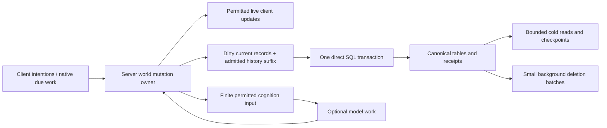

# Simpler saving and personal evidence — technical design

| Status      | Current progress                                                                                   | Last updated |
| ----------- | -------------------------------------------------------------------------------------------------- | ------------ |
| In progress | Direct saving and compact evidence are implemented; required operating qualification remains open. | 2026-10-31   |

**Design selected 2026-10-31, 05:10 UTC. Architecture inspected at Macrofold/OpenLegend `7a197980a6d65909fd185244c2631b8055faadf0`, local `codex/stealth-runtime-01-evidence`.** The [feature specification](bookkeeping-simplification-feature-spec.md) owns intended play, preserved behavior and consequential choices. Architecture used and implementation reconciled 2026-10-31 10:59 UTC on `codex/bookkeeping-runtime-01`, based on `39aa9775a5cf48e4318227410d0ab5625f92db9d`. [BK](../maintainers/production-data.md#bookkeeping-simplification) owns remaining qualification; concurrent unrelated work is outside this project. The [integration contract](attention-and-scenes-runtime-design.md#14-integration-contract-for-the-completed-bk-ru-and-vw-branches) coordinates BK with RU consumers and VW tooling without duplicating this implementation.

## 1. Selected architecture and current baseline

Use one authoritative in-memory world and one ordered direct PostgreSQL writer. Record only admitted experience. Keep immutable shared **substantial/stable** received values, inline small changing values, append personal history in explicit batches, and delete obsolete storage asynchronously. Keep existing semantic owners, command receipts, snapshot isolation, private-read fencing and paid-operation records. Remove the custom second durable application stage and storage layout state hidden on domain objects.

The concurrently designed [contact/group model](attention-and-scenes-runtime-design.md#13-proposed-structural-replacement-contacts-and-grouped-receipts) supplies native contact ownership, grouped checks and derived attention preparation. Adopt that model, not its minimal bulk-only or log-only alternatives. SR08/SR09 own those native conversions and SR10 their derived-state removal; BK integrates their storage once. Where that proposal retains the current segmented shared-value store, journal or accepted/applied fences, this project specifies their final replacement. Its reception, selection, correction and current-default guarantees remain unchanged.

The diagram does not permit premature command publication: routine native progress is live before its background save; strict command candidates publish only after their transaction. Cognition runs outside mutation ownership and returns a proposal.

### Inspected mechanisms

| Current mechanism                                                                                    | Reason it exists                                                                         | Target disposition                                                                                                       |
| ---------------------------------------------------------------------------------------------------- | ---------------------------------------------------------------------------------------- | ------------------------------------------------------------------------------------------------------------------------ |
| `WorldService.saveProgress` and `backgroundSave`                                                     | Save native progress while simulation continues                                          | Keep the responsibility and current cadence; use direct table writes                                                     |
| `WorldService.commit`, `store.commit`, canonical/history writers                                     | Atomic effects, history, receipt and revision                                            | Keep one shared direct transactional path                                                                                |
| `world-journal*`, `journal-*`, accepted/applied heads and query fences                               | Acknowledge a durable change package before ordinary tables catch up                     | Remove; PostgreSQL’s transaction log handles database crash recovery                                                     |
| `evidence-segments` layout/encoding weak maps and `world-records` placement previews                 | Preserve append suffixes and avoid repeat preparation                                    | Replace with explicit append batches and pure preparation; no dry-run side effects                                       |
| `retention-metadata`                                                                                 | Complete accepted/applied/pending ownership and membership while cold records are absent | Remove those global mirrors; retain only actual owner counters and scoped indexed SQL selection                          |
| `retention-record-metadata`, `received-record-references`                                            | Extract compact facts and exact references from real owners                              | Consolidate the useful pure extraction into the owning record codec; do not discard needed fields merely to delete files |
| `received-value-retirement`, partial block clearing, generations, application fences, temporary pins | Reclaim shared slots safely across several storage stages                                | Whole immutable value rows, one SQL reference projection, one serialized background collector                            |
| Source-version, account-retention and private retrieval owners                                       | Exact historical revisions, forgetting, source dependencies and disclosure               | Keep semantic responsibilities; remove redundant storage-stage bookkeeping through their common writer                   |

The preview defect was an internal incomplete-save inspection, not a player-facing preview: preparing candidate records could bind physical segment boundaries or positions to live objects before completeness was refused. For example, a previously saved two-entry prefix plus one appended entry could be regrouped as a single three-entry segment; the later real save reused that dry-run layout. The existing narrow fix makes that path read-only. The target removes the underlying hidden placement dependency, so an inspection has nothing to install. This describes a demonstrated coupling, not evidence that players lost data.

## 2. Ownership and contracts

| Owner                                        | Responsibility                                                                              | Must not acquire                                                                             |
| -------------------------------------------- | ------------------------------------------------------------------------------------------- | -------------------------------------------------------------------------------------------- |
| Domain perception/current evidence           | Received fields, exact variants, freshness/support and observer-local correspondence        | SQL state, physical row placement or a hidden live-world lookup during historical reads      |
| Domain experience/retention                  | Attention admission, personal frames, logical chunks, necessary support and expiry          | A second sensory pipeline, narrated episode classifier or model job on every expiry          |
| Domain knowledge/recognition                 | Actual learned people, names, places, methods and their minimal proof                       | Automatic identification from a private payload/source ID                                    |
| Server world service                         | Ordered mutation, immutable finite cuts, live publication and durability barriers           | Multiple writable copies of the world or independent per-feature commit queues               |
| Server store and existing typed repositories | Current-format rows, bounded batch execution, references and coherent read transactions     | Fictional retention policy, attention scoring or world-specific object categories            |
| Existing memory/model projection             | Select and render permitted facts; revalidate delayed results                               | Raw whole-world state, unfiltered storage records or access merely because bytes still exist |
| Installed world                              | Sampling, attention allocation, recognition, meaningful retention, supported senses/actions | Database layout or permission to bypass application privacy/spending                         |

Preserve existing typed source families and exact revisions. Ordinary neutral source revision, received variant, actor/local-contact identity, physical life, acquisition identity and current body grant are different meanings. No new universal revision number replaces them. IDs come from the existing allocation/identity owner; composite keys preserve field boundaries. Shared IDs remain server-private and world/timeline scoped.

## 3. Runtime representation

### 3.1 Current truth and current personal state

The actual entity owns its latest physical position. A personal contact owns the last actually received pose, original measurement times, current availability and sparse field exceptions. The existing two compatible samples suffice for immediate motion queries; longer paths belong only to admitted recent history. An appearance observation can remain older than pose. Availability can change without changing the last measured value. One support change can affect several fields without writing separate loss events.

Use contact-owned received groups from SR08: fields sharing their original acquisition/source, modality, precision and check semantics share one group stamp/mask. Partial checks, correction or loss split only the affected membership; current groups partition held fields rather than accumulating old group versions. A successful unchanged check updates its actual covered group once, with no per-field confirmation objects or source re-interning. Consecutive check compression includes only checks that actually occurred; missing checks split a run. A coat last checked at 110 remains at 110 when pose alone is measured at 120. Derive expanded field proofs only for selected consumers. Current received content and actual check clocks have separate identities, so an unchanged check preserves cached descriptions and reference membership. Groups encode one compact timing tuple; fields with unequal timing occupy separate groups.

Keep minimal meaningful attention state—selection order, discovery progress, acknowledged versions, displacement anchors and cue expiry—but rebuild scores, candidate views and formatted descriptions. Optional descriptive novelty uses a compact non-security content label; exact evidence, identity, permissions and correction never use that label. Producers supply actually received geometry changes to relation invalidation, so a numeric detail update need not restart spatial work. Those derived candidates are not persisted mirrors. Recovery preserves the same selection without taking a new sample or crediting familiarity again. Existing changed-key persistent collections prevent one contact update from copying every contact of an observer.

Continue existing isolated native drafts and structural sharing. Change only touched contact/feature records and seal completed values once at the owning transition. Do not copy every actor’s field map, iterate old history, or rebuild root entity lists to discover these changes. Exact maintained membership/count queries and established dirty-key lineage remain useful derived tooling. This project removes hidden **storage placement** caches, not every immutable memoization or spatial index.

### 3.2 Inline values and shared values

The native value owner supplies the representation for supported facets:

- **Inline:** pose/location scalars, small support/availability states and small numeric/categorical changes; one receiver frame in the personal frame header. Keep exact representation/precision, not rounded text. A differently received uncertain location remains different from an exact pose.
- **Shared immutable value:** stable body/detail bundles, descriptions, larger received geometry and similarly substantial typed values. Different clipping, field availability or precision creates a distinct variant. Reuse only a compatible value still owned by current or retained evidence; a process cache of old addresses is insufficient.
- **Existing occurrence source:** exact received speech, interactions and action-result families continue using their existing event/account source owners. Do not copy them into a second universal event store or replace a personal account with the global event.

Replace block-plus-slot addresses with stable value IDs in the shared-value owner. No mutable array of mixed live/dead payload slots, reused ordinal, per-slot reclamation generation or compaction address rewrite remains. A new variant allocates a new immutable value; an unchanged stable variant can be shared for as long as some real owner retains it. Preparation may cache a neutral value, but an unowned cached value gets a new ID when legitimately acquired again.

Sharing is an optimization of **values**, not occurrences. Two independent observations of an equal body can share bytes while preserving separate actual acquisition/confirmation times. Later recognition does not rename formerly anonymous evidence as if the observer knew the name then. Pose history stays in personal frames even though the same pose can also occur in current state; those have different lifetimes and purposes.

Do not introduce size-dependent automatic promotion between two formats. The initial family choices above are fixed in their adapters. If later profiling demonstrates that a particular high-fan-out scalar family merits shared storage, change that adapter and all current-format consumers together; the materializer and ownership contract already support it.

The native value owner inlines non-body fragments up to 192 encoded bytes; larger fragments and stable outward bodies use immutable IDs. This is a representation choice, independent of reception, attention and retention permission.

### 3.3 Personal frames and chunks

Retain the existing semantic personal-frame contract: actor/life/epoch scope, original acquisition order/time, actual receiver frame, and typed ordered operations. Operations begin a track with its received baseline, change supported facets, receive an occurrence, close/mark support, end detailed capture, and update independently acquired physical features. Different event-time/measurement metadata remains explicit where unequal. Repeated held-state reads append nothing. Actual unchanged-value confirmation uses shared check templates over the admitted field mask, without constructing rich per-field envelopes. Native contact/check-scope watermarks advance once per accepted group; independent physical-feature support remains separate. Body pose/detail exceptions preserve their independent proof and timing.

Use the existing preferred 64 KiB logical chunk and two-chunk resident-tail policy. A chunk has a stable ID, one self-contained entry checkpoint, coverage bounds and counters. It is a storage/retention unit, not a guessed narrative episode. An acquisition crossing a chunk boundary splits only at whole-operation boundaries and is admitted atomically; keep the existing whole-operation oversize behavior. Stable fact identity is actor/life/epoch/acquisition/operation, independent of save batching and row placement.

**Persist immutable append batches, not a mutable growing JSON page.** At save capture, take only the unsaved whole-operation suffix for each affected chunk. Each completed receiving acquisition closes a deterministic immutable batch containing its whole operations, declarations and check metadata. A synchronous receiving owner finishes that acquisition before publishing a world cut; later work allocates a new acquisition. Batch boundaries follow those explicit frame/operation ordinals, independent of save cadence. Use the existing SQL batch-byte envelope and whole-operation oversize rule. Derive each batch key from the owning chunk and first frame/operation ordinal. Store its end ordinal explicitly. A subsequent save inserts later batches; it never rewrites the prior prefix or repeats the entry checkpoint. A completed acquisition may produce a small batch; there is no delay to fill it. Native chunk allocation order and batch start ordinals supply SQL ordering directly; cold residency cannot renumber them. The codec reuses the existing immutable append proof to encode only later acquisitions, retaining the complete path for corrections, unknown predecessors and extensions of an earlier acquisition. Each decoded chunk owns its complete batch collection, so known-new suffix rows insert directly; a missing cold parent never proves a row new.

Use the explicit lexicographic position `(acquisitionOrdinal, operationOrdinal)` for a split acquisition; a batch key is `(chunkId, startPosition)` with an exclusive end position. Never key two split pieces by acquisition number alone. New payload rows are insert-only; an ID collision is not an upsert permission to replace an immutable value. Deduplication of owner/value use pairs is safe because those pairs are sets, not distinct occurrences.

The service’s durable revision is advanced only after SQL commit. The in-flight batch owns its encoded rows until settlement. No `WeakMap` remembers where an arbitrary live array was previously stored. Encoding the same supplied suffix and bounds produces the same result without mutating either input. Original frame/operation identities survive different legitimate physical batching.

Read a selected chunk’s checkpoint plus bounded relevant batches in order. Dictionary/checkpoint entries, exact support and traversal work count under current budgets. A prefix certificate cannot prove an unobserved path. Never replay a chain through all previous chunks to answer a local history query.

### 3.4 Lasting accounts and exact support

Promoting knowledge or retaining an account creates an independent minimal support record through the existing owner. Examples: the actually understood introduction supporting a learned name; the received position/extent and permitted label supporting a Known place; exact terms of an unresolved promise. Copy small necessary facts and their original provenance, or reference an already shared substantial value. Do not retain the entire recent chunk merely because one fact mattered.

An impression copies its selected claims and bounded provenance spans, explicitly without exact-coordinate/quotation authority. Existing exact summaries retain the complete exact sources they actually need, including transitive correction dependencies; this project does not quietly turn them into impressions. Existing native learned-method/identity rules still decide what constitutes sufficient support. No promotion occurs merely because a chunk is about to expire.

Correction metadata identifies source kind/ID/revision, observer scope and covered acquisition/claim ranges; it need not preserve every discarded raw body. Source-version bodies remain only for real exact consumers. Active obligations retain their admitted support until their owning completion/cancellation rules permit retirement. Required support is not an unlimited pool, and arbitrary `remember` output cannot claim its protection.

## 4. Direct transactional saving

### 4.1 One pending change buffer and one writer

Extend the existing dirty-record and append-intent owners. Keep one accumulating buffer and at most one immutable in-flight batch. A buffer holds changed current records keyed by canonical row identity, explicit removals, ordered admitted history suffixes and required operation receipts. It holds compact record values/changes, not a sequence of complete world roots.

For current state, a later unsaved update to the same row replaces its prior pending value. For history and discrete effects, preserve every admitted occurrence/order; only explicitly supersedable operational input may coalesce under its existing contract. A transient current value that was never durable and has no admitted receipt need not be inserted. Deleting a row that exists in the durable baseline remains an explicit delete. Required source corrections and receipt-dependent operations keep their barrier; do not treat them as an ordinary last-write-wins overwrite.

Capture swaps the accumulating buffer, so later changes enter the next buffer. A successful commit advances the durable mark and releases only the captured buffer. Failure never clears newer dirty work. If a newly captured baseline does not match the writer’s predecessor, refuse rather than rediscovering it from arbitrary latest rows. These are ordinary ordered saves, not a second durable journal.

Retain the existing roughly one-second save opportunity, single-writer ownership, native work admission and queue/age backpressure. Keep one accumulating live prefix and at most one immutable in-flight save; the existing maximum in-flight age holds advancement at a coherent native boundary. The former journal’s 32 MiB debt threshold is removed with that queue, rather than introducing another per-step encoded-debt census. SQL groups retain their encoded byte/row bounds, and an admitted oversized atomic transition stays one transaction while advancement waits. Measure actual prepared bytes and decoded retained buffers separately; one in-flight save is not a universal heap bound. Do not queue multiple full captures or let pending history grow silently.

### 4.2 Routine native progress

1. Apply a coherent native transition and record its actual received evidence through existing semantic owners.
2. Publish its permitted state from server memory at the existing delivery cadence. Queue exact changed records and admitted history for the next save.
3. At the due save opportunity, capture the finite change buffer and release mutation ownership.
4. The ordered writer inserts new shared values, writes current records, appends frame batches/accounts and their reference projections, updates derived durable counters, and advances the single database head in one transaction.
5. After commit, publish the durable mark to existing paid-work/cold-read/checkpoint consumers. Evict only committed inactive records; the in-flight buffer retains unsaved evidence even if it leaves the hot simulation tail.

No ownership query, value cleanup, whole-world record walk or complete retention scan runs before ordinary movement admission. Validation of a newly received value happens at its producer/owner boundary; formatting and SQL preparation use that trusted result.

### 4.3 Strict commands and accepted model results

1. Admit current authority and request identity. Recover an already recorded identical command result before executing anything again; refuse conflicting content.
2. Await the preceding in-flight save, if any, then evaluate the candidate through the existing isolated mutation/batch owner. Preserve each command’s rollback boundary.
3. Include all preceding unsaved native progress and the candidate’s effects/evidence/receipt in the same direct transaction. Freeze further mutation for this short barrier; do not expose the candidate early.
4. On success install/publish the candidate and return its result. On failure discard that candidate, retain the previously live native prefix and enter the existing storage hold where appropriate. No receipt describes an uncommitted effect.

Existing bounded queued-command grouping may share a transaction while preserving order and individual rejected outcomes. An idle command starts immediately. Provider calls and long semantic preparation remain outside this barrier; their outputs revalidate source/permission/action preconditions after returning. No automatic paid retry or additional cognition cadence is introduced.

### 4.4 Database authority and recovery

Keep one database world head with current timeline/generation and revision, updated by compare-and-swap in the same transaction as its rows and receipts. Remove accepted/applied dual heads, journal table classification, replay eligibility proofs, pending SQL overlays, application workers and alignment drains. Derived search coverage has its own legitimate source/index revision and is not removed merely because it also uses revisions.

Use normal durable PostgreSQL commits; do not disable `synchronous_commit`, WAL or filesystem durability to improve timing. If a connection fails around COMMIT, do not execute gameplay again. Stop further writes, establish that the previous writer can no longer commit, then inspect the existing head and exact receipt using the normal store owner. A proved committed batch adopts its recorded outcome; a proved rollback preserves the earlier baseline; uncertainty stays a storage hold. This small recovery distinction prevents duplicate effects and is still needed with zero players. Reuse existing receipt/connection ownership, not a new replay service.

Paid reservations, uncertain provider attempts, authentication/control grants and operational restore records retain their existing durability and non-rewindable owners. A background save or manual gameplay restore cannot refund real spending or restore revoked authority. PostgreSQL handles interrupted **database** transactions; filesystem checkpoint publication and external paid outcomes still require their existing explicit protocols.

## 5. Physical rows, indexes and queries

Reuse current canonical table families and the typed record writer; names below specify required row meanings, not a new generic repository layer. A current-format cutover may rename obsolete tables coherently. No old reader or dual schema remains.

| Row meaning                       | Identity / essential fields                                                                                          | Required access path                                                  |
| --------------------------------- | -------------------------------------------------------------------------------------------------------------------- | --------------------------------------------------------------------- |
| Shared received value             | World/timeline + immutable value ID; typed payload; encoded bytes; nullable GC-candidate sequence                    | Primary key; partial candidate index                                  |
| Current contact/feature           | Observer/life + local subject/feature; compact current fields and inline pose; shared IDs; independent times/support | Exact actor/local key; actor owner scan at restore                    |
| Logical recent chunk              | Actor/life/epoch + chunk ID; checkpoint; first/last order/time; logical bytes/change count                           | Actor + order/time; existing lookup metadata                          |
| Immutable frame batch             | Chunk + first ordinal, end ordinal; exact frames; first/last time; byte/count metadata                               | Chunk + ordinal range; actor/subject selection through chunk metadata |
| Shared-value use                  | World/timeline + owner kind/ID + value ID                                                                            | Unique owner/value key; reverse value-ID index; FK to value           |
| Personal lasting/required account | Existing source/account identity, permitted body and minimum support                                                 | Existing actor/source, eligibility and correction indexes             |
| Source dependency                 | Existing exact source/derived owner relationship                                                                     | Source-kind/ID/revision + actor-scoped reverse lookup                 |

The shared-value use table is a **derived transactional projection of real owner fields**, not separately writable knowledge. Closed owner kinds are current contact/feature, recent chunk and retained exact-support/account owners. Reuse the canonical reference extractor for writes, current-format validation and capture. A polymorphic owner link needs exact owner-kind validation; do not pretend a foreign key to the value proves the owner exists. Delete owner links in the same transaction as owner removal. Startup/capture integrity verifies both directions once, not on every tick.

For a current contact, update use rows only when its shared IDs change; pose/freshness-only updates leave them alone. For a recent chunk, insert each distinct value use once across its checkpoint and all batches, using bounded bulk insert with a unique key. Do not write one use per sample. A retained account uses its own support, so deleting a chunk releases only that chunk’s uses. Keep each chunk’s small resident reference set with that chunk; do not mirror every cold chunk’s ownership into JavaScript.

New values and their first owners commit together. Writes insert values before uses; removes delete/repoint uses before deleting a value. Ordinary updates use the existing bounded typed SQL grouping, parameter limits and one atomic transaction, not one statement per observer. Stable explicit keys eliminate list renumbering where order has no meaning. Ordered personal evidence retains its original order.

Cold queries select actor, lifetime, time/order, subject and eligible source metadata **before** loading JSON or expanding reference arrays. Existing candidate filters may be reused if their exact postcheck and measured plans remain sound; do not add redundant full-value GIN indexes. A page containing one desired source must not expand all unrelated sources before filtering. Query projections need only fields consumed by the caller. Current truth uses active indexes/counts rather than rebuilding entity arrays merely to count them.

Do not require every observation to be a SQL row. One received frame can contain many facet changes, and one immutable batch can contain several frames. This amortizes row/index cost while preserving exact identity and chronology. Logical chunking provides bounded replay/expiry; immutable batches avoid rewriting an open 64 KiB chunk on every save. SQL pages on disk are PostgreSQL’s business; there is no application page-layout cache attached to live objects.

## 6. Expiry, forgetting and physical cleanup

### 6.1 Logical eligibility and accounting

The experience owner enforces actual age and optional pressure. Reads apply its authoritative cutoff and current source/privacy restrictions even while expired bytes await deletion. Ordinary age expiry advances a retained-prefix boundary; it creates no permanent forgetting record per observation. Optional pressure retires whole oldest logical chunks under the current policy. Necessary support is already independent; cleanup must never race to create a last-minute summary or proof copy.

Charge each actor’s complete personal encoding/support under the existing pool limits, regardless of physical sharing. Keep durable per-actor pool counters and oldest retained chunk/order in their existing owner, updated from admitted append/remove metadata. Do not reconstruct them from every cold body for routine admission. Validate against actual rows during complete current-format capture/load. Resident caches cover only the active/tail working set, not lifetime membership.

Saved actor totals and next-due times select maintenance outside native steps. Maintenance captures compact indexed headers for the affected actors, overlays their exact candidate delta and discards the snapshot after use. Do not add a duplicate resident header deque or lifetime source catalogue: native steps perform no SQL, while the existing SQL chronology remains the canonical retained-header index. This chooses fewer maintained representations at the cost of actor-scoped maintenance reads; query visits and retained-header growth must qualify with the complete game. Long-lived account/alias lookups remain scoped SQL outside movement.

Retiring a whole recent prefix advances that actor/life/epoch’s canonical retained-from boundary and pool totals in the next ordered save. It does not issue a delete for every old frame. Cold readers and startup select only eligible chunks under that boundary and the captured age cutoff. Physically retired chunks can remain until the collector deletes them; their use rows are released atomically at retirement. They grant no access and are excluded from logical totals. Complete capture exports eligible owners and their reachable values, not expired leftovers awaiting cleanup. Current-format counter audits use the same eligibility/charge rules. This keeps physical cleanup from silently mutating live semantic counters.

Age expiry may cut through the oldest chunk. Access stops at the exact cutoff; physical cleanup may retain that whole chunk until its last fact expires. Conservatively charge the remaining physical chunk’s logical bytes/count until retirement instead of repeatedly repacking the prefix. This can shorten optional coverage by at most the current chunk target, subject to its existing oversize exception; it never extends access. This is an explicit granularity tradeoff, not a claim that expired facts remain remembered. A required exact deletion/correction follows the targeted path below rather than waiting for whole-chunk age expiry.

### 6.2 One background collector

Reuse the existing maintenance scheduler and ordered database writer. There is no collector on command admission, no per-field database check, and no second writer allowed to race canonical ownership.

1. Wake when expiry is due or an owner releases values. Coalesce ordinary notifications over five real seconds; after a nonempty bounded slice, yield then continue while debt remains. One SQL transaction handles both candidate kinds, alternating priority so oversized chunks cannot starve values. Startup can reconstruct outstanding work from persisted cutoffs and candidate rows.
2. Select the oldest fully retired chunk/account rows using indexed metadata. Delete a bounded group and its use rows in one short transaction. Retain exact currently eligible partial chunks.
3. When use rows disappear, mark their distinct value IDs with a nullable **candidate sequence**, in the same transaction. This is only an indexed hint that a whole value might now be unowned, not a pending-delete state machine or reference count. Repeated hints coalesce.
4. Select a bounded set of marked values. One indexed `NOT EXISTS` check against the reverse use index determines which have no owner. Delete those whole rows; clear the hint on still-owned values. No payload decode, slot compaction or traversal of every containing page is needed.
5. Release committed cold payloads from process caches independently of physical deletion. Only actual resident current/tail owners and in-flight writes require RAM; cold SQL ownership does not require resident bodies.

Examine at most 128 candidates of each kind; select at most 256 combined owner/value candidates and 256 KiB of selected encoded bodies per slice, reusing smaller applicable repository/statement limits. Count dependent use-row work too. Whole oversized admitted records/chunks are processed alone. Never load a huge body just to decide whether its ID has a use. At most one cleanup slice is queued; give overdue cleanup one turn between foreground write batches through the existing fair scheduler, rather than waiting for complete idleness or draining an unlimited backlog ahead of a command. End each slice before scheduling another.

Keep physical storage/backlog metrics and existing operational storage-failure/backpressure controls. There is no separate gameplay admission check over all candidate bytes per movement command. These bounds limit each pass, not total physical debt: if cleanup cannot keep up, disk can grow despite bounded logical memory. Sustained debt and physical/index reuse are required operating acceptance, and failure blocks release; it is not permission to hide the growth by deleting required records. Storage exhaustion/failure stops authority explicitly. Do not claim a universal disk bound from an age window.

### 6.3 Why unsaved work and reads are safe without pins

The required invariant is: **every reference admitted after a durable cut either names a newly allocated value retained by that pending write, or derives from a still-eligible real owner.** Payload-address caches alone are never owners. This removes the need for a second pending/cold ownership census.

- If the owner exists in the durable cut, its use row protects the value while new pending owners are created. Removing its last durable use requires an ordered later save, which includes any admitted replacement owners in the same cut.
- If the value was created after the durable cut, it has a new ID and is held in the pending buffer; cleanup cannot select an uncommitted row. Its first database insertion includes its real owners.
- If the last owner has actually expired/been removed, neither a held ID nor a weak cache can create a new reference. A new physical acquisition creates a new value/owner; a stale recall or promotion fails current eligibility.
- A cold reader selects the owner and its values in one bounded repeatable-read transaction, then copies the permitted finite closure and releases the transaction. PostgreSQL preserves that snapshot while concurrent deletion completes. There is no later fetch by naked payload ID outside the read scope. Publication still rechecks current expiry, correction and authority.

A temporary model/capture copy is independent bytes, not a storage pin or a retention extension. Future code must use the existing owning read/receipt admission API, never a raw `getValue(id)` that grants evidence or a cleanup exemption. Verify release/reacquisition, delayed cold read and in-flight save cases explicitly before removing the old guards.

### 6.4 Correction, explicit forgetting and source versions

Semantic correction/forgetting keeps the existing strict atomic owner. Select affected owner IDs through the source dependency index, load only their bounded records, and revoke/rewrite actual affected facts and derived sources together. For rare edits inside a batch, replace that bounded batch while preserving stable surviving acquisition identities; recompute the affected chunk’s uses from its bounded contents. Do not repack the entire history or weaken source-specific deletion into “drop everything nearby.” The correction owner’s existing whole affected-operation admission remains controlling when the transitive dependency set is large.

Record explicit forgetting where needed to prevent restoration from reviving it; ordinary expiry is not explicit erasure. Old source-version bodies and derived vectors/text leave access immediately, then physical cleanup follows their current privacy obligations. For a shared value still needed by another observer, remove the requesting observer’s uses/accounts rather than deleting the other person’s evidence. Correction of the source itself reaches all actually affected owners through existing exact dependencies. Current operational privacy overlays continue to constrain checkpoints and provider-context reuse.

## 7. Reads, cognition, capture and restore

### Live and cold reads

Current gameplay/projection reads use the captured server state and existing permitted selectors. Ordinary display does not force persistence. For a history request spanning hot and cold evidence, select the bounded pending/hot suffix at the request’s acquisition cut, read eligible durable history up to that same cut, and merge by stable actor/life/acquisition identity. Duplicate overlap is removed; no generic whole-database pending overlay is introduced. Correction/forgetting and timeline/authority changes fence the entire read after waits. Expiry is checked again at publication, not only when selecting rows.

A request requiring a fully durable cut uses the existing `WorldService.whenDurable()`/durable-mark boundary, outside the mutation turn where possible. A paid decision may wait for its required trigger to be durable without delaying native movement or requiring a private evidence save of its own. Optional indexes can lag; their existing source/coverage checks remain. Search index coverage is distinct from the removed query-table application stage.

### Finite model inputs

Build context from selected current facts, relevant chronological changes, independent physical context, required evidence and selected memories. Reuse the existing materializer and `experience-context` projection; no internal artwork ID, storage use row, physical batch position or full raw body goes into the prompt merely because it exists in SQL. Labels, exact understood words, relative geometry and useful appearance remain when selected and permitted.

Keep current broad/static/discovery allowances and legitimate familiarity, rather than sorting an unbounded whole-world set first. No background sixteen-source sampler, personality/object whitelist, per-step semantic call or hidden global trajectory query is introduced. Source-fragment sharing does not replace exact observer receipts. A request holds a bounded selected copy, no old world root or database transaction during provider work. Late acceptance follows existing source, authority, spending and action-precondition owners.

### Pure capture and validation

Separate three operations: **describe/capture** returns explicit records from a selected complete cut; **validate** returns a result without mutation; **commit** installs rows and advances durable state. Reuse field codecs and validators across them, not a mutating save planner with flags such as “don’t bind this time.” Pure memoization is allowed only where it cannot change later write placement or authority.

A manual checkpoint first saves the required live prefix, then establishes one read-only database snapshot and streams all current/cold canonical owners plus exact dependencies through the existing checkpoint owner. This is an occasional complete operation, not a per-step full scan. Invalid/incomplete candidates fail without touching the live world, cursor, dirty buffer, cache layout or baseline. Check both refusal and subsequent ordinary save.

Same-format loading reconstructs IDs before links, validates references and complete counters once at the owning boundary, rebuilds transient indexes and resumes under existing pause/control policy. It never regenerates past model outcomes. Restore preserves current operational permissions/accounting/erasure, abandons stale work and gives clients a new baseline. Restoration replaces the complete recent-history rows, including physically retained retired chunks, inside its atomic transaction; it cannot leave newer batches attached to a restored prefix. Manual save files retain atomic publication and their existing catalog/retention; a checkpoint is self-contained, so deleting active database history does not break an existing complete file. Existing privacy transforms still govern loading that file.

Under the [development policy](../../AGENTS.md#development-save-policy), implementation updates one current format and replaces incompatible disposable gameplay data through existing setup. Preserve the union of useful authored opening content and separate assets, credentials, grants and real accounting. No migration tool, journal importer, compatibility alias or previous-layout reader is delivered.

## 8. Performance model and extension rules

The important dimensions are active entities, actual observer/source pairs, acquired changes, unique shared variants, retained personal history, and concurrent readers/commands. Hundreds of real observers receiving a changed source entails real receiver work; no index makes their distinct receipts free. Ten years of encounters must not become a ten-year hot ownership map or a per-tick scan.

An object existing or moving does not require a new autobiographical/world-history row for every possible observer. Preserve the existing common recording admission before constructing optional occurrence wrappers. Shared received history contains only real retained uses, not a permanent objective trajectory archive. Independently retained world events, checkpoint files, exact command receipts and operational accounting have their own retention owners; bounded personal memory does not prove those totals bounded. Remove obsolete optional sensory source closure through those owners, but never delete required receipts/accounting or silently reduce their retention to make this project look small.

| Path                 | Work allowed                                                                                   | Work removed                                                                                   |
| -------------------- | ---------------------------------------------------------------------------------------------- | ---------------------------------------------------------------------------------------------- |
| Native update        | Changed/due physical scopes and real recipients; cheap current updates; admitted frame appends | SQL ownership reads, all-history traversal, eager rich materialization and layout planning     |
| Routine save         | Distinct dirty current rows + new retained frames/values/uses; one direct commit               | Journal encode/write/apply, duplicate heads, full-prefix rewrite, separate ownership mirrors   |
| Cold recall          | Actor/source/time-index selection, bounded chosen batches and closure                          | Payload-first filtering, per-source sequential queries, global source-history reconstruction   |
| Expiry               | Due actor/chunk metadata and bounded deletion slices                                           | Per-facet loss/retirement records, command-path cleanup, partial shared-block compaction       |
| Full checkpoint/load | Complete canonical state streamed or validated once                                            | Codec mutation by preview, replay of effects, duplicate validation of unchanged installed data |

Keep only indexes with real readers: exact identity, actor/time/order, source correction and reverse shared-value uses. Measure their write cost and repeated delete/vacuum reuse. Batching reduces statement and row overhead but does not remove bytes, WAL, CPU or database contention. Native and SQL work are asynchronous only where the ownership contract permits; `async` syntax does not offload CPU. No extra worker or service is selected. Reconsider CPU offload only after measurements isolate substantial remaining encoding work and account for transfer/queue cost.

New sense/mechanic adapters provide exact typed value, original source/reception metadata, stable facet equality and required support through existing owners. The common value owner supplies its inline/shared representation rule. New retained record owners expose reference/metadata extraction once to the same writer and validator. They do not add a parallel retention service, branch on named game situations or expand raw shared values directly into prompts.

## 9. Delivery sequence and removal checklist

One focused tracker, [BK00–BK07](../maintainers/production-data.md#bookkeeping-simplification), owns implementation status. Complete the whole conversion; an intermediate direct-write benchmark does not finish the project.

1. **BK01: direct saving.** Reuse the existing synchronous writer for all supported world batches. Preserve ordered asynchronous native saves, strict command/receipt barriers, checkpoints, paid durable-mark consumers and failure recovery. Remove journal initialization, admission/classifier proxies, application worker, replay/head fields and drain callers. Keep current layout temporarily within this coherent stage; no new legacy reader.
2. **BK02: explicit compact evidence.** Integrate SR08/SR09’s contact/group conversion once, with stable shared value IDs, inline small fields and explicit immutable frame batches from domain producers through current/captured/cold materializers, canonical schema, checkpoint streams and validators. Replace layout/ordinal weak maps for these owners. Preserve actual fact handles, timing, uncertainty and selected model/public projection. Run one complete deer/unknown-person continuation through PostgreSQL before broadening verification.
3. **BK03: simple ownership and minimal support.** Add the one transactional use projection and reverse index through existing codecs. Convert knowledge, recognition, names, places, exact summaries/obligations and source-version users to independent minimum support. Replace complete cold metadata mirrors with scoped SQL and actor counters. Include account/temporal/feature readers, not only sight.
4. **BK04: cleanup and residency.** Install whole-value collection and due chunk retirement on the existing writer/maintenance lanes; remove partial-block retirement, application-generation states, temporary assembly pins and cleanup from ordinary commands. Implement pure finite read/capture closure and the no-unowned-address reuse rule before deleting the old protection. Exercise concurrent source release, capture, save and correction.
5. **BK05: all callers and current-format readiness.** Coordinate SR10’s derived-candidate removal; finish service/HTTP/protocol/client, native-animal/knowledge, thought/reflection/recall, index/editing, checkpoint/startup and operational recovery integration. Remove obsolete utilities, flags, schema entries, diagnostics and tests tied only to old mechanisms. Update current-format initialization; replace incompatible development gameplay only through its owner. No fallback path or stub remains.
6. **BK06: correctness and review.** Complete the focused scenarios below, source review, static/build checks affected by implementation and canonical documentation reconciliation. Preserve separately owned vision/acoustic/combat and shared-restore scope.
7. **BK07: complete-game qualification.** Run the complete matched operating workloads after all removals. Fix obvious attributable residual waste; if normal play still fails, produce a fresh step-by-step diagnosis and concrete next design, preserving failed results. Do not claim completion from microbenchmarks or repeatedly run unchanged failing profiles.

After BK05, repository search should find no executable dependency on `WorldJournal`, journal table application, accepted/applied ownership mirrors, block-slot retirement, storage placement binding during preview, or mutating evidence-layout caches. Historical verification documents may retain those names. Pure shared reference extraction, immutable memoization, current-format validation, paid-attempt journals and operational restore recovery are not blanket deletion targets.

## 10. Acceptance and measurement

### Required correctness passes

Use existing focused checks and disposable real-consumer scenarios; this design does not request a new maintained test suite or a full unit-suite run. Group cases into connected journeys instead of testing every helper independently.

| Case                                    | Pass condition                                                                                                                                                                                                     |
| --------------------------------------- | ------------------------------------------------------------------------------------------------------------------------------------------------------------------------------------------------------------------ |
| Shared walk and slow background save    | Two actual connected clients receive continuing permitted motion while the routine save is held; direct commands retain their promised durability; saved native state and personal evidence restore together       |
| Strict effects and uncertain completion | Transfer/action/speech records and receipts commit atomically; duplicate identity executes once; conflicting identity refuses; disconnect around commit resolves the stored outcome without replay                 |
| Unknown person and deer sequence        | Intermediate attended generic facet changes, received interactions, independent detail times and contact transition survive current/hot/cold/save paths; no pre-attention or unseen route appears                  |
| Crowd/static context and interpretation | Existing daughter/cliff and broad-over-capacity cases preserve permitted bodies/features and exact semantic input; no extra model calls or all-pairs stored graph                                                  |
| Sharing and correction                  | Compatible body details share one value; different variants remain separate; forgetting one observer does not erase another; source correction withdraws affected derivatives and stale replies                    |
| Minimal retained support                | Name, recognition, Known place, learned-method and active exact terms remain usable after unrelated recent chunks retire; deliberately forgetting their exact support revokes the appropriate dependent capability |
| Capture and collector races             | A read gets one permitted complete closure or explicit stale/missing outcome; delete/reacquire and pending append cannot create dangling references; no temporary reader grants lasting access                     |
| Read-only refused preview               | Repeated valid and incomplete inspections leave dirty state, storage layout, pending removals and later saved meaning unchanged                                                                                    |
| Expiry and physical reuse               | With providers disabled, multiple fill/expiry cycles keep logical pools bounded, delete obsolete batches/values/versions/indexes, retain required support and make cleanup progress under foreground traffic       |
| Restart and restore                     | Actual process interruption before/after commit recovers a coherent cut; current-format reopening and manual checkpoint restore retain useful starting content and current external authority/spending             |

Mechanical forcing can establish native input/data behavior, not natural model quality. Reuse applicable live semantic evidence where unchanged. If changed projection alters what the model receives, run only the affected admitted semantic examples under the standing budget and report uncertainty; provider spending is not part of a native throughput test.

### Complete performance evidence

Retain [SR07’s existing workload/gate definition](attention-and-scenes-runtime-design.md#10-acceptance-and-reporting): standard five-minute ordinary play and the substantial active scene must meet their existing normal-clock pass; 300 active actors, faster clocks and mature/ten-year history distributions are required measurements rather than new unsupported capacity promises. Do not waive an existing gate here. Compare the same actual movement, population, observations, attention/retention settings, clients and provider policy. Verify the workload did the intended work before interpreting timing.

Attribute each step: native movement and due sensing; received current-field/temporal construction; draft sealing; save preparation/encoding; mutation queue waits; SQL execution/commit/WAL/index writes; client projection/delivery; maintenance/cold reads. Report elapsed time and completed game time, actual counts/bytes, p50/p95 command and first-motion latency, heap and process RSS, pending-save age/bytes and physical cleanup debt. Separate active SQL work from waiting and physical cleanup from logical expiry. No opaque percentage-only diagnosis.

Compare fresh, sustained ordinary play and retained-history-heavy cases. Include a dense first exposure, because stable-history savings do not eliminate initial recipient fan-out. Compare total value/use/current/batch/index/WAL bytes, not only shared JSON size. Grow lifetime encounters independently of currently active subjects. Measure cold retrieval and repeated storage/index reuse after deletion; do not label a warmed cache cold. Use existing diagnostic and setup tools rather than a new benchmark framework.

**Structural pass:** no ordinary command/step scans all historical owners, no save rewrites earlier immutable batches, no pose-only write churns stable value-use rows, no preview changes future writes, and no separate journal/application stage remains. **Operating pass:** required ordinary/substantial gates plus sustainable saving/cleanup; a queue that merely hides growing debt fails. **Reported measurements:** wider capacities and tradeoffs with all failures retained. **Human evidence:** interesting remembered consequences and responsive connected play remain distinct from correctness or CPU measurements.

Design completion supplies none of these runtime passes. Broader hosted failure recovery, new region ownership and unimplemented social/vision features retain their existing trackers rather than becoming prerequisites through incidental mentions.

## 11. Alternatives, evidence and maintained records

PostgreSQL already writes a recovery log before reporting a durable commit and restores table changes after a crash. That supports removing an additional application replay stage; it does not prove a particular batching strategy faster. [PostgreSQL WAL](https://www.postgresql.org/docs/current/wal-intro.html). Its foreign keys/constraints protect relational references, but owner eligibility and private perception remain application semantics. [PostgreSQL constraints](https://www.postgresql.org/docs/current/ddl-constraints.html).

Unreal’s selected `SaveGame` data and asynchronous save API illustrate separating gameplay state from save work; Unity’s [persistence guidance](https://unity.com/blog/games/persistent-data-how-to-save-your-game-states-and-settings) likewise leaves game-state selection to the application. Neither engine prescribes OpenLegend’s server database or guarantees multiplayer durability. [Unreal saving](https://dev.epicgames.com/documentation/en-us/unreal-engine/saving-and-loading-your-game-in-unreal-engine). The existing OpenLegend server already separates live native advancement from background saves; reuse it rather than invent a client simulation or new actor framework.

Rejected for this project: universal append-only world truth (latest state would require replay or a second projection); copying every rich observation (wastes stable sharing); sharing every scalar (unnecessary joins/lifetimes); rewriting open chunks each save (repeats prefix bytes); one row per coordinate/facet (excess row/index work); a global in-memory ownership mirror (history-sized hot state); arbitrary TTL deletion of still-owned values (broken evidence); and moving the existing journal into another worker (retains its stages and accounting).

No blocking product question remains. The selected hybrid and direct writer are implementation targets; actual throughput, appropriate cleanup batch tuning and player enjoyment remain evidence obligations. Future expansion must earn a separate mechanism through an actual consuming need, not the possibility that richer mechanics might exist.

- Behavior and journeys: [feature specification](bookkeeping-simplification-feature-spec.md).
- Tasks and dependencies: [BK00–BK07](../maintainers/production-data.md#bookkeeping-simplification).
- Limits: [BKS-L01–BKS-L05](../limits/persistence.md#bks-l01--direct-transactional-saving-target); current world retention: [attention profile](../worlds/base/attention.md).
- Preserved contracts: [save/load](../save-and-load.md), [memory](../memory-architecture.md), [identity](../identity-and-references.md), [storage performance](../performance/storage.md), [engine/world boundaries](../engine-and-world-boundaries.md).
- Earlier architecture and measured limits: [attention runtime](attention-and-scenes-runtime-design.md), [journal experiment](performance-overhaul/journal-contract.md), [complete-game diagnosis](../verification/performance/2026-10/attention-runtime.md).
