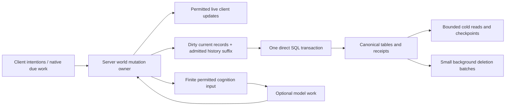

# Simpler saving and personal evidence — technical design

| Status      | Current progress                                                                                           | Last updated |
| ----------- | ---------------------------------------------------------------------------------------------------------- | ------------ |
| In progress | BK24 is installed; deeper attribution finds costly execution boundaries and a lifecycle validation defect. | 2026-11-05   |

**Design selected 2026-10-31, 05:10 UTC. Architecture inspected at Macrofold/OpenLegend `7a197980a6d65909fd185244c2631b8055faadf0`, local `codex/stealth-runtime-01-evidence`.** The [feature specification](bookkeeping-simplification-feature-spec.md) owns intended play, preserved behavior and consequential choices. Architecture used and implementation reconciled 2026-10-31 10:59 UTC on `codex/bookkeeping-runtime-01`, based on `39aa9775a5cf48e4318227410d0ab5625f92db9d`. [BK](../maintainers/production-data.md#bookkeeping-simplification) owns remaining qualification; concurrent unrelated work is outside this project. The [integration contract](attention-and-scenes-runtime-design.md#14-integration-contract-for-the-completed-bk-ru-and-vw-branches) coordinates BK with RU consumers and VW tooling without duplicating this implementation.

**Architecture used for BK09–BK15 November 2, 2026, 06:49 UTC.** The [runtime companion](bookkeeping-simplification-runtime-design.md) is the current BK09–BK15 contract for live acceptance, independent support, due/pressure retention, precise row writes and captured pending reads. Connected semantic/storage checks and certified source-removal integration pass. The [completed-source AWS standard gate](../verification/performance/2026-10/bookkeeping-simplification.md#aws-operating-qualification) has no runtime/storage failure or pause but fails normal-speed acceptance; BK12/BK16 retain cleanup sustainability and operating acceptance. Architecture used for these repairs November 3, 2026, 08:45 UTC. The sections below retain the direct-writer and evidence semantics, with execution following that companion.

## 1. Selected architecture and current baseline

Use one authoritative in-memory world and one ordered direct PostgreSQL writer. Record only admitted experience. Keep immutable shared **substantial/stable** received values, inline small changing values, append personal history in explicit batches, and delete obsolete storage asynchronously. Keep existing semantic owners, command receipts, snapshot isolation, private-read fencing and paid-operation records. Remove the custom second durable application stage and storage layout state hidden on domain objects.

The installed [contact/group model](attention-and-scenes-runtime-design.md#13-proposed-structural-replacement-contacts-and-grouped-receipts) supplies native contact ownership, grouped checks and derived attention preparation. Adopt that model, not its minimal bulk-only or log-only alternatives. SR08/SR09 own those native conversions and SR10 their derived-state removal; BK integrates their storage once. The earlier segmented shared-value store, journal and accepted/applied fences are removed; the current writer and captured read projection are the sole persistence path. Its reception, selection, correction and current-default guarantees remain unchanged.

Ordinary native/player/NPC gameplay publishes its complete in-memory transition before the scheduled save. Protected effects retain their durable barrier. Cognition runs outside mutation ownership, waits for the fixed evidence cut required by paid dispatch and returns a proposal.

### Original replacement responsibilities

| Original mechanism                                                                                   | Reason it exists                                                                         | Target disposition                                                                                                       |
| ---------------------------------------------------------------------------------------------------- | ---------------------------------------------------------------------------------------- | ------------------------------------------------------------------------------------------------------------------------ |
| `WorldService.saveProgress` and `backgroundSave`                                                     | Save native progress while simulation continues                                          | Keep the responsibility and current cadence; use direct table writes                                                     |
| `WorldService.commit`, `store.commit`, canonical/history writers                                     | Atomic effects, history, receipt and revision                                            | Keep one shared direct transactional path                                                                                |
| `world-journal*`, `journal-*`, accepted/applied heads and query fences                               | Acknowledge a durable change package before ordinary tables catch up                     | Remove; PostgreSQL’s transaction log handles database crash recovery                                                     |
| `evidence-segments` layout/encoding weak maps and `world-records` placement previews                 | Preserve append suffixes and avoid repeat preparation                                    | Replace with explicit append batches and pure preparation; no dry-run side effects                                       |
| `retention-metadata`                                                                                 | Complete accepted/applied/pending ownership and membership while cold records are absent | Remove those global mirrors; retain only actual owner counters and scoped indexed SQL selection                          |
| `retention-record-metadata`, `received-record-references`                                            | Extract compact facts and exact references from real owners                              | Consolidate the useful pure extraction into the owning record codec; do not discard needed fields merely to delete files |
| `received-value-retirement`, partial block clearing, generations, application fences, temporary pins | Reclaim shared slots safely across several storage stages                                | Whole immutable value rows, one SQL reference projection, one serialized background collector                            |
| Source-version, account-retention and private retrieval owners                                       | Exact historical revisions, forgetting, source dependencies and disclosure               | Keep semantic responsibilities; remove redundant storage-stage bookkeeping through their common writer                   |

The preview defect was an internal incomplete-save inspection, not a player-facing preview: preparing candidate records could bind physical segment boundaries or positions to live objects before completeness was refused. For example, a previously saved two-entry prefix plus one appended entry could be regrouped as a single three-entry segment; the later real save reused that dry-run layout. The existing narrow fix makes that path read-only. The target removes the underlying hidden placement dependency, so an inspection has nothing to install. This describes a demonstrated coupling, not evidence that players lost data.

## 2. Ownership and contracts

| Owner                                        | Responsibility                                                                              | Must not acquire                                                                             |
| -------------------------------------------- | ------------------------------------------------------------------------------------------- | -------------------------------------------------------------------------------------------- |
| Domain perception/current evidence           | Received fields, exact variants, freshness/support and observer-local correspondence        | SQL state, physical row placement or a hidden live-world lookup during historical reads      |
| Domain experience/retention                  | Attention admission, personal frames, logical chunks, necessary support and expiry          | A second sensory pipeline, narrated episode classifier or model job on every expiry          |
| Domain knowledge/recognition                 | Actual learned people, names, places, methods and their minimal proof                       | Automatic identification from a private payload/source ID                                    |
| Server world service                         | Ordered mutation, immutable finite cuts, live publication and durability barriers           | Multiple writable copies of the world or independent per-feature commit queues               |
| Server store and existing typed repositories | Current-format rows, bounded batch execution, references and coherent read transactions     | Fictional retention policy, attention scoring or world-specific object categories            |
| Existing memory/model projection             | Select and render permitted facts; revalidate delayed results                               | Raw whole-world state, unfiltered storage records or access merely because bytes still exist |
| Installed world                              | Sampling, attention allocation, recognition, meaningful retention, supported senses/actions | Database layout or permission to bypass application privacy/spending                         |

Preserve existing typed source families and exact revisions. Ordinary neutral source revision, received variant, actor/local-contact identity, physical life, acquisition identity and current body grant are different meanings. No new universal revision number replaces them. IDs come from the existing allocation/identity owner; composite keys preserve field boundaries. Shared IDs remain server-private and world/timeline scoped.

## 3. Runtime representation

### 3.1 Current truth and current personal state

[PP08’s common receiving procedure](perspective-perception-runtime-design.md) owns channel-neutral sample/confirmation/availability/occurrence mutation through these contacts. BK executes the same SR08/SR09 representation and lifecycle conversion; it does not add a parallel sensor or receipt store.

The actual entity owns its latest physical position. A personal contact owns the last actually received pose, original measurement times, current availability and sparse field exceptions. The existing two compatible samples suffice for immediate motion queries; longer paths belong only to admitted recent history. An appearance observation can remain older than pose. Availability can change without changing the last measured value. One support change can affect several fields without writing separate loss events.

Use contact-owned received groups with immutable `received` content and typed part-partition metadata. Successful checks, recording and availability change metadata without replacing content. Partial coverage splits only affected metadata; a body's original acquisition pose remains evidence while independently acquired location owns its newer pose. The current codec saves content independently of clock partitions. Native correspondence, body, recognition and attention borrow selected values synchronously; explicit evidence consumers materialize proof through that same owner. [BK17 mechanics](bookkeeping-simplification-reception-design.md#31-stable-content-clocks-and-member-identity) define identity, masks and codec guarantees.

Keep minimal meaningful attention state—selection order, discovery progress, acknowledged versions, displacement anchors, cue expiry and partial scan cursors—but rebuild scores, candidate views, formatted descriptions and relation-dirty work at activation. Optional descriptive novelty uses a compact non-security content label; exact evidence, identity, permissions and correction never use that label. Producers supply actually received geometry changes to relation invalidation, so a numeric detail update need not restart spatial work. Those derived candidates are not persisted mirrors. Recovery preserves the same selection without taking a new sample or crediting familiarity again. Existing changed-key persistent collections prevent one contact update from copying every contact of an observer.

Continue existing isolated native drafts and structural sharing. Change only touched contact/feature records and seal completed values once at the owning transition. Do not copy every actor’s field map, iterate old history, or rebuild root entity lists to discover these changes. Exact maintained membership/count queries and established dirty-key lineage remain useful derived tooling. This project removes hidden **storage placement** caches, not every immutable memoization or spatial index.

### 3.2 Inline values and shared values

The native value owner supplies the representation for supported facets:

- **Inline:** pose/location scalars, small support/availability states and small numeric/categorical changes; one receiver frame in the personal frame header. Keep exact representation/precision, not rounded text. A differently received uncertain location remains different from an exact pose.
- **Shared immutable value:** stable body/detail bundles, descriptions, larger received geometry and similarly substantial typed values. Different clipping, field availability or precision creates a distinct variant. Reuse only a compatible value still owned by current or retained evidence; a process cache of old addresses is insufficient.
- **Existing occurrence source:** exact received speech, interactions and action-result families continue using their existing event/account source owners. Do not copy them into a second universal event store or replace a personal account with the global event.

Replace block-plus-slot addresses with stable value IDs in the shared-value owner. No mutable array of mixed live/dead payload slots, reused ordinal, per-slot reclamation generation or compaction address rewrite remains. A new variant allocates a new immutable value; an unchanged stable variant can be shared for as long as some real owner retains it. Preparation may cache a neutral value, but an unowned cached value gets a new ID when legitimately acquired again.

Sharing is an optimization of **values**, not occurrences. Two independent observations of an equal body can share bytes while preserving separate actual acquisition/confirmation times. Later recognition does not rename formerly anonymous evidence as if the observer knew the name then. Pose history stays in personal frames even though the same pose can also occur in current state; those have different lifetimes and purposes.

The native value owner always inlines validated body-pose, location, observation-frame and observation-header fragments, even above the ordinary 192-byte small-fragment threshold. Suitable rich stable content remains shared. This single representation policy prevents a valid coordinate sample or its changing proof header from allocating a pooled SQL row; it does not grant reception or retention permission.

### 3.3 Personal frames and chunks

The temporal owner stores ordered **received batches** containing sparse baselines, actual samples, availability/admission boundaries and discrete occurrences. Observer/life/epoch, batch order, entry and stable member indices identify evidence independently of physical placement. Current freshness partitions remain separate from recording admission. Attention entry dates an acquired baseline; subsequent actual changes retain their own clocks and frames. Equal checks update current freshness only. Bounded admission reserves coverage-terminal space; no late-closed value span or predecessor proof chain is stored.

A detached save packs only its new mixed actor suffix into immutable preferred 64 KiB physical blocks. Complete bounded native blocks remain indivisible; compact owner/clock/source/frame metadata makes each received record independently decodable without predecessor seeds. Packing and sparse correction preserve logical addresses and physical predecessor checks. Shared substantial values grant neither another observer's receipt nor private knowledge.

The pending save owns native suffix intent and one immutable in-flight cut. Failure preserves that cut and newer accepted work. Acknowledgement rebases placement onto the existing native tail without rebuilding logical eligibility. Ordered tuple bounds select candidate raw receipts; the actual owned entry/member proves source existence. Current state and finite permitted captures have their separate owners; historical readers do not replay expired events or reconstruct arbitrary old scenes. [Section 15](#15-compact-native-evidence-and-change-history) owns the current layout and lifetimes.

### 3.4 Lasting accounts and exact support

Promoting knowledge or retaining an account creates an independent minimal support record through the existing owner. Examples: the actually understood introduction supporting a learned name; the received position/extent and permitted label supporting a Known place; exact terms of an unresolved promise. Copy small necessary facts and their original provenance, or reference an already shared substantial value. Do not retain the entire recent chunk merely because one fact mattered.

An impression copies its selected claims and bounded provenance spans, explicitly without exact-coordinate/quotation authority. Existing exact summaries retain the complete exact sources they actually need, including transitive correction dependencies; this project does not quietly turn them into impressions. Existing native learned-method/identity rules still decide what constitutes sufficient support. No promotion occurs merely because a chunk is about to expire.

Correction metadata identifies source kind/ID/revision, observer scope and covered acquisition/claim ranges; it need not preserve every discarded raw body. Source-version bodies remain only for real exact consumers. Active obligations retain their admitted support until their owning completion/cancellation rules permit retirement. Required support is not an unlimited pool, and arbitrary `remember` output cannot claim its protection.

## 4. Direct transactional saving

### 4.1 One pending change buffer and one writer

Extend the existing dirty-record and append-intent owners. Keep one accumulating buffer and at most one immutable in-flight batch. A buffer holds changed current records keyed by canonical row identity, explicit removals, ordered admitted history suffixes and required operation receipts. It holds compact record values/changes, not a sequence of complete world roots.

For current state, a later unsaved update to the same row replaces its prior pending value. For history and discrete effects, preserve every admitted occurrence/order; only explicitly supersedable operational input may coalesce under its existing contract. A transient current value that was never durable and has no admitted receipt need not be inserted. Deleting a row that exists in the durable baseline remains an explicit delete. Required source corrections and receipt-dependent operations keep their barrier; do not treat them as an ordinary last-write-wins overwrite.

Capture swaps the accumulating buffer, so later changes enter the next buffer. A successful commit advances the durable mark and releases only the captured buffer. Failure never clears newer dirty work. If a newly captured baseline does not match the writer’s predecessor, refuse rather than rediscovering it from arbitrary latest rows. These are ordinary ordered saves, not a second durable journal.

Use one-second save opportunities, one accumulating live prefix and one immutable in-flight save. Five seconds since the oldest unsaved acceptance stops further ordinary admission. The combined pending-work ceiling is 64 MiB, with a 64 KiB emergency-Pause margin inside it; these are operational limits, not world retention policy. The former journal’s 32 MiB debt threshold is removed with that queue, rather than introducing another per-step encoded-debt census. SQL groups retain their encoded byte/row bounds, and an operation that cannot fit its finite pending allowance is refused before ordinary publication or uses its existing explicit durable path. Measure actual prepared bytes and decoded retained buffers separately; one in-flight save is not a universal heap bound. Do not queue multiple full captures or let pending history grow silently.

### 4.2 Routine native progress

1. Apply a coherent native transition and record its actual received evidence through existing semantic owners.
2. Publish its permitted state from server memory at the existing delivery cadence. Queue exact changed records and admitted history for the next save.
3. At the due save opportunity, capture the finite change buffer and release mutation ownership.
4. The ordered writer inserts new shared values, writes current records, appends frame batches/accounts and their reference projections, updates derived durable counters, and advances the single database head in one transaction.
5. After commit, publish the durable mark to existing paid-work/cold-read/checkpoint consumers. Evict only committed inactive records; the in-flight buffer retains unsaved evidence even if it leaves the hot simulation tail.

No ownership query, value cleanup, whole-world record walk or complete retention scan runs before ordinary movement admission. Validation of a newly received value happens at its producer/owner boundary; formatting and SQL preparation use that trusted result.

### 4.3 Ordinary commands and protected results

1. Admit current authority/request identity and recover an identical accepted or durable outcome before preparing another action. Active receipt-reader pins prevent a concurrent cold miss from losing an accepted result to cache eviction.
2. Prepare required cold evidence outside mutation, then recheck exact sources, control and native preconditions in one short turn.
3. Accept and publish the complete ordinary transition and receipt in memory. Fold changed current rows into the pending buffer while retaining ordered admitted occurrences and exact source-version plans.
4. Save one detached prefix with the existing writer. Its final storage checks concern expected revision, writer ownership and current-format integrity; an expired originating session cannot undo already accepted gameplay.

Spending, access/control, explicit privacy settlement, authoring/installation, checkpoints and restore retain their own durable barriers, ordering after preceding accepted play. Correction/editor factories prepare cold dependency/source-version closure outside mutation, then rerun the native operation against the current world; they merge only selected cold residency, reject changed dependencies and commit the complete privacy result. Ordinary publication and protected success are distinct. No automatic paid retry or new model cadence is introduced.

### 4.4 Database authority and recovery

Keep one database world head with current timeline/generation and revision, updated by compare-and-swap in the same transaction as its rows and receipts. Remove accepted/applied dual heads, journal table classification, replay eligibility proofs, journal-alignment overlays, application workers and alignment drains. Captured live reads project RAM deltas onto a recognized durable snapshot; that projection is ephemeral and cannot mutate authority. Derived search coverage has its own legitimate source/index revision and is not removed merely because it also uses revisions.

Use normal durable PostgreSQL commits; do not disable `synchronous_commit`, WAL or filesystem durability to improve timing. If a connection fails around COMMIT, do not execute gameplay again. Stop further writes, establish that the previous writer can no longer commit, then inspect the existing head and exact receipt using the normal store owner. A proved committed batch adopts its recorded outcome; a proved rollback preserves the earlier baseline; uncertainty stays a storage hold. This small recovery distinction prevents duplicate effects and is still needed with zero players. Reuse existing receipt/connection ownership, not a new replay service.

Paid reservations, uncertain provider attempts, authentication/control grants and operational restore records retain their existing durability and non-rewindable owners. A background save or manual gameplay restore cannot refund real spending or restore revoked authority. PostgreSQL handles interrupted **database** transactions; filesystem checkpoint publication and external paid outcomes still require their existing explicit protocols.

## 5. Physical rows, indexes and queries

Reuse current canonical table families and the typed record writer; names below specify required row meanings, not a new generic repository layer. A current-format cutover may rename obsolete tables coherently. No old reader or dual schema remains.

| Row meaning                       | Identity / essential fields                                                                                          | Required access path                                                          |
| --------------------------------- | -------------------------------------------------------------------------------------------------------------------- | ----------------------------------------------------------------------------- |
| Shared received value             | World/timeline + immutable value ID; typed payload; encoded bytes; nullable GC-candidate sequence                    | Primary key; partial candidate index                                          |
| Current contact/feature           | Observer/life + local subject/feature; compact current fields and inline pose; shared IDs; independent times/support | Exact actor/local key; actor owner scan at restore                            |
| Immutable recent block            | Actor/life/epoch + physical ID; mixed batches, used-part seeds and exact charge directory                            | Actor/received tuple, actor/time and bounded-bucket GIN with exact postchecks |
| Shared-value use                  | World/timeline + owner kind/ID + value ID                                                                            | Unique owner/value key; reverse value-ID index; FK to value                   |
| Personal lasting/required account | Existing source/account identity, permitted body and minimum support                                                 | Existing actor/source, eligibility and correction indexes                     |
| Source dependency                 | Existing exact source/derived owner relationship                                                                     | Source-kind/ID/revision + actor-scoped reverse lookup                         |

The shared-value use table is a **derived transactional projection of real owner fields**, not separately writable knowledge. Closed owner kinds are current contact/feature, recent page and retained exact-support/account owners. Reuse the canonical reference extractor for writes, current-format validation and capture. A polymorphic owner link needs exact owner-kind validation; do not pretend a foreign key to the value proves the owner exists. Delete owner links in the same transaction as owner removal. Startup/capture integrity verifies both directions once, not on every tick.

For a current contact, update use rows only when its shared IDs change; pose/freshness-only updates leave them alone. A recent page owns each distinct direct value once, inserted in bounded bulk with a unique owner/value key. Independently retained support owns its own closure, so retiring a page releases only that page's uses. Keep the selected/resident reference closure rather than mirroring cold ownership into JavaScript. Occurrence-survival queries reuse the 16,384-bucket GIN candidate index and exact source/person postchecks under actor/live-parent/removal fences; hash collisions grant no survival proof.

New values and their first owners commit together. Writes insert values before uses; removes delete/repoint uses before deleting a value. Ordinary updates use the existing bounded typed SQL grouping, parameter limits and one atomic transaction, not one statement per observer. Stable explicit keys eliminate list renumbering where order has no meaning. Ordered personal evidence retains its original order.

Cold queries select actor, lifetime, time/order, subject and eligible source metadata **before** loading JSON or expanding reference arrays. Existing candidate filters may be reused if their exact postcheck and measured plans remain sound; do not add redundant full-value GIN indexes. A page containing one desired source must not expand all unrelated sources before filtering. Query projections need only fields consumed by the caller. Current truth uses active indexes/counts rather than rebuilding entity arrays merely to count them.

Do not require every observation to be a SQL row. Immutable pages amortize exact samples across each save suffix without rewriting prior pages. Scalar and selection projections come from the same encoder; canonical payloads omit duplicate derived membership/reference arrays. SQL row/index/TOAST costs are measured separately from personal logical charges.

## 6. Expiry, forgetting and physical cleanup

### 6.1 Logical eligibility and accounting

The native temporal actor enforces world-owned age/count/byte rules by retiring whole optional native blocks at their oldest-record age boundary or prefix pressure. Its bounded directory holds block totals and derived individual membership, rebuilt from complete eligible metadata at activation/restore. No per-member closure ledger remains. Ordinary expiry reads no SQL, writes no per-page retirement marker and never expires current knowledge. Increasing an allowance cannot revive retired blocks; younger optional neighbors can disappear early.

Raw, pending, story, player/model, editor and cold readers apply eligibility before disclosure. A block-range or dependency-alias match only selects candidates; exact source existence requires its actual owned entry/member. Sparse correction/forgetting may remove individual fields without renumbering unrelated acquisitions, independently of whole-block expiry. Save/load compare complete current-format counters. Finite already permitted copies survive ordinary expiry, while explicit source/privacy withdrawal still fences affected output and current actions recheck current authority.

Expiry releases block charges and returns only affected local-individual candidates for pruning. Wholly ineligible physical blocks are collected behind the durable frontier with their value-use and story-access projections; a partly live physical block retains bounded inaccessible slack. Pending/in-flight references remain protected. Lasting-account maintenance stays separate: one query family per account table batches selected actors, deduplicates before hydration and preserves each actor's 64-account/4 MiB preparation limits and world-owned ranking. [Section 15](#bounded-saving-and-ownership) owns current accounting and failure handling.

### 6.2 One background collector

Reuse the existing maintenance scheduler and ordered database writer. There is no collector on command admission, no per-field database check, and no second writer allowed to race canonical ownership.

1. Wake when expiry is due or an owner releases values. Coalesce ordinary notifications over five real seconds; after a nonempty bounded slice, wait at least 250 ms before another opportunity while debt remains. One SQL transaction handles both candidate kinds, alternating priority so oversized pages cannot starve values. Startup can reconstruct outstanding work from persisted cutoffs and candidate rows.
2. Select the oldest wholly ineligible block/account rows using durable frontier metadata. Delete a bounded group and its use rows in one short transaction. Retain currently eligible partial pages.
3. When use rows disappear, mark their distinct value IDs with a nullable **candidate sequence**, in the same transaction. This is only an indexed hint that a whole value might now be unowned, not a pending-delete state machine or reference count. Repeated hints coalesce.
4. Select a bounded set of marked values. One indexed `NOT EXISTS` check against the reverse use index determines which have no owner. Delete those whole rows; clear the hint on still-owned values. No payload decode, slot compaction or traversal of every containing page is needed.
5. Release committed cold payloads from process caches independently of physical deletion. Only actual resident current/tail owners and in-flight writes require RAM; cold SQL ownership does not require resident bodies.

Examine at most 128 candidates of each kind; select at most 256 combined owner/value candidates and 256 KiB of selected encoded bodies per slice, reusing smaller applicable repository/statement limits. Count dependent use-row work too. Whole oversized admitted records/pages are processed alone. Never load a huge body just to decide whether its ID has a use. At most one cleanup slice is queued; give overdue cleanup one turn between foreground write batches through the existing fair scheduler, rather than waiting for complete idleness or draining an unlimited backlog ahead of a command. End each slice before scheduling another.

Keep physical storage/backlog metrics and existing operational storage-failure/backpressure controls. There is no separate gameplay admission check over all candidate bytes per movement command. These bounds limit each pass, not total physical debt: if cleanup cannot keep up, disk can grow despite bounded logical memory. Sustained debt and physical/index reuse are required operating acceptance, and failure blocks release; it is not permission to hide the growth by deleting required records. Storage exhaustion/failure stops authority explicitly. Do not claim a universal disk bound from an age window.

### 6.3 Why unsaved work and reads are safe without pins

The required invariant is: **every reference admitted after a durable cut either names a newly allocated value retained by that pending write, or derives from a still-eligible real owner.** Payload-address caches alone are never owners. This removes the need for a second pending/cold ownership census.

- If the owner exists in the durable cut, its use row protects the value while new pending owners are created. If a captured save releases that last durable use before a newer accepted owner reaches disk, the collector excludes live/pending legitimate owners until their own ordered settlement. No payload cache gains ownership from this exclusion.
- If the value was created after the durable cut, it has a new ID and is held in the pending buffer; cleanup cannot select an uncommitted row. Its first database insertion includes its real owners.
- If the last owner has actually expired/been removed, neither a held ID nor a weak cache can create a new reference. A new physical acquisition creates a new value/owner; a stale recall or promotion fails current eligibility.
- A cold reader selects the owner and its values in one bounded repeatable-read transaction, then copies the permitted finite closure and releases the transaction. PostgreSQL preserves that snapshot while concurrent deletion completes. There is no later fetch by naked payload ID outside the read scope. Publication still rechecks current expiry, correction and authority.

A temporary model/capture copy is independent bytes, not a storage pin or a retention extension. Future code must use the existing owning read/receipt admission API, never a raw `getValue(id)` that grants evidence or a cleanup exemption. Verify release/reacquisition, delayed cold read and in-flight save cases explicitly before removing the old guards.

### 6.4 Correction, explicit forgetting and source versions

Semantic correction/forgetting keeps the existing strict atomic owner. Select affected owner IDs through the source dependency index, load only their bounded records, and revoke/rewrite actual affected facts and derived sources together. For rare edits inside a page, replace that bounded page while preserving stable surviving acquisition identities; recompute its uses from the selected contents. Do not repack the entire history or weaken source-specific deletion into “drop everything nearby.” The correction owner’s existing whole affected-operation admission remains controlling when the transitive dependency set is large.

The existing operational privacy ledger retains actor-scoped forgotten IDs and correction links across gameplay and operational restoration. Reapply exclusions through the native experience owner without importing unavailable later correcting text; ordinary expiry is not explicit erasure. Old source-version bodies and derived vectors/text leave access immediately, then physical cleanup follows their current privacy obligations. For a shared value still needed by another observer, remove the requesting observer’s uses/accounts rather than deleting the other person’s evidence. Correction of the source itself reaches all actually affected owners through existing exact dependencies. Current operational privacy overlays continue to constrain checkpoints and provider-context reuse.

## 7. Reads, cognition, capture and restore

### Live and cold reads

Current gameplay/projection reads use the captured server state and existing permitted selectors. Ordinary display does not force persistence. For a history request spanning hot and cold evidence, select the bounded pending/hot suffix at the request’s acquisition cut, read eligible durable history up to that same cut, and merge by stable actor/life/acquisition identity. Duplicate overlap is removed; no generic whole-database pending overlay is introduced. Correction/forgetting and timeline/authority changes fence the entire read after waits. Expiry is checked again at publication, not only when selecting rows.

A request requiring a fully durable cut uses the existing `WorldService.whenDurable()`/durable-mark boundary, outside the mutation turn where possible. A paid decision may wait for its required trigger to be durable without delaying native movement or requiring a private evidence save of its own. Optional indexes can lag; their existing source/coverage checks remain. Search index coverage is distinct from the removed query-table application stage.

### Finite model inputs

Build context from selected current facts, relevant chronological changes, independent physical context, required evidence and selected memories. Reuse the existing materializer and `experience-context` projection; no internal artwork ID, storage use row, physical batch position or full raw body goes into the prompt merely because it exists in SQL. Labels, exact understood words, relative geometry and useful appearance remain when selected and permitted.

Keep current broad/static/discovery allowances and legitimate familiarity, rather than sorting an unbounded whole-world set first. No background sixteen-source sampler, personality/object whitelist, per-step semantic call or hidden global trajectory query is introduced. Source-fragment sharing does not replace exact observer receipts. A request holds a bounded selected copy, no old world root or database transaction during provider work. Late acceptance follows existing source, authority, spending and action-precondition owners.

### Pure capture and validation

Separate three operations: **describe/capture** returns explicit records from a selected complete cut; **validate** returns a result without mutation; **commit** installs rows and advances durable state. Reuse field codecs and validators across them, not a mutating save planner with flags such as “don’t bind this time.” Pure memoization is allowed only where it cannot change later write placement or authority.

A manual checkpoint first saves the required live prefix, then establishes one read-only database snapshot and streams all current/cold canonical owners plus exact dependencies through the existing checkpoint owner. This is an occasional complete operation, not a per-step full scan. Invalid/incomplete candidates fail without touching the live world, cursor, dirty buffer, cache layout or baseline. Check both refusal and subsequent ordinary save.

Same-format loading reconstructs IDs before links, validates references and complete counters once at the owning boundary, rebuilds transient indexes and resumes under existing pause/control policy. It never regenerates past model outcomes. Restore preserves current operational permissions/accounting/erasure, abandons stale work and gives clients a new baseline. Restoration replaces the complete recent-history rows, including physically retained retired chunks, inside its atomic transaction; it cannot leave newer batches attached to a restored prefix. Manual save files retain atomic publication and their existing catalog/retention; a checkpoint is self-contained, so deleting active database history does not break an existing complete file. Existing privacy transforms still govern loading that file.

Under the [development policy](../../AGENTS.md#development-save-policy), implementation updates one current format and replaces incompatible disposable gameplay data through existing setup. Preserve the union of useful authored opening content and separate assets, credentials, grants and real accounting. No migration tool, journal importer, compatibility alias or previous-layout reader is delivered.

## 8. Performance model and extension rules

The important dimensions are active entities, actual observer/source pairs, acquired changes, unique shared variants, retained personal history, and concurrent readers/commands. Hundreds of real observers receiving a changed source entails real receiver work; no index makes their distinct receipts free. Ten years of encounters must not become a ten-year hot ownership map or a per-tick scan.

An object existing or moving does not require a new autobiographical/world-history row for every possible observer. Preserve the existing common recording admission before constructing optional occurrence wrappers. Shared received history contains only real retained uses, not a permanent objective trajectory archive. Independently retained world events, checkpoint files, exact command receipts and operational accounting have their own retention owners; bounded personal memory does not prove those totals bounded. Remove obsolete optional sensory source closure through those owners, but never delete required receipts/accounting or silently reduce their retention to make this project look small.

| Path                 | Work allowed                                                                                   | Work removed                                                                                   |
| -------------------- | ---------------------------------------------------------------------------------------------- | ---------------------------------------------------------------------------------------------- |
| Native update        | Changed/due physical scopes and real recipients; cheap current updates; admitted frame appends | SQL ownership reads, all-history traversal, eager rich materialization and layout planning     |
| Routine save         | Distinct dirty current rows + new retained frames/values/uses; one direct commit               | Journal encode/write/apply, duplicate heads, full-prefix rewrite, separate ownership mirrors   |
| Cold recall          | Actor/source/time-index selection, bounded chosen batches and closure                          | Payload-first filtering, per-source sequential queries, global source-history reconstruction   |
| Expiry               | Due actor/chunk metadata and bounded deletion slices                                           | Per-facet loss/retirement records, command-path cleanup, partial shared-block compaction       |
| Full checkpoint/load | Complete canonical state streamed or validated once                                            | Codec mutation by preview, replay of effects, duplicate validation of unchanged installed data |

Keep only indexes with real readers: exact identity, actor/time/order, source correction and reverse shared-value uses. Measure their write cost and repeated delete/vacuum reuse. Batching reduces statement and row overhead but does not remove bytes, WAL, CPU or database contention. Native and SQL work are asynchronous only where the ownership contract permits; `async` syntax does not offload CPU. No extra worker or service is selected. Reconsider CPU offload only after measurements isolate substantial remaining encoding work and account for transfer/queue cost.

New sense/mechanic adapters provide exact typed value, original source/reception metadata, stable facet equality and required support through existing owners. The common value owner supplies its inline/shared representation rule. New retained record owners expose reference/metadata extraction once to the same writer and validator. They do not add a parallel retention service, branch on named game situations or expand raw shared values directly into prompts.

## 9. Delivery sequence and removal checklist

One focused tracker, [BK00–BK07](../maintainers/production-data.md#bookkeeping-simplification), owns implementation status. Complete the whole conversion; an intermediate direct-write benchmark does not finish the project.

1. **BK01: direct saving.** Reuse the existing synchronous writer for all supported world batches. Preserve ordered saves, exact command outcomes, protected barriers, checkpoints, paid durable-mark consumers and failure recovery under the current runtime companion. Remove journal initialization, admission/classifier proxies, application worker, replay/head fields and drain callers. Keep current layout temporarily within this coherent stage; no new legacy reader.
2. **BK02: explicit compact evidence.** Integrate SR08/SR09’s contact/group conversion once, with stable shared value IDs, inline small fields and explicit immutable frame batches from domain producers through current/captured/cold materializers, canonical schema, checkpoint streams and validators. Replace layout/ordinal weak maps for these owners. Preserve actual fact handles, timing, uncertainty and selected model/public projection. Run one complete deer/unknown-person continuation through PostgreSQL before broadening verification.
3. **BK03: simple ownership and minimal support.** Add the one transactional use projection and reverse index through existing codecs. Convert knowledge, recognition, names, places, exact summaries/obligations and source-version users to independent minimum support. Replace complete cold metadata mirrors with scoped SQL and actor counters. Include account/temporal/feature readers, not only sight.
4. **BK04: cleanup and residency.** Install whole-value collection and due chunk retirement on the existing writer/maintenance lanes; remove partial-block retirement, application-generation states, temporary assembly pins and cleanup from ordinary commands. Implement pure finite read/capture closure and the no-unowned-address reuse rule before deleting the old protection. Exercise concurrent source release, capture, save and correction.
5. **BK05: all callers and current-format readiness.** Coordinate SR10’s derived-candidate removal; finish service/HTTP/protocol/client, native-animal/knowledge, thought/reflection/recall, index/editing, checkpoint/startup and operational recovery integration. Remove obsolete utilities, flags, schema entries, diagnostics and tests tied only to old mechanisms. Update current-format initialization; replace incompatible development gameplay only through its owner. No fallback path or stub remains.
6. **BK06: correctness and review.** Complete the focused scenarios below, source review, static/build checks affected by implementation and canonical documentation reconciliation. Preserve separately owned vision/acoustic/combat and shared-restore scope.
7. **BK07: complete-game qualification.** Run the complete matched operating workloads after all removals. Fix obvious attributable residual waste; if normal play still fails, produce a fresh step-by-step diagnosis and concrete next design, preserving failed results. Do not claim completion from microbenchmarks or repeatedly run unchanged failing profiles.

After BK05, repository search should find no executable dependency on `WorldJournal`, journal table application, accepted/applied ownership mirrors, block-slot retirement, storage placement binding during preview, or mutating evidence-layout caches. Historical verification documents may retain those names. Pure shared reference extraction, immutable memoization, current-format validation, paid-attempt journals and operational restore recovery are not blanket deletion targets.

## 10. Acceptance and measurement

### Required correctness passes

Use existing focused checks and disposable real-consumer scenarios; this design does not request a new maintained test suite or a full unit-suite run. Group cases into connected journeys instead of testing every helper independently.

| Case                                    | Pass condition                                                                                                                                                                                                     |
| --------------------------------------- | ------------------------------------------------------------------------------------------------------------------------------------------------------------------------------------------------------------------ |
| Shared walk and slow background save    | Two actual connected clients receive continuing permitted motion while the routine save is held; direct commands retain their promised durability; saved native state and personal evidence restore together       |
| Strict effects and uncertain completion | Transfer/action/speech records and receipts commit atomically; duplicate identity executes once; conflicting identity refuses; disconnect around commit resolves the stored outcome without replay                 |
| Unknown person and deer sequence        | Intermediate attended generic facet changes, received interactions, independent detail times and contact transition survive current/hot/cold/save paths; no pre-attention or unseen route appears                  |
| Crowd/static context and interpretation | Existing daughter/cliff and broad-over-capacity cases preserve permitted bodies/features and exact semantic input; no extra model calls or all-pairs stored graph                                                  |
| Sharing and correction                  | Compatible body details share one value; different variants remain separate; forgetting one observer does not erase another; source correction withdraws affected derivatives and stale replies                    |
| Minimal retained support                | Name, recognition, Known place, learned-method and active exact terms remain usable after unrelated recent chunks retire; deliberately forgetting their exact support revokes the appropriate dependent capability |
| Capture and collector races             | A read gets one permitted complete closure or explicit stale/missing outcome; delete/reacquire and pending append cannot create dangling references; no temporary reader grants lasting access                     |
| Read-only refused preview               | Repeated valid and incomplete inspections leave dirty state, storage layout, pending removals and later saved meaning unchanged                                                                                    |
| Expiry and physical reuse               | With providers disabled, multiple fill/expiry cycles keep logical pools bounded, delete obsolete batches/values/versions/indexes, retain required support and make cleanup progress under foreground traffic       |
| Restart and restore                     | Actual process interruption before/after commit recovers a coherent cut; current-format reopening and manual checkpoint restore retain useful starting content and current external authority/spending             |

Mechanical forcing can establish native input/data behavior, not natural model quality. Reuse applicable live semantic evidence where unchanged. If changed projection alters what the model receives, run only the affected admitted semantic examples under the standing budget and report uncertainty; provider spending is not part of a native throughput test.

### Complete performance evidence

Retain [SR07’s existing workload/gate definition](attention-and-scenes-runtime-design.md#10-acceptance-and-reporting): standard five-minute ordinary play and the substantial active scene must meet their existing normal-clock pass; 300 active actors, faster clocks and mature/ten-year history distributions are required measurements rather than new unsupported capacity promises. Do not waive an existing gate here. Compare the same actual movement, population, observations, attention/retention settings, clients and provider policy. Verify the workload did the intended work before interpreting timing.

Attribute each step: native movement and due sensing; received current-field/temporal construction; draft sealing; save preparation/encoding; mutation queue waits; SQL execution/commit/WAL/index writes; client projection/delivery; maintenance/cold reads. Report elapsed time and completed game time, actual counts/bytes, p50/p95 command and first-motion latency, heap and process RSS, pending-save age/bytes and physical cleanup debt. Separate active SQL work from waiting and physical cleanup from logical expiry. No opaque percentage-only diagnosis.

Compare fresh, sustained ordinary play and retained-history-heavy cases. Include a dense first exposure, because stable-history savings do not eliminate initial recipient fan-out. Compare total value/use/current/batch/index/WAL bytes, not only shared JSON size. Grow lifetime encounters independently of currently active subjects. Measure cold retrieval and repeated storage/index reuse after deletion; do not label a warmed cache cold. Use existing diagnostic and setup tools rather than a new benchmark framework.

**Structural pass:** no ordinary command/step scans all historical owners, no save rewrites earlier immutable batches, no pose-only write churns stable value-use rows, no preview changes future writes, and no separate journal/application stage remains. **Operating pass:** required ordinary/substantial gates plus sustainable saving/cleanup; a queue that merely hides growing debt fails. **Reported measurements:** wider capacities and tradeoffs with all failures retained. **Human evidence:** interesting remembered consequences and responsive connected play remain distinct from correctness or CPU measurements.

Design completion supplies none of these runtime passes. Broader hosted failure recovery, new region ownership and unimplemented social/vision features retain their existing trackers rather than becoming prerequisites through incidental mentions.

## 11. Alternatives, evidence and maintained records

PostgreSQL already writes a recovery log before reporting a durable commit and restores table changes after a crash. That supports removing an additional application replay stage; it does not prove a particular batching strategy faster. [PostgreSQL WAL](https://www.postgresql.org/docs/current/wal-intro.html). Its foreign keys/constraints protect relational references, but owner eligibility and private perception remain application semantics. [PostgreSQL constraints](https://www.postgresql.org/docs/current/ddl-constraints.html).

Unreal’s selected `SaveGame` data and asynchronous save API illustrate separating gameplay state from save work; Unity’s [persistence guidance](https://unity.com/blog/games/persistent-data-how-to-save-your-game-states-and-settings) likewise leaves game-state selection to the application. Neither engine prescribes OpenLegend’s server database or guarantees multiplayer durability. [Unreal saving](https://dev.epicgames.com/documentation/en-us/unreal-engine/saving-and-loading-your-game-in-unreal-engine). The existing OpenLegend server already separates live native advancement from background saves; reuse it rather than invent a client simulation or new actor framework.

Rejected for this project: universal append-only world truth (latest state would require replay or a second projection); copying every rich observation (wastes stable sharing); sharing every scalar (unnecessary joins/lifetimes); rewriting open chunks each save (repeats prefix bytes); one row per coordinate/facet (excess row/index work); a global in-memory ownership mirror (history-sized hot state); arbitrary TTL deletion of still-owned values (broken evidence); and moving the existing journal into another worker (retains its stages and accounting).

No blocking product question remains. The selected hybrid and direct writer are implementation targets; actual throughput, appropriate cleanup batch tuning and player enjoyment remain evidence obligations. Future expansion must earn a separate mechanism through an actual consuming need, not the possibility that richer mechanics might exist.

- Behavior and journeys: [feature specification](bookkeeping-simplification-feature-spec.md).
- Tasks and dependencies: [BK00–BK07](../maintainers/production-data.md#bookkeeping-simplification), [BK24 lifecycle/qualification](../maintainers/production-data.md#bk24--reception-cost-removal) and [BK25 proposed experiments](../maintainers/production-data.md#bk25--native-execution-and-current-read-reduction-proposed).
- Limits: [BKS-L01–BKS-L05](../limits/persistence.md#bks-l01--direct-transactional-saving-target); current world retention: [attention profile](../worlds/base/attention.md).
- Preserved contracts: [save/load](../save-and-load.md), [memory](../memory-architecture.md), [identity](../identity-and-references.md), [storage performance](../performance/storage.md), [engine/world boundaries](../engine-and-world-boundaries.md).
- Earlier architecture and measured limits: [attention runtime](attention-and-scenes-runtime-design.md), [journal experiment](performance-overhaul/journal-contract.md), [complete-game diagnosis](../verification/performance/2026-10/attention-runtime.md).

## 12. Database-work reduction target

[The runtime companion](bookkeeping-simplification-runtime-design.md) is the detailed owner of installed database-work reduction: typed mutation intent, metadata-only current writes, independently retained support, background quota/cleanup, owner-held authority checks, exact banner reuse and ordinary acceptance before saving. These extend BK/RU/PP08 owners; [BK08–BK16](../maintainers/production-data.md#database-work-reduction) distinguishes source completion from unmet operating gates. [BKS-L06–BKS-L08](../limits/persistence.md#bks-l06--maintenance-headroom-target) owns constraints. The later representation/lifetime companions below own their specific replacements; no new journal/application stage or legacy API is selected.

## 13. Compact representation

The [compact reception companion](bookkeeping-simplification-reception-design.md) records the BK17–BK19 foundation; the batch companion below supersedes its span/check storage and expiry mechanics. That predecessor batch format was schema 54. Section 15 now owns current-format schema 55’s sparse native blocks, with no old reader, second timeline, writer or model maintenance loop. Semantic and operating evidence are tracked separately by [BK17–BK19 and BK12/BK16](../maintainers/production-data.md#received-state-and-history-representation). Source implementation does not establish normal-speed or population qualification.

## 14. Received batches

The [batch and lifetime companion](bookkeeping-simplification-batch-design.md) records the November 4 BK20–BK23 foundation: one receiving transition, stable logical addresses, mixed save suffixes and retirement outside ordinary SQL commands. Its exact-check encoding used first-use descriptors and predecessor support so retained historical checks could decode independently. Those representation and accounting mechanics are superseded by [Section 15](#15-compact-native-evidence-and-change-history); they are not another supported format or reader.

The receiving/current/attention/retention/direct-writer owners remain shared. Current schema 55 retains independently timed personal knowledge, ordered meaningful changes and occurrences, shared substantial values, exact sparse correction and independent required support. It removes unchanged-check history, held-state carrier replay and per-member closure accounting. [BK20–BK23](../maintainers/production-data.md#received-batches-and-lifetime) retains the foundation's evidence; [BK24](../maintainers/production-data.md#bk24--reception-cost-removal) owns the coordinated current conversion and pending operating qualification.

## 15. Compact native evidence and change history

**Implemented November 5, 2026; operating qualification remains open.** Architecture used **2026-11-05 05:39 UTC**, Macrofold/OpenLegend `codex/stealth-runtime-01-evidence`, design `348a9fb965e6e1e7a8810060e30e5c6e36685a9b`. This section owns current schema 55's coordinated sparse-change conversion. The [feature contract](bookkeeping-simplification-feature-spec.md#12-playable-personal-knowledge-and-sparse-recent-history) owns intended play and deliberate fidelity losses; [connected evidence](../verification/performance/bookkeeping/2026/2026-11-05-sparse-reception.md) covers native and PostgreSQL semantics. AWS comparisons and operating gates remain separate from source completion; no unmeasured speedup or capacity is claimed.

### Alternatives and selection

| Candidate                                                     | Removes                                                                                                                                                                              | Retains / tradeoff                                                                                                                                                                                |
| ------------------------------------------------------------- | ------------------------------------------------------------------------------------------------------------------------------------------------------------------------------------ | ------------------------------------------------------------------------------------------------------------------------------------------------------------------------------------------------- |
| A: compact native representation with exact historical checks | Expanded native proof graphs, recursive remeasurement of those graphs, repeated conversion before saving                                                                             | Exact check chronology, masks, predecessor reconstruction, exact closure accounting and partial-member pressure remain. Smallest fidelity change, but substantial recurring bookkeeping survives. |
| B: compact current state and change-only history              | A's graph overhead plus historical unchanged checks, second recording scans, predecessor-proof replay, per-member byte/closure ledgers and recent locators inside learned identities | Current independent freshness, received changes, meaningful events and independent learned support remain. Historical continuity becomes explicitly sparse; optional expiry retires whole blocks. |

B is selected and implemented after the matched experiments and source review. A records the alternative fidelity tradeoff; reconsidering exact historical checks requires a demonstrated worthwhile player experience. Do not revive the old journal, keep parallel native formats or equate an experimental feature cut with implementation.

The remainder specifies B unless explicitly labeled shared. Alternative A would retain BKS-L10's exact confirmation/retention branch with compact native records; it is not installed and does not meet B's no-history-on-unchanged-check contract.

### Scope, ownership and cost decisions

The [expanded removal matrix](../verification/performance/bookkeeping/2026/2026-11-05-subsystem-ranking.md) supports reducing the work that reception creates, not deleting attention or wildlife. Current perception and history account for about 47% of the sampled wall-time partition; freezing selection also removes downstream detail/history, so its gain is not selector CPU alone. Animal freezing improves progress in two pairs but worsens command latency and removes real activity. Sight-only 60/30 nearly matches changing all sight/context/relation periods; slowing relation work has no demonstrated additional benefit. Snapshot failure is a separate correctness/size problem, not the main steady slowdown. These are overlapping effects, not additive savings or forecasts.

Keep current native intervals, collision/contact, routes, action effects, saved randomness, required speech/outcomes, familiar-person knowledge and world-owned animal behavior. Remove intermediate representation and redundant work before changing sampling. No sleeping offscreen bodies, route prediction from private truth, group mind, new model-call loop, worker per observer, second scheduler or replacement mutable-world engine is selected. Reuse the already delivered source/observer spatial indexes, dirty sight scopes, animal work queue, ordered writer and read lane. Candidate A remains the documented comparison, not a parallel implementation to maintain.

| Responsibility                     | Semantic owner to extend                                                                        | Removed work                                                                                                                                       |
| ---------------------------------- | ----------------------------------------------------------------------------------------------- | -------------------------------------------------------------------------------------------------------------------------------------------------- |
| Physical change → due sensory work | `perception-timing.ts`, `encounter-cache.ts:prepareExposure`, `kernel.ts:updateEncounters`      | Boolean escalation of targeted obligations into full sight; unrelated selected-target detail work where complete dependencies prove it unnecessary |
| Personal current knowledge         | `perception-evidence.ts`, `perception-current.ts`                                               | Per-field proof expansion, repeated group search, timestamp-driven semantic changes                                                                |
| Selection and native relations     | Existing `attention.ts` / relation owners and shared body-read scope                            | Outgoing plus entrant inspections, duplicate ranking, full preparation just to find a deadline                                                     |
| Recent chronology / support        | `temporal-evidence.ts`, existing experience/knowledge owners                                    | Eager empty history builders, current-to-history rescans, repeated confirmation records, recursive proof sizing and prefix rescans                 |
| Animal decisions / movement        | `AnimalWorkQueue`, `reconcileAnimalWander`, existing controller, route and flight owners        | Keep canonical eligibility; the E2 witness was measured and removed. Reduce observer fan-out upstream without changing movement/reactions          |
| Save / export                      | Existing canonical codec, writer, checkpoint, temporal-page and received-value ownership owners | Re-encoding unchanged content; exporting or auditing collectible-only payload closure                                                              |

### One receiving owner and compact native state

Extend `perception-evidence.ts` / `perception-current.ts`, rather than putting another adapter after the expensive existing graph. The actual receiving result supplies stable channel/exposure/body-life ownership, typed fields or existing immutable rich-value IDs, exact acquisition/measurement times and successful coverage. Shapes, uncertainty and acquisition roles remain typed data; compact does not mean converting every meaningful value to a number.

Fields that were actually co-checked refer to one current check-scope stamp. Preserve independent measurement dates; establish or split coverage only when it actually differs. A later broad position check cannot advance face/detail support. An unchanged successful result updates that scope's current stamp once, without creating historical tokens, bindings, proofs or admission calculations for every field. Unknown/partial coverage must retain separate scopes; an observer-wide timestamp cannot imply every visible source was checked. There is one writable freshness representation, not group clocks plus per-field mirrors.

Make this distinction before constructing history. The receiving adapter compares supplied typed values and uncertainty with its existing current fields, using an exact stable content revision only where that producer owns the complete relevant dependencies. A new sample ID, receiver frame ID or global world revision cannot stand in for a changed value. Compare small coordinates directly; retain/reuse rich content through its existing immutable value owner. Do not serialize/hash a whole scene or build the old proof graph to discover that it was unchanged. The receiving result separates checked scopes, changed fields, availability transitions and distinct occurrences. Current freshness consumes checked scopes; optional recording consumes only admitted changes/occurrences and explicit track boundaries. A new receipt time does not become a new semantic source revision. Separate current-content generation, an immutable dated received acquisition/change, and explicit revocation: moving from P to Q invalidates prepared current reads but does not falsify P at its original time or cancel a thought that captured it. New values/exposures get their actual received identities; only explicit correction/withdrawal, privacy and timeline rules revoke the older fact. Claims requiring current presence and physical proposals still recheck current support.

Use the following minimum contracts within those existing types; the names describe responsibilities, not a new package or public protocol:

| Data                           | Canonical contents and lifetime                                                                                                                                                                                                                                                                                                                                                     |
| ------------------------------ | ----------------------------------------------------------------------------------------------------------------------------------------------------------------------------------------------------------------------------------------------------------------------------------------------------------------------------------------------------------------------------------- |
| Current exposure / typed field | Parent observer/life; local subject routing and physical-life binding; complete channel pin and exposure; typed field/part → inline value or shared rich-value ID, original measurement/acquisition tuple, direct semantic source and one check-scope ID. Internal routing never grants recognized identity.                                                                        |
| Current check scope            | Latest successful check time and actual availability/unchecked/input-dependency guard for its member field parts. A full-scope confirmation updates one stamp. Partial coverage splits only affected members; delete empty scopes. There are at most as many scopes as live field parts, not one scope per check. Different value measurement dates can share a confirmation stamp. |
| Synchronous received delta     | Checked-scope IDs; ordered actual typed value/uncertainty changes with address, times and direct source; availability transitions; distinct occurrence references; changed local correspondence. It is consumed in this native phase, never saved as another scene or retained across an await.                                                                                     |
| Current read scope             | Observer/life/channel and current dependencies plus lazily prepared body eligibility. Owns no sensory truth or history. Mutation ends affected reuse; immutable captured requests own their finite copies separately.                                                                                                                                                               |

Validate source families and received payloads at their existing admission boundary. Domain consumers pass typed addresses, not parsed display keys. Stable semantic dependencies preserve their source family's identity/revision; a new current check is not a new source occurrence. Add no universal numeric source-version convention. An authored source edit or explicit correction/revocation changes its appropriate semantic dependency even if displayed text stays equal; ordinary received-value supersession preserves the older dated observation.

For example, one observer receives position P and appearance A at time 10. A position-only check at 20 sees P again: only position's current check stamp changes, appearance remains dated 10, and history gains nothing. At 30 the position is Q: current position becomes Q and, if attended, one compact dated position change is appended. Save/restore retains Q checked at 30 and A checked at 10. This is deliberately insufficient to enumerate every old successful check, while retaining the useful movement and current uncertainty. The same rule applies to any supported typed detail; it is not a movement-specific exception.

Apply acquired changed values and current availability through that owner, then pass its already-known changed fields/subjects to attention, relations and recording. An actual history change is a changed received value, uncertainty, availability or exposure, or a new meaningful occurrence. Confirmation dates, new check revisions/source-header IDs and bookkeeping object identity alone are not changes. Classify from the producer's known content/coverage deltas and typed value semantics; do not deep-compare or serialize every unchanged field. For geometry, compare the received position/bearing/region and uncertainty in its meaningful coordinate frame, not a new frame ID. Store only frame components needed to interpret that type, shared once at the receiving/block boundary; the observer moving must not fabricate movement of every stationary point. A changed bearing origin/uncertainty can be a real changed observation. Equal values on a new exposure/admission still require a dated baseline, and two separate equal utterances remain distinct occurrences. Native reactions still use actual acquired current geometry/positions. Do not rebuild a scene for deadline selection or rescan current contacts to discover the same changes. Reads validate requested observer scope at their boundary and consume trusted owned values; they do not recursively prove every field's acquisition again. Source/grant, schema, privacy and actual action boundaries remain validated.

Current reads use a direct typed address (subject, channel/exposure and field) plus its shared check scope. Make the canonical exposure's typed fields directly addressable; replace `currentContactNativeFacet`'s repeated group search and `currentNativeFacet`'s address parsing in typed internal callers. An underspecified lookup may use a derived field-to-exposure index, with zero/one/multiple eligible matches producing unavailable/value/ambiguous respectively. It stores addresses only, never copied values or private cross-observer identity associations. Maintain affected keys at acquisition, loss, correction and exposure replacement; rebuild once on restore. Repeated known-address reads do not rediscover all contact groups.

Extend `prepareCurrentBodyReadScope` as the single synchronous preparation owner. The caller creates one scope after the relevant receiving stage, then passes it explicitly to attention candidate/selection readers, relation preparation and any compatible selected presentation. Prepare observer/channel eligibility once and lazily memoize each requested body's eligibility, including unavailable results. Field access reads the canonical value and its check stamp directly; it does not build an acquisition-proof wrapper. A subsequent current/body/sensory/permission mutation ends the affected scope; the post-detail stage gets a new scope. Do not carry a mutable scope across an await or reuse it for another observer, life or exposure. Independently captured immutable input retains its existing bounded contract and grants no future action authority.

| Caller family                                   | Shared work / boundary                                                                                                                                                                              |
| ----------------------------------------------- | --------------------------------------------------------------------------------------------------------------------------------------------------------------------------------------------------- |
| Attention candidate scoring and final selection | Same permitted body/position/description references and body admission; no second preparation or lookup for the same subject in that cut.                                                           |
| Relation anchors and deadlines                  | Reuse eligible anchor keys/scalar deadlines; actual evaluation shares current geometry inputs within its cut. No rich proof construction merely to ask when work is due.                            |
| Player/context formatting                       | Materialize only selected already-permitted values; reuse input when the captured observer/cut matches, otherwise prepare a new scoped read. Public or model egress keeps its own permission check. |
| Recording and recognition                       | Consume the receiving owner's typed changes; do not reread the whole current scene to reconstruct them. Learned support remains independently owned.                                                |

Preserve the current motion owner's existing single previous point plus canonical latest location. Replace `CurrentMotionSample`'s rich earlier proof with its minimal actually received value/time/source/correspondence data; `currentMotionValue` / `currentMotionFacet` derive selected motion context through the same direct read scope. Do not add a second paired-position or trajectory store. These two samples support native relative-motion cues only under their actual continuity and uncertainty; they do not reconstruct the unseen path or require a recent-history lookup.

These mechanisms remove repeated work as well as repeated code. Calling one common helper repeatedly is insufficient when it repeats a group scan, eligibility preparation or wrapper allocation each time. Delete superseded preparation in callers instead of adding a cache around every existing helper. No new general cache service, saved prepared scene or mutable evidence authority is introduced.

The residual CPU trace includes capability/status preparation under native readers, but the isolated component cuts show no large gain. Reuse `NativeStatusPreparation` only within its already valid coherent native cut; do not add a cross-cut status cache to this conversion. A proposed longer reuse witness would be a separate before/after experiment requiring complete active-effect, lifetime, authored-condition, foreign-source and deadline dependencies; uncertain coverage retains current evaluation. Preserve elapsed-time integration and native deadlines. Reduce the objects and wrappers inside the existing transaction/publication system rather than replace the mutable-world framework.

### Attention and native relation work

Feed the existing attention owner a compact received delta, not another reconstructed evidence scene: semantic content changes, current availability/exposure transitions, position changes, and explicit salience/goal/familiarity changes. Freshness-only reception does not dirty candidate descriptions, selection entries, presented-change revisions or learned identity rows. Current measurement dates remain available to consumers independently. Presenting a newer timestamp is not presenting a new event. The installed `changeRevision` source/ordinal/acquisition tuple currently causes entry replacement on equal remeasurement; replace that dependency with actual received content/availability revision. Discovery still uses meaningful unconsidered description changes, and the existing stability/displacement/familiarity rules remain world-owned.

Maintain the existing candidate preparation from those deltas, updating affected score inputs once; a knowledge-owner familiarity change dirties the corresponding local individuals explicitly rather than polling every candidate's knowledge on every sight pass. Policy replacement may rebuild once. Reuse one prepared selection for native consumers and the finite context cut. Keep actual selection changes and their entry baselines; do not freeze attention or suppress genuine new subjects to achieve a timing result.

For **one observer**, attention priority means how strongly each eligible received subject competes for that observer's detail places. Existing world rules combine physical urgency/change, unfamiliar descriptions, explicit focus/current action, familiarity, incumbent stability and the reserved discovery opportunity. Another observer computes its own selection from its own evidence and knowledge. No AI call is needed for this selection; no other character's private priorities or unknown identity may be borrowed.

Use the existing received-phase owner to run one optional selection/detail opportunity for that observer:

1. Apply actual loss/unchecked boundaries and receive due broad presence, placement and permitted outward cues. Actual broad changes received while a detailed track is still active remain recordable under that admission before its later selection exit; choosing a replacement cannot erase the broad observation that triggered the switch. Broad-only candidates do not acquire rich descriptions, public-attribute expansion or movement history merely to compete for attention. Detail-only due work uses eligible current broad state without forcing another broad scan.
2. Update only changed candidate inputs, also handling expired cue/stability/discovery deadlines and explicit focus/action/familiarity changes. If no relevant input/deadline changed, reuse the previous selection. Otherwise invoke the existing selector once using broad cues and **previously received** detail with its original dates. A scalar candidate scan is allowed; rebuilding rich evidence for every candidate is not.
3. Install the final eligible selection and its entry/exit boundaries, then acquire due optional detail once per selected subject. Even when all ten places change, no outgoing subject receives a fresh detailed inspection just because it occupied a place on entry. An entry baseline uses only already-permitted values; a subsequent actual sample produces its own ordered change.
4. Apply acquired detail through the same receiving owner; deliver its changes to current knowledge, recognition, recent recording and native relations. Detail-derived salience marks the next selection opportunity dirty. It cannot recursively rank or request another same-opportunity optional inspection. A later selection change waits for the next existing world detail opportunity, within that interval, with unchanged clocks until actual reception.

For an observer whose ten places contain A–J, broad cues may cause K to replace J. The only detailed inspections that opportunity are the selected A–I and K, at most ten. J's earlier observations remain eligible history, and its track ends at its actual last observation; no fresh J detail is invented. If K's new detail suggests another shift, it affects the next opportunity. This deliberately gives up the installed extra inspection of outgoing subjects and immediate reranking after new detail. Required speech/contact/outcomes, actual loss and native reactions retain their own boundaries; memoryless physical detectors do not acquire an autobiographical attention system.

Assign the phase split to `kernel.ts:updateEncounters`, which currently prepares sight geometry before selection inside `reconcileVisualEvidence`: prepare/apply due broad reception → select final detail subjects once → prepare remaining geometry for those subjects through the existing bounded round-robin/batch owner → apply detail → complete independently due context, native relations and recording before publication. A detail-only opportunity selects from held broad facts before ray preparation. Reuse same-instant broad visibility results; new entrants cannot trigger duplicate or unmetered synchronous fallback rays. The physical instant and existing native mutation ownership remain fixed through geometry-worker/cooperative yields. Only detached IDs/scalars and owned preparation survive an await; create a fresh synchronous body-read scope afterward. Split the existing phase functions rather than introduce a service or scheduler.

Replace the `beforeAttention` detail predicate and entrant second pass in `reconcileVisualEvidence`; remove `reconcileAttendedTemporalEvidence`'s second `updateAttention` call and its same-opportunity `requestSightWork` feedback. That reconciliation consumes the already selected tracks and received changes instead. Reuse the existing phase/deadline state to prevent duplicate entry at the same opportunity, rather than adding another scheduler. Shared physical preparation may span compatible observers, but their receipt, scoring, selection and private read scopes remain separate. The held-member experiments do not predict the exact gain because those diagnostic cuts also leave vacancies empty.

The same mutation owners maintain eligible relation-anchor keys and the next scalar deadline on contact, selection, target/direct-cue, latch and policy transitions. Reuse existing admission/sensory invalidation for observer/subject physical life and participation, perception capability/channel-pin changes and dirty sensory scopes; cached eligibility cannot outlive those guards. Asking when work is due must not repeat current-body admission/metadata reads and annotation scans. The installed deadline helper does not build full proofs; full geometry/proof materialization occurs later in relation evaluation. Due relation evaluation consumes changed permitted positions/features or changed availability/support/freshness eligibility, explicit withdrawals, unfinished scan continuation and actual latch-clear deadlines under the existing bounded candidate/scanning policy. Unchanged coordinates alone cannot suppress these meaningful transitions. It does not construct and validate a full rich scene separately for each anchor or retain an all-pairs relationship graph. Share an immutable per-observer geometry projection within that actual evaluation cut, with independent freshness and uncertainty. Native meaningful cues still arrive before optional AI interpretation; saving, prose preparation and cleanup remain outside that dependency. Narrow relation/ranking experiments determine priority within this conversion; the broad attention cut alone cannot allocate its gain among ranking, relations and changed detail acquisition.

### Due sight and moving animals

**Installed baseline:** ordinary sight is already change-fed. `queueSightChange` coalesces source scopes; `prepareExposure` selects observers using old/new spatial neighborhoods; `sightScopeDue` supplies aligned opportunities. Clean completed scopes do not need periodic sensing. Extend this path instead of introducing a dirty-region service, per-pair notification graph or visibility-crossing predictor.

**Experiment E1a — route due work by cause.** Replace the boolean `measurementDue` escalation from `nextPerceptionMeasurementAt` through `takeRoutineObservation` with the existing owner’s typed due reasons and affected keys. The same earliest deadline bounds the native interval; it does not authorize all kinds of sensing. Geometry continuation finishes geometry; recognition/dwell and missing-current repair inspect their affected subjects/channels; selection/relations can consume held evidence without buying a fresh sample. Initialization, changed physical life/channel or unknown dependency coverage retain their required full acquisition. An empty completed continuation must retire its deadline; incomplete computation waits for its actual next eligible continuation and never fabricates absence. Do not create new recurring clocks to represent these reasons. Incidental broad samples formerly caused only by unrelated geometry/recognition deadlines deliberately disappear; other bodies wait for their next legitimate opportunity, retaining older truthful dates. This changes accidental over-sampling, not a required event-time recipient.

**Experiment E1b — narrower detail acquisition.** At a detail-only opportunity, derive requested IDs from the final selected subjects intersected with the existing complete dirty-target set, then add selected entrants lacking the relevant current detail and independently due recognition/repair targets. Required targets outside selection use their own admission; they do not silently consume optional detail slots or gain long-route recording. Broad changes received before selection still follow the earlier ordering contract. Keep requested IDs separate from returned spatial candidates so a dead, departed, occluded or out-of-range target produces the appropriate checked availability transition instead of vanishing from the work list.

| Input change                                                                                | Scope that must be reconsidered                                                                                                                                                                           |
| ------------------------------------------------------------------------------------------- | --------------------------------------------------------------------------------------------------------------------------------------------------------------------------------------------------------- |
| Known target movement, final stop, outward detail or participation change                   | That target for affected observers, including old/new neighborhoods and previously held exposure; retain the final stopped sample                                                                         |
| Selected object/remains change                                                              | Include object/remains dirty IDs; `changedPeople` and its visible-person reverse membership alone are incomplete. Until coverage is extended, conservatively inspect selected objects when `objectsDirty` |
| Observer pose/heading/body/sense/range/capability/life, occluder/map or unclassified change | All affected final selected targets; preserve broad acquisition/loss and invalidation obligations                                                                                                         |
| Recognition/dwell, explicit source repair or selected entry                                 | Named subject/channel work; full only when the owning producer cannot establish narrower coverage                                                                                                         |
| Geometry scan continuation, relation latch or priority/discovery deadline                   | Its own geometry/interpretation work, not an automatic full physical sight pass                                                                                                                           |
| Unknown/overflowed change coverage, fork, restore or definition replacement                 | Rebuild from current authority and use the conservative complete scope                                                                                                                                    |

An unchecked source is not confirmed merely because its unchanged value was reused. Skipped clean subjects receive no new measurement/check stamp or history. Finishing covered revision R clears only R's requested scopes; later R+1 dirtiness and pending broad work survive. Do not postpone dirty work by resetting its due time on each movement. A stationary observer may benefit greatly; a moving observer legitimately invalidates many rays and must still receive the complete required broad scene. This is an uncertain query/invalidation change: compare equivalent received results at unchanged cadence before integrating it. Count routine, detail and forced work separately by reason; lower configured frequency alone does not prove fewer acquisitions.

**Animal movement uses the same rule, not a special recording exception.** An animal advances through the existing physical route/controller. Its changed pose updates the existing spatial/sensory owners once. Each affected observer may acquire a broad current position; only actually admitted detail/required evidence becomes history, through the same typed delta as a person or object. Stop/turn/contact/flight/arrival/outcome boundaries keep their real order and support. An animal's own native detector continues through its existing evidence path; lack of human-style memory is not blindness. Existing idle animal observer retirement remains in place.

**E2 — tested and rejected; no witness is installed.** The [matched comparison](../verification/performance/bookkeeping/2026/2026-11-05-sparse-reception.md#matched-structural-comparison) found no CPU benefit sufficient to keep the added dependency machinery. Canonical queue reconciliation and all wildlife rules remain. The conditions below describe any future reconsideration, not remaining BK24 implementation. `AnimalWorkQueue` already owns due clocks and feed cursors. Do not rebuild it or add another timer. The remaining broad `participants.ambientMovers` and forecast/endpoint eligibility passes can revisit `advanceFlight(..., 0)` / `reconcileAnimalWander` after position-only changes. Extend existing dirty reasons to distinguish movement execution from controller eligibility only where the owner proves its complete inputs. Eligibility must wake for alive/participation/controller/body/profile/capability changes, action/route/flight transitions, needs/food/territorial/threat inputs, due clocks and changed supported targets. Unknown or foreign dependencies retain the current path. Narrow each existing pass against its own predicate/deadline; a wander-eligibility witness cannot gate foraging, refuge or time-zero takeoff. Do not make one animal-wide cache whose dependency set either rechecks on every need update or suppresses another owner. Actual flight/movement integration, feeding, escape review and saved RNG draws cannot be skipped. No changed wander distance, pause, speed, reaction period or animal count is selected. First isolate avoided eligibility work with equal controller decisions/routes/events/RNG at fixed game-time endpoints; reject the shortcut if wake coverage cannot be demonstrated. The animal-freeze result is not evidence that controller caching itself will help.

**E1c — existing-cut shared rich-source preparation retained.** The matched comparison removes duplicate construction without a new cache; an isolated throughput benefit remains unproved. `captureExposure` / `withPublicAttributes` prepare animation, status presentation and public-attribute dependencies before selection; `prepareVisualSourceValues` can prepare some of the same content again. Extend the existing immutable source/detail-token preparation so a compatible content revision is materialized once when actually consumed, and released with that preparation's existing lifetime. Preserve cheap broad outward cues and complete dependencies needed for salience, masking and public change detection. This is not a general cache or permission reuse across observers. First compare first-arrival and moving-source preparation counts, allocations and full-call cost: some of this content is needed by broad reception, so lazy scheduling alone may save nothing. Leave the eager branch if simpler and no measured cost is eliminated; do not make this conditional experiment a prerequisite for the core conversion.

### Recent records and their lifetime

Reuse the existing temporal/experience owner with a compact native record: stable observer/life/timeline ownership at block scope; local subject or existing non-entity subject type; received time/order; kind; typed changed values with their actual measurement dates and flat typed semantic source identities (family, ID, observer scope and meaningful revision where applicable). Equal raw IDs from different source families or witnesses never collapse. Small moving points stay inline; stable descriptions/geometry may reuse existing shared values. Use one compact authoritative RAM record/block shape through production, append and storage. Remove rich `ReceivedBinding`/`TemporalFacetReference` shadow graphs from those producers; selected proof/context formatting is a read projection only. Adding another save-only codec does not implement this design.

Create recording machinery **lazily**: current-only scope/delta work precedes the acquisition builder and its frame/order capture. On the first admitted change, occurrence, entry baseline, terminal boundary or independent required-support request, allocate the compact append builder and the necessary immutable frame/order. Freshness-only work allocates no history builder, frame, receipt ID, binding, ownership set or byte-admission graph. Existing current check ordering may advance; history identity must not advance solely to encode a confirmation.

A newly admitted baseline/change has the current recording time and order, even when it retains an older held observation after capacity recovers. Original acquisition/measurement dates remain on its fields; required occurrences keep their actual receiving chronology. The record constructor consumes the already computed typed delta and copies only values that actually survive the synchronous transition. `captureTemporalCurrent` must not repartition every checked field to discover history, and `flushReceivedBatch` must not snapshot a rich native graph, recursively size it, or rescan the sizes of every earlier batch. Maintain the existing actor's append count/reservation and block aggregate incrementally; actual encoding runs once per sealed block. Current, recording and required effects finish atomically before publication; optional formatting, SQL and AI remain outside. Making history asynchronous would require a queue of the same captured data and is not selected as a work reduction.

| Transition                             | Required behavior                                                                                                                                                                                                                                                                                                                                                                                                                                |
| -------------------------------------- | ------------------------------------------------------------------------------------------------------------------------------------------------------------------------------------------------------------------------------------------------------------------------------------------------------------------------------------------------------------------------------------------------------------------------------------------------ |
| First reception                        | Establish current contact/local correspondence. Broad reception alone does not start an unlimited route or prose memory.                                                                                                                                                                                                                                                                                                                         |
| Detail admission                       | Record a bounded baseline of then-permitted details with their original dates. No earlier route is acquired.                                                                                                                                                                                                                                                                                                                                     |
| Unchanged check                        | Update current check scope only. No recent record, identity locator, pooled-value use mutation or history save work.                                                                                                                                                                                                                                                                                                                             |
| Actual change or occurrence            | Append the received changed values or existing permitted event reference once in order. Same-time intermediate changes remain distinct. Speech/outcomes retain their meaningful exact content.                                                                                                                                                                                                                                                   |
| Loss, detail exit or recording refusal | Record one transition/gap for each independently timed ending scope of an existing admitted track; coalesce equal subject/time/reason/coverage boundaries. Keep last actual values/dates. Repeated absence appends nothing. Admission reserves one terminal marker within the bounded history/control accounting; a full payload buffer cannot suppress the already reserved close. Resume with a dated baseline, never bridge omitted movement. |
| Recent expiry                          | Stop access when the oldest record in a block reaches the age horizon, or when block pressure advances the prefix frontier; reclaim behind the durable cut. Younger neighbors may disappear early. Reads apply this eligibility even before cleanup. Current knowledge and independent support survive.                                                                                                                                          |
| Correction/forgetting                  | Revoke selected semantic evidence/fields and dependent claims, preserving unrelated witnesses/acquisitions. Rewrite only affected bounded blocks when necessary for erasure.                                                                                                                                                                                                                                                                     |
| Restore                                | Restore current values with original independent dates and sparse records/capsules; rebuild disposable indexes once. No resensing credit, fabricated missing route or arbitrary historical-scene reconstruction.                                                                                                                                                                                                                                 |

Use the existing per-track recording continuation for a finite terminal reservation, not a separate gap log. Admitting a baseline reserves its payload plus the constructor's bounded closing-marker bytes/slot; if either cannot fit, keep current perception/attention but decline optional recording. At most the configured active tracks and their supported field parts hold reservations. A split transfers its per-part units instead of duplicating the original budget. The first loss, exit or payload refusal consumes the ending scope’s reservation into an ordinary terminal record in the same blocks; repeated refused/absent checks append nothing. Ending a track does not uncharge that saved marker. A new baseline needs newly available capacity and begins a new explicit recording segment for its fields; pressure retirement can free whole old optional blocks. While refused, retry only on an actual recording opportunity after capacity or required inputs change, not through a tight retry loop. Expiry of the old baseline does not pin its block; an eventual terminal marker can remain a partial record with no invented predecessor. Account reservations, open blocks and pending-save bytes together. Required support retains its separate complete admission and may not be replaced with an optional gap.

A terminal marker describes **recording coverage**, not necessarily a perceived event. Carry reason (unchecked, confirmed unavailable, detail exit or optional refusal), affected field parts, boundary time and last actual received time separately. Geometry baselines and terminals use the already allocated observer-local observation ID as their subject; the shared exposure episode remains in their origin. Several terrain fragments from one exposure therefore close independently. Empty geometry terminals retain the spatial-context marker so body-scoped `includeGeometry` reads find them without inventing body associations. Coalesce only matching subject/time/reason and coverage cutoffs; independent freshness boundaries remain distinct. Leaving attention does not mean the observer saw disappearance; a scheduler/coverage gap does not prove physical loss. Missing old baseline/context remains explicitly partial. Every selected history/player/model reader consumes these distinctions rather than rendering all terminals as a departure.

Each cold record has its typed changed value, local subject identity/minimum descriptor and required direct semantic references; decoding it must not require replaying a predecessor proof chain. A missing older baseline means partial descriptive context, not permission to synthesize it or copy the whole current scene into every block. History APIs return actual sparse observations/changes. They must not manufacture a complete scene at an arbitrary old timestamp. Current-context and pending-capture callers use their finite captured state; historical movement readers consume the ordered samples and gaps. Independently dated body and position baselines can join within their supported scope; a field baseline alone does not end the whole track. Endpoint comparisons depend on the participating tracks and actual geometry gaps, not proof-list length or an unrelated companion. Truncated reads retain supported points but omit endpoint comparisons when a separating terminal may be missing. An outgoing changed/lost track may retain its last actual confirmation date as one terminal fact, without preserving every earlier repeated check or asserting uninterrupted observation.

### Meaningful knowledge, identity and delayed interpretation

Keep names, recognition profiles, places, methods, familiarity and promises in their existing knowledge owners with independently retained minimum support. A claim has direct semantic evidence/claim dependencies, including claim-to-claim edges when a summary depends on another summary. This is not a recursive sensory proof graph copied into every field. Contrary testimony remains attributed new evidence; explicit correction/forgetting uses the existing protected revocation owner.

Learning may not depend on optional history being created. Replace `currentRecordedCarrier` → `retainTemporalCurrentSupport` → `selectedCreditAttentionContact` coupling: first ask the existing world knowledge policy whether this actual permitted current/check/occurrence supports a due learning mutation, then atomically admit its minimum exact capsule and that mutation. No recent-carrier lookup, route pin or capsule on a mere check without a learning effect. If complete support admission fails, install neither learning nor its capsule; current reception and independently admitted history remain valid. Keep name/language sources, cross-channel association and original correction dependencies explicit. Familiarity changes notify only their actual current local candidates. Incidental contact credit retains its existing finite optional support/retirement policy; giving credit does not make every first-seen individual or capsule required/permanent. Independently qualifying recognition, names, notes or work keep their own support. Unsupported incidental individuals can still disappear when current/recent/eligible support ends.

Remove `ObserverIdentity.recentReference` and its per-entry updates/whole-row encoding. Recent availability belongs to the existing bounded recent owner: derive individual membership from current contacts, optional blocks and independent support. Each block carries one unique-individual set; the existing actor recent owner maintains counts only on block add/drop, sparse edit and actual contact/support changes. Readers never scan recent/cold bodies for individual liveness. Rebuild from complete eligible block metadata plus the recognized pending cut at startup/restore. Source-existence reads instead select the actual entry/member: range and dependency aliases alone are not proof. Deletion-only familiarity pruning treats cold or bounded selected residency as unknown, retaining an eligible root until block retirement or explicit revocation; that uncertainty grants no evidence or action. For candidate A, existing projection first/last-use transitions can provide the same derived membership without altering exact retention. Neither candidate adds a lifetime identity ledger. Actual learning/familiarity changes still write through the world knowledge owner; temporary observation bookkeeping cannot dirty those records.

At thought admission, retain one finite immutable permitted input and its direct semantic dependencies under existing request byte/deadline bounds. Ordinary freshness updates or optional expiry do not revoke that already captured information. Ordinary retention removes history eligibility/ownership without issuing the semantic-withdrawal fence used by pending thoughts. Explicit source withdrawal, forgetting, privacy/control change and timeline replacement still fence affected output through the existing pending-dependency owner, including a captured source whose optional storage has already expired. Use the bounded active request dependencies; do not add lifetime tombstones or a second revocation registry. A missing expired source row is not a changed semantic revision: the captured dated fact stays usable, while explicit correction/forgetting must still match the active dependency after that row expires. Normal later movement or a different shirt invalidates a current read, not the older truthful observation. Recheck current body/life/action prerequisites before effects. No saved-history pin, paid retry or recurring model loop is introduced.

### Bounded saving and ownership

Keep the current ordered writer, atomic accepted prefix, one-second target saves, backpressure and protected spending/access/privacy barriers. Current check stamps coalesce to their latest values at the save cut. Current records contain compact received state, never the history recording machinery or repeated proof graphs. Seal every nonempty open block included in the scheduled save cut, even when below its preferred target; later arrivals begin the next block. This preserves the one-second save target without rewriting a growing saved prefix. Batch these small rows through the existing writer. Encode each new immutable block once; no full saved prefix, arbitrary scene baseline or repeated rich-body serialization per save.

Replace exact per-append deduplicated closure-byte accounting with the [bounded ingress/block contract](../limits/persistence.md#bks-l11--sparse-history-and-bounded-capture-proposal). Count admitted small records/slots and bounded rich payloads cheaply before retaining them; enforce actual encoded limits when sealing a block. A large incoming value is bounded before copying. A pending-save byte ceiling still protects the server. Actual encoded sizes and the cached sizes of each block's unique owned rich values are charged once and reused; short references cannot hide retained payload. Conservative repeat charging across blocks replaces exact per-entry deduplication. Do not rediscover sizes by walking unchanged graphs.

Current contacts, sealed optional blocks and independent capsules each own their actual rich-value references. Mutations supply added/removed ownership at those boundaries. Freshness-only updates perform no reference-diff tree walk. Whole-block retirement releases its unique ownership list once; rare sparse correction recomputes only the affected block. Keep current/durable pending protection and transactional deletion. No new reference store or second mutable knowledge authority is needed. Block retirement uses the oldest-record age boundary, preserving the age maximum while deliberately accepting bounded early loss of neighbors; it never waits for the youngest record and discloses already-expired observations.

### Retained-state checkpoint and recovery

A snapshot represents eligible logical state at one captured durable revision, not all physical rows awaiting deletion. Extend the existing `writeCheckpoint` repeatable-read worker, expected-revision check, short capture barrier and streamed atomic publication. Establish one trusted internal retained-selection contract at that cut, shared by the following callers. It is SQL/read preparation from canonical state, not a saved index, cleanup job or second retention authority.

| Family                        | Exact selection                                                                                                                                                                                                                                                                                                                 |
| ----------------------------- | ------------------------------------------------------------------------------------------------------------------------------------------------------------------------------------------------------------------------------------------------------------------------------------------------------------------------------- |
| Optional temporal blocks      | Omit only blocks positively proven collectible by the owner's committed frontier and whole-block eligibility predicate. Keep a partially eligible block whole with its required decoding metadata; missing/corrupt ownership is an error, not expiry. B's final block predicate replaces old charge-directory logic everywhere. |
| Temporal history perspectives | Omit only the perspectives associated with omitted blocks through the existing actor/life/epoch/received-coordinate relation used by physical collection. Preserve surviving occurrence perspectives and non-temporal accounts.                                                                                                 |
| Shared received values        | Keep the union referenced by retained current/motion owners and retained blocks. Values owned only by omitted blocks or no canonical owner need not export. Inline independent minimum support remains with its canonical account.                                                                                              |
| Other data                    | Keep learned knowledge, private/cold history, source versions/annotations, events and retained-event total, clocks/frontiers, definitions and native continuation unchanged. Operational accounts, grants and spending are not gameplay retention data.                                                                         |

Implement the selection in the existing temporal-page/received-value ownership SQL helpers; the checkpoint owner supplies it explicitly to `checkpointLines` / `tableRows`. Filter scalar metadata before reading/detoasting bodies. Do not change `liveEvidenceRowSql` globally and assume dependent families follow it. Do not decode expired blocks to decide eligibility, build world-sized JavaScript ID sets, or rematerialize every retained ID for each 64-row page. Start with indexed owner/metadata joins under the captured snapshot; shared predicates must use the same retention meaning as reads and collection.

Scope `ReceivedValueOwnership.validate` to the **same retained canonical owners and relevant derived uses** before capture/full recovery. Its installed all-physical audit unnests even collectible pages; leaving that audit unchanged would do much of the discarded work before filtering output. Preserve positive validation of every selected reference and relevant projection, including a value shared with an omitted owner. `received_value_uses` remains derived, omitted from saves and rebuilt once on restoration from selected canonical owners. Missing selected values or inconsistent selected ownership refuse capture/restore. Never disable current-format validation to make export fit.

Convert `checkpoint.ts:writeCheckpoint/checkpointLines`, `record-pages.ts:tableRows`, full `WorldRecords.load(false)` / `store.ts:load`, and `GameSaves.read`/payload validation together. Each caller retains its existing capture/validation scope and applies this selection only to the families it consumes: full repository recovery reads canonical world rows and audits event count, while checkpoint payload validation also covers captured history. Do not add an all-history-perspective pass to repository loading. Publish the accepted baseline only after its required coherent validation; normal bounded resident recovery keeps its existing tail behavior. Operational backup's gameplay portion already calls `GameSaves.create` and uses the same selection; its separate `OPERATION_TABLES` stream stays complete and unfiltered. Manual save, automatic checkpoint and pre-load recovery all go through the same owner. Restore still applies current privacy, timeline and authority rules; a formerly valid checkpoint cannot revive subsequently forgotten private facts.

Split `SaveFiles.writeStream`'s combined allowance guard into safe typed failures: `recordBytes`, `totalBytes`, then `records`, preserving its check order and limits. For the already encoded next line of size S, check `recordBytes = S`, `totalBytes = acceptedBytes + S`, then `records = acceptedLines + 1`, advancing accepted counters only after all pass. Report the rejected candidate and accepted-before-failure bytes/lines separately, with observed/allowed numbers but no payload text, JSON reparse or second encoding. The line count includes manifest/table markers, not just database rows. Preserve 1 MiB per record, 256 MiB per package, two million lines, existing capture deadlines/watchdog, concurrency, retries and previous-file preservation. The measured failures do not identify the first exceeded allowance. A successful stream must retain exact revision, checksum and row metadata; a settled/exit-zero worker with failed capture is not success.

**Experiment E3 — live export query work.** A smaller output alone does not establish faster selection. At one fixed logical world, compare negligible versus large collectible physical debt and mixed live/dead ownership; inspect actual SQL visits, loops, buffers, ownership-audit expansion, payload bytes, memory, snapshot age and concurrent command tails. Reject a query that repeats whole-history work per page or loses selected closure. If the unchanged size limit still fails, diagnose the exact remaining record/table/limit before choosing another representation; do not raise caps or silently truncate meaningful accounts. No claim is made that this export change alone reaches normal speed.

### Work and lifetime growth

A crowded first encounter still needs observer-specific acquisition for each genuinely received subject; shared descriptions do not share private grants. Prepare compatible immutable content once, establish compact current contacts, and create historical baselines only for admitted detailed tracks. Broad visibility outside those tracks remains usable. Repeated unchanged reception scales with actual checked scopes, not every field multiplied by history/proof/storage representations. Ranking scales with eligible candidates when meaningful inputs change; detailed recording scales with admitted actual changes and occurrences. These are target work counts, not measured CPU predictions.

Optional storage/resident work is bounded by current contacts, active detail tracks, bounded open/sealed blocks and their unique rich-value ownership. Current contacts include temporary unchecked support awaiting the existing sensing opportunity. Preserve the existing availability-ended → field/group removal → empty-contact removal contract on actual loss, departure or channel/body-life invalidation; the current-contact map is not a lifetime last-seen ledger. Do not age-delete still-perceived subjects. Last-seen information survives only through eligible recent records or independently retained support, not a second current-contact quota. Ordinary expiry visits retiring blocks and their owned-value lists, not all lifetime encounters. Prune an unrecognized local individual when current, eligible-recent and independent-support ownership all disappear. Existing world memory/support quotas and meaningful consolidation still govern learned material; the engine does not preserve a permanent ID or locator for every object ever encountered. Cold selected reads use existing actor/time/source indexes and bounded block expansion; corrections may visit the genuinely affected retained blocks. No ten-year replay or full historical-scene reconstruction is a routine operation.

### Delivery and removal checks

Implement in independently reviewable stages; current-format producers/readers switch together at each coherent boundary. Intermediate branches may be incomplete, but no parallel legacy reader or codec is a delivered result.

1. **Current reception and lazy recording entry:** establish the typed current/check/delta contract and direct scoped reads. Convert all supported visual, auditory, tactile, occurrence, inspection, self/outcome and native consumers through their existing adapters. Remove unchanged-field proof construction, empty recording builders and semantic revisions driven by confirmation. Preserve current-format round trips and existing private cuts before proceeding.
2. **One selection and sparse history:** convert entry/exit/change/gap recording, finite terminal reservations, required support, history queries and context formatting. Remove `beforeAttention` outgoing inspections, entrant resampling, second `updateAttention`, current-to-recording rescans, `ReceivedBinding.parts` / predecessor carriers and arbitrary historical-scene reconstruction. Convert quotas, identity liveness, explicit correction/forgetting and pending-request fences, then current SQL codecs/exports/restore together. Remove per-member charge/closure directories and saved recent locators. E0 below measures this complete semantic conversion at unchanged cadence.
3. **Targeted due work and moving-source fan-out:** implement and qualify E1a due-reason routing and E1b dirty-target narrowing separately, then E2 only against the accepted baseline. E1c is a conditional source-preparation experiment only if its remaining cost warrants it. No new sensor, speculative path predictor, animal policy slowdown or additional controller scheduler. Keep conservative scope when complete coverage is unavailable; a rejected experiment leaves that path unchanged and its outcome documented.
4. **Checkpoint closure:** implement the retained export and explicit allowance outcomes; qualify E3 and actual successful manual/automatic/recovery/operational captures. Do not retain removed charge machinery for export. SL08 owns the failure fix, PF00 the profiler outcome fields.
5. **Ordinary admission:** complete the [existing service-owned boundary](bookkeeping-simplification-runtime-design.md#53-sessions-controls-and-story-display) independently, with protected SQL fences and bounded ready-command fairness. The removal matrix found no throughput gain from merely moving that await; E4 must check responsiveness as well as progress.
6. **World timing and integrated acceptance:** run E5 at the final structural baseline before selecting the new default; reconcile world definitions, limits and selected-world consumers together. Exercise the scenarios below and the complete [caller conversion inventory](bookkeeping-simplification-batch-design.md#caller-conversion-and-removal-checklist). Use BK12/BK16/BK23's existing normal-speed, retirement and scaling gates; no new parallel qualification queue.

Use the actual producer/consumer paths to demonstrate these work-removal checks before a speed claim:

| Scenario                                                             | Required result                                                                                                                                                                                                                                             |
| -------------------------------------------------------------------- | ----------------------------------------------------------------------------------------------------------------------------------------------------------------------------------------------------------------------------------------------------------- |
| Repeat an unchanged admitted observation                             | Current checked-scope stamp advances; zero new optional records, recording bindings/proof graphs, rich-content encodings or reference-owner mutations. Older unchecked fields retain their dates.                                                           |
| Replace one or all ten selected subjects                             | At most one optional selection pass and one due detailed inspection per final selected subject; no outgoing-only detail pass, empty-slot shortcut or same-opportunity resample. Required event reception is measured separately.                            |
| Ask for the same body/position from several readers                  | One body-eligibility preparation in the matching synchronous scope; repeated known field accesses neither scan groups nor reconstruct proofs. An intervening loss/correction invalidates reuse, including a previously cached unavailable result.           |
| Two observers receive different views of one person                  | Sharing immutable content does not share detail, freshness, local identity, attention score or permissions. Restore preserves the distinction.                                                                                                              |
| Delay command preparation, then change control or repeat the request | Native advancement remains eligible during preparation without starving ready commands; stale commands refuse before effects, duplicates produce one effect, and protected operations retain SQL checks. Measure command latency/skips with clock progress. |

For C eligible coarse candidates, K selected detail subjects and D actually changed received fields, the target is coarse sensing plus selection over compact candidate inputs when needed, at most K optional detailed acquisitions per opportunity, and history work proportional to admitted D/occurrences/boundaries. Current checks still cost work per actually checked scope; attention does not make the whole scene O(K). Zero changed values must not incur field × confirmation × history-representation expansion. Keep candidate maps bounded to current eligible/continuing exposures under existing owners; no lifetime ranking index or new priority-queue framework is required.

### Gameplay and lifecycle walkthroughs

These use normal producer/consumer paths, not named situation handlers. They exercise reusable OBS/ANI/CARE/SOC repertoire meanings without adding new hunting, rescue or conversation mechanics.

| Scenario                                                | Required behavior through current → history → consumption                                                                                                                                                                                                                                                                                                                                                                                                                                                                                                             |
| ------------------------------------------------------- | --------------------------------------------------------------------------------------------------------------------------------------------------------------------------------------------------------------------------------------------------------------------------------------------------------------------------------------------------------------------------------------------------------------------------------------------------------------------------------------------------------------------------------------------------------------------- |
| Ordinary walk past trees and animals                    | Physics moves actual bodies. Dirty sensory work acquires only due permitted scopes; broad subjects remain visible, but no route/identity record is written merely because each was checked. Equal acquired values advance current scopes only. Known labels stay in independent knowledge.                                                                                                                                                                                                                                                                            |
| Crowded first arrival                                   | One compatible source preparation can serve multiple receivers, but each receiver gets its own actual grants/local identities. One broad acquisition and final selection; at most K optional subject-detail acquisitions. Only selected baselines/changes and independently required facts enter recent history. Required event recipients are never capped at K. Report first-exposure allocations separately from steady work.                                                                                                                                      |
| Person passes anvil, kitchen and observer               | Retain each admitted changed sample and actual interaction in order, including same-time distinct operations. No nearest-object destination inference, motion-only episode boundary or endpoint-only simplification. A kitchen label needs supported observation/interpretation, not a sign; actual naming/interpretation stays with existing owners.                                                                                                                                                                                                                 |
| Stale face, fresh position; unknown reappearance        | Partial scope updates preserve the old face date; same-channel address and cross-channel ambiguity remain exact. Unknown local subjects cannot borrow a canonical name or familiarity. A lost/reappearing exposure has a new admission baseline and no invented intervening route.                                                                                                                                                                                                                                                                                    |
| Daughter, cliff and fifteen pursuers                    | Broad received bodies and independently acquired feature context remain available beyond ten detail slots. World familiarity/focus/cues choose detail; generic relation queries use received positions/bounds and explicit incomplete coverage, never all pairs or hidden daughter/enemy meanings. Native effects and already-supported cues precede optional AI. Faster context/relation deadlines do not fabricate fresher body positions. No guaranteed warning or rescue when the needed geometry/identity is unreceived; missed short opportunities stay honest. |
| Attended deer, focus exit, full buffer, later return    | Keep last actual position/date and the distinct coverage terminal; selecting it again admits only a current dated baseline and later changes. Required support never disappears to make optional room. Whole-block expiry may erase optional neighbors, not an independently learned fact.                                                                                                                                                                                                                                                                            |
| Correction during pending thought / after source expiry | Explicit correction/forgetting fences the affected captured dependency, including after ordinary optional expiry. Unrelated new movement or another observer's correction does not revoke the dated evidence. A delayed action validates current body, permission and game conditions.                                                                                                                                                                                                                                                                                |
| Cold restore, pause or branch of state                  | Rebuild scopes, candidate/identity membership and due plans from current-format authority once. Preserve clocks, life/epoch, RNG, gaps, original detail dates and current privacy overlay. Pause freezes game-age expiry; restore grants no new acquisition or old-track replay.                                                                                                                                                                                                                                                                                      |

The distinctive play being protected is a lively world with fallible, persistent witnesses: the hunter retains a deer's selected recent path, the passerby sees it without accumulating a diary, a quiet portrait gets its fair discovery turn, and two witnesses can give different truthful accounts. These are capabilities of the existing observation/knowledge design, not extra automatic narration or model spending. Connected checks prove mechanics; uncoached play still must establish useful noticing, readable uncertainty and enjoyment under the selected cadence.

### Isolated experiments and adoption gates

Uncertain changes must remain independently attributable, not combined with a policy slowdown and reported as one speedup. These are implementation-time measurements, not work executed by this design. Disposable comparisons do not require shipping permanent flags or duplicate formats. Use the [standard AWS worker](../../.agents/rules/verification-workers.md#standard-speed-test-worker), frozen source/seed and matched setup; never compare a failed warmup/capture or CPU-instrumented case as an ordinary speed pass.

| Experiment                                       | Comparison and required correctness                                                                                                                                                                                                                                                                                                                                                                                                                                                                       | Benefit to establish / stop condition                                                                                                                                                                                                                                                                                                               |
| ------------------------------------------------ | --------------------------------------------------------------------------------------------------------------------------------------------------------------------------------------------------------------------------------------------------------------------------------------------------------------------------------------------------------------------------------------------------------------------------------------------------------------------------------------------------------- | --------------------------------------------------------------------------------------------------------------------------------------------------------------------------------------------------------------------------------------------------------------------------------------------------------------------------------------------------- |
| E0: compact current/sparse recording             | Complete stages 1–2 versus installed source at **20/10 sight, 20 context/relation**. Same actual physical activity, independent freshness/identity, required evidence, ordering of retained acquisitions and explicit gaps; the outgoing-detail/same-opportunity extra inspections and historical confirmation diary are deliberate removed fidelity, not required matching output.                                                                                                                       | Zero history builders/records/encodings/owner mutations on unchanged checks; no prefix sizing or second selection/detail pass. Measure allocations, current writes, history records/bytes, save work, heap and full-game progress/tails. Structural counts alone do not qualify speed; investigate a regression rather than stacking more features. |
| E1a/E1b: due-reason and changed-target narrowing | Isolate due-reason routing first, then dirty-detail filtering against the accepted preceding stage at unchanged cadence. Match actual received values/times/availability for every still-warranted check, native outcomes and required events. Unrelated forced broad samples and clean confirmations intentionally disappear; their previous dates are retained, never advanced without a check. Include unrelated animal movement, object/remains, moving observer, occluder, final stop and dirty R+1. | Reduce full-sight escalations and exact detail work without a new large index or missed loss. Report work by reason and widen conservatively if correctness is unproved. Revert a neutral/regressive added optimization rather than retain machinery without benefit.                                                                               |
| E1c: shared rich-source preparation              | Same received broad cues, selection inputs and selected detail for two differently masked observers; fixed first encounter and moving sources.                                                                                                                                                                                                                                                                                                                                                            | Actual duplicate preparation/allocation falls without a new long-lived cache or incomplete outward invalidation; otherwise leave existing preparation.                                                                                                                                                                                              |
| E2: animal eligibility work                      | Equal animal policy, bodies, routes, decisions, needs, ordered effects and RNG; contrast position-only changes with each true eligibility transition and cold restore.                                                                                                                                                                                                                                                                                                                                    | Avoid actual redundant eligibility passes; report controller CPU separately from downstream observer work. If coupled dependencies defeat simple reuse or gains are indistinguishable from variance, keep existing queue behavior.                                                                                                                  |
| E3: retained-state export                        | Same logical state with different physical debt, including partial blocks and shared current/history values; all capture/recovery callers restore equal eligible meaning.                                                                                                                                                                                                                                                                                                                                 | No collectible payload/audit expansion or per-page whole-history scan. Capture must actually succeed within unchanged bounds; expired storage omission is not permission to drop live data.                                                                                                                                                         |
| E4: service-owned ordinary admission             | Isolated boundary conversion with delayed cold reads, duplicate inputs, concurrent native work, revocation, expiry and disconnected writer.                                                                                                                                                                                                                                                                                                                                                               | Zero held ordinary SQL checks, no duplicate/stale effects, no starvation. Compare command offers/accepted/skipped/busy, first movement, p95/max and clock progress; fewer held milliseconds alone is insufficient.                                                                                                                                  |
| E5: sight timing                                 | Final structural source at installed 20/10 versus proposed **60/30 sight**, retaining **20 context/relation** initially. Actual forced reasons remain visible; test interval phase, fast targets, approach/loss/conversation and daughter/cliff responses.                                                                                                                                                                                                                                                | A material repeatable full-path reduction with acceptable observable delay. No slower clock, wildlife freeze, extra model calls or new observer cap. If responsiveness fails, retain 20/10; do not loosen acceptance or adopt 120/60 merely for its diagnostic speed.                                                                               |

The base-world timing owner specifies the rates and movement distances; the selected experiment changes sight only. Sight-only 60/30 measured about 0.60 normal, almost the same as all-shared 60/30; preserving the existing context/relation period avoids an additional unproved delay. Shared 120/60's 0.86 result remains a diagnostic upper tradeoff, not an adopted target. Sight is still sampled: physical motion/contact and actual occurrences keep their own boundaries; relation work cannot infer motion between unreceived samples or force a fresh sight check. A late optional interpretation uses its received times and current action preconditions, never backdated effects.

Use the smallest fixed-game-time component comparison that proves each work removal, then matched complete opening runs with warmup excluded, sufficient length to cross an automatic checkpoint and recent retirement, and actual movement/population/error/pause counters. Record CPU, waiting, allocation, retained heap, input latency, save bytes/debt and snapshot success separately; overlapping timings cannot be summed. Controls already vary substantially, so one small difference is inconclusive: use a matched repeat only for a stated variance question. Stop an experiment on privacy, chronology, physical/RNG, closure or boundedness failure; stop timing an invalid run rather than turn it into a favorable ratio. After coherent implementation and final checks, if normal speed still fails, report attribution and unmet gates instead of beginning an open-ended optimization campaign. Do not expand to crowds until the tiny opening is sound; existing dozens/hundreds qualification remains required measurement, not an unsupported capacity promise.

Measure records/bytes/allocations and completed physical work as well as time. An unchanged stationary scene should produce no new optional history after admission, no repeated learned-identity writes, and only coalesced current freshness. Changed movement should produce compact received changes proportional to admitted subjects and actual samples, not fields times representations. Source implementation remains separate from BK12/BK16/BK23 operating acceptance; [BK24](../maintainers/production-data.md#bk24--reception-cost-removal) owns this source conversion and its remaining qualification.

## 16. Proposed native execution and current-read reduction

**Design only, November 5, 2026, 14:30 UTC.** Source: Macrofold/OpenLegend `3a6baeff2ee23341f8e7514e3be9a8ef24f2be82`, executable contents identical to `bd7da905984e500c6434bc39aab814a042e69e1b`. [The evidence](../verification/performance/bookkeeping/2026/2026-11-05-deep-runtime-ablation.md) owns measurements and failed outcomes; [feature behavior](bookkeeping-simplification-feature-spec.md#13-proposed-native-execution-and-current-read-reduction) and [BK25](../maintainers/production-data.md#bk25--native-execution-and-current-read-reduction-proposed) distinguish these proposals from installed Section 15. No diagnostic feature suppression is selected for production.

### Diagnosis and candidate selection

Removing encounters and animal actions together cuts main CPU/game by roughly two-thirds in two groups, with changed animal/alarm state. This is a coupled upper bound, not an achievable optimization forecast. Native ordinary-reception suppression, optional-history removal, current-row SQL suppression and slower sight do not independently reproduce it. The valid trace identifies proxy traversal, current-field navigation and publication alongside actual native work. A broad history/SQL rewrite or another cadence change is therefore not the first response.

| Architecture                              | Canonical state / owners                                                                                                                                                               | Benefit hypothesis and cost                                                                                                                                                                                                           | Selection                                                                                                         |
| ----------------------------------------- | -------------------------------------------------------------------------------------------------------------------------------------------------------------------------------------- | ------------------------------------------------------------------------------------------------------------------------------------------------------------------------------------------------------------------------------------- | ----------------------------------------------------------------------------------------------------------------- |
| A — remove duplicate execution boundaries | Existing entity/current/received/history state; existing native queue, command, receiving and publication owners                                                                       | Eliminate false forecast endings, repeated visual-batch completion, repeated same-cut field preparation and qualified native-command forks. No second scheduler, store or world engine. Moderate, separable changes; gain unmeasured. | Recommended first prototypes. Keep only demonstrated improvements.                                                |
| B — directly addressed runtime exposures  | A plus replace current group/mask navigation with direct typed fields and independent check-scope references in the existing personal-current owner; group only at codecs where useful | Removes remaining storage-layout navigation/wrapper creation. Larger coordinated current-format producer/consumer/codec/restore conversion; more scalar duplication may be worthwhile, but total cost is unknown.                     | Conditional experiment only if A leaves this representation demonstrably expensive. No parallel canonical format. |

A complete mutable-world/column-engine rewrite is not selected: the trace establishes recurring state-library work, not that replacing its entire isolation mechanism beats narrower ownership fixes. The earlier specialized-sealing cuts leave generic copying intact and do not resolve that comparison. No new worker, cross-observer knowledge cache, per-pair notification graph, global event log or reflection/model loop is proposed.

### A1 — keep controller wake-ups separate from physical invalidation

`AnimalWorkQueue.nextChoiceAt` and `advanceWorldNative` already limit execution through `privateReviewAt`, independently of the cached mechanical forecast. `nativeInterval` nevertheless inserts `animal.foraging.reviewAt` as a forecast-ending `foraging-review`; the foraging review path then unconditionally calls `discardMechanics('foraging-review')`. The baseline has 1,040 foraging-review ending causes and 1,540 endpoint discards in 2,162 forecasts. Animal-action suppression leaves only 300 forecasts. These are work counts, not CPU shares; a standalone status-rule removal has only a small uncertain effect.

Reuse that existing private wake path. Remove only the duplicate foraging-review **mechanical expiration**, retaining actual work end, movement/collision, attribute/status thresholds, acoustic/danger expiry and every other physical/effect boundary. At the exact due review, capture the change cursor, events, allocations and manifest **before settling earned pending values**, then settle through the existing owner and run the review against reacquired actor references. The guard spans both settlement and review: rate settlement can itself emit a body/status effect even if the review returns no intention. Reuse the existing observation-materialization proof where applicable; do not compare only the review’s writes. A deadline-only renewal leaves the unrelated forecast valid. Actual local body/action/attribute changes use the existing `localizeState` classification; events, allocation, foreign/coupled/reactive effects, unknown coverage or manifest changes retain conservative invalidation. Reacquire actor references after an actual successor. Do not use controller metadata equality to certify physical truth, skip an action effect, delay the review or predict an unreceived target.

Continue using `nextChoiceAt`’s strictly-future result: a declined feed review can leave its clock already due, so re-inserting that past deadline would create a zero-duration spin. `choiceIds` and actual work/arrival boundaries still select supported active work; pending navigation retains its current suspension behavior. No new calendar, cached eligibility witness or saved deadline field is needed. Saved review clocks and existing continuation rules remain canonical; cold restoration rebuilds preparation and lands on the same due instants. The E2 broad animal-eligibility witness remains rejected. This experiment instead removes duplicate scheduling authority over the same due review.

### A2 — complete one visual acquisition once

`updateEncounters` calls `reconcileVisualEvidence` for broad and detail with `deferCompletion`, then `finishVisualReception`. Each reconciliation still opens/closes `withCurrentPerceptionBatch`; its finalizer can run attended reconciliation and seal contacts despite deferred inner completion. Thus broad and detail can repeatedly prepare entry tracks/sets, close/seal current state and reconcile temporal state in one unchanged physical cut.

Extend the existing receiving/current batch owner with a lazy scoped lifetime spanning **broad reception → final selection → selected detail → finish**. Use the same pending-contact overlay and existing temporal acquisition, not another current store. The scope opens only when actual current work begins. Reads during selection see the accepted broad prefix through that overlay; detail cannot retroactively affect that selection. Distinct received transitions still carry actual time/order and independently changed parts. Coalesce publication work, never erase a change followed by its reversal or merge independent occurrences.

Open after contact-episode updates and place `acquireExposure` events; close before changed-being notices, `reconcileCombatSight` and `encounter.flush`, which can create actual effects/occurrences. The current `confirm` handler can call `captureTemporalCurrent` immediately: an outer wrapper alone does not remove that work. Move only duplicate same-cut capture into the existing accumulated delta while preserving real source order, outgoing/incoming selected tracks and terminal reservations.

For siblings acquired together, add a subject patch to the same receiving owner: one admitted observer/channel/exposure and complete ordered changed-field/checked-scope set. Resolve channel/correspondence once, apply actual parts through existing setters, and union dirty keys once. Independent channels, times and occurrences remain separate. Delete the per-field re-entry into channel/address/history hooks for that patch; do not keep both paths as writable authorities.

Finalize once at the observer's actual end: reconcile affected derived attention membership and finish actual attended capture/terminal/recording-mark updates **against the pending contact overlay**, then seal/install changed contacts once and publish the owner. Installing contacts before recording marks would reopen and reseal them, defeating the removal. Do not restore global reranking during history recording. A technical cooperative yield is not a new sensory sample. Retain the private native batch across such a yield only under the existing exclusive mutation lane; borrowed read handles do not survive a mutation. Before a physical/rate/required-occurrence effect changes the relevant cut, or before an actual snapshot/publication, flush the accepted prefix and end the scope. Cancellation/error releases preparation and preserves the existing all-or-nothing transition behavior; no half-open batch may escape. A native acoustic/own-effect occurrence keeps its independent causal reception and immediate supported reaction, even while optional visual work is deferred.

If a generator-safe lifetime requires a second transaction manager or can only work by holding a mutable scope across independent mutations, reject that implementation. The fallback is narrower: let broad/detail share existing owned preparation and defer only provably redundant finalization, retaining current prefix flush boundaries.

### A3 — join current reads before rich projection

Extend `prepareCurrentBodyReadScope`, `currentContactNativeFacet` and their current-address owners into one explicit synchronous subject/channel/exposure read handle. It resolves contact identity, eligible channel/life and field-to-group/partition addresses once, memoizing each requested typed value or unavailable/ambiguous result. Known typed addresses do not parse display keys. Scoring/description reads borrow received values; selected geometry asks for its actual independent clock; a proof/support/export request alone resolves acquired originals and expands its required provenance. Keep zero/one/multiple eligible matches unavailable/value/ambiguous. Never choose a hidden identity to resolve ambiguity.

Use the handle in `receivedAttentionSource`, candidate description/location/association preparation, relation anchors and compatible selected presentation. The existing contact/partition indexes and immutable fragment caches remain useful; replace their repeated caller preparation rather than adding a global cache around every accessor. Description-cache reuse currently happens after fetching several sibling fields: test unchanged semantic inputs before rebuilding that input list. Position-only changes must not freshen description, recognition or names. One body scope ending after broad cannot silently be reused after detail mutation.

For player projection, move a complete unchanged-row decision **before** `currentObservedFacetValues` and body/grant preparation, using the actual encoded dependency tuple: body/detail/availability, acquired identity, source/privacy/life, observer frame and represented check times/references. `visualConfirmation.completeThrough` may give meaning to omitted per-field times, and actual confirmation changes may legitimately alter proof references. Do not remove these dependencies. The existing GamePatch/context-action memoization already exists; this is earlier permitted-row reuse, not new transport or lazy action enumeration. Permission/captured-history/asset authorization still rechecks at its existing egress boundary. D's held-view ceiling is about 6.7% conditional, not a promised reuse gain.

Scopes and row caches are derived, bounded by active requested subjects/fields, never persisted. Mutation, yield into independently changing work, permission change or incompatible cut ends reuse. Captured AI input remains a finite immutable permitted copy with current correction/privacy fences; the read handle grants no later action authority.

### A4 — prepare and commit qualified native actions without whole-world forks

The single-route pure-wander fast path already admits in place; do not implement it again. The sampled fork path is generic native admission, including `nativeForagingIntention → executeCommand → executeCommandNative → draftWorld`, followed by another `workingNativeWorld` fork after completion. Multi-route escape has additional tentative-randomness/metadata forks, but `nativeMovementTransition` itself is rare in this trace. Snapshot work is real but bounded: `draftWorld` appears in 2,344 of 83,618 samples inclusive; that is not proof it explains the full interaction.

Split qualified supported admission inside the **existing command owner** into read-only preparation and bounded commit. Preparation returns the affected actor/action/target dependencies, resolved route and all possible refusal decisions; it changes no IDs, events, stock, receipts or RNG. Commit rechecks dependencies and all effect-time permissions/preconditions, settles only actual participants, then applies the validated action through the existing mutation/effect owners in the already-owned native draft. Use it first for the actual foraging movement path. Shared player/NPC command callers consume the same preparation logic; no native-only validation bypass.

An interrupt, transfer, effectful cancellation or other operation that can still refuse after partial mutation is not eligible until its preparation covers that effect. This includes exception-based `WorkBudgetError` / `ResourceReservationError`: admit or bound fallible work/reservation charges before commit, or retain the isolated path. Returning the original pointer cannot undo writes to an in-place draft. Unqualified operations retain their existing isolated draft. For multi-route selection, evaluate admissible routes through the same preparation, calculate a prospective saved RNG successor locally, and commit the draw/selected action together only on success. A failed final admission must preserve IDs/RNG/state/events exactly. Do not add general rollback logs, a second command implementation or a blanket `nativeController` in-place shortcut. After a qualified commit, reconcile its semantic changes once; do not seal/fork the world between consecutive private actions just to report an internal success. Final outward publication, real previews/forks and explicit capture keep isolation.

### B — conditional canonical representation experiment

If joined reads still spend material time navigating mutable group/mask structures, prototype replacing the runtime contact content with **exposure → typed field part → value/source/check-scope reference** directly. Keep original acquired source identities, observer-local correspondence and independent value/check/availability dates. Share immutable received rich values only when acquired content is compatible; observers never share attention, recognition, names or personal receipt authority. Co-checked fields share an actual check stamp; a partial check splits only affected membership. Do not save a mirror group graph or add another authority index. Derived underspecified-field addresses rebuild once after restore.

Acquisition installs the direct fields; unchanged confirmation updates only its existing check scope; change replaces the actual parts and supplies ordered receiving deltas; loss ends only matching exposures and prunes dependent attention. Attention entry captures only then-available baseline, exit ends detailed recording, correction/forgetting revoke matching sources and pending output, and ordinary expiry leaves independent current/learned support alone. Save uses one canonical current codec plus the existing compact recent blocks; restore validates that current format and rebuilds derived addresses. All supported producers/consumers, minimal support, correction and cold restoration must convert together. No legacy reader or incremental dual-format rollout is needed.

Expected work is proportional to requested/changed parts, plus genuine affected observer/subject acquisition; it cannot remove necessary observer × visible-subject work. Dense first exposure still acquires legitimate facts for each observer, but no repeated group discovery or historical proof per native read. Unchanged reads allocate no new field wrapper after their first scoped request. Current space remains proportional to live personal contacts/parts; recent storage remains admitted sparse changes under existing bounds, and lasting support remains independent. Ten years of memory cannot become a lifetime index of transient read handles. These are algorithmic targets, **not measured capacity**. Compare total resident/native/encoded size and finalization cost: duplicating scalar direct slots can outweigh avoided navigation. Reject B if it merely moves equivalent work into index maintenance or worsens total opening cost.

### Lifecycle repair, stages and isolated adoption

The reproduced dead-observer defect is a required BK24 correctness repair, separate from optimization. At the existing withdrawal owner, invalidate/prune attention annotations and selected entries whose last acquired source/exposure ends, including whole-observer death/capability/participation loss. Reconcile actual detailed-track closure through the existing temporal owner; keep remembered names/places and independent support. Use the same dependent cleanup for partial withdrawal, correction, forgetting and exposure replacement. It runs atomically with source removal even when no future selection occurs. A no-effect repeated end returns before touching owner sequence/collections or opening a batch; actual reception still prepares/stamps deduplication before insertion. Never weaken `validateCurrentWorldState` or rerank every contact as cleanup.

| Stage / experiment          | Concrete removal target                                                                        | Acceptance / stopping condition                                                                                                                                                                                                                                                                                                                                            |
| --------------------------- | ---------------------------------------------------------------------------------------------- | -------------------------------------------------------------------------------------------------------------------------------------------------------------------------------------------------------------------------------------------------------------------------------------------------------------------------------------------------------------------------- |
| 0 — lifecycle repair        | Dangling attention annotations after source withdrawal; no-op endings rewriting empty metadata | Reproduce death/perception loss and partial source withdrawal through actual native owners, validate live and cold copies, then actual PostgreSQL checkpoint/reopen. Required support and meaningful closure survive. Repeat end performs no state mutation. No performance claim from this correctness repair.                                                            |
| 1 — A1 private review       | Duplicate `foraging-review` forecast ending and unconditional review invalidation              | At fixed game-time inputs compare decisions, due times, paths, effects, body/rates and saved RNG including hunger thresholds, settlement-emitted effects, interruption, food loss, foreign/coupled effects and restore. Count real forecast/status rebuilds. Stop on a missed wake or changed effect; reject added dependency machinery if no repeatable full-path saving. |
| 2 — A2 acquisition lifetime | Multiple current/attended finalizations and sealing within one visual cut                      | Count batch opens/finalizations, visited/copied contact/part nodes and allocations, not merely wrapper calls. Compare actual received facts/dates/order, entry/exit, broad-before-detail selection, required occurrence interleaving and technical-yield cancellation. Fail on leaked scope, invented absence or a lost transient change.                                  |
| 3 — A3 current/projection   | Same-cut repeated contact/group/original/partition lookups and pre-memo row preparation        | Contrast stationary scene, moving observer, dense first arrival, partial detail and correction. Measure visited nodes/wrappers, CPU, allocation/heap and encoded views; preserve stale independent fields, unknown identity, exact current grants and egress privacy. Reject cache complexity without actual avoided work.                                                 |
| 4 — A4 action commit        | Qualified foraging/selected-route whole-world forks and following private successor fork       | Compare accepted and refused commands, work-budget/resource-reservation exceptions, interrupts/capacity/resource races, IDs/RNG/events and frame/receipt order; changing unrelated witnesses/history must not increase qualified admission copy work. Keep unqualified isolated fallback. Measure actual `current`/snapshot copied nodes and complete native cost.         |
| 5 — optional B              | Remaining canonical group navigation only if A3 evidence still warrants replacement            | Isolate a private prototype before committing to the coordinated codec conversion. Measure first exposure, unchanged movement, dense arrival and total memory/storage. Stop if indexes/encoding replace the removed cost or semantics diverge.                                                                                                                             |

Stages are independently reviewable experiments; they are not approval to implement now or permission to adopt a losing prototype. First measure fixed-game-time work to establish the actual removal, then one matched standard AWS opening with before/after controls, normal wildlife, same offered input/cadence, warmup excluded and measured-window profiling. Use CPU/game, command p95/max, offered/accepted/busy/skipped input, actual animal movement/alarm populations, checkpoint/read outcomes, heap and storage/debt separately. Do not add inclusive timings or extrapolate the combined feature-cut ceiling. Require a difference beyond the observed control spread with meaningful work removed; one favorable specimen is insufficient. Stop on semantic/privacy/restoration failure; after the coherent chosen implementation and end checks, report a failed ≥0.98 normal gate rather than expanding into another optimization campaign. Do not start crowd qualification until the tiny complete opening is sound; existing retirement/scale gates remain open.

Pressure cases use general owners: ordinary walking and crowded arrival retain real acquisition outside attention slots; an attended work/eat/approach sequence keeps sparse chronology; fresh location leaves old detail stale; daughter/pursuers/cliff uses acquired people/geometry rather than a story-specific handler; an unknown body gains no hidden name; correction during pending work fences old input; cold restore rebuilds derived preparation without replaying the path. Native supported reactions execute before optional model response. Safe async boundaries remain unchanged: collision, ordered physical effects and admitted required reception precede publication; optional cognition, saving/indexing and scoped formatting can finish later under their existing fences. Coalesce permitted presentation only within its actual current dependencies. Moving core acquisition/finalization to a worker would retain its CPU cost and require cut/order coordination, so it is not a selected substitute for removal. No new inference, world fidelity change, async mutation authority, storage system or gameplay limit is introduced by A/B. No unresolved product decision is required for these proposed experiments; their measured benefit and complete equivalence remain unknown.
