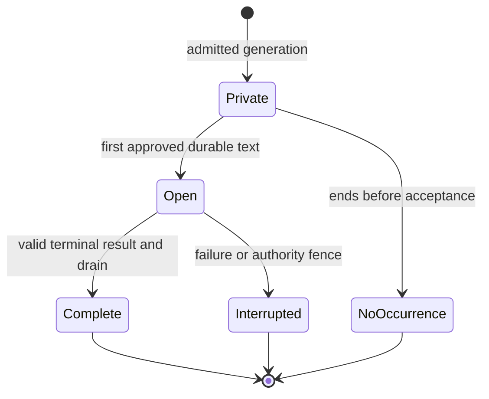

# Shared NPC speech streaming — technical design

| Status | Current progress | Last updated |
| --- | --- | --- |
| In progress | Selected text-only contract is designed; implementation and qualification are owned by NST01–NST10. | 2026-10-18 |

## Design authority and implementation baseline

Mike selected immediate progressive display for **all public NPC dialogue**, without naturally paced speech or environmental progression. This design adds an appendable text body to one instantaneous native speech occurrence. It does not add a speaking action, another clock, per-part geometry or a second speech authority.

The feature is the shared-text slice of [ND16](../maintainers/needs-design.md#nd16--hearing-and-communication-beyond-direct-path-speech) and [NC19](../maintainers/narration-and-conversations.md#nc19--progressive-display-of-structured-conversation-replies). Its [feature specification](npc-speech-streaming-feature-spec.md) owns journeys and product acceptance. The accepted [SPK design](speech-and-social-perception-tech-design.md) supplies the ordinary speech, identity, addressing and complete-experience baseline. [NST dependency order](../maintainers/npc-speech-streaming.md#dependency-order) defines the coordinated implementation cut; none of the accepted targets below is a claim of delivered runtime behavior.

Source inspection used main **`d261c94f50875edd88e8eb4a69cf8f4a413563cb`**, October 18, 2026. File links in the source map identify existing owners; types, methods and fields explicitly introduced below are **proposed contracts**, not symbols assumed to exist. Recheck those owners at implementation time without reopening the settled product choices.

## Maintained records

- Implementation stages, dependencies and exit criteria: [NST00–NST10](../maintainers/npc-speech-streaming.md).
- New limits and behavioral restrictions: [NST-L01–NST-L09](../limits/npc-speech-streaming.md). Reuse existing hearing, narration, interface, cognition, memory, native-work and provider envelopes through that inventory.
- Semantic owners: [Hearing and speech](../hearing-and-speech.md), [Narration and conversations](../narration-and-conversations.md), [Memory architecture](../memory-architecture.md), [Identity and references](../identity-and-references.md), [Save and load](../save-and-load.md), [AI providers](../ai-providers.md) and [Performance](../performance.md).
- Release qualification: [PD07](../maintainers/production-deployment.md#adult-content-and-companion-safety-release-requirements) and [Agent content and companion safety](../agent-content-and-companion-safety.md#safeguards-beyond-the-prompt). A schema-valid string alone is not approved public output.

## Current source map and required changes

| Existing owner | Baseline and required target |
| --- | --- |
| [domain speech](../../packages/domain/src/speech.ts), [events](../../packages/domain/src/events.ts), [response](../../packages/domain/src/response.ts), [types](../../packages/domain/src/types.ts) | Complete text currently emits once. Add pure begin/append/close transitions through that owner, frozen observer capsules and stream-stable partial evidence. Keep all native speech producers coherent. |
| [experience](../../packages/domain/src/experience.ts), [speech recall](../../apps/server/src/speech-recall.ts) | Existing sequence/linguistic-content selection assumes completed speech. Add one terminal semantic eligibility/readiness rule shared by hot/cold reads and all context consumers. |
| [cognition contracts](../../apps/server/src/cognition-contracts.ts), [response context](../../apps/server/src/response-context.ts), [decision task](../../apps/server/src/decision-task.ts), [decision preparation](../../apps/server/src/decision-preparation.ts) | Current generated shape is an operations array with one complete `talk.text`. Replace the generated speech representation with the record contract below; normalize into the same native logical operations and update prompts/schema/examples together. |
| [AI types](../../packages/ai/src/types.ts), [JSON stream](../../packages/ai/src/json-stream.ts), [direct client](../../packages/ai/src/client.ts), [Macrofold adapter](../../packages/ai/src/macrofold.ts), [Macrofold transport](../../apps/server/src/macrofold.ts) | Only qualified Macrofold fast/complex currently emits ordinary progress. Keep typed execution/channel observation in AI transport; implement direct Responses streaming and strict complete-record parsing without world policy in the AI package. |
| [AI director](../../apps/server/src/ai-director.ts), [decision escalator](../../apps/server/src/decision-escalator.ts), [publication](../../apps/server/src/decision-publication.ts), [validity](../../apps/server/src/decision-validity.ts) | Attach one server publication attempt to every public producer. Separate early speech acceptance from whole-response receipt/group closure; preserve genuine cancellation, evidence, accounting and escalation fences. |
| [WorldService](../../apps/server/src/world-service.ts) | `commit`, `installWorld`, `updateHistoryRevision` and notification distinguish new events from generic edits. Add a trusted speech amendment delta, exact event lookup update and durable-before-publication path, preserving history/security epochs. |
| [history](../../apps/server/src/history.ts), [history append](../../apps/server/src/history-append.ts), [personal accounts](../../apps/server/src/personal-accounts.ts), [history residency](../../apps/server/src/history-residency.ts) | Generic edits delete/reproject/revoke derived sources. Add atomic same-identity speech body/account/reference amendments and explicit active-reference retention; do not archive every cumulative prefix. |
| [view](../../apps/server/src/view.ts), [perceived events](../../apps/server/src/perceived-events.ts), [HTTP delivery](../../apps/server/src/http.ts) | Continue projecting observer evidence through the existing scoped game SSE stream. Add revisioned same-event upserts and an active-speech snapshot independent of the recent history tail. |
| [protocol](../../packages/protocol/src/index.ts), [client API](../../apps/client/src/api.ts), [connection lifecycle](../../apps/client/src/main.tsx) | Update public DTOs, validators, patch application and resets together. Reuse base/next revision and authority validation; no compatibility alias or separate speech endpoint. |
| [captions](../../apps/client/src/speech-captions.tsx), [scene](../../apps/client/src/scene.ts), [Events](../../apps/client/src/ui/world-events.tsx), [shared history reader](../../apps/client/src/ui/conversation.tsx) | Captions and Events currently skip seen IDs. Reconcile the same ID by permitted revision; preserve read progress, row order, selection, accessibility and caption density. |
| [base-world knowledge](../../packages/domain/src/worlds/base/knowledge.ts) | Introduction learning currently relies on newest awareness/current sight. Use exact terminal event evidence and the frozen permitted association; never learn a hidden or unfinished name from the header. |

### Current preview is not this feature

`NpcReplyPreviews` selects a complete independent first operation at `operations[0]`, for the requesting human with clear hearing and permitted visible attribution. It does not stream partial JSON strings. The player transcript that consumed it is retired. With decision escalation eligible/enabled, `begin()` creates a decision root and the ordinary preview guard excludes that job. Do not describe the retained preview as default multiplayer streaming.

The preview's volatile, retractable contract remains historical [NP05](../maintainers/parallel-batch-02-foundations-and-usability.md) evidence. Public speech here is irreversible accepted evidence. Do not reuse its membership, requesting-player, current sight/distance or withdrawal rules for the new public path.

## Invariants

1. One logical utterance has one event ID, original `at`/order/sequence, speaker, optional addressee, first-publication audience and immutable delivery/identity policy pins.
2. Canonical accepted text is append-only while open and immutable after closure. Empty/unapproved generation creates no speech event.
3. Every public word follows an acknowledged durable commit. Network or provider callbacks cannot directly broadcast a candidate.
4. Observer evidence contains only permitted words and coarse gaps/attribution. Public revisions advance only when that observer's projection changes.
5. Hearing is calculated once per utterance. Later geometry never changes its audience or mask. Current access/privacy authority is checked separately at every read/delivery boundary.
6. No semantic/model consumer reads open speech, including opportunistic context reads. Terminal readiness is durable and occurs once without changing occurrence chronology.
7. One original attempt owns accepted speech. It cannot be replaced by another attempt or automatically repaired through another paid call.
8. First speech acceptance does not write the whole-response terminal receipt or close the response decision group. Remaining operations retain their original order and admission checks.
9. Transport fragments, parsed records, approved passages, durable batches and public upserts are different boundaries. Their indexes are not interchangeable or public hearing metadata.
10. One slow listener cannot block the commit chain, other listeners or provider receipt settlement. Delivery buffers are bounded and cumulative.
11. Restore captures retained evidence, not a runnable stream. It closes captured open records without re-generation, remasking or automatic paid work.
12. All public producers use this owner; arbitrary generated text, private thought, narration and observe-only evaluations do not.

## State and durable data



`Private` is bounded server work, not world state. A parsed speech-end record seals the candidate utterance; it does **not** close its world lifecycle early. Completion waits for the accepted provider terminal, complete typed response validation and the serialized admission drain. Consequently malformed trailing output preserves the accepted prefix as interrupted and authorizes no unaccepted remainder. Several sequential speech operations can remain open until that terminal boundary, within the existing logical-operation allowance.

### Canonical event

Keep the ordinary event identity, occurrence metadata, origin, actor/target and accepted `data.text` under native speech. Add a typed speech-publication member to current-format speech. The exact TypeScript nesting follows SPK's selected speech event type; its semantics are required:

| Field | Type/meaning |
| --- | --- |
| `state` | `open`, `complete` or `interrupted`. Only open may append. |
| `revision` | Private canonical integer, initially 1, increased by each committed content/terminal amendment. Never copied as the listener's public revision. |
| `operationBinding` | Structured world/timeline-generation, originating job, provider attempt and logical operation identity; no ambiguous concatenated key. Server-supplied, never model-supplied. Atomic authored/player speech has the existing command binding and is terminal in its first transaction. |
| `lastAcceptedAppend` | Private admitted record boundary and digest of exact accepted content. Retry of the same boundary/digest is a no-op; conflicting reuse is a fault. |
| `maskPolicy` | Pinned incremental lexical/masking version; retained with frozen hearing and attribution policy facts. |
| `semanticReadyOrder` | Absent while open; allocated once at closure from the existing saved native order domain. |
| `terminalCause` | Trusted operational cause for recovery/inspection. Public and model projections receive only their explicitly permitted completion/interruption meaning. |

Do not expose request IDs, provider Run IDs, global append counts, raw source text, model schema fields or the full audience list in a listener's public event. Do not retain unscreened text in gameplay saves, ordinary history or observer accounts.

### Observer account

Retain one complete world/actor/event/source-family key and the same frozen perception capsule. Store actual permitted segments, physical hearing tier, permitted participant roles, event-time labels and the mask continuation state. Add an observer-local `perceivedRevision` and the allowed lifecycle projection. Terminal readiness is retained server-side for hot/cold semantic readers. The revision begins at 1 when the observer's item is first materialized and increases only for a changed permitted body/lifecycle.

A physical partial-hearing tier must not collapse to ineligible when its initial text happens to be hidden. An observer may retain a detected speech/sound occurrence without a quotation. Coalesce adjacent unintelligible gaps. Identical permitted projections produce no speech content upsert solely because other listeners heard new words.

The speaker's self-expression follows the same terminal semantic rule. Current forgetting, retirement and privacy may revoke an observer account; a later append must not recreate it or restore its old access. Suppression is retained through the existing source-revocation owner for the remaining lifecycle.

### Native transitions and receipts

Add pure native transitions, named here `beginSpeech`, `appendSpeech` and `closeSpeech`, through the existing response/speech mutation owner. They return one narrow trusted delta describing exact changed event/account keys. They are not creator commands or arbitrary event edits.

- **Begin:** validate the bound header and native eligibility, calculate the full hearing snapshot, allocate event/order and retained capsules, admit nonempty approved text, initialize stream state and exact operation progress.
- **Append:** require the exact operation binding, open lifecycle, expected revision and contiguous approved prefix; preserve all occurrence/header/audience facts, update accepted text and the changed observer segments.
- **Close:** finalize only the accepted lexical tail; set complete/interrupted, allocate semantic readiness once, and return terminal eligible sources. No new speech event or observer account is created.
- **Replay:** return the existing acknowledged result for an exact duplicate. A conflicting digest, stale authority or terminal event rejects the suffix. Terminal replay neither increments readiness nor creates another reaction.

The first append records a **speech-operation progress receipt**, not `world.responseReceipts[job.id]`. Existing director guards treat that outer receipt as full response completion; using it early would skip later life/capability checks. Terminal native response admission reuses the accepted speech receipt instead of calling ordinary `say` again, assembles the usual component outcomes, and writes the whole-response receipt once.

## Generated record contract

### Representation

Replace the generated response's complete-string speech encoding with one `records` array of complete discriminated objects. A speech operation is represented by a start record, one or more text records and an end record. Non-speech operations retain their existing request-bound payload inside an operation record. The final normalizer produces the existing ordered logical response operations; transport records do not become extra native operations.

| Record | Required fields and meaning |
| --- | --- |
| `speech_start` | `kind`, `localId`, `requiresAccepted`, `addresseeEntityId`, `volume`, `selfIntroduction`. Validate the entire closed object, permitted references and all header constraints before accepting text. |
| `speech_text` | `kind`, `localId`, `text`. An exact nonempty decoded literal piece for the currently open candidate. No trimming, added spacing or Markdown/JSON interpretation. |
| `speech_end` | `kind`, `localId`. Seals that candidate. No second end, later text or metadata revision is allowed for the ID. |
| `operation` | `kind` plus the existing **flattened** request-bound operation fields, including `localId`, `requiresAccepted`, `talk: null` and exactly one permitted non-null non-speech kind. Strip only the record tag when normalizing. |

All objects reject additional/duplicate keys. Nullable values are explicitly required for provider schemas. `records: []` remains a legitimate decision to continue without intervention. Local ID syntax, uniqueness, backward dependencies, capability-bound references, native speech lengths and whole logical-response bounds retain their existing owners. Start records and operation records each count once toward the existing 16 logical operations; text/end records do not expand that allowance. [NST-L02](../limits/npc-speech-streaming.md#nst-l02--structured-parts-and-aggregate-output) owns finite record/part bounds.

Illustrative generated body, with the request supplying the actual permitted ID:

```json
{
  "records": [
    {
      "kind": "speech_start",
      "localId": "reply",
      "requiresAccepted": [],
      "addresseeEntityId": "PERMITTED_ID",
      "volume": "normal",
      "selfIntroduction": null
    },
    { "kind": "speech_text", "localId": "reply", "text": "The bridge is east. " },
    { "kind": "speech_text", "localId": "reply", "text": "Follow the river." },
    { "kind": "speech_end", "localId": "reply" }
  ]
}
```

There is one active candidate between start/end in array order. No nested/interleaved start, non-speech operation inside a speech, missing local ID, repeated logical ID, future dependency, empty speech or text after end is accepted. Raw concatenation preserves literal pieces; the whole-field canonicalizer below preserves native trimming without trimming pieces. Validate Unicode scalar well-formedness at decoded record boundaries; a transport split may divide UTF-8 bytes or JSON escapes, but a closed text record must not contain an unpaired surrogate. The existing model limit is 1,200 **UTF-16 code units**, not graphemes.

Use the approved `@streamparser/json` 0.0.26 complete-token/complete-value path with a server-declared records path, equivalent to `$.records.*` or `$.answers.q0.value.records.*`. Validate the actual complete callback's ancestors, array parent and numeric index; an object key named `"0"` is not an array element. Copy the validated record instead of retaining mutable parser stack/parent references. Do not enable partial JSON string interpretation, search for a `text` key, depend on object property order, or introduce a custom JSON lexer. Bound depth, object keys, decoded bytes and text accumulation; nonempty parts plus the aggregate bounds derive the record-count bound. A duplicate-key detector must cover every object on and within the selected envelope, not only the current speech object. Structural violations stop candidate admission even if earlier complete records were valid.

Use a strict object root and nested `anyOf` object variants with required fields/explicit nulls. Do not require tuple `prefixItems`, conditional schema support or a root union. The same schema compiler and final interpreter serve completed and streamed results; there is no accepted old operations-only generation shape after cutover.

This explicitly changes the old whole-response-first speech boundary: each closed validated record may contribute independently admitted speech before the rest of the root document is known. Later invalid syntax or an incompatible envelope cannot retract that speech; it ends the stream interrupted and rejects the unaccepted remainder. Full typed validation remains mandatory for successful completion and any non-speech effects.

### Ordering and dependencies

Preserve native operation order. Early admission may advance only through a leading sequence of speech operations whose earlier speech candidates are sealed and approved. A `requiresAccepted` dependency is eligible only when its earlier speech operation has actually admitted its full sealed candidate. Seeing a header is not admission. The first non-speech operation, unresolved dependency, withheld passage or new-reference dependency is a barrier: buffer the remainder until final response validation and ordinary ordered native admission. Never skip the barrier to show a later independent speech early.

After final validation, visit logical operations in order. Already published speech uses its exact progress receipt and closes once. Buffered speech is screened and admitted through the same owner, usually begin+close in one transaction; its hearing snapshot is taken then. Non-speech operations use unchanged native acceptance and `requiresAccepted` meaning: admission, not physical completion. A failed action can suppress its dependent later speech but cannot undo earlier accepted words. A malformed/policy-rejected generated document authorizes none of its remaining unaccepted operations; unrelated native gameplay continues.

This is an explicit early-display restriction, not a missing public producer: all public speech uses the owner, while action-dependent content waits for the boundary required to say it safely. Do not reorder model output to increase the proportion that streams.

### Provider and caller matrix

| Caller/route | Selected integration and qualification |
| --- | --- |
| `AiDirector.decideAttempt`, `npc_response`, chat and thought jobs | Attach the same server publisher by public-speech capability. Remove the requesting-human/first-operation/no-decision-root restrictions from this new path. Use the typed `records` root. |
| Macrofold fast/complex at ordinary NPC levels | Reuse accepted Run identity, selected output channel, streamed JSON transport, same-Run observation and final receipt reconciliation. Ordinary NPC speech currently selects these routes, including configured levels 3/4. |
| Direct Responses ordinary generation | Implement the adapter's currently missing streaming mode. Select assistant output text by typed item/content identity, not output index zero; never route reasoning/refusal/tool fields into speech. |
| `DecisionEscalator` apply-mode response task | Use the caller-declared `answers.q0.value.records` path and existing original response-group entitlement. Additionally wait for complete parsed `answers.q0.status === "answered"` and `answers.q0.reason === null`. If records arrive first, hold them within existing bounds. A later duplicate/changed status, wrong group or incompatible final envelope interrupts accepted speech. Observe mode supplies no public publisher. |
| Full Macrofold execution | No ordinary current NPC response selects it. A future public caller must qualify a typed response channel through this owner before progressive enablement; completed approved output can use the same normalizer/admission. World Agent free-form progress is not such a channel. |
| Private thoughts/reflections, invention prose, Narrator and World Agent | No public speech capability. Retain their own output contracts and remaining NC19 qualification. |

Keep the AI package responsible for transport, typed execution/output identity and terminal results. The server owns parsing against its bound response task, screening, publication authority, native effects and provider spending. A stream's EOF is not proof of success or a known bill.

The direct adapter must preserve bounded SSE decoding, timeout/cancellation and final usage/receipt behavior; recognize refusal, incomplete, failed and cancelled terminals separately. Deduplicate identified provider events and reject reordered/foreign-channel content. A final selected output must match the observed candidate document and the exact already accepted prefix. Same-Run recovery may observe a terminal result and settle that original request; it cannot replace a conflicting prefix or start another paid execution.

## Canonical text and partial hearing

### Whole-field trim without changing accepted text

The current native `say` path trims the whole input. Preserve that behavior with one incremental canonicalizer per logical speech, before screening/publication. Count the raw decoded concatenation against the existing 1,200-unit bound before any trimming. Skip initial ECMAScript trim whitespace; once non-whitespace text starts, hold trailing trim whitespace privately until a later non-trim character arrives, then release that held whitespace unchanged before the character. At terminal discard only the still-held trailing trim whitespace. Reuse one shared trim-character predicate matching the current runtime's `String.prototype.trim` behavior, with explicit fixtures.

For any raw prefix, this yields the same canonical text as trimming that entire prefix, and each nonempty result extends its predecessor. It never changes internal whitespace or adds a separator. For `"  The bridge "` then `"is east.  "`, the accepted canonical prefixes are `"The bridge"` then `"The bridge is east."`. The final normalizer must produce exactly the same string. Do not independently trim the two records and accidentally create `"bridgeis"`.

Do not normalize NFC/NFD, replace malformed Unicode, silently crop an over-limit field or split a surrogate pair. A raw all-whitespace candidate creates no world occurrence and is invalid as a nonempty logical speech. On interruption, only canonical text already durably accepted is eligible for tail sealing; queued/screened-but-unsaved text is not part of it.

### Stream-stable partial mask

The old whole-string `partialSpeech()` builds and shuffles runs using the eventual total word count; rerunning it on prefixes would change earlier evidence. The selected current-format policy replaces that algorithm for **all new speech**, including complete player/authored speech, so the same final words and initial listener capsule do not depend on whether generation streamed. Existing retained evidence is never remasked.

Pin the application mask revision, segmentation implementation/data-build identity, requested/resolved locale and word/extended-grapheme settings from the qualified runtime. The current `Intl.Segmenter('und')` implementation must identify that supported pin; arbitrary host/runtime portability is not assumed. Persist actual permitted segments and enough continuation facts to close a supported open save without interpreting them under another policy.

Use this deterministic algorithm:

1. Keep an accepted unsealed canonical tail. Segment extended grapheme clusters using the pinned owner; the last cluster of an open tail remains provisional until a following cluster or terminal establishes its end.
2. A robust separator is a **complete grapheme cluster consisting only of** U+0009–U+000D, U+0020, U+0085, U+2028 or U+2029. Do not use `\s`, punctuation, apostrophes, decimal dots, NBSP or NNBSP as additional early separators. Space-plus-combining-mark/ZWJ and prepend-plus-space clusters do not match.
3. Text between robust separators is an island. Once sealed, run the pinned word segmenter over that island once and keep `isWordLike` spans. Align each span outward to whole grapheme boundaries; merge overlapping aligned spans before assigning lexical indices. Never retokenize a sealed island.
4. Number lexical units globally across islands, beginning at zero. Pair `(0,1)`, `(2,3)` and so on. Derive one stable selection bit per pair using an unambiguous structured key of mask policy, world seed, event ID, observer ID and pair ordinal through the existing local deterministic hash/randomness owner. Do not consume shared simulation RNG.
5. Bit 0 reveals the first unit and hides the second; bit 1 hides the first and reveals the second. Hold an unmatched unit while open. At terminal, seal the entire remaining accepted island and apply that same pair bit to a singleton: 0 reveals it, 1 hides it.
6. For a contiguous revealed run, retain the exact canonical substring from its first lexical span's start through its last span's end. Preserve intervening punctuation/spacing only between adjacent revealed units. Omit leading/trailing nonword material outside those spans; never copy glue across a hidden word. Represent each hidden run with one opaque gap and coalesce adjacent gaps.
7. Append newly resolved segments or extend a last adjacent heard run; never change an earlier heard/hidden decision. Persist those actual segments and private lexical/tail continuation facts. A pending tail does not add a guessed gap or progress estimate.

Ordinary space-separated partial speech progresses; unspaced Chinese/Japanese/Thai, a URL or an unusual combining sequence can wait until the next robust separator or closure. Clear/self evidence receives canonical accepted text without this lexical masking delay. This deliberate partial-listener latency tradeoff avoids a new online dictionary tokenizer.

Keep physical hearing tier and frozen participant grants separate from available words. A hidden singleton may yield only an opaque gap; a punctuation/emoji-only utterance may yield no lexical segments. Render a permitted generic indistinct-speech description rather than an empty quote, guessed name or new undetected state. Repeated hidden/unsealed text must not increment an observer's public revision or send an empty message per source part. Lifecycle closure itself is a permitted observable change. The half-word policy permits coarse inference; no additional exact source-length/progress counter is disclosed.

### Recognition, introductions and native sound evidence

At begin, SPK's existing permitted detection, direct-addressing and stable-source association run once. They do not grant the `selfIntroduction` name annotation. At terminal, the name owner resolves the **exact event/observer** capsule and accepted words; it may learn a complete supported name actually heard without a gap, including a fully heard name in an interrupted prefix. A header-only, hidden, truncated or rejected name grants nothing. Do not use `awareness.at(-1)` or current sight; later events/movement may have intervened. The event's original label stays frozen while future labels can use newly learned knowledge.

If SPK sound-only receivers are enabled, retain their own detected/physical evidence without inventing linguistic awareness. The initial sensory facts are fixed; native sound-reaction work derived from this occurrence receives one terminal readiness under its existing owner. No per-part sound pulse, startle, waking, appraisal or name acquisition is introduced.

## Server publication attempt and decision ownership

### One bounded tracked owner

Create a server-owned publication attempt alongside the existing admitted AI job. Bind world/timeline/generation, actor/control/physical-life authority, root job and provider attempt, response task/schema/path, decision group, source/cursor proof, permitted references, policy digest and current useful deadline. The model supplies none of these grants. Use the ordinary job lifetime and existing AI admission slot; there is no new stream queue or scheduler.

The attempt owns the parser, at most one assembling record sequence, bounded candidate text per logical operation, one screening operation, one cumulative pending suffix per admitted utterance, one active serialized admission task and one scheduled continuation wake. The existing synchronous `onProgress` callback validates/enqueues into this bounded state and returns. It never launches an untracked `async` world write. Callback/observer failure cannot suppress provider terminal observation or settlement; the attempt records the admission fault and fences content while the original transport continues its accounting obligations.

An exact duplicate provider event/parsed record does not append again. Require ordered content from the one qualified execution/channel. Conflicting same-position content, foreign Run/channel, missing/reordered delivery or parser overflow makes early delivery unusable. Same-Run observation may recover a compatible final candidate within the same still-current attempt; it cannot silently resume a closed occurrence or replace the published prefix. Do not restart a paid request to recover display.

### Passage approval contract

Before public acceptance, pass the canonical accepted prefix, proposed next canonical boundary, bounded unscreened context and trusted content-policy/version/caller identity to the existing qualified output-admission owner. The result is one of:

| Result | Exact effect |
| --- | --- |
| `allow` | Approves an exact canonical candidate boundary/digest with its current policy proof. It is still private until the commit succeeds. |
| `hold` | Needs more context. Keep bounded private text and re-evaluate when new complete records or terminal context arrive; no public suffix. |
| `stop` | Policy rejection, unavailable required screening or unrecoverable screening failure. Fence this attempt's unaccepted remainder, retain accepted text and close interrupted when the world owner can commit. |

Screen a meaningful passage with context, not individual provider tokens. A closed JSON string alone is insufficient. Screening may merge several records; it cannot rewrite accepted text, insert a synthetic replacement, bless another caller or approve unspecified future words. A changed policy/authority proof must be rechecked before acceptance. At a sealed/terminal candidate, unresolved `hold` cannot be treated as `allow`. No listener-specific model/screening request is created; listener projection is native evidence after the single speech-content gate.

This is a required interface and integration gate, not a claim that PD07's implementation/provider qualification is already complete. Unqualified progressive routes remain explicitly completed-output-only, and completed output still obeys required content checks. Any billable screening uses existing explicit admission/reservation/receipt ownership; this feature creates no independent paid per-part retry path.

### Admission loop

Run the following through the existing WorldService serialized owner:

1. Process complete records in their original order. Stop early publication at the defined logical barrier; coalesce approved canonical growth in the bounded pending state.
2. The first eligible nonempty approved passage schedules immediately if no writer is active. Continuations schedule no more frequently than the 250 ms **start window** from the preceding continuation admission start. There is at most one pending wake; an in-flight write is never overlapped. Readiness while paused follows the existing caller pause owner.
3. Inside the commit, recheck the exact bound current job/group/attempt, control/life/timeline, required source proof, useful deadline, policy and native eligibility. Begin performs first-publication hearing; append uses its frozen capsule and does no geometry query.
4. Apply the pure native transition. Prepare the narrow history delta, changed observer accounts and exact source references. Include the matching operational decision mutation in the same durable transaction.
5. Only after successful durable commit acknowledge that canonical prefix, update the event lookup/derived active indexes and notify the existing game publication owner. No socket write participates in this transaction.
6. If candidate text arrives during the write, merge it into the one pending suffix and schedule the next eligible drain. Terminal intent bypasses the continuation wait but still obeys serialization, screening, pause and authority.

250 ms is an initial batching value, not an output SLA; screening and database latency may dominate. Do not insert a per-character delay or a second batch timer per observer. If the bounded buffer cannot retain further required input, fence publication, close the accepted prefix and finish observing/settling the original provider request.

### First accepted words reserve the existing response

Extend `DecisionState`/publication through its existing `operationalChange` and `mutateDecision` transaction, not a separate job database. Add a typed stream-publication claim for the original response group containing the owning attempt, admitted operation bindings and terminal state. A group can remain open for that same publisher while being unavailable to replacement/original/higher claims. `decisionClaimCurrent` must accept only that exact owner's continuation and reject another attempt.

In the first durable speech transaction, bind the group to that publisher and consume the originating decision cursor once through the existing cursor owner. Record that consumption for idempotent finalization/recovery. Do **not** call the current `finishDecisionPublication` per passage: its partial-success path would close q0 before later words/actions. Do **not** write the outer whole-response receipt. A header or screened-but-unsaved passage consumes no public response entitlement.

Once any words are accepted, the same response group cannot be replaced, escalated as an unanswered response or automatically repaired. Other independent decision groups retain their existing rules. At final drain, reuse accepted speech component progress instead of re-emitting it, apply remaining valid operations in order and write the normal receipt/group resolution once. A failed/partial attempt becomes ended-unresolved under the existing owner; it does not make the already consumed trigger available for another paid answer.

### Validity, pause and terminal coordination

Open speech, canonical/perceived revisions and its own pending progress are excluded from semantic context and the attempt's captured semantic validity proof. Prefer deferring conversation/context bookkeeping to closure under SPK. If begin must update an owned structural field, conditionally advance only that exact expected field in the same transaction; never refresh the entire captured world/source digest and accidentally authorize unrelated changes.

Preserve current independent validity changes, including selected source mutation/forgetting, a new relevant addressed event, action/outcome/agency or mind changes, physical-life/control loss and deadlines. Current `decisionValidity` can reject more than the older urgent-evidence threshold; do not simplify it to “only urgent events cancel.” These are existing AI request guards, not per-word physical interruption mechanics. Own terminal effects must not cancel/reopen their publisher: mark it settling/fenced before notification and validate the final transaction against the pre-effect admission snapshot.

Explicit player requests retain their existing `awaitResume` behavior: no new world effects or paid stage begins while paused. A pending terminal waits for that allowed world-commit boundary, with bounded state and no synthetic speaking clock. Autonomous jobs retain existing cancellation. Shutdown/authority reset fences callbacks immediately; cleanup or startup reconciliation closes any remaining captured open record through the authorized owner. A late callback never gains permission from the fact that some words previously committed.

Observe/settle the provider terminal independently of public delivery, then validate the full typed envelope, exact record sequence and canonical-prefix match, await the tracked screening/admission drain, and finalize through the serial world owner. Accepted provider success plus valid complete response permits complete closure. Invalid/refused/truncated/uncertain output, source/authority loss or stop permits only interrupted closure of the already committed prefix and rejects its unaccepted remainder. Billing uncertainty is retained in its receipt owner; no stream state can assert that a call was free. Database failure withholds the unsaved suffix; if even closure cannot persist, fence further publication and let the existing storage-failure/recovery owner close the last durable open state before serving it again.

## Terminal semantic readiness

Occurrence order and eligibility order are different facts. At the source baseline, speech awareness uses `event.order ?? event.sequence`; native `event.order` uses the saved `world.nextId` domain. Allocate a terminal `semanticReadyOrder` through that **same native order allocator**, not the separate event-count sequence and not a new speech counter. This allocation does not add an occurrence or change its original history time/order.

Introduce one shared selector, conceptually `semanticEvidenceOrder(source)`:

- Open speech: absent/ineligible.
- Terminal progressive speech: retained `semanticReadyOrder`.
- Ordinary already terminal evidence: its existing awareness/evidence order.

Use it for selection, comparison, sorting and consumed maxima throughout experience conversion, `unseenExperiences`, director trigger/context filters and `responseInterruptions`. The latter's occurrence-ordered backward scan may not break when it encounters an old occurrence: an older row can have newly allocated readiness. Use the existing scoped index/query or a bounded candidate selection by readiness, with a rebuildable index over retained canonical accounts. Keep ordinary history sorting by occurrence order.

Closure, ready-order allocation, word-derived permitted consequences and the terminal observer accounts commit atomically. A repeat closure returns the recorded result. If a crash follows commit but precedes a wake notification, normal actor-work/decision reconstruction finds that readiness. There is no new permanent queue, one job per part or extra world event solely to announce completion.

**All semantic paths must use the same eligibility rule**, not only subscriptions: direct selected-source reads; recent and cold recall; response context; in-flight evidence refresh; model-facing lexical/vector search; embedding eligibility; compaction/summaries/consolidation/reflection/dreams; Narrator/story nomination; appraisal/commitment/teaching/name interpretation; and action-result experience that references quoted speech. Human Events/search/source detail may read the latest committed open body through a separately declared human-presentation purpose. Do not accidentally reuse that human query as model context. Open source bodies cannot enter a derivative that assumes an immutable quote.

One closed occurrence supplies one semantic opportunity per eligible observer, subject to existing attention/budget/ability rules; it does not guarantee a reply. Preserve a structured interrupted marker for an incomplete accepted prefix. Native consumers cannot assume a missing negation/condition/ending, and a text fragment alone is not proof of an unperformed action or a complete promise.
