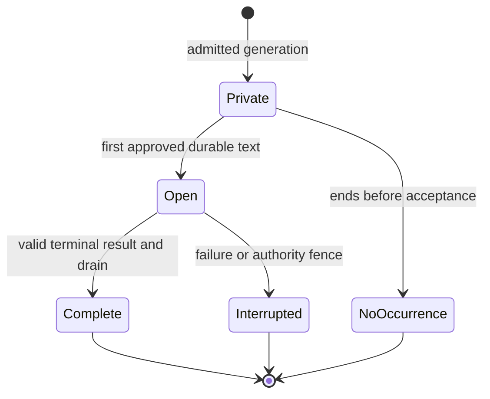

# Shared NPC speech streaming — technical design

| Status | Current progress | Last updated |
| --- | --- | --- |
| In progress | Selected text-only contract is designed; implementation and qualification are owned by NST01–NST10. | 2026-10-18 |

## Design authority and implementation baseline

Mike selected immediate progressive display for **all public NPC dialogue**, without naturally paced speech or environmental progression. This design adds an appendable text body to one instantaneous native speech occurrence. It does not add a speaking action, another clock, per-part geometry or a second speech authority.

The feature is the shared-text slice of [ND16](../maintainers/needs-design.md#nd16--hearing-and-communication-beyond-direct-path-speech) and [NC19](../maintainers/narration-and-conversations.md#nc19--progressive-display-of-structured-conversation-replies). Its [feature specification](npc-speech-streaming-feature-spec.md) owns journeys and product acceptance. The accepted [SPK design](speech-and-social-perception-tech-design.md) supplies the ordinary speech, identity, addressing and complete-experience baseline. [NST dependency order](../maintainers/npc-speech-streaming.md#dependency-order) defines the coordinated implementation cut; none of the accepted targets below is a claim of delivered runtime behavior.

Source inspection used main **`d261c94f50875edd88e8eb4a69cf8f4a413563cb`**, October 18, 2026. File links in the source map identify existing owners; types, methods and fields explicitly introduced below are **proposed contracts**, not symbols assumed to exist. Recheck those owners at implementation time without reopening the settled product choices.

## Maintained records

- Implementation stages, dependencies and exit criteria: [NST00–NST10](../maintainers/npc-speech-streaming.md).
- New limits and behavioral restrictions: [NST-L01–NST-L09](../limits/npc-speech-streaming.md). Reuse existing hearing, narration, interface, cognition, memory, native-work and provider envelopes through that inventory.
- Semantic owners: [Hearing and speech](../hearing-and-speech.md), [Narration and conversations](../narration-and-conversations.md), [Memory architecture](../memory-architecture.md), [Identity and references](../identity-and-references.md), [Save and load](../save-and-load.md), [AI providers](../ai-providers.md) and [Performance](../performance.md).
- Release qualification: [PD07](../maintainers/production-deployment.md#adult-content-and-companion-safety-release-requirements) and [Agent content and companion safety](../agent-content-and-companion-safety.md#safeguards-beyond-the-prompt). A schema-valid string alone is not approved public output.

## Current source map and required changes

| Existing owner | Baseline and required target |
| --- | --- |
| [domain speech](../../packages/domain/src/speech.ts), [events](../../packages/domain/src/events.ts), [response](../../packages/domain/src/response.ts), [types](../../packages/domain/src/types.ts) | Complete text currently emits once. Add pure begin/append/close transitions through that owner, frozen observer capsules and stream-stable partial evidence. Keep all native speech producers coherent. |
| [experience](../../packages/domain/src/experience.ts), [speech recall](../../apps/server/src/speech-recall.ts) | Existing sequence/linguistic-content selection assumes completed speech. Add one terminal semantic eligibility/readiness rule shared by hot/cold reads and all context consumers. |
| [cognition contracts](../../apps/server/src/cognition-contracts.ts), [response context](../../apps/server/src/response-context.ts), [decision task](../../apps/server/src/decision-task.ts), [decision preparation](../../apps/server/src/decision-preparation.ts) | Current generated shape is an operations array with one complete `talk.text`. Replace the generated speech representation with the record contract below; normalize into the same native logical operations and update prompts/schema/examples together. |
| [AI types](../../packages/ai/src/types.ts), [JSON stream](../../packages/ai/src/json-stream.ts), [direct client](../../packages/ai/src/client.ts), [Macrofold adapter](../../packages/ai/src/macrofold.ts), [Macrofold transport](../../apps/server/src/macrofold.ts) | Only qualified Macrofold fast/complex currently emits ordinary progress. Keep typed execution/channel observation in AI transport; implement direct Responses streaming and strict complete-record parsing without world policy in the AI package. |
| [AI director](../../apps/server/src/ai-director.ts), [decision escalator](../../apps/server/src/decision-escalator.ts), [publication](../../apps/server/src/decision-publication.ts), [validity](../../apps/server/src/decision-validity.ts) | Attach one server publication attempt to every public producer. Separate early speech acceptance from whole-response receipt/group closure; preserve genuine cancellation, evidence, accounting and escalation fences. |
| [WorldService](../../apps/server/src/world-service.ts) | `commit`, `installWorld`, `updateHistoryRevision` and notification distinguish new events from generic edits. Add a trusted speech amendment delta, exact event lookup update and durable-before-publication path, preserving history/security epochs. |
| [history](../../apps/server/src/history.ts), [history append](../../apps/server/src/history-append.ts), [personal accounts](../../apps/server/src/personal-accounts.ts), [history residency](../../apps/server/src/history-residency.ts) | Generic edits delete/reproject/revoke derived sources. Add atomic same-identity speech body/account/reference amendments and explicit active-reference retention; do not archive every cumulative prefix. |
| [view](../../apps/server/src/view.ts), [perceived events](../../apps/server/src/perceived-events.ts), [HTTP delivery](../../apps/server/src/http.ts) | Continue projecting observer evidence through the existing scoped game SSE stream. Add revisioned same-event upserts and an active-speech snapshot independent of the recent history tail. |
| [protocol](../../packages/protocol/src/index.ts), [client API](../../apps/client/src/api.ts), [connection lifecycle](../../apps/client/src/main.tsx) | Update public DTOs, validators, patch application and resets together. Reuse base/next revision and authority validation; no compatibility alias or separate speech endpoint. |
| [captions](../../apps/client/src/speech-captions.tsx), [scene](../../apps/client/src/scene.ts), [Events](../../apps/client/src/ui/world-events.tsx), [shared history reader](../../apps/client/src/ui/conversation.tsx) | Captions and Events currently skip seen IDs. Reconcile the same ID by permitted revision; preserve read progress, row order, selection, accessibility and caption density. |
| [base-world knowledge](../../packages/domain/src/worlds/base/knowledge.ts) | Introduction learning currently relies on newest awareness/current sight. Use exact terminal event evidence and the frozen permitted association; never learn a hidden or unfinished name from the header. |

### Current preview is not this feature

`NpcReplyPreviews` selects a complete independent first operation at `operations[0]`, for the requesting human with clear hearing and permitted visible attribution. It does not stream partial JSON strings. The player transcript that consumed it is retired. With decision escalation eligible/enabled, `begin()` creates a decision root and the ordinary preview guard excludes that job. Do not describe the retained preview as default multiplayer streaming.

The preview's volatile, retractable contract remains historical [NP05](../maintainers/parallel-batch-02-foundations-and-usability.md) evidence. Public speech here is irreversible accepted evidence. Do not reuse its membership, requesting-player, current sight/distance or withdrawal rules for the new public path.

## Invariants

1. One logical utterance has one event ID, original `at`/order/sequence, speaker, optional addressee, first-publication audience and immutable delivery/identity policy pins.
2. Canonical accepted text is append-only while open and immutable after closure. Empty/unapproved generation creates no speech event.
3. Every public word follows an acknowledged durable commit. Network or provider callbacks cannot directly broadcast a candidate.
4. Observer evidence contains only permitted words and coarse gaps/attribution. Public revisions advance only when that observer's projection changes.
5. Hearing is calculated once per utterance. Later geometry never changes its audience or mask. Current access/privacy authority is checked separately at every read/delivery boundary.
6. No semantic/model consumer reads open speech, including opportunistic context reads. Terminal readiness is durable and occurs once without changing occurrence chronology.
7. One original attempt owns accepted speech. It cannot be replaced by another attempt or automatically repaired through another paid call.
8. First speech acceptance does not write the whole-response terminal receipt or close the response decision group. Remaining operations retain their original order and admission checks.
9. Transport fragments, parsed records, approved passages, durable batches and public upserts are different boundaries. Their indexes are not interchangeable or public hearing metadata.
10. One slow listener cannot block the commit chain, other listeners or provider receipt settlement. Delivery buffers are bounded and cumulative.
11. Restore captures retained evidence, not a runnable stream. It closes captured open records without re-generation, remasking or automatic paid work.
12. All public producers use this owner; arbitrary generated text, private thought, narration and observe-only evaluations do not.

## State and durable data



`Private` is bounded server work, not world state. A parsed speech-end record seals the candidate utterance; it does **not** close its world lifecycle early. Completion waits for the accepted provider terminal, complete typed response validation and the serialized admission drain. Consequently malformed trailing output preserves the accepted prefix as interrupted and authorizes no unaccepted remainder. Several sequential speech operations can remain open until that terminal boundary, within the existing logical-operation allowance.

### Canonical event

Keep the ordinary event identity, occurrence metadata, origin, actor/target and accepted `data.text` under native speech. Add a typed speech-publication member to current-format speech. The exact TypeScript nesting follows SPK's selected speech event type; its semantics are required:

| Field | Type/meaning |
| --- | --- |
| `state` | `open`, `complete` or `interrupted`. Only open may append. |
| `revision` | Private canonical integer, initially 1, increased by each committed content/terminal amendment. Never copied as the listener's public revision. |
| `operationBinding` | Structured world/timeline-generation, originating job, provider attempt and logical operation identity; no ambiguous concatenated key. Server-supplied, never model-supplied. Atomic authored/player speech has the existing command binding and is terminal in its first transaction. |
| `lastAcceptedAppend` | Private admitted record boundary and digest of exact accepted content. Retry of the same boundary/digest is a no-op; conflicting reuse is a fault. |
| `maskPolicy` | Pinned incremental lexical/masking version; retained with frozen hearing and attribution policy facts. |
| `semanticReadyOrder` | Absent while open; allocated once at closure from the existing saved native order domain. |
| `terminalCause` | Trusted operational cause for recovery/inspection. Public and model projections receive only their explicitly permitted completion/interruption meaning. |

Do not expose request IDs, provider Run IDs, global append counts, raw source text, model schema fields or the full audience list in a listener's public event. Do not retain unscreened text in gameplay saves, ordinary history or observer accounts.

### Observer account

Retain one complete world/actor/event/source-family key and the same frozen perception capsule. Store actual permitted segments, physical hearing tier, permitted participant roles, event-time labels and the mask continuation state. Add an observer-local `perceivedRevision` and the allowed lifecycle projection. Terminal readiness is retained server-side for hot/cold semantic readers. The revision begins at 1 when the observer's item is first materialized and increases only for a changed permitted body/lifecycle.

A physical partial-hearing tier must not collapse to ineligible when its initial text happens to be hidden. An observer may retain a detected speech/sound occurrence without a quotation. Coalesce adjacent unintelligible gaps. Identical permitted projections produce no speech content upsert solely because other listeners heard new words.

The speaker's self-expression follows the same terminal semantic rule. Current forgetting, retirement and privacy may revoke an observer account; a later append must not recreate it or restore its old access. Suppression is retained through the existing source-revocation owner for the remaining lifecycle.

### Native transitions and receipts

Add pure native transitions, named here `beginSpeech`, `appendSpeech` and `closeSpeech`, through the existing response/speech mutation owner. They return one narrow trusted delta describing exact changed event/account keys. They are not creator commands or arbitrary event edits.

- **Begin:** validate the bound header and native eligibility, calculate the full hearing snapshot, allocate event/order and retained capsules, admit nonempty approved text, initialize stream state and exact operation progress.
- **Append:** require the exact operation binding, open lifecycle, expected revision and contiguous approved prefix; preserve all occurrence/header/audience facts, update accepted text and the changed observer segments.
- **Close:** finalize only the accepted lexical tail; set complete/interrupted, allocate semantic readiness once, and return terminal eligible sources. No new speech event or observer account is created.
- **Replay:** return the existing acknowledged result for an exact duplicate. A conflicting digest, stale authority or terminal event rejects the suffix. Terminal replay neither increments readiness nor creates another reaction.

The first append records a **speech-operation progress receipt**, not `world.responseReceipts[job.id]`. Existing director guards treat that outer receipt as full response completion; using it early would skip later life/capability checks. Terminal native response admission reuses the accepted speech receipt instead of calling ordinary `say` again, assembles the usual component outcomes, and writes the whole-response receipt once.

## Generated record contract

### Representation

Replace the generated response's complete-string speech encoding with one `records` array of complete discriminated objects. A speech operation is represented by a start record, one or more text records and an end record. Non-speech operations retain their existing request-bound payload inside an operation record. The final normalizer produces the existing ordered logical response operations; transport records do not become extra native operations.

| Record | Required fields and meaning |
| --- | --- |
| `speech_start` | `kind`, `localId`, `requiresAccepted`, `addresseeEntityId`, `volume`, `selfIntroduction`. Validate the entire closed object, permitted references and all header constraints before accepting text. |
| `speech_text` | `kind`, `localId`, `text`. An exact nonempty decoded literal piece for the currently open candidate. No trimming, added spacing or Markdown/JSON interpretation. |
| `speech_end` | `kind`, `localId`. Seals that candidate. No second end, later text or metadata revision is allowed for the ID. |
| `operation` | `kind`, `operation`. The existing non-speech operation union, including its `localId`, dependencies and exactly one permitted non-null operation kind. `talk` is not permitted in this wrapper. |

All objects reject additional/duplicate keys. Nullable values are explicitly required for provider schemas. `records: []` remains a legitimate decision to continue without intervention. Local ID syntax, uniqueness, backward dependencies, capability-bound references, native speech lengths and whole logical-response bounds retain their existing owners. Start records and operation records each count once toward the existing 16 logical operations; text/end records do not expand that allowance. [NST-L02](../limits/npc-speech-streaming.md#nst-l02--structured-parts-and-aggregate-output) owns finite record/part bounds.

Illustrative generated body, with the request supplying the actual permitted ID:

```json
{
  "records": [
    {
      "kind": "speech_start",
      "localId": "reply",
      "requiresAccepted": [],
      "addresseeEntityId": "PERMITTED_ID",
      "volume": "normal",
      "selfIntroduction": null
    },
    { "kind": "speech_text", "localId": "reply", "text": "The bridge is east. " },
    { "kind": "speech_text", "localId": "reply", "text": "Follow the river." },
    { "kind": "speech_end", "localId": "reply" }
  ]
}
```

There is one active candidate between start/end in array order. No nested/interleaved start, non-speech operation inside a speech, missing local ID, repeated logical ID, future dependency, empty speech or text after end is accepted. Concatenation must exactly equal the normalized `talk.text`; whitespace belongs to the model's literal pieces. Validate Unicode scalar well-formedness at decoded record boundaries; a transport split may divide UTF-8 bytes or JSON escapes, but a closed text record must not contain an unpaired surrogate. The existing model limit is 1,200 **UTF-16 code units**, not graphemes.

Use the approved `@streamparser/json` complete-token/complete-value path with a server-declared records path. Do not enable partial JSON string interpretation, search for a `text` key, depend on object property order, or introduce a custom JSON lexer. Bound depth, object keys, decoded bytes, record count and text accumulation; a duplicate-key detector must cover every object on and within the selected envelope, not only the current speech object. Structural violations stop candidate admission even if earlier complete records were valid.

This explicitly changes the old whole-response-first speech boundary: each closed validated record may contribute independently admitted speech before the rest of the root document is known. Later invalid syntax or an incompatible envelope cannot retract that speech; it ends the stream interrupted and rejects the unaccepted remainder. Full typed validation remains mandatory for successful completion and any non-speech effects.

### Ordering and dependencies

Preserve native operation order. Early admission may advance only through a leading sequence of speech operations whose earlier speech candidates are sealed and approved. A `requiresAccepted` dependency is eligible only when its earlier speech operation has actually admitted its full sealed candidate. Seeing a header is not admission. The first non-speech operation, unresolved dependency, withheld passage or new-reference dependency is a barrier: buffer the remainder until final response validation and ordinary ordered native admission. Never skip the barrier to show a later independent speech early.

After final validation, visit logical operations in order. Already published speech uses its exact progress receipt and closes once. Buffered speech is screened and admitted through the same owner, usually begin+close in one transaction; its hearing snapshot is taken then. Non-speech operations use unchanged native acceptance and `requiresAccepted` meaning: admission, not physical completion. A failed action can suppress its dependent later speech but cannot undo earlier accepted words. A malformed/policy-rejected generated document authorizes none of its remaining unaccepted operations; unrelated native gameplay continues.

This is an explicit early-display restriction, not a missing public producer: all public speech uses the owner, while action-dependent content waits for the boundary required to say it safely. Do not reorder model output to increase the proportion that streams.

### Provider and caller matrix

| Caller/route | Selected integration and qualification |
| --- | --- |
| `AiDirector.decideAttempt`, `npc_response`, chat and thought jobs | Attach the same server publisher by public-speech capability. Remove the requesting-human/first-operation/no-decision-root restrictions from this new path. Use the typed `records` root. |
| Macrofold fast/complex at ordinary NPC levels | Reuse accepted Run identity, selected output channel, streamed JSON transport, same-Run observation and final receipt reconciliation. Ordinary NPC speech currently selects these routes, including configured levels 3/4. |
| Direct Responses ordinary generation | Implement the adapter's currently missing streaming mode. Select assistant output text by typed item/content identity, not output index zero; never route reasoning/refusal/tool fields into speech. |
| `DecisionEscalator` apply-mode response task | Use the caller-declared `answers.q0.value.records` path and existing original response-group entitlement. A response-start record is the independently admitted public commitment; later `abstained`, wrong group or incompatible final envelope is invalid and interrupts accepted speech. Observe mode supplies no public publisher. |
| Full Macrofold execution | No ordinary current NPC response selects it. A future public caller must qualify a typed response channel through this owner before progressive enablement; completed approved output can use the same normalizer/admission. World Agent free-form progress is not such a channel. |
| Private thoughts/reflections, invention prose, Narrator and World Agent | No public speech capability. Retain their own output contracts and remaining NC19 qualification. |

Keep the AI package responsible for transport, typed execution/output identity and terminal results. The server owns parsing against its bound response task, screening, publication authority, native effects and provider spending. A stream's EOF is not proof of success or a known bill.

The direct adapter must preserve bounded SSE decoding, timeout/cancellation and final usage/receipt behavior; recognize refusal, incomplete, failed and cancelled terminals separately. Deduplicate identified provider events and reject reordered/foreign-channel content. A final selected output must match the observed candidate document and the exact already accepted prefix. Same-Run recovery may observe a terminal result and settle that original request; it cannot replace a conflicting prefix or start another paid execution.

## Further implementation sections

The publication, evidence, persistence, delivery, UI and qualification contracts below are completed in the next documentation checkpoint before review. No implementation is authorized by this checkpoint.
