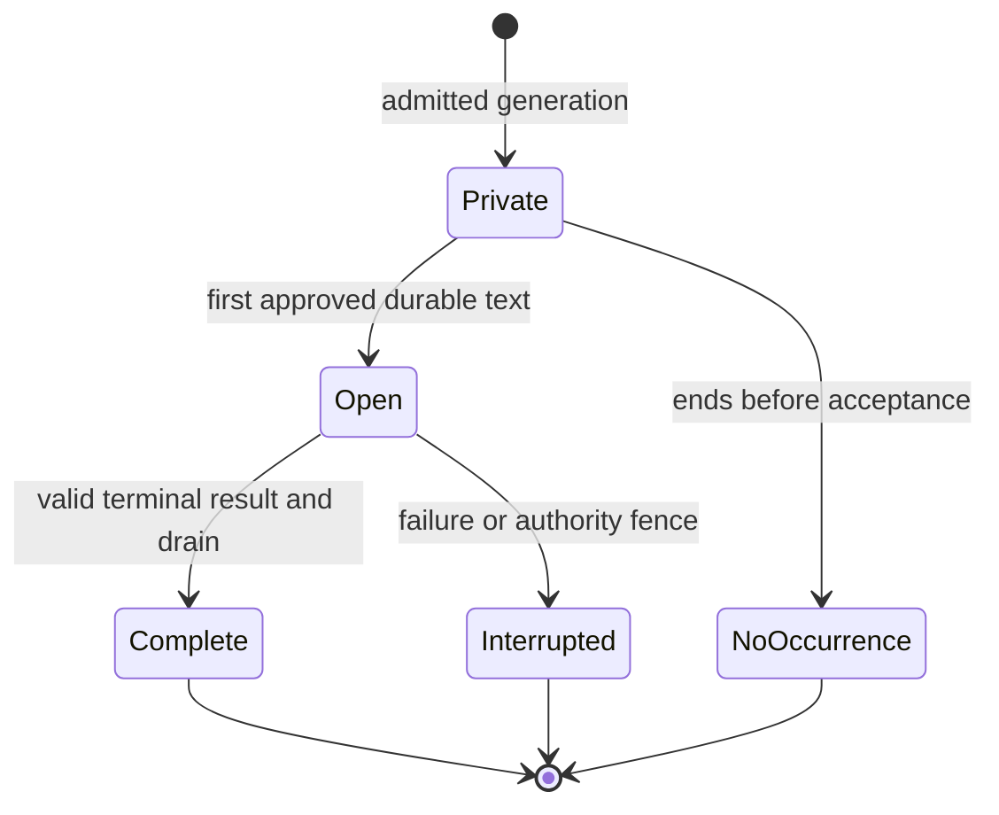

# Shared NPC speech streaming — technical design

| Status      | Current progress                                                                                    | Last updated |
| ----------- | --------------------------------------------------------------------------------------------------- | ------------ |
| In progress | Selected text-only contract is designed; implementation and qualification are owned by NST01–NST10. | 2026-10-18   |

## Design authority and implementation baseline

Mike selected immediate progressive display for **all public NPC dialogue**, without naturally paced speech or environmental progression. This design adds an appendable text body to one instantaneous native speech occurrence. It does not add a speaking action, another clock, per-part geometry or a second speech authority.

The feature is the shared-text slice of [ND16](../maintainers/needs-design.md#nd16--hearing-and-communication-beyond-direct-path-speech) and [NC19](../maintainers/narration-and-conversations.md#nc19--progressive-display-of-structured-conversation-replies). Its [feature specification](npc-speech-streaming-feature-spec.md) owns journeys and product acceptance. The accepted [SPK design](speech-and-social-perception-tech-design.md) supplies the ordinary speech, identity, addressing and complete-experience baseline. [NST dependency order](../maintainers/npc-speech-streaming.md#dependency-order) defines the coordinated implementation cut; none of the accepted targets below is a claim of delivered runtime behavior.

Source inspection is reconciled with **Macrofold/OpenLegend `main` at `0b1262a597ca718be54c287eea0619b073952f32`**, October 18, 2026, including its shared network and provider-accounting owners. File links in the source map identify existing owners; types, methods and fields explicitly introduced below are **proposed contracts**, not symbols assumed to exist. This is source/design review, not runtime qualification. Recheck changed owners at implementation time without reopening the settled product choices.

## Maintained records

- Implementation stages, dependencies and exit criteria: [NST00–NST10](../maintainers/npc-speech-streaming.md).
- New limits and behavioral restrictions: [NST-L01–NST-L09](../limits/npc-speech-streaming.md). Reuse existing hearing, narration, interface, cognition, memory, native-work and provider envelopes through that inventory.
- Semantic owners: [Hearing and speech](../hearing-and-speech.md), [Narration and conversations](../narration-and-conversations.md), [Memory architecture](../memory-architecture.md), [Identity and references](../identity-and-references.md), [Save and load](../save-and-load.md), [AI providers](../ai-providers.md) and [Performance](../performance.md).
- Release qualification: [PD07](../maintainers/production-deployment.md#adult-content-and-companion-safety-release-requirements) and [Agent content and companion safety](../agent-content-and-companion-safety.md#safeguards-beyond-the-prompt). A schema-valid string alone is not approved public output.

## Current source map and required changes

| Existing owner                                                                                                                                                                                                                                                                                                                                                                                                                   | Baseline and required target                                                                                                                                                                                                                             |
| -------------------------------------------------------------------------------------------------------------------------------------------------------------------------------------------------------------------------------------------------------------------------------------------------------------------------------------------------------------------------------------------------------------------------------- | -------------------------------------------------------------------------------------------------------------------------------------------------------------------------------------------------------------------------------------------------------- |
| [domain speech](../../packages/domain/src/speech.ts), [events](../../packages/domain/src/events.ts), [response](../../packages/domain/src/response.ts), [types](../../packages/domain/src/types.ts)                                                                                                                                                                                                                              | Complete text currently emits once. Add pure begin/append/close transitions through that owner, frozen observer capsules and stream-stable partial evidence. Keep all native speech producers coherent.                                                  |
| [experience](../../packages/domain/src/experience.ts), [speech recall](../../apps/server/src/speech-recall.ts)                                                                                                                                                                                                                                                                                                                   | Existing sequence/linguistic-content selection assumes completed speech. Add one terminal semantic eligibility/readiness rule shared by hot/cold reads and all context consumers.                                                                        |
| [cognition contracts](../../apps/server/src/cognition-contracts.ts), [response context](../../apps/server/src/response-context.ts), [decision task](../../apps/server/src/decision-task.ts), [decision preparation](../../apps/server/src/decision-preparation.ts)                                                                                                                                                               | Current generated shape is an operations array with one complete `talk.text`. Replace the generated speech representation with the record contract below; normalize into the same native logical operations and update prompts/schema/examples together. |
| [AI types](../../packages/ai/src/types.ts), [JSON stream](../../packages/ai/src/json-stream.ts), [direct client](../../packages/ai/src/client.ts), [Macrofold adapter](../../packages/ai/src/macrofold.ts), [Macrofold transport](../../apps/server/src/macrofold.ts)                                                                                                                                                            | Only qualified Macrofold fast/complex currently emits ordinary progress. Keep typed execution/channel observation in AI transport; implement direct Responses streaming and strict complete-record parsing without world policy in the AI package.       |
| [AI director](../../apps/server/src/ai-director.ts), [decision escalator](../../apps/server/src/decision-escalator.ts), [publication](../../apps/server/src/decision-publication.ts), [validity](../../apps/server/src/decision-validity.ts)                                                                                                                                                                                     | Attach one server publication attempt to every public producer. Separate early speech acceptance from whole-response receipt/group closure; preserve genuine cancellation, evidence, accounting and escalation fences.                                   |
| [WorldService](../../apps/server/src/world-service.ts)                                                                                                                                                                                                                                                                                                                                                                           | `commit`, `installWorld`, `updateHistoryRevision` and notification distinguish new events from generic edits. Add a trusted speech amendment delta, exact event lookup update and durable-before-publication path, preserving history/security epochs.   |
| [history](../../apps/server/src/history.ts), [history append](../../apps/server/src/history-append.ts), [personal accounts](../../apps/server/src/personal-accounts.ts), [history residency](../../apps/server/src/history-residency.ts)                                                                                                                                                                                         | Generic edits delete/reproject/revoke derived sources. Add atomic same-identity speech body/account/reference amendments and explicit active-reference retention; do not archive every cumulative prefix.                                                |
| [memory repository](../../apps/server/src/memory-repository.ts), [store](../../apps/server/src/store.ts), [journal application](../../apps/server/src/journal-application.ts), [journal data](../../apps/server/src/world-journal-data.ts), [record schema](../../apps/server/src/world-record-schema.ts), [records](../../apps/server/src/world-records.ts), [current-world validation](../../apps/server/src/upgrade-world.ts) | Carry validated amendment classification through normal saves and reconstruction. Exempt exact benign open-speech amendments from per-prefix memory source archives/derivative churn; preserve unrelated corrections in the same transaction.            |
| [view](../../apps/server/src/view.ts), [perceived events](../../apps/server/src/perceived-events.ts), [HTTP delivery](../../apps/server/src/http.ts)                                                                                                                                                                                                                                                                             | Continue projecting observer evidence through the existing scoped game SSE stream. Add revisioned same-event upserts and an active-speech snapshot independent of the recent history tail.                                                               |
| [protocol](../../packages/protocol/src/index.ts), [client API](../../apps/client/src/api.ts), [connection lifecycle](../../apps/client/src/main.tsx)                                                                                                                                                                                                                                                                             | Update public DTOs, validators, patch application and resets together. Reuse base/next revision and authority validation; no compatibility alias or separate speech endpoint.                                                                            |
| [captions](../../apps/client/src/speech-captions.tsx), [scene](../../apps/client/src/scene.ts), [Events](../../apps/client/src/ui/world-events.tsx), [shared history reader](../../apps/client/src/ui/conversation.tsx)                                                                                                                                                                                                          | Captions and Events currently skip seen IDs. Reconcile the same ID by permitted revision; preserve read progress, row order, selection, accessibility and caption density.                                                                               |
| [world renderer interface](../../apps/client/src/world-renderer.ts), [client acceptance](../../apps/client/src/main.tsx)                                                                                                                                                                                                                                                                                                         | Deliver validated speech changes synchronously to existing caption/loaded-history owners before React render coalescing can skip a terminal snapshot. Retain one synchronously current accepted-view reference, not a new message queue.                 |
| [base-world knowledge](../../packages/domain/src/worlds/base/knowledge.ts)                                                                                                                                                                                                                                                                                                                                                       | Introduction learning currently relies on newest awareness/current sight. Use exact terminal event evidence and the frozen permitted association; never learn a hidden or unfinished name from the header.                                               |

### Engine and selected-world ownership

The installed world's speech/perception selection owns fictional disclosure rules. NST extends that existing composition and validation boundary; it does not make the bundled world's hearing or half-word rule an engine law.

| Responsibility                                                             | Owner and result                                                                                                                                                                                      | Must not do                                                                                             |
| -------------------------------------------------------------------------- | ----------------------------------------------------------------------------------------------------------------------------------------------------------------------------------------------------- | ------------------------------------------------------------------------------------------------------- |
| Identity, append integrity, serialization and reusable Unicode preparation | Native speech/events and the current record owners maintain one event, canonical lexical continuation and exact retained observer evidence.                                                           | Choose a world's hearing, recognition or proportion of words revealed.                                  |
| Detection, intelligibility, recognition and lexical disclosure selection   | The installed speech/perception policy supplies the selected supported rules and exact pins at begin. Extend its current manifest boundary narrowly where the lexical selection is missing.           | Obtain application access rights, read ungranted evidence or change an open occurrence's selected rule. |
| Bundled paired-word behavior and wording                                   | [Base-world speech](../worlds/base/speech.md), implemented in proposed `packages/domain/src/worlds/base/speech.ts`, owns the paired half-word choice, associated tuning and player/model explanation. | Copy the choice into server prompts, schema examples, projection or client rendering.                   |
| Generation and durable publication                                         | Server response compilation, content admission and the existing publication/job owner interpret records and commit approved boundaries.                                                               | Select listener words or native consequences.                                                           |
| Display and accessibility                                                  | Existing client caption/history owners advance permitted snapshots and reading/announcement progress.                                                                                                 | Infer hidden canonical text, hearing or source identity.                                                |

Atomic and streamed speech resolve the same installed selection and reuse the same canonical preparation and disclosure operation. Retain the selected definition pin beside the existing sense/acoustic dependencies through manifest validation, event/account continuation, save/load and supported live-policy changes. Stored terminal fragments render without rerunning any policy. Request schemas, examples and prompts read the selected policy's explanatory projection when they need it; they do not reimplement the policy. Implement the selected paired-word rule in that one base-world source through the existing composition point; no registry, loader or unused strategy framework is required. Qualify the atomic/streamed equivalence and a sound-only receiver that never enters linguistic masking.

### Current preview is not this feature

`NpcReplyPreviews` selects a complete independent first operation at `operations[0]`, for the requesting human with clear hearing and permitted visible attribution. It does not stream partial JSON strings. The player transcript that consumed it is retired. With decision escalation eligible/enabled, `begin()` creates a decision root and the ordinary preview guard excludes that job. Do not describe the retained preview as default multiplayer streaming.

The preview's volatile, retractable contract remains historical [NP05](../maintainers/parallel-batch-02-foundations-and-usability.md) evidence. Public speech here is irreversible accepted evidence. Do not reuse its membership, requesting-player, current sight/distance or withdrawal rules for the new public path.

## Invariants

1. One logical utterance has one event ID, original `at`/order/sequence, speaker, optional addressee, first-publication audience and immutable delivery/identity policy pins.
2. Canonical accepted text is append-only while open and immutable after closure. Empty/unapproved generation creates no speech event.
3. Every public word follows an acknowledged durable commit. Network or provider callbacks cannot directly broadcast a candidate.
4. Observer evidence contains only permitted words and coarse gaps/attribution. Public revisions advance only when that observer's projection changes.
5. Hearing is calculated once per utterance. Later geometry never changes its audience or mask. Current access/privacy authority is checked separately at every read/delivery boundary.
6. No semantic/model consumer reads open speech, including opportunistic context reads. Terminal readiness is durable and occurs once without changing occurrence chronology.
7. One original attempt owns accepted speech. It cannot be replaced by another attempt or automatically repaired through another paid call.
8. First speech acceptance does not write the whole-response terminal receipt or close the response decision group. Remaining operations retain their original order and admission checks.
9. Transport fragments, parsed records, approved passages, durable batches and public upserts are different boundaries. Their indexes are not interchangeable or public hearing metadata.
10. One slow listener cannot block the commit chain, other listeners or provider receipt settlement. Delivery buffers are bounded and cumulative.
11. Restore captures retained evidence, not a runnable stream. It closes captured open records without re-generation, remasking or automatic paid work.
12. All public producers use this owner; arbitrary generated text, private thought, narration and observe-only evaluations do not.

## State and durable data



`Private` is bounded server work, not world state. A parsed speech-end record seals the candidate utterance; it does **not** close its world lifecycle early. Completion waits for the accepted provider terminal, complete typed response validation and the serialized admission drain. Consequently malformed trailing output preserves the accepted prefix as interrupted and authorizes no unaccepted remainder. Several sequential speech operations can remain open until that terminal boundary, within the existing logical-operation allowance.

### Canonical event

Keep the ordinary event identity, occurrence metadata, origin, actor/target and accepted `data.text` under native speech. Add a typed speech-publication member to current-format speech. The exact TypeScript nesting follows SPK's selected speech event type; its semantics are required:

| Field                | Type/meaning                                                                                                                                                                                                                                                                           |
| -------------------- | -------------------------------------------------------------------------------------------------------------------------------------------------------------------------------------------------------------------------------------------------------------------------------------- |
| `state`              | `open`, `complete` or `interrupted`. Only open may append.                                                                                                                                                                                                                             |
| `revision`           | Private canonical integer, initially 1, increased by each committed content/terminal amendment. Never copied as the listener's public revision.                                                                                                                                        |
| `operationBinding`   | Structured world/timeline-generation, originating job, provider attempt and logical operation identity; no ambiguous concatenated key. Server-supplied, never model-supplied. Atomic authored/player speech has the existing command binding and is terminal in its first transaction. |
| `lastAcceptedAppend` | Private admitted record boundary and digest of exact accepted content. Retry of the same boundary/digest is a no-op; conflicting reuse is a fault.                                                                                                                                     |
| `maskPolicy`         | Pinned incremental lexical/masking version; retained with frozen hearing and attribution policy facts.                                                                                                                                                                                 |
| `semanticReadyOrder` | Absent while open; allocated once at closure from the existing saved native order domain.                                                                                                                                                                                              |
| `terminalCause`      | Trusted operational cause for recovery/inspection. Public and model projections receive only their explicitly permitted completion/interruption meaning.                                                                                                                               |

Do not expose request IDs, provider Run IDs, global append counts, raw source text, model schema fields or the full audience list in a listener's public event. Do not retain unscreened text in gameplay saves, ordinary history or observer accounts.

### Observer account

Retain one complete world/actor/event/source-family key and the same frozen perception capsule. Store actual permitted segments, physical hearing tier, permitted participant roles and event-time labels. Observer mask continuation retains only the stable reveal-choice seed/state, resolved progress and pending canonical-span references needed by its selected policy; it does not copy the hidden canonical tail or own a segmenter. Add an observer-local `perceivedRevision` and the allowed lifecycle projection. Terminal readiness is retained server-side for hot/cold semantic readers. The revision begins at 1 when the observer's item is first materialized and increases only for a changed permitted body/lifecycle.

Keep lifecycle and readiness on the common observer/event capsule, outside the optional linguistic `speech` payload. A speech-origin account with only acquired `sound` still has its permitted lifecycle; it does not gain quotation, intended-recipient, linguistic intelligibility or hidden speaker fields. The common `EventEvidence` projection preserves this distinction. Lifecycle selection tests the speech-origin occurrence and its required metadata; language-specific consumers separately require actual permitted linguistic evidence.

A physical partial-hearing tier must not collapse to ineligible when its initial text happens to be hidden. An observer may retain a detected speech/sound occurrence without a quotation. Coalesce adjacent unintelligible gaps. Identical permitted projections produce no speech content upsert solely because other listeners heard new words.

The speaker's self-expression follows the same terminal semantic rule. For listeners, begin is the only physical-acquisition check. Later movement, sleep, incapacity, death, loss of a sense, ordinary departure or a replacement body does not remask, truncate or reacquire this instantaneous occurrence. Append/close amend the exact retained observer account and preserve its original acquisition pose/life; they do not attach a fresh account to a corpse, new body or another actor. Current effect owners still decide whether that listener can learn, act or enter cognition when terminal evidence becomes eligible. Actual retirement/removal, forgetting/source suppression and changed disclosure authority keep their existing owners; a later append cannot recreate a removed account or restore revoked access. An absent hot record is not evidence of retirement. Sensory expiry remains absolute: open pins and closure neither renew it nor re-expose an expired sensory account. Retain only the existing exact suppression/closure bookkeeping needed to finish the occurrence.

### Native transitions and receipts

Add pure native transitions, named here `beginSpeech`, `appendSpeech` and `closeSpeech`, through the existing response/speech mutation owner. They return one narrow trusted delta describing exact changed event/account keys. They are not creator commands or arbitrary event edits.

- **Begin:** validate the bound header and native eligibility, calculate the full hearing snapshot, allocate event/order and retained capsules, admit nonempty approved text, initialize stream state and exact operation progress. When enabled, pass the already-complete permitted acoustic cue once to the installed native sound intake in this same domain transition; commit its ordinary consequences with the occurrence and observer records.
- **Append:** require the exact operation binding, open lifecycle, expected revision and contiguous approved prefix; preserve all occurrence/header/audience facts, update accepted text and the changed observer segments. Do not replay acoustic intake.
- **Close:** finalize only the accepted lexical tail; set complete/interrupted, allocate semantic readiness once, and return terminal word-derived eligible sources. No new speech event, observer account or native sound onset is created.
- **Replay:** return the existing acknowledged result for an exact duplicate. A conflicting digest, stale authority or terminal event rejects the suffix. Terminal replay neither increments readiness nor creates another reaction.

The first append records a **speech-operation progress receipt**, not `world.responseReceipts[job.id]`. Existing director guards treat that outer receipt as full response completion; using it early would skip later life/capability checks. Terminal native response admission reuses the accepted speech receipt instead of calling ordinary `say` again, assembles the usual component outcomes, and writes the whole-response receipt once.

## Generated record contract

### Representation

Replace the generated response's complete-string speech encoding with one `records` array of complete discriminated objects. A speech operation is represented by a start record, one or more text records and an end record. Non-speech operations retain their existing request-bound payload inside an operation record. The final normalizer produces the existing ordered logical response operations; transport records do not become extra native operations.

| Record         | Required fields and meaning                                                                                                                                                                                                  |
| -------------- | ---------------------------------------------------------------------------------------------------------------------------------------------------------------------------------------------------------------------------- |
| `speech_start` | `kind`, `localId`, `requiresAccepted`, `addresseeEntityId`, `volume`, `selfIntroduction`. Validate the entire closed object, permitted references and all header constraints before accepting text.                          |
| `speech_text`  | `kind`, `localId`, `text`. An exact nonempty decoded literal piece for the currently open candidate. No trimming, added spacing or Markdown/JSON interpretation.                                                             |
| `speech_end`   | `kind`, `localId`. Seals that candidate. No second end, later text or metadata revision is allowed for the ID.                                                                                                               |
| `operation`    | `kind` plus **flattened** request-bound `localId`, `requiresAccepted` and exactly one active non-speech payload. Do not include inactive `talk: null` or other sibling payloads. Strip only the record tag when normalizing; preserve the active payload's declared fields and genuine null meanings. |

All objects reject additional/duplicate keys. Nullable values are explicitly required for provider schemas. `records: []` remains a legitimate decision to continue without intervention. Local ID syntax, uniqueness, backward dependencies, capability-bound references, native speech lengths and whole logical-response bounds retain their existing owners. Start records and operation records each count once toward the existing 16 logical operations; text/end records do not expand that allowance. [NST-L02](../limits/npc-speech-streaming.md#nst-l02--structured-parts-and-aggregate-output) owns finite record/part bounds.

The selected [situation-aware context design, §9.6](situation-aware-cognition-context-tech-design.md#96-composition-with-the-selected-public-speech-record-contract) owns sparse logical payload projection. Core SC retains current revision fields and meaningful modes and can be delivered independently on its current operations-root contract; SC12's server-bound metadata refinements are deferred optional work, not a prerequisite for SC or this speech cutover. Compose the current sparse payloads with this sole `records` envelope when NST cuts over; the former operations-root generation reader does not remain afterward. If optional metadata refinements are separately selected, apply their exact captured-read/same-reply concurrency rules without changing record ordering or speech ownership. NST continues to own the record grammar, normalization, ordered barriers, screening and durable publication lifecycle. This coordination removes inactive structural padding without changing those speech semantics or weakening native mutation checks.

Illustrative generated body, with the request supplying the actual permitted ID:

```json
{
  "records": [
    {
      "kind": "speech_start",
      "localId": "reply",
      "requiresAccepted": [],
      "addresseeEntityId": "PERMITTED_ID",
      "volume": "normal",
      "selfIntroduction": null
    },
    { "kind": "speech_text", "localId": "reply", "text": "The bridge is east. " },
    { "kind": "speech_text", "localId": "reply", "text": "Follow the river." },
    { "kind": "speech_end", "localId": "reply" }
  ]
}
```

There is one active candidate between start/end in array order. No nested/interleaved start, non-speech operation inside a speech, missing local ID, repeated logical ID, future dependency, empty speech or text after end is accepted. Raw concatenation preserves literal pieces; the whole-field canonicalizer below preserves native trimming without trimming pieces. Validate Unicode scalar well-formedness at decoded record boundaries; a transport split may divide UTF-8 bytes or JSON escapes, but a closed text record must not contain an unpaired surrogate. The existing model limit is 1,200 **UTF-16 code units**, not graphemes.

Use the approved `@streamparser/json` 0.0.26 complete-token/complete-value path with a server-declared records path, equivalent to `$.records.*` or `$.answers.q0.value.records.*`. Validate the actual complete callback's ancestors, array parent and numeric index; an object key named `"0"` is not an array element. Copy the validated record instead of retaining mutable parser stack/parent references. Do not enable partial JSON string interpretation, search for a `text` key, depend on object property order, or introduce a custom JSON lexer. Bound depth, object keys, decoded bytes and text accumulation; nonempty parts plus the aggregate bounds derive the record-count bound. A duplicate-key detector must cover every object on and within the selected envelope, not only the current speech object. Structural violations stop candidate admission even if earlier complete records were valid.

Use a strict object root and nested `anyOf` object variants with required fields/explicit nulls. Do not require tuple `prefixItems`, conditional schema support or a root union. The same schema compiler and final interpreter serve completed and streamed results; there is no accepted old operations-only generation shape after cutover.

Compile permitted envelope-key sets from the caller-bound schema. Require actual object root/`answers`/`q0`/`value` containers and an actual `records` array at the selected escalation path. The q0 key must be this request's trusted response task/group. Observe complete status/reason scalars from that exact object. Token/container callbacks reject an already observed unsupported key, duplicate key or wrong container immediately, including invalid keys before otherwise valid records. Records arriving before required status/reason remain private. Never combine proof from another answer, object or duplicated envelope.

Change [the decision task compiler](../../apps/server/src/decision-task.ts)'s generated q0 schema property order and matching prompt/example order from `status, value, reason` to **`status, reason, value`**. Ask the model to emit both gate fields before starting the response value; otherwise the ordinary schema-ordered output would delay all speech until the value is complete. The decoder still accepts arbitrary valid property order and withholds early records until the exact gate is available. Generation order improves useful progress; it is never trusted as proof of admission.

The parser's selected-document ceiling is `Math.min(1_000_000, admittedLevel.visibleOutputBytes + (actorInventionEnabledForThisRequest ? 80_000 : 0))` UTF-8 bytes. At the inspected ordinary generative levels it is 40,000 bytes, or 120,000 with that separately admitted invention envelope. Count the entire selected structured document, including wrappers, JSON escaping and the escalation answer envelope. Record encoding receives no extra allowance. Independently enforce the existing 40,000-byte normalized `ActorResponse`, sixteen operations and field limits, and recheck native envelope validity after entity/appraisal resolution. Provider framing/body/token limits are additional bounds. Passing one limit never waives another.

This explicitly changes the old whole-response-first speech boundary: each closed validated record may contribute independently admitted speech before the rest of the root document is known. Later invalid syntax or an incompatible envelope cannot retract that speech; it ends the stream interrupted and rejects the unaccepted remainder. Full typed validation remains mandatory for successful completion and any non-speech effects.

### Useful early passages

Update the common response instruction owner in `apps/server/src/cognition-contracts.ts` and compose the same guidance into ordinary response preparation and the response-valued decision task. Use the existing common instruction/compiler path, not parallel caller-specific copies:

> When speech is warranted, emit a completed meaningful phrase or sentence in a `speech_text` record promptly. Continue with further literal pieces where useful. Include every intended space and punctuation mark so literal concatenation reproduces the utterance exactly. Keep a short reply short; do not add filler, extra sentences or extra speech operations just to demonstrate streaming. Preserve character voice, permitted knowledge, operation order and dependencies.

This is a generation preference, not a hard language-specific minimum, mandatory sentence splitter or arbitrary part-count rule. A valid one-record reply remains valid. Existing schema/envelope/field bounds remain authoritative. The q0 compiler's `status, reason, value` ordering serves the separate typed admission prerequisite.

### Ordering and dependencies

Preserve native operation order. Early admission may advance only through a leading sequence of speech operations whose earlier speech candidates are sealed and approved. A `requiresAccepted` dependency is eligible only when its earlier speech operation has actually admitted its full sealed candidate. Seeing a header is not admission. The first non-speech operation, unresolved dependency, withheld passage or new-reference dependency is a barrier: buffer the remainder until final response validation and ordinary ordered native admission. Never skip the barrier to show a later independent speech early.

After final validation, visit logical operations in order. Already published speech uses its exact progress receipt and closes once. Buffered speech is screened and admitted through the same owner, usually begin+close in one transaction; its hearing snapshot is taken then. Non-speech operations use unchanged native acceptance and `requiresAccepted` meaning: admission, not physical completion. A failed action can suppress its dependent later speech but cannot undo earlier accepted words. A malformed/policy-rejected generated document authorizes none of its remaining unaccepted operations; unrelated native gameplay continues.

This is an explicit early-display restriction, not a missing public producer: all public speech uses the owner, while action-dependent content waits for the boundary required to say it safely. Do not reorder model output to increase the proportion that streams.

### Provider and caller matrix

| Caller/route                                                            | Selected integration and qualification                                                                                                                                                                                                                                                                                                                                                                                              |
| ----------------------------------------------------------------------- | ----------------------------------------------------------------------------------------------------------------------------------------------------------------------------------------------------------------------------------------------------------------------------------------------------------------------------------------------------------------------------------------------------------------------------------- |
| `AiDirector.decideAttempt`, `npc_response`, chat and thought jobs       | Attach the same server publisher by public-speech capability. Remove the requesting-human/first-operation/no-decision-root restrictions from this new path. Use the typed `records` root.                                                                                                                                                                                                                                           |
| Macrofold fast/complex at ordinary NPC levels                           | Reuse accepted Run identity, selected output channel, streamed JSON transport, same-Run observation and final receipt reconciliation. Ordinary NPC speech currently selects these routes, including configured levels 3/4.                                                                                                                                                                                                          |
| Direct Responses ordinary generation                                    | Implement the adapter's currently missing streaming mode. Select assistant output text by typed item/content identity, not output index zero; never route reasoning/refusal/tool fields into speech.                                                                                                                                                                                                                                |
| `DecisionEscalator` apply-mode response task                            | Use the caller-declared `answers.q0.value.records` path and existing original response-group entitlement. Additionally wait for complete parsed `answers.q0.status === "answered"` and `answers.q0.reason === null`. If records arrive first, hold them within existing bounds. A later duplicate/changed status, wrong group or incompatible final envelope interrupts accepted speech. Observe mode supplies no public publisher. |
| Full Macrofold execution                                                | No ordinary current NPC response selects it. A future public caller must qualify a typed response channel through this owner before progressive enablement; completed approved output can use the same normalizer/admission. World Agent free-form progress is not such a channel.                                                                                                                                                  |
| Private thoughts/reflections, invention prose, Narrator and World Agent | No public speech capability. Retain their own output contracts and remaining NC19 qualification.                                                                                                                                                                                                                                                                                                                                    |

Keep the AI package responsible for transport, typed execution/output identity and terminal results. The server owns parsing against its bound response task, screening, publication authority, native effects and provider spending. A stream's EOF is not proof of success or a known bill.

The direct adapter must preserve bounded SSE decoding, timeout/cancellation and final usage/receipt behavior; recognize refusal, incomplete, failed and cancelled terminals separately. Deduplicate identified provider events and reject reordered/foreign-channel content. A final selected output must match the observed candidate document and the exact already accepted prefix. Same-Run recovery may observe a terminal result and settle that original request; it cannot replace a conflicting prefix or start another paid execution.

### Current shared transport integration

The current transport owner is `@open-legend/network`: [operation](../../packages/network/src/operation.ts), [HTTP](../../packages/network/src/http.ts), [SSE/subscription](../../packages/network/src/events.ts) and [capacity/lifetime owner](../../packages/network/src/owner.ts). Reuse [provider HTTP](../../packages/ai/src/provider-http.ts) and [browser network](../../apps/client/src/browser-network.ts) integration under the [bounded network contract](completed/bounded-network-requests-tech-design.md):

| Boundary          | Current API and integration requirement                                                                                                                                                                                                                                                                                                                                                                                                        |
| ----------------- | ---------------------------------------------------------------------------------------------------------------------------------------------------------------------------------------------------------------------------------------------------------------------------------------------------------------------------------------------------------------------------------------------------------------------------------------------- |
| Finite operation  | `NetworkOwner.run({ timeoutMs, deadlineAtMs, signal, parent? }, work)` yields `NetworkOperation` with `signal`, `deadlineAtMs`, `remainingMs()`, `throwIfStopped()`, `wait(phase, start)` and `within(timeoutMs, work)`. Reuse the existing long-lived provider owner and original finite budget; no new deadline race or per-request capacity owner.                                                                                          |
| Provider HTTP/SSE | `consumeHttp(operation, request, { headers, chunk, end, idle? })` owns the response/reader and bounded callbacks. `SSEFramer.push(bytes)` / `finish()` own UTF-8 and SSE framing. `consumeEventStream` is the finite all-SSE form, with bounded frames and an optional already established cumulative bound. Neither function reconnects paid generation.                                                                                      |
| Direct Responses  | Extend the existing `packages/ai/src/client.ts` `network.run`/receipt flow. Use the shared HTTP/SSE reader while preserving its non-success status, bounded diagnostic body, rate-limit/model/usage capture and outcome classification. A successful SSE branch must not replace known HTTP rejection with a generic framing error. Interpret typed provider events in the adapter; JSON record parsing remains the server's bound parser.     |
| Macrofold         | `MacrofoldTransport.run` preserves one original budget across admission, acceptance callback and same-Run observation; `currentOperation()` exposes that admitted operation to its current owner. `request` already uses `consumeHttp` and `SSEFramer`, and guards required acceptance via `operation.wait('callback', ...)`. Keep its final-prefix check, accepted Run recording, distinct failure/uncertainty and bounded `runCleanup` path. |
| Game subscription | `browserSubscription(url, signal, 'game', consume)` uses `subscribeEvents` with connect/liveness ownership and the reviewed complete game projection policy. It returns `Subscription { close(), done }`. `apps/client/src/main.tsx` owns bootstrap, reconnect, revision/reset and current connection checks. Deliver accepted speech within that path; do not add an EventSource, reader or reconnect loop.                                   |

Provider event/channel identity checks remain adapter semantics, and JSON record position remains server parser semantics; shared SSE framing supplies neither speech permission nor provider success. Required final receipts stay with existing AI/server accounting.

## Canonical text and partial hearing

### Whole-field trim without changing accepted text

The current native `say` path trims the whole input. Proposed domain `speech-text.ts` supplies one pure incremental canonicalizer per logical speech before screening/publication. Generated-record normalization and complete native/player admission reuse its exported operations; NST04 does not implement another canonicalizer. Each input owner first enforces its own raw bound: generated speech counts the decoded concatenation against its existing 1,200 UTF-16-unit bound before trimming, without imposing that limit on other speech inputs. Skip initial ECMAScript trim whitespace; once non-whitespace text starts, hold trailing trim whitespace privately until a later non-trim character arrives, then release that held whitespace unchanged before the character. At terminal discard only the still-held trailing trim whitespace. Reuse one shared trim-character predicate matching the current runtime's `String.prototype.trim` behavior, with explicit fixtures.

For any raw prefix, this yields the same canonical text as trimming that entire prefix, and each nonempty result extends its predecessor. It never changes internal whitespace or adds a separator. For `"  The bridge "` then `"is east.  "`, the accepted canonical prefixes are `"The bridge"` then `"The bridge is east."`. The final normalizer must produce exactly the same string. Do not independently trim the two records and accidentally create `"bridgeis"`.

Do not normalize NFC/NFD, replace malformed Unicode, silently crop an over-limit field or split a surrogate pair. A raw all-whitespace candidate creates no world occurrence and is invalid as a nonempty logical speech. On interruption, only canonical text already durably accepted is eligible for tail sealing; queued/screened-but-unsaved text is not part of it.

### Stream-stable partial mask

The old whole-string `partialSpeech()` builds and shuffles runs using the eventual total word count; rerunning it on prefixes would change earlier evidence. The selected [base-world lexical disclosure policy](../worlds/base/speech.md) replaces that algorithm for **all newly admitted speech using that policy**, including complete player/authored speech, so the same final words and initial listener capsule do not depend on whether generation streamed. The installed selection owns that choice under the responsibility cut above. Existing retained evidence is never remasked.

Pin the application mask revision, segmentation implementation/data-build identity, requested/resolved locale and word/extended-grapheme settings from the qualified runtime. The current `Intl.Segmenter('und')` implementation must identify that supported pin; arbitrary host/runtime portability is not assumed. Persist actual permitted segments and enough continuation facts to close a supported open save without interpreting them under another policy.

Preserve the existing events owner's shared lexical preparation across listeners. One utterance-owned scanner in the same pure `speech-text.ts` module retains offsets/continuation into its single accepted canonical body. Per accepted batch, prepare newly accepted/sealed spans once under the pinned Unicode profile and supply one immutable lexical delta to all entitled listener mask operations. Only the unsealed tail may be revisited, once for the utterance; no listener instantiates a segmenter, rescans the canonical prefix or copies its hidden tail. Prepare lexical deltas only when an actual receiver's selected policy needs them; clear/self evidence uses canonical growth directly. Persist canonical scanner continuation and each observer's minimal continuation with actual permitted fragments so recovery can seal a supported saved prefix without remasking resolved evidence. Transient shared deltas are not another durable text store.

Use this deterministic computation for the selected paired policy: steps 1–3 are shared utterance preparation; steps 4–7 apply the selected disclosure rule to each original listener:

1. Keep an accepted unsealed canonical tail. Segment extended grapheme clusters using the pinned owner; the last cluster of an open tail remains provisional until a following cluster or terminal establishes its end.
2. A robust separator is a **complete grapheme cluster consisting only of** U+0009–U+000D, U+0020, U+0085, U+2028 or U+2029. Do not use `\s`, punctuation, apostrophes, decimal dots, NBSP or NNBSP as additional early separators. Space-plus-combining-mark/ZWJ and prepend-plus-space clusters do not match.
3. Text between robust separators is an island. Once sealed, run the pinned word segmenter over that island once and keep `isWordLike` spans. Align each span outward to whole grapheme boundaries; merge overlapping aligned spans before assigning lexical indices. Never retokenize a sealed island.
4. Number lexical units globally across islands, beginning at zero. Pair `(0,1)`, `(2,3)` and so on. Derive one stable selection bit per pair using an unambiguous structured key of mask policy, world seed, event ID, observer ID and pair ordinal through the existing local deterministic hash/randomness owner. Do not consume shared simulation RNG.
5. Bit 0 reveals the first unit and hides the second; bit 1 hides the first and reveals the second. Hold an unmatched unit while open. At terminal, seal the entire remaining accepted island and apply that same pair bit to a singleton: 0 reveals it, 1 hides it.
6. For a contiguous revealed run, retain the exact canonical substring from its first lexical span's start through its last span's end. Preserve intervening punctuation/spacing only between adjacent revealed units. Omit leading/trailing nonword material outside those spans; never copy glue across a hidden word. Represent each hidden run with one opaque gap and coalesce adjacent gaps.
7. Append newly resolved segments or extend a last adjacent heard run; never change an earlier heard/hidden decision. Persist actual segments and observer progress/pending-span references, leaving canonical lexical/tail state with the utterance. A pending tail does not add a guessed gap or progress estimate.

Complete/atomic speech runs through this **same separator/island loop** before terminal tail handling, not a whole-utterance tokenizer shortcut. Freeze the actual seed or derived pair-key seed at begin; append never reads a subsequently changed world seed. The qualified grapheme profile is the pinned default extended-grapheme behavior, or an explicitly qualified equivalent with the same prefix-sealing property. Only the unsealed tail can be resegmented. Extending a last heard run appends the exact substring from its old end through the newly adjacent revealed unit; old text remains an unchanged prefix and glue never crosses a hidden unit.

Ordinary space-separated partial speech progresses; unspaced Chinese/Japanese/Thai, a URL or an unusual combining sequence can wait until the next robust separator or closure. Clear/self evidence receives canonical accepted text without this lexical masking delay. This deliberate partial-listener latency tradeoff avoids a new online dictionary tokenizer.

Keep physical hearing tier and frozen participant grants separate from available words. A hidden singleton may yield only an opaque gap; a punctuation/emoji-only utterance may yield no lexical segments. Render a permitted generic indistinct-speech description rather than an empty quote, guessed name or new undetected state. Repeated hidden/unsealed text must not increment an observer's public revision or send an empty message per source part. Lifecycle closure itself is a permitted observable change. The half-word policy permits coarse inference; no additional exact source-length/progress counter is disclosed.

### Recognition, introductions and native sound evidence

At begin, SPK's existing permitted detection, direct-addressing and stable-source association run once. They do not grant the `selfIntroduction` name annotation. At terminal, the name owner resolves the **exact event/observer** capsule and accepted words; it may learn a complete supported name actually heard without a gap, including a fully heard name in an interrupted prefix. A header-only, hidden, truncated or rejected name grants nothing. Do not use `awareness.at(-1)` or current sight; later events/movement may have intervened. The event's original label stays frozen while future labels can use newly learned knowledge.

If SPK sound-only receivers are enabled, retain their detected physical evidence without inventing linguistic awareness. The fixed acoustic cue is already complete at begin: pass it once, in native occurrence order, to SPK's installed native sound owner inside the same domain transition as the occurrence and observer records. Its existing self/threshold/pattern checks and absolute simulation-time expiry apply. Begin replay returns its existing progress receipt before intake, and append, close and recovery never repeat that onset. No per-part pulse, new waking/damage policy, duration, environmental resampling or additional reaction queue is introduced. This direct typed acoustic path exposes no open quotation to word-derived/model readers; common publication lifecycle/readiness remains required on retained sound-only speech accounts.

## Server publication attempt and decision ownership

### One bounded tracked owner

Create one server-owned publication attempt per admitted public response attempt alongside the existing AI job. Bind world/timeline/generation, actor/control/physical-life authority, root job and provider attempt, response task/schema/path, optional actual decision group, source/cursor proof, permitted references, policy digest and current useful deadline. The model supplies none of these grants. Use the ordinary job lifetime and existing AI admission slot while provider execution needs it; durable close obligations outlive that slot as specified below. There is no new stream queue or scheduler.

The attempt owns the parser, at most one assembling record sequence, bounded candidate text per logical operation, one screening operation, one cumulative pending suffix per admitted utterance, one active serialized admission task and one scheduled continuation wake. The existing synchronous `onProgress` callback validates/enqueues into this bounded state and returns. It never launches an untracked `async` world write. Callback/observer failure cannot suppress provider terminal observation or settlement; the attempt records the admission fault and fences content while the original transport continues its accounting obligations.

An exact duplicate provider event/parsed record does not append again. Require ordered content from the one qualified execution/channel. Conflicting same-position content, foreign Run/channel, missing/reordered delivery or parser overflow makes early delivery unusable. Same-Run observation may recover a compatible final candidate within the same still-current attempt; it cannot silently resume a closed occurrence or replace the published prefix. Do not restart a paid request to recover display.

Parsed record identity is the trusted execution/channel and validated array position. Identical literal text at different positions is intentional repeated content, not a duplicate: two successive `"ha"` records produce `"haha"`. Only replay of the same position with identical content is a no-op. A conflicting position is an integrity fault. A clean delivery loss may enter `awaiting-final` under the same current attempt and deadline; stop consuming unreliable deltas and use only existing same-execution terminal observation. If its full final document is valid and matches the admitted record/prefix proof, the remaining approved text can drain at completion. An integrity fault or expired/cancelled attempt fences content permanently and closes interrupted; a later result can only settle accounting.

### Passage approval contract

The current source has no implemented, qualified generated-content screening service. The [character-safety policy](../agent-content-and-companion-safety.md#safeguards-beyond-the-prompt) is an accepted requirement; [PD07](../maintainers/production-deployment.md#adult-content-and-companion-safety-release-requirements) owns its implementation and release qualification. Do not call a nonexistent service or treat JSON validation, prompt presence or provider success as content approval.

Add the proposed server module `apps/server/src/speech-content-admission.ts`. It owns the narrow `SpeechContentAdmission` integration interface, exact-input/result binding and unavailable behavior. The response publication attempt calls this module before native speech acceptance. Construct one instance with the server's trusted dependencies, pass the same instance into ordinary director publication and apply-mode escalation, and keep it outside `packages/ai`, the domain and the browser. The module is an adapter boundary, not another policy engine, scheduler or writable speech store.

Its injected `SpeechContentAdmissionSupplier` has one asynchronous `check(request)` operation. PD07 supplies and qualifies the real implementation and its trusted release/policy inputs; NST06 implements this boundary, wiring and lifecycle behavior. The maintained character-safety document owns product policy, and the release owners approve the actual policy/model/prompt/supplier configuration. NST does not select a new moderation model or redefine that policy. An omitted or ineligible supplier returns technical unavailability; there is no production allow-all implementation.

Each request is one immutable bounded snapshot with these fields:

| Input                                 | Required meaning                                                                                                                                                                                                                                                                                                          |
| ------------------------------------- | ------------------------------------------------------------------------------------------------------------------------------------------------------------------------------------------------------------------------------------------------------------------------------------------------------------------------- |
| Publication binding                   | The existing trusted world/timeline, original job/provider attempt, logical speech operation and selected output-channel identity. Reuse the publication attempt's exact tuple; add no model-supplied grant.                                                                                                              |
| Accepted prefix and proposed boundary | The exact already accepted canonical text/digest and one proposed next complete-text-record boundary, its cumulative canonical text and digest. The supplier may use later complete records as private context; it approves exactly the proposed boundary, never an unspecified offset or future text.                    |
| Bounded context and completion stage  | The relevant already prepared, permitted context plus bounded candidate context; whether this speech is still assembling, sealed, or accompanied by the fully validated terminal response. No raw world scan, extra memory retrieval or unbounded transcript is implied.                                                  |
| Current policy binding                | Trusted service policy/release identity, shared instruction version, configured generation and screening identities, and the eligibility/presentation facts that the approved service contract requires. Character/player prose cannot supply them. Missing required facts produce unavailable, not invented eligibility. |
| Control                               | The original attempt's abort signal, effective remaining useful deadline and currentness check. The supplier gains no world-mutation capability. Recheck after waits and again at native acceptance.                                                                                                                      |

The result is the following discriminated union. The integration module verifies every returned binding against that exact request before handing an approval to the publisher.

| Result  | Exact effect                                                                                                                                                                                                                                                                                                                |
| ------- | --------------------------------------------------------------------------------------------------------------------------------------------------------------------------------------------------------------------------------------------------------------------------------------------------------------------------- |
| `allow` | Returns the exact supplied boundary/digest and matching current policy binding. The text remains private until its durable native commit.                                                                                                                                                                                   |
| `hold`  | More context is required. Retain the one bounded pending candidate and check again only after new complete candidate/context or terminal input, never by retrying unchanged input on a timer. A final unresolved hold is technical unavailability.                                                                          |
| `stop`  | Carries a distinct trusted cause: policy rejection, unavailable required screening, screening failure, cancellation or expiry. Permanently fence the unaccepted remainder and close any accepted prefix as interrupted through the existing owner. Do not attribute a technical failure to a character's voluntary refusal. |

Screen meaningful passages with enough context, not isolated provider tokens. A closed JSON string alone proves neither meaning nor safety. The supplier may hold several records together, but cannot rewrite accepted words, manufacture a substitute utterance, approve another caller or authorize non-speech effects. Keep one screening operation in flight per publication attempt; new input replaces its bounded pending candidate rather than creating concurrent checks or a call per listener. Do not retain raw rejected text in ordinary telemetry, game history, memories or model context.

Select and retain the route disposition before generation admission:

| Route disposition     | Required condition and behavior                                                                                                                                                                                                                                                                                                         |
| --------------------- | --------------------------------------------------------------------------------------------------------------------------------------------------------------------------------------------------------------------------------------------------------------------------------------------------------------------------------------- |
| Progressive           | The typed provider channel, shared instructions, supplier's progressive mode and actual policy/model/prompt/release binding are qualified, and their time/capacity/cost requirements fit current admission. Approved passages may enter the ordinary durable publication owner.                                                         |
| Completed-output-only | The completed-output supplier path is qualified, while progressive delivery is unsupported, unqualified or cannot fit current execution capacity. Keep early text private and screen the fully validated result from the same original generation before ordinary native admission.                                                     |
| Unavailable           | Even completed output lacks a configured/qualified required check, trusted inputs, admitted capacity or credible cost bound. Refuse the affected public-generation route before paid dispatch when known. If the dependency fails after dispatch, withhold unaccepted content and preserve the original receipt/accounting obligations. |

A completed-output fallback is not permission to skip screening or generate another answer. A permanent screening/policy/authority stop cannot be undone by switching modes; clean same-execution transport recovery retains only the already specified current-attempt recovery contract. Route/policy changes invalidate approval proofs before the next acceptance. Public generation remains unavailable until its applicable PD gates pass; internal controlled evaluation retains its separate authorization and cannot qualify an external-player route by itself.

Any billable screening must declare its execution class and conservative cost before dispatch, reserve/record/settle an original child attempt under the existing server root allowance, and use the existing provider receipts and shared network transport. It gets no independent budget, automatic paid retry, extra primary model slot or renewed deadline. `AiDirector.call` currently holds the primary execution while generating; a checker needing that same occupied slot cannot be assumed to run concurrently. If the selected supplier cannot perform progressive checks within the already admitted resources, select completed-output-only when that path qualifies, otherwise unavailable. Provider terminal settlement proceeds independently of slow delivery or close-only cleanup.

### Admission loop

Run the following through the existing WorldService serialized owner:

1. Process complete records in their original order. Stop early publication at the defined logical barrier; coalesce approved canonical growth in the bounded pending state.
2. The first eligible nonempty approved passage schedules immediately if no writer is active. Continuations schedule no more frequently than the 250 ms **start window** from the preceding continuation admission start. There is at most one pending wake; an in-flight write is never overlapped. Readiness while paused follows the existing caller pause owner.
3. Inside the commit, recheck the exact bound current job/group/attempt, control/life/timeline, required source proof, useful deadline, policy and native eligibility. Begin performs first-publication hearing; append uses its frozen capsule and does no geometry query.
4. Apply the pure native transition. Prepare the narrow history delta, changed observer accounts and exact source references. Include the matching operational decision mutation in the same durable transaction.
5. Only after successful durable commit acknowledge that canonical prefix, update the event lookup/derived active indexes and notify the existing game publication owner. No socket write participates in this transaction.
6. If candidate text arrives during the write, merge it into the one pending suffix and schedule the next eligible drain. Terminal intent bypasses the continuation wait but still obeys serialization, screening, pause and authority.

250 ms is an initial batching value, not an output SLA; screening and database latency may dominate. Do not insert a per-character delay or a second batch timer per observer. If the bounded buffer cannot retain further required input, fence publication, close the accepted prefix and finish observing/settling the original provider request.

### First accepted words reserve the existing response

The shared publication claim exists for **every public response job**, including jobs without a `DecisionState` because escalation is unavailable/disabled. Retain it in the existing operational job owner and write it through the same WorldService `operationalChange` transaction as accepted speech. A decision-backed job additionally binds its actual response group; a non-decision job uses its original job/attempt claim without creating a fictitious group or enabling escalation.

The operational job's saved claim is the **only writable publication-progress owner**. It contains the exact world/timeline/generation, original job/provider attempt, optional existing group binding, `publishing`/`settling`/`closed` lifecycle, admitted operation-to-event bindings, outstanding-close bindings and fulfilled/unfulfilled source-consumption obligation. Canonical events own accepted text, lifecycle and append-integrity facts; the claim references them rather than mirroring growing bodies or the append cursor. Preserve an actual supplied cursor where one exists; otherwise use the existing originating request/response receipt ownership, without manufacturing a cursor. First durable nonempty speech satisfies that obligation once, including on later failure; do not depend on a success-only `onCompleted` callback. Non-decision job updates preserve the claim instead of overwriting it from a stale in-memory job. In-memory acknowledged progress and active indexes are rebuildable caches of these durable owners.

Extend `DecisionState`/publication through its existing `operationalChange` and `mutateDecision` transaction, not a separate job database. The actual response group retains only an exact reference to the owning operational claim plus its ordinary availability/disposition; it does not copy operation bindings, append progress or a second publication lifecycle. A group can remain open for that same publisher while being unavailable to replacement/original/higher claims. `decisionClaimCurrent` resolves that reference and accepts only the exact owner's continuation. Native progress, source consumption, the job claim and group reference/disposition change in the same existing atomic transaction.

In the first durable speech transaction, bind the group to that publisher and consume the originating decision cursor once through the existing cursor owner. Record that consumption for idempotent finalization/recovery. Do **not** call the current `finishDecisionPublication` per passage: its partial-success path would close q0 before later words/actions. Do **not** write the outer whole-response receipt. A header or screened-but-unsaved passage consumes no public response entitlement.

Once any words are accepted, the same response group cannot be replaced, escalated as an unanswered response or automatically repaired. Other independent decision groups retain their existing rules. At final drain, reuse accepted speech component progress instead of re-emitting it, apply remaining valid operations in order and write the normal receipt/group resolution once. A failed/partial attempt becomes ended-unresolved under the existing owner; it does not make the already consumed trigger available for another paid answer.

Add one shared accepted-response-progress predicate over completed component receipts **and** the saved speech-publication claim. Once a nonempty prefix commits, it reports accepted effects even while the outer response receipt is absent. Use it in explicit failed-reply retry admission, urgent refresh, failure escalation/handoff, immediate deferral, job finalization and restart. Preserve the existing immediate-decision disposition and record actual first durable publication timing; its timer cannot transfer a response already owned by a speech publisher. A missing full receipt is never proof that nothing was accepted.

Separate the immutable publisher proof from the operational row's changing CAS revision. Each transaction reads the current job/decision through its existing serialized conditional mutation and checks the saved owner, operation, policy, lifetime and applicable source proof. Its expected row revision comes from that transaction's current read, not forever from the first passage. Receipt/`returnedAt`/`accountedAt` bookkeeping may advance the row revision without transferring ownership. On CAS conflict, reread/revalidate the same owner under the existing bounded native admission retry; never refresh unrelated source evidence, ignore a changed group owner or resubmit provider work. Own successful publication updates the acknowledged row revision.

### Validity, pause and terminal coordination

Open speech, canonical/perceived revisions and its own pending progress are excluded from semantic context and the attempt's captured semantic validity proof. Prefer deferring conversation/context bookkeeping to closure under SPK. If begin must update an owned structural field, conditionally advance only that exact expected field in the same transaction; never refresh the entire captured world/source digest and accidentally authorize unrelated changes.

Begin's native acoustic consequences are part of that admitted transaction and validate against its pre-effect snapshot. After commit, the original captured producer/source/policy proof still governs future suffixes. Exclude only the open occurrence's own append/readiness bookkeeping from semantic validity; do not suppress other committed consequences merely because speech caused them. If native intake changes a guarded producer action, body/life, mind, required source or other actual dependency, fence further text and close the accepted prefix interrupted through the close-only owner. An unchanged producer proof continues normally even if a receiver's native alarm or movement changed. Do not refresh the entire semantic/source digest, replay intake, buy a replacement response or rerun hearing to keep the stream alive.

Preserve current independent validity changes, including selected source mutation/forgetting, a new relevant addressed event, action/outcome/agency or mind changes, physical-life/control loss and deadlines. Current `decisionValidity` can reject more than the older urgent-evidence threshold; do not simplify it to “only urgent events cancel.” These are existing AI request guards, not per-word physical interruption mechanics. Own terminal effects must not cancel/reopen their publisher: mark it settling/fenced before notification and validate the final transaction against the pre-effect admission snapshot.

Original explicit player jobs in `AiDirector` retain `awaitResume`: no new world effect or paid stage begins while paused. Autonomous director jobs retain their existing cancellation. `DecisionEscalator` children retain cancellation-on-pause, including children of player chat roots. Accepted words survive either policy. A cancelled route fences text immediately; accounting continues and close-only cleanup waits for the normal authorized world-commit boundary. No deadline is renewed and no cancelled provider attempt is automatically resumed. Shutdown/authority reset fences callbacks immediately; recovery closes captured open records through the authorized owner.

Interruption uses a distinct **current-WorldService-owned close-only transition**. It requires an exact existing open event, saved operation binding, current world/timeline incarnation and expected event revision. It may seal only the durable accepted lexical tail, mark interruption and allocate readiness; it cannot append, create an occurrence, replace words, restore revoked accounts or admit remaining response effects. Cleanup does not require the expired provider/job claim or a still-living/capable speaker: those failures are reasons to interrupt. If the job/group already ended, its saved exact binding permits cleanup without reopening it. The ordinary pause/storage commit gate still controls when cleanup commits, with callbacks fenced while it waits. Scoped restore gives the recovery owner that authority over captured bindings, never stale callbacks.

The operational claim retains every outstanding-close binding until that occurrence is durably terminal or an existing authorized world-removal transition disposes of it. Remove an obligation only in the transaction that establishes that outcome. A publication claim reaches `closed` only when its outstanding-close set is empty; provider/job terminal status may precede that. Normal terminal-job pruning cannot discard the claim or its required canonical/account references earlier. Count these retained obligations against existing retained native/operational work admission even after provider execution/accounting ends; admission must see unresolved obligations before allowing more publication work. A storage failure or pause can therefore consume retained-work capacity without occupying a paid-execution slot. Recovery uses those same claim bindings, not a second cleanup queue, and closes them without reviving a response entitlement.

Observe/settle the provider terminal independently of public delivery, then validate the full typed envelope, exact record sequence and canonical-prefix match, await the tracked screening/admission drain, and finalize through the serial world owner. Accepted provider success plus valid complete response permits complete closure. Invalid/refused/truncated/uncertain output, source/authority loss or stop permits only interrupted closure of the already committed prefix and rejects its unaccepted remainder. Billing uncertainty is retained in its receipt owner; no stream state can assert that a call was free. Database failure withholds the unsaved suffix; if even closure cannot persist, fence further publication and let the existing storage-failure/recovery owner close the last durable open state before serving it again.

## Terminal semantic readiness

Occurrence order and eligibility order are different facts. At the source baseline, speech awareness uses `event.order ?? event.sequence`; native `event.order` uses the saved `world.nextId` domain. Allocate a terminal `semanticReadyOrder` through that **same native order allocator**, not the separate event-count sequence and not a new speech counter. This allocation does not add an occurrence or change its original history time/order.

The existing `nextId()` returns an ID with the pre-increment suffix, while event/awareness order stores the **post-allocation `world.nextId` value**. Store that post-allocation order for readiness; never parse the returned ID or reuse the pre-increment value. Preserve the director's durable-nextId clamps in scheduling/recovery. The ready order must exceed prior applicable consumed orders in that world/timeline, without colliding with the next ordinary evidence allocation.

Introduce one shared selector, conceptually `semanticEvidenceOrder(source)`:

- Open speech: absent/ineligible.
- Terminal speech, including atomic speech: retained `semanticReadyOrder`.
- Other already terminal evidence families: their existing awareness/evidence order.

Every **speech record in the new current format**, including atomic player/authored speech, has the declared lifecycle and terminal ready order. Discriminate on the actual speech-origin source and common lifecycle, not the presence of an optional linguistic payload; sound-only accounts obey the same readiness boundary when that receiver capability is enabled. The ordinary-evidence fallback above is for other already-complete source families, not a missing speech field or a non-streaming provider. Missing/contradictory speech lifecycle/readiness is a validation error. This semantic selector does not gate fixed native acoustic intake: that owner receives only its already-complete typed cue directly at begin. Terminal closure cannot replay it or turn sensory-only evidence into model memory. The selector is pure and never allocates. With durable considered order 13 and `world.nextId` 13, closure reserves an allocation and stores readiness 14; the next ordinary allocation remains strictly later.

Make the existing semantic entry points safe by default. In `packages/domain/src/experience.ts`, add `eligibleAwareness(entry: Awareness): EligibleAwareness | undefined`, where `EligibleAwareness` is a readonly carrier `{ awareness: Awareness; semanticOrder: number }` constructed through `semanticEvidenceOrder`. Open speech returns no carrier; malformed current-format speech is a validation error. Change `awarenessMemory` to accept this carrier and use its `semanticOrder` for the returned memory's sequence. Preserve the original awareness's occurrence sequence and time. `experiences`, `unseenExperiences` and `retainedSpeech` use this boundary internally before preference/ranking, limits or cursor maxima; their ordinary caller-facing collection shapes can remain unchanged. Linguistic recall additionally requires actual permitted words. Keep episode-shadow suppression keyed by **all** canonical awareness IDs: filtering that identity set to terminal entries would expose a duplicate episode while its awareness is open.

| Owner                          | Input and output                                                                                                                       | State owner and boundary                                                                                                                                                                                                                                                                | Excluded responsibility                                              |
| ------------------------------ | -------------------------------------------------------------------------------------------------------------------------------------- | --------------------------------------------------------------------------------------------------------------------------------------------------------------------------------------------------------------------------------------------------------------------------------------- | -------------------------------------------------------------------- |
| `experience.ts`                | Actor-permitted awareness → eligible carrier → semantic memory with readiness order                                                    | Pure lifecycle/order conversion; existing actor access, forgetting, memory selection and occurrence chronology retain their owners.                                                                                                                                                     | No new access grant, order allocator or presentation query.          |
| `speech-recall.ts`             | Existing actor scope → terminal, permitted linguistic recall under the existing ranking and capacity                                   | Reuses the carrier before sorting/slicing; no separate speech eligibility policy.                                                                                                                                                                                                       | No independent lifecycle policy.                                     |
| `MemoryRepository`             | Existing scoped selection, exact-ID, required, context and maintenance APIs → eligible metadata, then exact permitted bodies           | Its current `recall_sources.eligible` remains the combined permission/forgetting/suppression gate. Add derived nullable `semantic_order` metadata (null for open speech), supplied by the same selector. It is a projection of native readiness, not another counter or progress owner. | No native readiness allocator or open-prefix derivative store.       |
| `History` model sources        | Terminal candidates and optional context → exact terminal personal accounts                                                            | Existing perspective projection retains derived readiness beside its account reference so SQL can exclude open accounts before its limit/body lookup. `storySelection` and source-currentness checks use that gate.                                                                     | No insertion-only assumption, paid dispatch or new nomination queue. |
| Human Events/source inspection | Existing `History.perceivedEvents`, `perceivedEventSources` and transcript/presentation owners → current permitted appendable evidence | This is the explicit human presentation route. It keeps current permission, forgetting and revision rules and supplies no model-context bypass.                                                                                                                                         | No semantic-context bypass.                                          |

For cold semantic readers, apply eligibility before SQL candidate ranking, top-N, byte admission, body hydration and semantic cursor maxima. Use `semantic_order` for readiness comparisons/maxima while retaining occurrence fields for chronological history and range membership. In particular, replace `context`'s raw-awareness maximum and required-conversation choice with eligible scoped metadata. Exact requested IDs and required sources do not bypass the gate. `hydrate` reuses the narrowed domain conversion instead of independently constructing an awareness memory; a stale or mismatched selection follows the existing generation/revision handling. Apply the projection in ordinary writes and all small-change/full-reconciliation/restore paths. Preserve the all-awareness identity check that suppresses duplicate episodes.

Open prefixes never enter lexical/vector construction or their add/update queues; `eligible=0` alone is insufficient because the existing lexical worker does not test that flag. Keep only any ineligible identity metadata needed by the existing projection, without semantic prefix text. Close admits the final source once. Preserve actual forgetting/correction removal work. Filter semantic maintenance candidates before their bounds; physical storage-pressure accounting still counts retained storage. `History.optionalSources` similarly filters readiness in metadata before selecting its 12 rows and resolving personal-account bodies. Do not build a general event-query framework or ask every downstream prompt caller to remember an opt-out flag.

Use it for selection, comparison, sorting and consumed maxima throughout experience conversion, `unseenExperiences`, director trigger/context filters and `responseInterruptions`. The latter's occurrence-ordered backward scan may not break when it encounters an old occurrence: an older row can have newly allocated readiness. Use the existing scoped index/query or a bounded candidate selection by readiness, with a rebuildable index over retained canonical accounts. Keep ordinary history sorting by occurrence order.

Include `responseWatch.afterSequence` initialization and prepared `awarenessSequence` maxima; both must count only terminal-eligible evidence in the native order domain. Do not mechanically change every field named `watermark`: conversation context also has a `max(turn.at)` time watermark. Preserve its units. A newly closed old occurrence changes terminal source-set membership inside any affected compacted chronological range. Revalidate that range's source membership/digest before reusing `cached.through`/`sourceDigest`, even when the new ready order is later than its old occurrence. Invalidate/rebuild only the affected actor/source coverage through the existing context owner; open appends never trigger recompaction, and a stale compacted prefix cannot hide the newly eligible words.

Closure, ready-order allocation, word-derived permitted consequences and the terminal observer accounts commit atomically. A repeat closure returns the recorded result. If a crash follows commit but precedes a wake notification, normal actor-work/decision reconstruction finds that readiness. There is no new permanent queue, one job per part or extra world event solely to announce completion.

The default-safe entry points above own lifecycle admission for direct selected-source reads, recent/cold recall, response context, refresh and semantic derivatives. Audit their remaining callers—director triggers, appraisal, commitments, teaching/name interpretation and action-result experience—for readiness-order use and source scope; avoid copying lifecycle checks into each prompt builder. Human Events/source inspection uses the declared presentation route. Open bodies never enter a derivative that assumes an immutable quote.

One closed occurrence supplies one semantic opportunity per eligible observer, subject to existing attention/budget/ability rules; it does not guarantee a reply. Preserve a structured interrupted marker for an incomplete accepted prefix. Native consumers cannot assume a missing negation/condition/ending, and a text fragment alone is not proof of an unperformed action or a complete promise.

### Terminal speech enters existing story selection

Derive a commit-local `newlyTerminalSpeech` delta from the terminal members of the trusted native speech-amendment result containing the exact event ID, newly allocated readiness order and changed observer keys. Thread that narrow delta through `prepareHistory` and the existing native-amendment branch of `History.project`; it is neither a new event nor a persistent candidate queue. Construct it only for an actual open-to-terminal transition, never by enumerating closed history. Newly inserted atomic terminal evidence keeps the ordinary insertion path. Begin and append produce no semantic nomination; a repeated close produces no new delta.

Stage the delta during source projection. After exact event/account/history source writes have been flushed within the transaction, route each still-permitted observer/principal's exact terminal personal account through the existing pure `storySelection` and its dependent scheduling reads. Keep source, story-job and milestone writes in that same world transaction and notify only through `History.committed` after commit. Reuse the existing policy, milestone/group/source deduplication, one queued/running job, source-capacity, cooldown and age rules. Keep the original event time/order and conversation attribution: closure does not make an old occurrence young, force selection or guarantee a paid story. Preserve candidate significance ordering and policy/source rechecks after awaits.

Initial load, restore and closed-history/journal replay do not manufacture a live terminal delta or regenerate historical stories. Recovery may close captured open evidence under the existing close-only authority, but performs no Narrator provider work during load. Durable story jobs already admitted by a live terminal transaction retain the current recovery rules: a lost post-commit wake is recovered from the saved queue; interrupted running generation becomes uncertain and is not dispatched again. The existing Narrator owns claim-before-reservation, its allowance, cancellation and receipts; no paid call occurs in close, projection or recovery.

## Persistence, history and recovery

### Atomic accepted amendments

Extend the existing WorldService commit result with a trusted speech delta containing the exact affected event/account keys, previous/next canonical revision, unchanged occurrence/header proof, changed permitted revisions and terminal readiness if any. Validate that delta against the actual before/after native states, not a caller's assertion that an arbitrary edit was a speech append. Begin remains an ordinary new occurrence; append/close use this narrow amendment classification.

Within the existing synchronous world/history/operational transaction, update the canonical event body, changed observer awareness, their exact source body references and matching publication progress. Update `eventLookup` directly for affected IDs. Do not rebuild a full event lookup, walk every prior event/audience, or invoke the generic correction path for each suffix. If a required supported store cannot make the relevant world/history/operational publication atomic, early display is unavailable for that store until the existing commit owner provides the guarantee; it must not publish first and repair afterward.

`HistoryRepository.project` currently treats changed same-ID speech as an edit: it deletes/reinserts and revokes derivatives. Add a dedicated trusted amendment branch before that handling. It preserves event/account identity, original row/order/count and pagination position. Reuse the existing table/repository owner, with the current canonical speech body plus one current permitted body per retained observer. No second speech database, full prefix event log or provider-token table is introduced.

`HistoryAppendWriter.perspective` currently combines a global event revision with observer evidence. For progressive speech, revision the observer's permitted body/lifecycle independently and atomically update its history reference. An unheard canonical suffix must not change that observer's public source hash/revision. Retain global/private integrity facts only in their operational/canonical owners. Human source inspection resolves the latest permitted body for the stable occurrence; it cannot turn an obsolete open body reference into immutable semantic evidence.

Carry this exact classification through `store.ts::applyWorldTables`, `journal-application.ts::applyRecordSources` and `MemoryRepository.project`. The latter currently archives changed awareness into `mind_source_versions`, removes recall sources/lexical entries and invalidates compaction. Exempt only the trusted open-speech amendment keys from those per-prefix operations, and admit the final source/required terminal source-set invalidation once. Do **not** set transaction-wide `archive:false`: an unrelated legitimate correction in the same commit retains its required version/invalidation. Extend the existing validated `world-journal-data` history delta beyond `{append, changed, removed}` with a typed `speechAmendments` collection carrying that narrow proof. Its decoder validates the exact before/after references and preserves the classification through replay; a missing or invalid proof cannot silently fall back to generic editing for an open-speech transition. Record schema, `WorldRecords.write`/`writeSources` and `validateCurrentWorldState` enforce the same single current-format contract. This uses existing storage/recovery machinery and does not require the experimental deferred journal.

Ordinary open-body growth changes the affected observer's content/history revision when its permitted projection changes; it does not advance transcript/security/reset epochs, erase narratives, reorder rows or notify “new event” per suffix. Actual correction, privacy erasure, control/timeline reset and source revocation retain their existing epoch behavior. Closed speech remains immutable, and creator/history editors cannot invoke append to rewrite it.

### Residency and derived active references

Maintain rebuildable exact indexes from admitted active speech bindings to events and from their original entitled observer keys to those same records. These are references to the canonical occurrence/account, not copied authoritative speech. Rebuild them from validated current records at installation; update them with the native commit delta. Every live open record must have an exact admitted owner, and every live ownership reference must resolve to that record. Immutable saved versions use the captured close-only proof below; they do not pin historical operational jobs forever.

The normal public tail of 60 journal events selected from up to 512 awareness entries, and the existing hot-awareness target of 256 rows/1 MiB, cannot be the sole lookup for an open utterance. Pin its exact current account or use an exact cold lookup through the existing repository without a whole-history scan. Charge live state to actual admitted jobs and their logical-operation limits, including terminal operational claims with outstanding close obligations; charge observer references to the complete actual audience. An unrelated flood of events must neither forget the open utterance nor create an unbounded uncapped global stream registry.

After terminal publication, release native open pins and transition only currently applicable scoped delivery channels to the final-snapshot handoff described below. Do not wait for a client acknowledgement, keep an AI admission slot for a slow connection or retain terminal bodies forever in an active map. Closed retained history and explicitly created save versions retain their existing lifetime. Streaming creates no archive copy for every cumulative prefix or new semantic derivative before closure.

### Save, restart and gameplay restore

A supported save captures accepted canonical text, the first-publication audience/attribution capsule, current permitted segments, lifecycle, mask continuation/policy pin, exact operation binding, append progress and any terminal ready/consumption facts. It excludes raw in-flight provider frames, unscreened candidates, parser stacks, socket cursors and live timers. All validators/serializers and supported database paths change with the data shape; follow the development policy's single current format, without migration/compatibility scaffolding.

A saved version containing open speech captures an immutable close-only proof from its admitted operation binding and accepted append-integrity facts: exact world/timeline, event and original operation identity, accepted boundary/content digest and required policy/capsule pins. It is a versioned save fact, not a second writable publication cursor or retained provider request. The existing save owner validates it against that saved occurrence/account state and the authorized current-format load. It permits the current recovery owner only to seal that captured prefix. Thus a save captured open remains loadable after the live occurrence has closed and its now-empty operational claim has been pruned. Validate this captured proof separately from current live bidirectional claim relationships; never require or recreate the old runnable job, reopen its response entitlement, restore a receipt or grant new hearing/access. Charge saved proof to the existing save version, not a forever-active pin.

Startup and gameplay restore run a deterministic reconciliation before normal projection or paid dispatch:

1. Validate current-format speech records and exact account references. Normal live recovery validates current claim bindings; a versioned gameplay restore validates its immutable captured close-only proof even if the original operational row is now terminal or absent. Reject inconsistent or unsupported saved state instead of fabricating missing fragments, eligibility or runnable ownership.
2. Reapply current privacy/forgetting/timeline rules. Suppressed accounts stay suppressed; a stored audience is not a fresh access grant.
3. For each captured open occurrence, use the trusted recovery owner to seal **only its saved accepted prefix**, close interrupted and allocate terminal readiness once. It is the same occurrence, not a replayed `say`, remasked history or new model job. Apply first terminal word-derived consequences only where permitted; already terminal records do not repeat them. The saved begin already contains native acoustic intake and its accepted consequences; closure never replays that onset or renews sensory expiry.
4. Restore ordinary pending semantic eligibility through existing actor-work/cursor owners, without dispatching paid work during load. Resume gameplay/work only through the normal lifecycle.
5. Resolve current human projection and derived active indexes from that recovered state. A completed historical caption is not replayed as new speech.

An open record requiring an unsupported segmentation/data pin cannot be silently finished with another runtime's rules. Fail the unsupported current-format load before serving that state, with an operator diagnostic; preserve the saved evidence. Close open publications under the supported runtime before a planned policy/runtime upgrade. Already terminal stored fragments never need retokenization to render. This follows current development-save policy rather than promising cross-version compatibility.

For an explicit load, pin validation occurs before installing/replacing the current world and before attempting closure or projection. Failure leaves that world and candidate evidence unchanged. Before a planned pin upgrade, stop new speech admission, fence generation and durably close open records under the old supported pin; a failed closure blocks that upgrade. A terminal historical record does not require its old segmentation engine merely to render stored fragments.

Operational requests, provider receipts/reservations, known/uncertain charges and accepted Run observation remain outside gameplay rewind under [Save and load](../save-and-load.md). A late result may settle its original charge, but an old callback cannot mutate the restored timeline, reopen a recovered occurrence or buy a replacement. Reconnecting a browser and restoring gameplay are distinct operations; neither grants new hearing.

## Scoped game delivery contract

### Public shape and patch semantics

Add top-level `PublicEvent.speechPublication: { state, revision }` for the coordinated current format. Require it on every permitted speech-origin occurrence, whether its acquired representation is linguistic speech, sound only or both; omit it for non-speech occurrences. `state` is open/complete/interrupted; `revision` is that observer's permitted revision. Keep it separate from the optional linguistic `PublicEvent.speech` payload. Sound-only evidence retains `sound`, leaves `speech` absent and gains no synthetic quotation, addressing, target or intelligibility fields. Lifecycle/upsert validators discriminate on speech origin plus `speechPublication`, never `Boolean(event.speech)`.

Continue supplying admitted `SpeechSegment[]` and participant/recipient fields only where linguistic evidence permits them, and bearing/source references only from the actual acquired representation. `PublicEvent.text` is derived from that same permitted body or its shared generic sound presentation. Never include canonical text or a hidden alternative in a second convenience field, DOM attribute, tooltip, debug property or accessibility label. Carry this common lifecycle through `EventEvidence`, public projection, validators, full snapshots, upserts and history/source readers in the same cut.

Available speech-origin `WorldEventSourceDetail` carries the same observer-only `speechPublication` as `PublicEvent`, independently of whether linguistic `speech` exists. The source-detail producer, public validators and human readers change in the same cut. Its numeric permitted revision orders speech-body updates; the opaque `reference.revision` remains an exact source reference and is never compared lexicographically as a sequence number. The existing source token already identifies the retained occurrence across content growth, so inspection uses the existing endpoint and current authority checks.

Use one pure client speech-snapshot advancement helper, shared by `api.ts` patch application, ordinary accepted full views, Events page merging and inspected speech details. Keep it beside the existing client transport/read owners, proposed `apps/client/src/speech-observations.ts`; it owns no timer, mutable registry, transport or authority. Normalize only the common permitted occurrence identity, fixed observer facts, content, source reference and publication metadata, retaining source-detail-only acquisition/correction information at its existing owner. Return distinct initial/advanced/duplicate/stale/divergent outcomes. Within one authorized scope, higher revisions may only preserve accepted content and immutable facts while advancing the allowed open/terminal lifecycle; equal revision/equal permitted body is a duplicate, contradictory equal revisions and terminal rewrites/reopening diverge. A compatible older snapshot is stale. Ordered live full views and patches treat stale same-ID speech as protocol divergence; independently completed HTTP page/detail reads ignore compatible stale content after their existing request/scope/privacy fences. Genuine resets install a new explicit baseline rather than weakening ordinary advancement checks.

Compare immutable facts and actual permitted speech segments, allowing only the specified append/coalescing and generic-placeholder-to-quotation transition; do not test prefix equality against rendered attribution, closing quotation marks or status prose. The transport validator compares with its accepted `GameView`, never with an independently newer HTTP detail. Loaded readers can therefore ignore an older live observation after accepting newer HTTP content without weakening ordered game-protocol validation.

Use these additions to the existing single game protocol, updating public DTOs, validators, producers and consumers in the same cut:

| Contract                                  | Required meaning                                                                                                                                                                                                                                                                           |
| ----------------------------------------- | ------------------------------------------------------------------------------------------------------------------------------------------------------------------------------------------------------------------------------------------------------------------------------------------ |
| `GameView.events`                         | The stable occurrence-ordered union of the ordinary permitted recent-event window and exact entitled open speech, plus any final speech snapshot awaiting its next scoped publication handoff. Deduplicate by event ID. This uses existing events, not a parallel conversation transcript. |
| `GamePatch.events`                        | Retains its existing full collection/membership replacement meaning when membership/order changes. It includes the current permitted bodies of retained items.                                                                                                                             |
| `GamePatch.speechUpdates?: PublicEvent[]` | Cumulative permitted snapshots for changed speech IDs already retained in the resulting event collection. Only speech amendments use it. No token/suffix replay instruction, independent sequence protocol or new endpoint.                                                                |
| Outer scope/revisions                     | Existing scope, base revision, next revision, history/security epochs and late-response fences remain authoritative. Advance the single current protocol version coherently with SPK's schema cut; do not accept the previous shape through an alias.                                      |

Apply one patch atomically in this order:

1. Validate its complete schema, current authority scope and expected outer base/next revision before mutating any view state.
2. Preserve an ID lookup of the previous accepted collection before preparing normal field/membership changes. Reject duplicate IDs in a full `events` replacement. Validate speech IDs present in both the previous and replacement collections against their previous accepted snapshots before replacing any proof; a membership replacement cannot bypass speech monotonicity. Build the candidate resulting collection only after these checks.
3. Validate every `speechUpdates` item as a permitted cumulative snapshot for a retained ID in that candidate collection, also checking its previous accepted snapshot when present. The event's original time/type/participant/delivery facts must match; source body reference and permitted content/lifecycle may advance. Reject unknown IDs, duplicate update IDs or contradictory immutable facts as protocol divergence and use the existing reset path.
4. For either route, accept growth only at a newer observer revision. Equal revision/equal body is a no-op; equal revision/different body, an older same-scope revision, rewritten accepted words or a reopened/changed terminal item is divergence. A validated authoritative full reset is a separate baseline operation; ordinary full collection replacement never gains reset semantics.
5. Publish the resulting view once to caption/history consumers. No intermediate partially applied collection may escape.

The server normally uses `speechUpdates` for same-ID growth instead of repeatedly re-encoding 60 unchanged events. If membership changes at the same publication, a full `events` replacement may subsume those updates; do not send contradictory versions of the same item in both fields. First appearance still uses normal membership admission. If a client missed it, outer-baseline recovery supplies a full permitted snapshot rather than guessing how to apply an unknown-ID amendment.

### Client observation handoff before render coalescing

Keep `applyGamePatch` pure, but change its coordinated current return contract to `{ view, speechChanges }`. `speechChanges` contains complete validated observer snapshots newly admitted/advanced by either `events` replacement or `speechUpdates`; it is a synchronous result, not an inbox. Update all callers together. The existing client `accept` owner records the latest accepted view/scope **synchronously** after validation; the current render-time `latest.current = view` assignment is not a sufficient fence for several packets accepted before React renders.

Before scheduling `setView`, the acceptance owner synchronously passes that batch to `WorldRenderer.acceptSpeechObservations(...)`, delegated by `WildernessScene` to its existing `SpeechCaptions`, and to one mounted WorldEvents-owned ref/imperative callback for its existing loaded-row/source-comparison state. Each merges into its current scope/ID/revision records immediately; only render notifications may batch. Do not call full scene `setView` on every packet, add a generic game bus or retain another unbounded live-text queue.

Scene `setView` may still update geometry, but must stop separately admitting speech from React's possibly older rendered snapshot. Speech admission has the one explicit observation entry point, with a baseline call from the synchronously current accepted view when the scene is created. A mounted Events owner likewise keeps its mutable accepted row reference current before scheduling its React update; an old page callback is fenced against that accepted scope/revision.

If scene or panel is absent, enqueue nothing for that absent consumer. On mount, use the current scoped baseline: open speech may resume; closed history does not replay as fresh captions, and Events loads through its existing query. Reset has an explicit `baseline/reset` mode through these owners, clears obsolete scope immediately and never treats all closed snapshot entries as newly live speech. Ordinary accepted live full-view responses use the same validated before/after observation derivation as patches; bootstrap/restore/reset uses baseline mode. A terminal observation followed by membership removal in one React batch therefore closes the existing caption/history entry before the live item disappears, without socket acknowledgement or a second speech archive.

### Final handoff before removing an old active item

An utterance can close after falling outside the recent tail. Do not remove its active projection pin at the native close and thereby omit its final text/state from every view. Stage a closed handoff only for a currently applicable scope with an admitted live game connection. Retain its latest permitted closed snapshot until the normal publisher has incorporated it into that channel's revisioned state and bounded replay/pending delivery. A channel with only private/pending connections, or no applicable live game connection, needs no speech delivery pin.

That publication handoff, not socket acknowledgement, permits pin retirement. A subsequent ordinary greater view revision can remove the no-longer-recent item from the live membership. Pin retirement never mutates an already published `GameView` in place. If the world is idle, its immutable cached closed snapshot may remain the current view; do not invent a world mutation solely to prune presentation. Client caption/history owners that observed its terminal body may retain it for their ordinary reading interval; removal from the live recent window is not erasure. Actual access/forgetting reset is a different path that clears it. A channel already recovering through a full reset can clear obsolete transient state and obtain retained history instead of replaying a finished caption.

Charge retained encoded closed-handoff payload against the existing **per-channel 1 MiB delivery budget shared with replay**, never an additional allowance or uncharged staging map. Evict ordinary replay as appropriate within its existing reset rules. If a final handoff cannot fit, mark that channel for an authoritative full reset and release its staged closed handoffs; reset clears obsolete open captions, and retained history recovers missed finished speech. A blocked/disconnected channel cannot retain an unbounded collection or keep generation alive. Latest-state coalescing, finite replay and reset may mean an overloaded client retrieves finished text from history; canonical words remain retained. No implementation may leave a client's old caption permanently open because it omitted terminal state and treated tail retirement as no change.

### Fan-out, backpressure and scope

The server ingests one admitted provider stream for the response. Native evidence projects once per actual observer; existing scoped channels encode/reuse the applicable public state for their entitled connections. Fan-out has ordinary network/encoding cost proportional to recipients and payload. It has no per-listener inference, provider credential or separate speech subscription.

Reuse current `/api/events` admission, the immediately-after-idle/50 ms publication-start scheduling, nominal 8 ms viewer yields, bounded 64-patch/1 MiB channel replay and 30-second blocked-write handling. `write(false)` means bytes were accepted into the transport buffer; do not resend that same frame after drain. A viewer's backpressure is outside the world commit and provider-settlement chain.

At the source baseline, player capacity defaults to 100 and the combined game/private/pending HTTP stream allowance is three times configured capacity, hence 300; scoped channels use that same configured allowance. These are configuration/admission settings, not successful workload measurements. This feature changes none of them and adds no stream per utterance.

Current scoped authorization must be checked before building/returning an upsert and again at awaited delivery/read boundaries required by the existing owner. Access/actor/timeline change clears queued stale projections and the client view. A frozen original audience authorizes only retained fictional evidence, not continued access by a revoked session. Do not send hidden-only source progress as empty frames or global revision counters specifically attributable to the utterance.

## Caption, Events and accessibility behavior

### One continuing caption entry

Replace `SpeechCaptions.observe`'s seen-ID-only rule with an entry keyed by current view scope and event ID plus latest permitted revision. Keep the current accepted permitted body, immutable participant/bearing association, already-read/displayed piece position, mutable unread tail and terminal state. A duplicate update changes nothing. A later revision updates that same entry, DOM identity and queue membership.

Append readable permitted content using the existing maximum-160-grapheme piece policy. Track read progress against stable permitted speech content using its segment ordinal and UTF-16 offset constrained to confirmed grapheme boundaries, never against flattened attribution/placeholder prose or an index into a newly partitioned chunk array. Already read pieces keep their boundaries; only the current unread tail is extended/repartitioned. The last extended grapheme cluster of an open text run remains mutable until the next cluster establishes its boundary or the utterance closes; do not freeze or mark that current-end boundary consumed merely because a provider record ended. Count permitted displayed content only; hidden canonical characters, raw source length and provider part count never set duration. A generic detected/indistinct description can be replaced by a real permitted quotation in the same entry. Reading that placeholder consumes none of the future quotation's cursor or reading allowance: the first actual words begin unread.

Give each actual display piece one reading budget, built from local reading intervals over disjoint unread content ranges. Use HR04's existing function `D(T) = clamp(2000 + R(T), 4000, 12000) × scale`, where `R(T) = max(300 × words(T), 45 × codePoints(T))`, `words(T)` retains the existing trimmed whitespace-token heuristic (not the world’s lexical segmentation), `codePoints(T)` counts its permitted displayed text, and an empty range has no reading interval. At an interval's start, capture the next currently available unread range within the current at-most-160-grapheme piece and its confirmed end cursor. That target does not move while its interval runs. Append new text visually at once, but leave text beyond that captured cursor unread even if it arrives just before expiry.

The first interval for a display piece credits `D(T)`. When it expires, advance the read cursor only to that interval's confirmed target. If more of that same piece is now available, credit only `min(R(U), 12000 − 2000) × scale` for the newly unread range `U`; do not add another orientation allowance or 4-second minimum and never count the previous prefix in `U`. Capture the new target then, not on each provider record. Appends while an interval runs simply accumulate in the current unread tail; several small appends therefore combine into the next actual reading interval. A genuinely new display piece starts its own ordinary `D(T)` once. Use the existing duration owner and one overlay clock; cumulative credited time and active elapsed time, or an equivalent existing lifetime representation, are the only timing authority.

If the read cursor reaches the currently available confirmed end while speech remains open, hold the fitted caption without consuming time on unavailable future text. The final provisional grapheme remains outside a consumed cursor until a following cluster or closure confirms its boundary. On closure, budget only newly confirmed/unread content and finish the existing interval and remaining pieces; closure alone does not renew already consumed text. The ring shows the remaining fraction of the current credited local reading interval, and is absent during the open hold. It never represents generation progress. A growing piece can require more total active reading time than one completed-output interval when later words arrive after earlier words were read; the 12-second ordinary interval is not a deadline that removes unread future words. Density and hidden/deferred expiry continue to bound transient presentation independently.

Keep 8 active/24 pending/3 total per identified speaker, priority, fitted-layout reading, pause/document-hidden behavior, explicit dismissal and 60-unpaused-presentation-second pending/hidden expiry. The open hold applies to a currently fitted/visible caption; it does not disable hidden/deferred expiry or resurrect a dismissed/expired entry on every suffix. Preserve a bounded seen/dismissed identity record under the current view scope until the ordinary caption owner can safely retire it. Missed/overflow counts increase once for an utterance, never once per amendment. Its retained Events source is the recovery surface.

An identified speaker still has one active caption under the existing queue ordering. If one generated response contains several early utterances, later ones use existing pending priority/overflow rather than bypassing the speaker's queue. At full finalization the accepted open utterances close in logical order; existing reading/queue rules determine which is visibly active. Caption limits never change the native audience or cancel speech generation.

### Events, paged history and inspected sources

Maintain the current scoped speech snapshots alongside the existing loaded Events rows and two selected source slots. Merge received same-ID speech through the shared advancement helper synchronously, before scheduling React updates. Advance text, permitted speech/sound presentation, publication lifecycle and exact source references together; preserve row order, selected source identity, comparison origin, expanded details, text selection and scroll. Feed actual changes to loaded bodies into `ConversationThread`'s existing `contentRevision` input so following-bottom and scrolled-away readers receive its established behavior. A suffix is content growth, not another occurrence or a request to rerender/refetch the whole transcript.

Separate a selected source's identity and private-read validity from its current body revision. In `ScopedComparisonOwner`, key source selection by the current scope plus source family/source ID, and key detail loading by the actual authority/privacy/reset inputs and selected source identities, not by the global Events content revision or every newer source-body reference. A benign append updates an already loaded detail and its selected reference in place without clearing the card, comparison slot or navigation origin and without another HTTP fetch. Fetch when a selected detail is missing, explicitly retried, or genuinely invalidated under the existing privacy/correction/control rules.

Every page/detail completion first passes the existing current request, scope, timeline and privacy fences, then merges each speech snapshot against the synchronously accepted current snapshot. An older result may supply still-valid non-speech detail fields for a selected source whose first read is pending, but cannot replace its newer accepted text, speech facts, lifecycle or reference. Do not discard that whole initial response and leave its source card permanently empty. A newer HTTP speech snapshot may advance the loaded reader; its later older live observation is a no-op at that reader. Contradictory speech content uses the existing recovery path rather than guessing which wording is true. Retain only the current body in the existing loaded-row/selected-detail owners, not an archive of prefixes or an event bus.

Update source references with the permitted body and resolve the exact original event/observer scope. Actual correction, forgetting, control loss and timeline/reset changes retain their present immediate invalidation behavior; a content-only revision cannot authorize reuse after those changes. New suffixes can alter ordinary human search matches, but existing rows do not repeatedly enter, leave or move under the user's pointer. Re-evaluate query membership through explicit refresh/current query policy, while updating the body of a source already loaded for that query. Semantic/model search remains terminal-only.

### Labels and announcements

Apply the shared [player-facing language standard](../ui-ux/player-facing-language.md#authored-generated-and-composed-text) to generation prompts/examples, interface status and accessible announcements. Prompts identify the actual character speaker, intended recipient/perspective and permitted knowledge while retaining that character's voice. System wording describes the player's situation and known outcome; a transport failure cannot become a fictional explanation. This is a writing requirement through existing owners, not an extra generation call, a new filtering service or permission to rewrite accepted literal speech.

Show accepted words immediately after receipt without a typewriter effect. Existing request/progress-indicator delays do not delay speech. Use a restrained open indicator and a neutral `Interrupted`/equivalent status outside quoted words at terminal failure; no fictional apology, lost-provider payload, countdown, percentage or inferred completion length. The requester may see its separately authorized request status. Hearing-only descriptions and unknown attributions retain their existing language.

Remove the changing whole-event accessible label/live-status behavior from the visual caption. Keep one caption-owned polite, atomic announcement region and one announced-through cursor per retained caption, using the same scoped permitted-content coordinates as reading but independently of the visual read cursor. The region receives only a newly selected permitted passage and its existing permitted speaker/address context; it never receives the whole old prefix again. Keep visual caption text available through a non-live accessible representation, and retain the complete current Events/source text for deliberate untimed reading. Events continues to pass `liveAnnouncements="off"` to `ConversationThread`; updating history cannot become a second speech announcement stream.

Build announcements from content, never provider record boundaries. Starting at an entry's announcement cursor, select at most the current 160-grapheme display-piece allowance: prefer its latest confirmed whitespace boundary, use the ordinary confirmed full-piece boundary when no such boundary fits, and flush a shorter remaining range when the utterance closes. Do not announce an unfinished trailing word merely because a provider record ended; an open short unspaced tail can wait for a boundary or closure. Preserve literal punctuation and permitted gap markers; do not invent hidden words to complete a passage. A generic indistinct-speech description is announced at most once and has its own flag; it consumes none of the later quotation's cursor.

The caption manager chooses ready passages in its existing eligible-caption order. After submitting one passage, use that passage's ordinary HR04 reading interval on the existing overlay presentation clock before replacing the announcement region with another; coalesce further text in each entry's current permitted body while waiting. Identify an announcement by its scoped occurrence and content start/end cursors, not by its string value: two actual later passages can contain identical words, and still require distinct announcement updates. This estimates spacing between announcements and does not extend the visual reading budget. Retain no per-record or per-passage queue beyond the current announcement and each existing entry's cursor/body. Do not assume a browser callback proves that assistive technology finished speaking. The implementation must separately qualify whether this pacing and its content boundaries are useful with supported screen readers, including multilingual/unspaced text; passing cursor assertions proves neither audibility nor intelligibility.

Pause/game pause/document hiding suspends new announcements through the existing presentation owner. On resume, surviving active entries retain their cursors and only their still-unannounced permitted content is eligible; newly historical hidden-tab events follow the existing baseline/no-avalanche rule. Explicit dismissal, caption expiry, disabling captions, scope/privacy invalidation and destruction discard the corresponding unannounced transient content. Reset uses the same explicit scoped baseline decision as caption reading and never queues closed historical speech for announcement. No announcement steals focus, and full retained history remains the recovery route for content the bounded transient presentation could not announce.

### Reconnect/reset behavior

A same-scope full snapshot may resume a currently open entitled utterance from its latest committed body. It grants no later-arrival hearing. A normal initial/reset snapshot containing only closed historical speech does not play it as fresh captions. If the old connection missed a terminal and the occurrence is now outside the tail, reset clears obsolete transient state and Events supplies the retained final body. A new actor, revoked grant, forgetting or restored timeline clears caption and loaded source caches according to the existing security epoch, including any queued update from the old connection.

## Failure disposition

| Condition                                                                         | Authoritative/public result                                                                                    | Remaining work and accounting                                                                                                      |
| --------------------------------------------------------------------------------- | -------------------------------------------------------------------------------------------------------------- | ---------------------------------------------------------------------------------------------------------------------------------- |
| No eligible/meaningful approved text                                              | No speech occurrence, caption or invented failure line.                                                        | Existing request status and receipt outcome only.                                                                                  |
| Screening holds a passage                                                         | Retain only the prior durable prefix; new text stays private and bounded.                                      | Await more complete context within current deadlines; terminal unresolved hold stops admission.                                    |
| Invalid header/path/duplicate key/oversized document, refusal or rejected content | Fence remainder; close accepted speech interrupted through close-only cleanup.                                 | No remaining response effects or automatic paid repair; settle original cost.                                                      |
| Clean provider stream loss with existing same-execution observation               | Stop early deltas; retain the open durable prefix under the same current deadline.                             | A matching valid original terminal can finish through the normal screened drain; otherwise close interrupted. No second execution. |
| Conflicting final prefix or foreign/reordered content proving an integrity fault  | Never replace words; interrupt once.                                                                           | Late terminal observation is accounting only.                                                                                      |
| Normal native action refuses after valid output                                   | Earlier speech stays accepted; dependent later speech does not occur.                                          | Existing component outcomes determine final group disposition; unrelated admitted operations retain existing order/rules.          |
| Actor/request/source/authority expires after publication                          | Stop suffix immediately; close-only owner retains the saved prefix and permitted accounts.                     | No dependence on an expired live publication claim for cleanup, no restored access and no reopened job.                            |
| Pause                                                                             | Original explicit director jobs wait; autonomous/escalation children follow their current cancellation policy. | No new effects/paid stages while blocked; no deadline renewal or new speaking clock.                                               |
| Database rejects append                                                           | Withhold that suffix; last acknowledged prefix is authoritative.                                               | Fence if required, close when storage/commit gate permits, recover a captured open prefix after restart.                           |
| Process stops after commit/before notification                                    | Saved occurrence/account/readiness survives; ordinary reconstruction recovers it.                              | No duplicate model request, event or semantic readiness.                                                                           |
| Slow/disconnected player                                                          | Latest cumulative delivery/reset/history recovers permitted text.                                              | No commit/provider stall, new audience calculation or per-listener retry.                                                          |
| Forgetting/access/restore during asynchronous delivery                            | Stale scoped bodies are discarded/cleared through the existing authority owner.                                | Frozen hearing never restores a revoked account or lets an old callback mutate a new timeline.                                     |

## Performance and observability

One utterance has bounded text, but its actual audience, observer evidence and retained history still determine work. Begin performs one complete native hearing calculation with existing spatial rejection/caches. Each accepted batch runs canonical preparation once, prepares newly sealed lexical spans once when needed, then applies necessary per-listener disclosure and exact account updates. Measure canonical scans/segmenter constructions and newly prepared spans separately from listener mask/projection counts; listener growth must not multiply Unicode preparation or hidden-tail copies. Use the changed-account delta instead of a world/history rescan. Public encoding/egress grows with changed permitted bodies and connections. Cumulative snapshots deliberately resend a short retained prefix to simplify recovery; measure actual byte/write amplification rather than assuming token-sized cost.

Use the existing native/model admission, WorldService writer, repository indexes, scoped publisher and caption limits. Keep one pending cumulative body per active operation, one admission task/wake per attempt and bounded existing replay per channel. Active pointers are derived from actual admitted jobs/operations and complete observer sets; terminal handoffs retire after publisher consumption. No full prefix archive, permanent per-part event/awareness row, per-part model index, independent message broker or paid per-observer work is allowed.

Fan-out adds **zero provider executions**. The ordinary crowd fixture has one generating attempt; its deterministic screening fixture does not establish that a real screening supplier is free. Count generation and every admitted screening execution/cost separately. Existing separately admitted escalation before any public prefix may involve further attempts under its current budget; listener count creates none, and a publishing response cannot buy another answer. Other distinct NPC decisions remain independent work. Do not increase current AI concurrency to make a text fan-out test pass.

Record metadata/counters through existing optional diagnostics: originating route/admission disposition/supplier identity and attempt outcome; queue/preparation/first provider progress, first useful complete record, first screened passage, first durable speech commit, first applicable scoped publication, observed client arrival/render, final output and closure; actual audience and changed account counts; canonical scans/segmenter constructions, newly prepared spans and per-listener projections; canonical/permitted bytes, transaction/write/archive counts, projection/encode time, event-loop delay, pending state high-water marks, patch/replay/egress/reset counts and generation/screening executions with complete known/uncertain cost. Keep raw rejected/private content and observer identity details out of ordinary telemetry. Separate wall-time performance from immutable game occurrence time.

NST09 measures 10, 20 and 50 eligible connected players with an independently controlled provider fixture and then each separately authorized live route. Include mixed clarity, several permitted scoped connections, one stalled socket, reconnect churn, dense unrelated native events and long retained history. Force the open occurrence beyond both the latest-60 view and 512-entry awareness tail; exercise exact cold/resident account lookup and terminal readiness. Verify one generating request for the single-attempt fixture, separately counted screening, complete actual hearing and bounded queues. Record throughput and latency distributions only for the actual run; these numbers do not establish a general population ceiling or a production 100-player pass.

For live usefulness, compare progressive and completed-output admission with matched prepared contexts, model/configuration, prompt/schema versions and limits for short replies, longer useful guidance and mixed action/speech responses. Fix cases and the readable-passage assessment before dispatch. Report all attempted replies as well as the early-eligible subset; retain failures and replies with no pre-terminal useful passage in the appropriate denominator instead of reporting only successes. Record the fraction with genuinely pre-terminal readable content, time to first useful passage, final latency and full generation/screening cost. Q01’s held-record fixture proves delivery plumbing only. This comparison establishes neither a new SLA nor human enjoyment.

The 250 ms batching value is an initial engineering selection. Qualify whether its persistence/screening/transport overhead gives useful early text; change it only with the full path measured. Do not set an impossible first-token guarantee, substitute mocked provider speed for live behavior or hide delayed text behind an artificial speaking animation. Required content-admission/provider release gates remain independent of performance success.

## Qualification matrix

These are **required implementation fixtures, not tests run by this documentation task**. Use independent expected content/state/counter assertions, controlled provider barriers and actual supported persistence/browser paths. Follow the repository's focused verification/spending guidance; each paid call needs the existing implementation authorization and shared budget. Keep one source-pinned evidence report for NST09 rather than scattered claims of coverage.

| ID  | Fixture and boundary                                                                                                                                                                                                                                                                                                                                                                                                                              | Required observations                                                                                                                                                                                                                                                                                                                                                                                                                                                                                                                                                                                                                          | Owner             |
| --- | ------------------------------------------------------------------------------------------------------------------------------------------------------------------------------------------------------------------------------------------------------------------------------------------------------------------------------------------------------------------------------------------------------------------------------------------------- | ---------------------------------------------------------------------------------------------------------------------------------------------------------------------------------------------------------------------------------------------------------------------------------------------------------------------------------------------------------------------------------------------------------------------------------------------------------------------------------------------------------------------------------------------------------------------------------------------------------------------------------------------- | ----------------- |
| Q01 | One NPC, 10/20/50 eligible healthy connected clear-hearing players; emit a complete header and meaningful first text record admitted by a deterministic screening fixture, then hold the second record and final JSON/provider terminal.                                                                                                                                                                                                          | Every entitled healthy client sees the first passage before the second part is released. One generating execution/event, one account per hearer and one caption identity; no fan-out inference. Canonical/lexical preparation counts do not multiply by listener count. This proves plumbing, not live useful output or free screening; real screening executions/cost are recorded separately. Mixed hearing uses Q05.                                                                                                                                                                                                                        | NST01/NST06–NST09 |
| Q02 | Player reply, NPC-to-NPC, overheard, ambient, Macrofold fast/complex, direct Responses and apply-mode escalation; empty/action-only/thought-only and excluded private/Narrator/invention/World Agent outputs. Emit escalation status/reason before value.records, then separately reorder its gate fields.                                                                                                                                        | All public routes share the native publisher; excluded outputs never enter it. Normal apply-mode escalation publishes before later records; reordered gate fields withhold until exact answered/null proof. Exercise progressive, qualified completed-output-only and unavailable dispositions using the same normalizer and declared supplier/trusted inputs. Pre-publication escalation remains separately accounted.                                                                                                                                                                                                                        | NST04–NST06/NST09 |
| Q03 | Permuted properties, split Unicode/escapes, wrong ancestor/array impersonation, unsupported or duplicate keys/IDs, malformed/truncated final/no end, 40,001-byte wrapper with sub-limit normalized text, repeated ha records; stale/foreign approval, bounded hold with unchanged input and hold at terminal.                                                                                                                                     | Only complete permitted typed records qualify. Raw wrapper and normalized bounds are independent; reordered scalars wait. Position preserves genuinely repeated words; replay adds none. Approval is bound to exact candidate/current policy; unchanged hold does not spin and terminal hold fails unavailable. Invalid/rejected suffix does not retract accepted text, enter logs/gameplay/memory or authorize remaining effects.                                                                                                                                                                                                             | NST04–NST06       |
| Q04 | Speech opens at occurrence/order 12; unrelated evidence at 13 is considered before closure. Put more than a result page of high-ranked open speech ahead of eligible evidence; include duplicate episodes, required/exact IDs, required conversation, optional Narrator context and compacted range membership.                                                                                                                                   | Default hot/cold APIs exclude open text/order before rank, limit, byte admission, hydration, derivative queues and maxima. Open rows cannot crowd out eligible evidence or leak through episode copies; suppression uses all awareness IDs. Human inspection still shows the permitted prefix. Close exposes final evidence once at a later ready order without moving chronology, invalidates affected compacted source membership once and preserves time-watermark units.                                                                                                                                                                   | NST01–NST03       |
| Q05 | Clear/partial/sound-only/self/undetected observers; listener movement, sleep/incapacity/death, hearing loss and body replacement after first text; late arrival, door/speaker motion. Compare atomic text with every scalar split under fixed base-world mask bits.                                                                                                                                                                               | Original audience/acquisition life/attribution and terminal fragments agree; no geometry or listener-sense rerun, body relabelling or newcomer suffix. Shared prepared lexical delta is reused across listeners; no duplicate hidden-tail copies. Hidden/unsealed progress gives no public counter or needless update. Physical partial status survives no visible word. Actual forgetting/removal uses Q08; unsupported sensory capability is not invented.                                                                                                                                                                                   | NST01/NST07–NST09 |
| Q06 | Failure before first save, within append/onset/close transactions and after durable commit/before notification; closure blocked after provider completion; speech amendments alongside an unrelated legitimate memory correction.                                                                                                                                                                                                                 | Only durable words and onset consequences become public; event/account/history/progress remain atomic and positioned. Exact terminal sources precede story-selection reads. No prefix archive or per-part recall/compaction; unrelated correction still archives/invalidates. Failed closure retains counted exact obligations despite terminal AI status. Restore closes captured state once; no periodic-save shortcut.                                                                                                                                                                                                                      | NST02/NST03/NST06 |
| Q07 | Duplicate/skipped patches, unknown baseline, stale/rewritten/reopened same-ID full replacements, duplicate IDs, reset/tail turnover and terminal-without-text; terminal plus removal in one React batch; delayed overlapping Events page and initial source-detail HTTP result racing live updates.                                                                                                                                               | One pure helper compares permitted segments/fixed facts across full views, patches, page rows and details. Ordered protocol staleness/divergence resets atomically; independent older HTTP data cannot overwrite a newer reader snapshot. Old detail may fill static metadata only. Synchronous handoff closes one caption/history row before coalescing/removal, preserving final read time and selection. Baseline does not replay completed captions.                                                                                                                                                                                       | NST07–NST08       |
| Q08 | Actual revoke/control-transfer/forget/retire/restore during screening, storage, blocked socket or history read, followed by late callbacks; ordinary listener changes/cold eviction; terminal provider job with storage-blocked close and attempted pruning.                                                                                                                                                                                      | Current authority wins after awaits; suppression never recreates accounts or exposes old scope/timeline. Ordinary listener change and cold absence preserve acquired evidence; expiry is not renewed. Exact close bindings survive terminal-job pruning and count against existing retained work until durable closure, while provider capacity/accounting may finish. Current close-only owner can close after original actor/claim expiry, without a second queue.                                                                                                                                                                           | NST02/NST06–NST08 |
| Q09 | Enable a native sound receiver and hold provider terminal past absolute sensory expiry; repeated append/close and restart. Use a trusted story rule that selects exact terminal speech under admissible timing/capacity, plus ordinary cooldown/age rejection; crash around source/job commit and wake. Include interrupted name/sentence and an observer without cognition.                                                                      | One acoustic onset at durable begin, no append/close/recovery replay or expiry renewal; sound-only evidence is not model memory. Word readiness and exact heard complete-name interpretation occur once at close. Begin/append nominate zero stories; same-ID live close offers one ordinary selection with original age/order, duplicate close zero, policy rejection stays rejected. Source/job/milestone persistence is atomic; saved queue recovers a lost wake. Load/replay/close-on-load dispatch no provider or synthetic historical nomination; interrupted running Narrator stays uncertain.                                          | NST01–NST03/NST06 |
| Q10 | First append races timer, urgent refresh, retry and higher-model handoff; interleave receipt/row revisions, no-group autonomous and escalation-disabled routes, native action barrier. At onset compare a receiver-only consequence with a real guarded producer action/life/mind/source change.                                                                                                                                                  | One operational claim owns progress; group stores only its exact ref/disposition. Durable accepted proof wins without duplicate paid answer or whole-job completion at first passage. Exclude only own publication bookkeeping from guards: native effects that change actual producer dependencies retain accepted facts but interrupt suffix; unrelated receiver change does not. Never refresh original proof to authorize more text. Preserve action order and original opportunity accounting.                                                                                                                                            | NST04–NST06       |
| Q11 | Current-format save/restore of open, terminal and atomic native/player speech; missing owner/close binding, ready order or capsule, unsupported scanner/runtime/base-policy pin; capture open, complete/prune its live claim, then load the earlier save; 1,198 ASCII units plus supplementary scalar versus 1,199 plus that scalar.                                                                                                              | Validate live owner relationships or the saved version’s captured close-only proof, canonical continuation and observer seed/progress/span refs before installation/projection/provider dispatch. A pruned original claim cannot prevent valid saved-prefix closure or be recreated as runnable work. Reject malformed/unsupported current state without replacing world; no per-observer hidden tail. Terminal fragments render without remasking. Raw generated bound uses UTF-16 before trim, never half-surrogate or another input owner’s limit.                                                                                          | NST01–NST02       |
| Q12 | Accepted provider execution then delivery loss, compatible same-Run terminal versus incompatible prefix; known failure/cancel/refusal/uncertain receipt. Missing/ineligible supplier, technical screening failure, stale policy, ignored cancellation, funding/capacity refusal; player/autonomous/escalation pause.                                                                                                                              | Only original execution/deadline recovery; no reopening, renewed budget or regenerated suffix after stop. Choose qualified completed mode only when its checks remain available, otherwise unavailable; a stopped attempt never resumes through fallback. Generation/screening keep original reservations/receipts and declared capacity, with no deadlock/extra slot assumption. Late charges settle original obligations. Applicable original director waits differ from cancelled autonomous/escalation work.                                                                                                                               | NST05–NST06/NST09 |
| Q13 | Long/multiple/crowded speech; placeholder to quotation, 160-grapheme combining-mark boundary; an initial visible `Go north. S` (confirmed `Go north. `, provisional `S`), then `tay left.` plus closure before the next interval; three small appends including one just before expiry. Selection/scroll/comparison, hide/pause/dismiss, stalled socket, remount, handoff overflow and idle retirement; accessible suffixes before/after closure. | First piece gets 4,000 ms for confirmed `Go north. `; newly confirmed unread `Stay left.` gets 600 ms at default scale, without repeated orientation/minimum or prior prefix. Frozen interval end never moves; late/provisional text stays unread. One bounded caption announcement cursor speaks permitted passage ranges once; Events live region remains off and history readable. No per-append refetch, blanking, focus theft, queue/missed-count growth or resurrection. Scope/visibility rules hold; handoff staging shares 1 MiB replay budget and overflow resets. Actual assistive-technology behavior remains separately qualified. | NST07–NST09       |

### Independent lexical examples

Inject pair bits for mask fixtures separately from testing the actual deterministic key encoding. With bits `[0, 1, 0]`, `The bridge is north of town.` produces `heard("The")`, one unintelligible run covering `bridge is`, `heard("north of")`, and one final gap. The hidden final word supplies no period. With the same bits, `(Ada),  Bob; Cyra Dara?\nEli  Finn.` produces `heard("Ada")`, one gap, exact `heard("Dara?\nEli")`, one gap. Atomic and every scalar-boundary partition use the same island loop and must end with those independent expected segments.

Include `don't`, `3.14159`, decomposed `e\u0301lan`, an introduced name with combining marks, woman-ZWJ-microscope, flags/keycaps, CR/LF split, space-plus-Extend/ZWJ/prepend clusters, NBSP/NNBSP and representative unspaced Chinese/Japanese/Thai text. A robust boundary must not seal prematurely; an unspaced unfinished island may wait. Check all-whitespace (no occurrence) separately from punctuation/emoji-only detected speech (no invented lexical quotation). Run failure after an accepted partial island and verify terminal singleton resolution exactly once, with raw unsaved suffix absent.

## Integration and final design disposition

Follow [NST01–NST10](../maintainers/npc-speech-streaming.md#dependency-order) as one coordinated current-format cut. SPK core speech/identity/context, relevant UI and persistence are prerequisites; animal controllers, optional media and all wider SPK acceptance are not. Parser/adapter scaffolding can be implemented before activation, but no public prefix path is enabled before durable amendment, semantic gating, screening/claim ownership and client consumers exist together. Select progressive, qualified completed-output-only or unavailable under the passage-admission contract; disabled-route scaffolding does not waive its supplier dependency.

The design is complete for the selected scope. Implementation and measured qualification remain open, including supplying and qualifying PD07's actual content-admission implementation and trusted service inputs. No broker, audio vendor, natural speaking rate, physical interruption rule or new simulation clock is a prerequisite. Record actual route, screening, body-limit and performance evidence before enabling the corresponding player-facing mode; absent completed-output qualification means unavailable. Do not check runtime boxes from this design or preserve an alternate old schema to avoid the coordinated cutover.

## Research and source basis

Repository source inspection at the pinned baseline above is the basis for current-owner statements. Official [Responses streaming documentation](https://developers.openai.com/api/docs/guides/streaming-responses) and [Structured Outputs documentation](https://developers.openai.com/api/docs/guides/structured-outputs), consulted October 18, 2026, establish typed streaming events and structured-output support; they do not establish OpenLegend adapter implementation, live quality or multiplayer capacity. The record protocol and its early-acceptance semantics are this project's engineering design. Reuse the repository-approved parser and qualified runtime rather than assuming arbitrary provider/schema or segmentation support.
