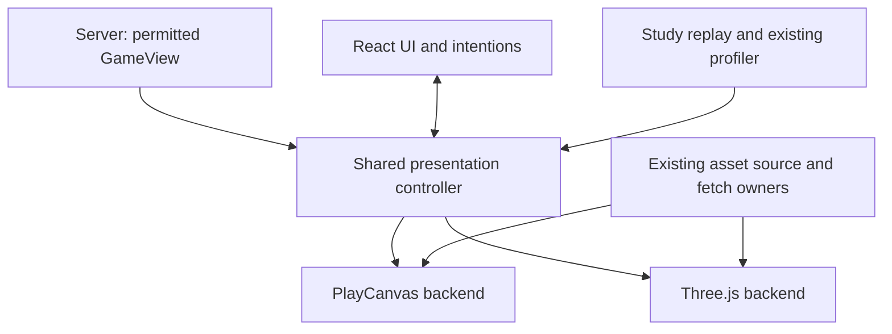

# Shared world presentation and renderer comparison — technical design

| Status      | Current progress                                                                                                          | Last updated |
| ----------- | ------------------------------------------------------------------------------------------------------------------------- | ------------ |
| In progress | Independent baseline and cloth preparation are complete; the shared controller and comparative qualification remain open. | 2026-10-31   |

Architecture last used: **2026-10-31 22:26 UTC**, for independent-preparation reconciliation; architecture unchanged.

## 1. Contract and architecture

Implement the [feature specification](renderer-comparison-feature-spec.md) through one shared browser presentation owner and two rendering backends. Preserve the existing public `WorldRenderer` interface for React/game callers where its semantics remain adequate; change its implementation, not the authoritative world. This design does not add a protocol projection endpoint, second simulation, generic graphics engine or compatibility layer.



Only one backend is active. Arrows describe ownership and calls, not network services or a per-property message bus. The controller converts the already-authorized view into the visual records needed now. Each backend retains native resources indexed by stable presentation IDs. It receives changed work and a shared frame sample, not a cloned entire world every animation frame.

### Authority and dependency direction

- `packages/domain` remains deterministic world authority. Renderer inputs never change action admission, navigation, collision, perception, body dimensions, knowledge or random state.
- `apps/server` retains permitted projection. The client cannot obtain raw whole-world state for parity, lighting, occlusion, debug picking or replay.
- `packages/protocol` remains the wire owner; this initial extraction needs no new public wire schema.
- `packages/spatial` retains renderer-free geometric queries and existing coordinates/support identities. Do not move world laws into it.
- `apps/client` owns permitted display, controls and intentions. The ordinary React action submission path still reaches the existing server admission owner.
- Authored appearances, laws and examples remain in their existing world/content owners. Both backends consume them. No renderer-specific world definitions or duplicated base-world recipe vocabulary.

`RenderWorldView` below is a **client-local visual projection**, not an additional authorization system. It can omit information a backend does not need; it cannot grant information missing from `GameView`. Rendered brightness, cutaways, current camera rays and diagnostic overlays never grant native sight or permission.

## 2. Source baseline and extraction map

Baseline: `Macrofold/OpenLegend` commit `7e95b415f18cc58828eacbddc88da8a86693c3d0`. Recheck touched source before implementation if the base advances. PlayCanvas is pinned to 2.22.2; Three.js is not installed. The current scene creates a PlayCanvas application without an explicit WebGPU initialization path. Current upstream capabilities must not be reported as enabled in this client.

Independent preparation uses refreshed `origin/main` at `d2f03a1e434e83191620e734351a7edee0e24eae`; its client source is unchanged from that design baseline. The [preparation inventory and evidence](../verification/renderer-preparation.md) records actual callers, exact study assets/settings and coverage limits. Neither the stealth runtime nor Cognition Lab is integrated for this slice.

Start source inspection at the [public renderer boundary](../../apps/client/src/world-renderer.ts), [current scene](../../apps/client/src/scene.ts), [scene study](../../apps/client/src/scene-study.ts) and [browser profiling driver](../../scripts/performance/profile-browser.mjs). These existing callers determine the extraction and integration steps below.

| Current owner                                                                           | Reuse or extract once                                                                                                  | Backend-specific work                                                                          |
| --------------------------------------------------------------------------------------- | ---------------------------------------------------------------------------------------------------------------------- | ---------------------------------------------------------------------------------------------- |
| `world-renderer.ts`, `main.tsx`, `scene.ts` factory                                     | Public methods/callbacks and one stable caller-facing renderer handle                                                  | Factory loads selected backend; scene object creation moves behind it                          |
| `world-camera.ts`, `world-motion.ts`                                                    | Existing camera commands/pose and support-aware visual interpolation                                                   | Apply projection/pose and displayed transforms using native objects                            |
| `scene.ts:setView`                                                                      | Scope changes, current/remembered image reconciliation, appearance signatures, selection validity, changed/moving sets | Create/update/remove native objects and resources                                              |
| `scene.ts` pointer/key methods                                                          | Gesture priority, drag/click classification, focus/cancel, target/placement/attack callbacks                           | Camera ray, rendered-geometry hit, projected anchor, markers                                   |
| `speech-captions.tsx`, `character-status.tsx`, `status-indicators.ts`, `vision-blur.ts` | Existing DOM/React behavior and content                                                                                | Supply consistent projected anchors/radii through a narrow query                               |
| `asset-files.ts`, `study-assets.ts`                                                     | Exact selected releases, URLs, transfer queue, cancellation, bytes/checksums, source identity/dimensions               | Decode/upload/instantiate per engine                                                           |
| `bundled-models.ts`, `scene-props.ts`                                                   | Loading state, deduplication, stale-result rejection, fallback and source-normalization policy                         | PlayCanvas registry/parser workarounds, Three loader/decoder/disposal                          |
| `library-actors.ts`, `characters/mercenary-motion.ts`                                   | Clip selection, transition intent, pause, heading smoothing, held-pose schedule                                        | Native skeleton/morph evaluation and engine blend-reset mechanics                              |
| `characters/mercenary-cloth.ts`                                                         | Typed-array particles, constraints, tethers, fixed stepping and quality decisions                                      | Read bone transforms, publish positions/normals and release mesh resources                     |
| `library-scenery.ts`, `billboard.ts`, `perception-overlay.ts`                           | Plain geometry, bounds, instance transforms, billboard math and guide geometry                                         | Native meshes/buffers, alpha/depth integration and drawing                                     |
| `world-presentation.ts`, `sunlight.ts`                                                  | Sun/daylight math, permitted light-source selection, read-through eligibility and reveal strengths                     | Lights/layers, stencil/depth, shadow passes and native skin/morph sharing                      |
| `art-treatment.ts`, `scene-pixels.ts`, `pixel-effects.ts`, `shadow-material.ts`         | Art parameters, portable math/kernel fragments and required compositing behavior                                       | Shader chunks/nodes, bindings, targets, formats, variants, pass ordering and cache preparation |
| `scene-performance.ts`                                                                  | Measurement names, bounded report, intervals, histograms, missing-data semantics                                       | PlayCanvas stats/WebGL query collector or Three/actual-API collector                           |
| `scene-study.ts`                                                                        | Workloads, camera path, selected quality and study actions                                                             | Access through the shared controller plus a narrow study interface                             |

An imported `pc` type does not make the whole file irreducibly engine-specific. Replace incidental vector math with existing plain spatial math where useful. Conversely, do not translate a whole material/pass implementation line by line through a nominally generic wrapper. The adapter is narrow in responsibility but remains substantial code.

The source baseline includes entity-level remembered images, retained-fire illumination and current support-aware motion smoothing. The selected [per-fact disclosure target](../world-presentation.md#selected-per-fact-stealth-disclosure) adds dated/partial facts, held admitted samples for other subjects and no live light/shadow/target role for historical images through SPX/VG. RCP does not claim to deliver that upstream work. When those contracts land, both backends consume the current projection; do not keep an older disclosure or interpolation path solely to reproduce an obsolete benchmark. Record which semantics each manifest actually uses.

## 3. Module ownership and contracts

Keep the initial work inside `apps/client/src`. Suggested homes are `presentation/` for shared behavior and `renderers/playcanvas/`, `renderers/three/` for native integration. Use existing small pure modules where they already own a concept; do not move them merely to fill a directory template. The names below identify responsibilities, not a requirement for one file per row.

| Owner                          | State and callers                                                                                                   | May depend on                                                                       |
| ------------------------------ | ------------------------------------------------------------------------------------------------------------------- | ----------------------------------------------------------------------------------- |
| `presentation/controller.ts`   | Implements `WorldRenderer`; latest permitted view, reconciled records, displayed motion, selected backend, settings | Existing protocol/spatial/math, interaction, preparation and backend contract       |
| `presentation/view.ts`         | Visual image records, scope identity, appearance signatures and change calculation                                  | Permitted `GameView`, exact asset/source descriptors; no native graphics objects    |
| `presentation/interaction.ts`  | Pointer/key gestures, cancellation, picking policy, ordinary callbacks                                              | DOM input, current shared state and backend query functions                         |
| `presentation/animation.ts`    | Desired clip, transition and absolute sample schedule; motion and cloth preparation as needed                       | Existing numeric helpers and source metadata                                        |
| `presentation/backend.ts`      | Native backend/factory contract and capabilities                                                                    | Plain visual records and geometry types only                                        |
| Backend implementation         | Scene/camera, decoded assets, native animation, meshes/materials/passes, native resource handles                    | Its own engine and shared records; not React command submission or server authority |
| Existing study/profiler owners | Selected workload, replay cursor, report and bounded collection                                                     | Controller/study interface, semantic measurements and backend collector             |

### 3.1 Minimal visual data

Define the actual TypeScript types by extracting the fields consumed in the source map, rather than copying the entire `GameView`. Reuse existing IDs and spatial types instead of introducing competing coordinate wrappers. The minimal schema has these meanings:

| Record                | Required meaning                                                                                                                                                                                                               | Lifetime                                                                                                                       |
| --------------------- | ------------------------------------------------------------------------------------------------------------------------------------------------------------------------------------------------------------------------------ | ------------------------------------------------------------------------------------------------------------------------------ |
| `PresentationScope`   | Separate world identity (`worldId`, save timeline, player ID, private-draft scope), access/control scope and selected presentation release/settings                                                                            | World replacement clears old state; same-character access renewal reauthorizes without rebuilding still-valid public resources |
| `RenderImage`         | Stable displayed-image ID, represented entity ID when permitted, current/remembered status, supplied appearance/representation, authorized XYZ/support, dimensions/orientation, motion/pose input, selected presentation flags | Controller-owned immutable record per accepted visual revision                                                                 |
| `AppearanceBinding`   | Exact asset reference or existing procedural/fallback recipe, authored dimensions/material roles and normalization inputs                                                                                                      | Shared source descriptor; no native texture, mesh or parser handle                                                             |
| `RenderWorldView`     | Current scope, environment/map reference and complete current set of permitted visual records for installation                                                                                                                 | Reused between updates; not rebuilt per frame                                                                                  |
| `PresentationChanges` | Added/replaced/changed records, removed IDs, invalidated geometry/settings/environment, changed projected overlays                                                                                                             | Produced at a view/settings boundary; stable records can be reused                                                             |
| `FrameSample`         | Shared monotonic presentation time, current camera pose/viewport, changed displayed transforms, desired pose samples and current visual effect parameters                                                                      | Borrowed for the synchronous frame; stable storage reused                                                                      |
| `PickHit`             | Permitted image/entity ID if any, hit XYZ/support, distance along the current ray and surface/body information needed by existing policy                                                                                       | Query result; never a new action permission                                                                                    |
| `BackendInfo`         | Engine/version, pipeline, requested/effective API, required-feature support, measured resource-counter availability                                                                                                            | Fixed at initialization except explicit context/device availability changes                                                    |

Do not put entity thoughts, hidden routes, undisclosed inventory, private health or inferred current positions into a visual record. The controller can retain the latest authorized `GameView` for nonvisual callbacks; a backend needs only its projection. A remembered image keeps its last permitted image and its existing historical styling/selection behavior, not live hidden transforms.

Use existing world-coordinate conventions and metres unchanged. Convert native engine conventions at the backend boundary, including camera/light axes, clip/depth ranges and UV/texture orientation. `SurfacePoint` and semantic support identity survive projection and picking. Do not flatten a destination onto a ground plane or reinterpret sprite visual offsets as physical body displacement.

### 3.2 A deliberately small backend interface

Implement these operations with the existing imported geometry/camera types where suitable. The record meanings and call ordering below are required; do not duplicate an existing type merely to match an example name.

```ts
interface PresentationFrameCallbacks {
  beforeFrame(nowMs: number): void;
  prepare(nowMs: number): FrameSample;
  afterPose(sample: FrameSample): void;
  afterFrame(sample: FrameSample): void;
}

interface PresentationBackend {
  readonly info: BackendInfo;
  install(view: RenderWorldView): void;
  apply(changes: PresentationChanges): void;
  start(callbacks: PresentationFrameCallbacks): void;
  setSuspended(suspended: boolean): void;
  setCamera(camera: CameraPose, viewport: Viewport): void;
  rayAt(point: ScreenPoint): WorldRay | undefined;
  pickGeometry(ray: WorldRay, candidates: PickCandidates): PickHit | undefined;
  project(point: WorldPoint, output: ProjectedPoint): boolean;
  projectAnchor(
    imageId: string,
    role: 'label' | 'status' | 'head' | 'aim',
    output: ProjectedPoint,
  ): boolean;
  stop(): void;
  dispose(): Promise<void>;
}
```

`start()` installs exactly one backend-owned scheduler. Each prepared tick calls shared `beforeFrame(nowMs)` for replay phase admission, begins its optional native collector bracket, then calls `prepare(nowMs)`, applies native camera/transforms/pose/cloth and updates query matrices, calls `afterPose()`, makes the engine's normal draw-admission decision, then finalizes its per-tick collector and calls `afterFrame()` once. The borrowed sample lives through that same tick only; clear it afterward, and never reuse it for an unprepared/suspended tick. Shared DOM anchors and hover/reveal decisions run in `afterPose()` against that tick's native state; any resulting highlight changes do not evaluate animation again. `afterFrame()` lets the study finalize a measurement after the terminal tick. In PlayCanvas it uses `frameend`; in Three it follows submission or the decision to skip it. Both callbacks run for prepared ticks that skip drawing; neither counts as a rendered frame. Actual draws retain their native postrender/collector owner. None of these phases advances the world or chooses a second animation clock. PlayCanvas calls `beforeFrame` before its existing `frameupdate` collector begin and passes the same sampled monotonic time to `prepare` in application update. Three uses the same order in its sole loop. Never start a new capture after that tick’s begin hook has already skipped recording and then finalize an unmatched frame; every included frame has one begin/end pair for the same capture. Outside replay, `beforeFrame` adds no optional measurement preparation.

`install()` replaces complete membership/environment for initialization or a real world reset. `apply()` carries the current scope, complete immutable upsert records, explicit removed IDs and changed environment/settings fields; absent change fields mean unchanged. Remove/revoke invalid images synchronously before asynchronous replacement preparation. Ordinary snapshots keep the backend/scope resource owner and do not restart unchanged loads. Access renewal removes newly invalid data without reinstalling valid public artwork. Source positions are shared-motion inputs: upserting one must not snap an existing native transform ahead of the shared displayed sample.

`setCamera()` synchronously applies the accepted camera/viewport, refreshes native query matrices and updates camera-dependent billboard/image mapping used by picking; resize the backing buffer only when dimensions change. Call it on camera/viewport changes and before synchronous queries if dirty. It does not advance animation, start another loop or force a draw. Frame preparation uses the same camera state; retain orientation/dirty checks so translation-only changes do not rebuild every billboard. Projection queries write caller-owned scratch results and use the latest camera with the most recently prepared displayed geometry. The finite anchor roles and clipping policy are defined in §5. A narrow study interface exposes art settings, diagnostic presentation and capture readiness; do not expose native engine objects through `WorldRenderer`.

Factories are asynchronous and own partial initialization. They accept the new canvas, exact backend choice, source services and an abort signal; they return a **device-ready** backend or a typed initialization failure. Installing a view starts its scoped asset/pass preparation; it is not yet **scene-ready**. Reuse the existing loading/readiness callbacks, tagged with the active view/backend owner, to report preparing, ready or failed. Scene readiness includes required artwork, visible preparation and a completed first device frame. On factory failure/abort release partial resources before settling. Invalid/cancelled completion cannot register callbacks, mutate DOM or publish a backend.

### 3.3 Data and resource ownership

- Immutable view/source records are borrowed; neither backend mutates protocol data, presentation signatures or another backend's inputs.
- Reused mutable frame/geometry buffers have one writer. A synchronous consumer must finish reading before return. An asynchronous upload/evaluation that outlives the call takes an owned copy or retains an explicitly leased immutable resource; never retain a buffer that will be overwritten next frame.
- Controller indexes relate permitted IDs to presentation state. Backend indexes relate those IDs to native handles. These are different responsibilities, not two writable copies of world state.
- Decoded models, skeletons, materials, textures, render targets, query handles and GPU buffers are backend-owned. Never reuse a mutable PlayCanvas object as Three data or vice versa.
- Share exact source metadata and existing admitted byte transfers where useful. Do not add an unbounded second byte cache merely to make a switch warm. Existing HTTP caching is distinct from decoded/GPU residency.
- Geometry prepared from immutable source assets can be shared as CPU data with explicit ownership. Each backend chooses efficient native batching, instancing, bounds and buffer layout.
- No generic dependency-injection container, event-sourced render command bus, new ECS, universal material language or new package is needed for two real consumers.

## 4. View reconciliation and the frame path

### 4.1 On an admitted `setView`

1. Distinguish a changed world/save timeline/player/private-draft identity from access renewal for the same character. A real identity/privacy replacement clears old protected records, visual jobs, target references and associated resources before replacement is visible. On same-character access renewal, retain valid public artwork and camera, clear old transient captions/hover/modifiers, discard ghosts absent from the fresh permitted set and reauthorize selection; do not rebuild the landscape or re-show an entry gate solely for renewal. A presentation-release/settings change invalidates the affected art/preparation. Reuse these current `setView` distinctions rather than combining them into one reset flag.
2. Reconcile permitted current and remembered records once. Preserve existing unchanged-record identity checks, appearance signatures and dirty/moving sets. Move an appearance signature out of a native entity tag into its shared record.
3. Apply every meaningful transition: removal, representation change, caption/action event, observer change and support discontinuity. Do not coalesce them away simply because a newer position exists.
4. Build only the changed visual records and native work descriptors. A full scan of the received permitted view can be appropriate at this boundary; do not repeat it per frame or for each material/pass.
5. Notify shared DOM/React owners only when their own visible data changes. Do not put hover/caption projection positions into React state every graphics frame.
6. Send the changes to the active backend. While none is active, retain the latest permitted state and process its shared scope/events normally; do not retain an unbounded queue of obsolete full views for later installation.

This local projection does not improve the server's candidate enumeration. Any upstream growth remains with its own performance owner. Camera movement alone does not rebuild static landscape, request new AI art or recalculate unrelated perception geometry.

### 4.2 One frame owner

The shared controller owns frame meaning and time; the active backend owns the sole engine scheduler. For PlayCanvas 2.22.2 retain its native application tick and call shared preparation from the existing application update callback, before the native render pass. For Three use one `requestAnimationFrame` loop that calls the same preparation and then renders. Do not add a controller RAF or manually render a second time from the PlayCanvas update callback. Preserve existing rendering backpressure where its backend requires it; a GPU fence is not optional profiling work.

For each active frame:

1. Sample the one presentation clock; `beforeFrame()` admits any replay measurement transition before the optional collector begins. Use that same tick time for shared preparation and the current viewport/camera state.
2. Update only moving/animated/changed entries using existing interpolation, support boundaries and pause/tab-gap behavior.
3. Prepare shared desired animation/heading and current light/overlay descriptors only where invalidated or time-dependent.
4. The backend evaluates each requested native pose once, reads its current bone anchors, invokes the shared numeric cloth step synchronously with those anchors, uploads changed cloth and updates native query matrices. Never solve against last frame's anchors or evaluate another skeleton for a shadow/outline.
5. Call shared `afterPose()` to project caption/status/aim anchors and refresh hover from that same displayed state. Existing DOM owners apply their own offsets/content; resulting native highlights use the already-evaluated pose.
6. Draw all required passes/attachments through native admission, then call `afterFrame()` even when no draw was admitted. Collect optional measurements only while enabled/recording; actual submission counts come from native draw hooks, never these callbacks. Ordinary gameplay frame-rate display remains separate.

The source baseline uses scene-owned application ticks and native animation updates. Keep the current supported controls that prevent an Open Legend-managed animation from independently advancing before its explicit pose update; trace component auto-update, mixer/layer calls and held-pose behavior before extraction. PlayCanvas's application update callback follows its component animation phase, so moving a manually managed actor there must not accidentally re-enable automatic advancement. Document these pinned API calls in RCP05. Engine scheduling differences do not create a second game clock.

### 4.3 Animation, cloth and discontinuities

The shared motion controller owns desired clip, absolute sample position, heading smoothing, transition intent, pause state and held-8/held-12 cadence when selected by the existing art profile. Backends evaluate that requested pose; an adapter may derive the required native mixer/layer delta from consecutive shared samples, but must not integrate its own wall time and drift. Preserve the existing normal-session blend duration/semantics. On install or seek, reset a transient blend to the currently requested clip/sample; a short blend discontinuity during the already-visible loading gap is accepted. Exact interrupted multi-clip fade reconstruction is not required and cannot be promised from a start timestamp alone.

Each pose request identifies the exact source/clip, absolute sample in seconds, loop/clamp behavior and transition/restart intent. Presentation/replay clocks use milliseconds; convert once at this boundary. Adapters do not select clips from actor names, kinds or action wording. Installation supplies the controller's displayed transform; only its explicit discontinuity/reset decision snaps subsequent motion.

One evaluated skeleton/morph pose supplies color, shadow, outline/read-through, attachments and cloth bindings. A second pass must not cause a second independent animation update. PlayCanvas interrupted-blend reset workarounds stay in its adapter; Three supplies the same clean-idle semantic through its mixer/actions. Skeleton cloning, inverse-bind transforms, animated bounds and equipment offsets are verified on the actual source assets, not assumed from glTF compatibility.

Extract the existing cloth solver's numeric particles/constraints/step policy only where its two consumers need it. The backend supplies bone/world transforms and publishes changed vertices/normals. Preserve pause/tab-gap resets and existing work quality. A future GPU implementation may execute differently while preserving the same declared visual behavior and bounds; a CPU-only common interface must not prohibit that optimization. No new cloth physics or gameplay authority is introduced.

Current independent extraction: `characters/cloth-solver.ts` owns in-place link/tether/seam correction, particle distance and the existing display-size quality hysteresis without a renderer dependency. `CapeCloth` consumes those calculations with the same binary64 buffers and operation order, then applies current-pose collisions after every constraint pass. It retains integration, fixed-step/reset policy, native anchors, contacts and mesh publication. This is reusable arithmetic, not the complete shared solver/clock or completion of RCP04.

Teleports, support/world/observer changes and long gaps use existing explicit motion reset semantics. Do not interpolate through hidden space, catch up thousands of missed cloth steps or replay expired captions when a renderer returns. Camera motion while paused remains usable without advancing the authoritative simulation.

Suspending a game tab is separate from pausing the simulation or destroying a backend. Preserve `setSuspended`: cancel held input, reset frame-rate sampling, stop recurring draws while retaining resources, and permit the current one-shot fresh-view frame behind the pause dialog. `setView` still applies permission revocation and removes invalid reveal while suspended. Resume resets frame timing without replaying missed animation/cloth steps. Do not map suspension to terminal `stop()` or send a new world pause command.

## 5. Input, projection and picking

The shared interaction owner retains the current DOM gesture rules: click/drag threshold, pan/orbit/zoom, modifiers, targeting, construction placement, held primary action, focus/text-input exclusions and cancellation. UI owns its event before the world. A renderer selector is an ordinary developer control; choosing it cannot click through to the scene.

Separate three operations:

1. The backend derives a ray from the **current** camera, viewport and pointer, and intersects the actual supported displayed geometry where native representation matters.
2. Shared spatial helpers evaluate native-authorized surfaces/construction shapes and preserve XYZ/support. Shared policy chooses eligible nearest/selected/revealed candidates using the current permitted image rules.
3. Existing callbacks submit intentions through the ordinary server path. The server independently checks them. A hit or preview never grants admission.

Preserve the distinction between selection, physical aim and movement destination. Re-pick at accepted primary-action release using the current display/camera as required by the action-execution contract. Do not substitute a selected object, stale pointer-down hit or generic bounding box for actual physical targeting. Camera cutaways/read-through do not grant collision bypass or reveal a hidden current body.

Backend tests/manual checks must include alpha-cutout foliage, sprites and their virtual body/depth, animated people, geometry above/below another surface, a thin construction panel, occluded/revealed selection and viewport resize. Both backends may use different acceleration structures; the resulting supported hit semantics remain the same. A Three BVH may help a measured workload, but is not an initial mandatory dependency or authoritative collision replacement.

Use projected displayed positions for captions/aim/blur, not an independently advanced transform. Reuse the existing caption/status/blur owners; no React Three Fiber migration is required to keep the React HUD.

Screen-space ray/projection inputs and outputs are canvas-local CSS pixels with top-left origin and positive Y downward. Convert DOM `clientX/clientY` using the current canvas bounding rectangle; native framebuffer pixels/DPR conversion stays in the backend. Existing viewport-client coordinates for menus/hover callbacks remain distinct. Recompute after resize/scroll/canvas replacement; do not apply devicePixelRatio twice.

`ProjectedPoint` supplies CSS `x/y` and signed forward depth in metres. `project()` returns false for an undefined/nonfinite projection, not merely for an offscreen or behind-camera point: speech-direction placement needs those results. Shared callers apply their existing visibility, near/far and viewport rules. `projectAnchor()` additionally returns false when the permitted image or its current representation has no such anchor. It preserves the current representation's apparent-height correction and painted-card transforms, which projecting a nominal world point alone cannot reproduce:

| Role     | Existing geometric meaning                                                                     |
| -------- | ---------------------------------------------------------------------------------------------- |
| `label`  | `screenPosition` model anchor or body-top anchor; shared UI applies its existing label offset. |
| `status` | Painted sprite's projected top edge including padding/tilt; otherwise the label anchor.        |
| `head`   | Existing status-indicator head point for the current representation.                           |
| `aim`    | Painted-card/body center from `aimScreenPosition`, with current model image correction.        |

Reuse shared dimension/anchor arithmetic where plain source data suffices. Keep native transform/image-correction queries in the adapter, and identity eligibility, clipping, speech redirection and CSS padding in shared consumers. A synchronous release pick after a camera command must see that updated camera without waiting for another animation frame.

## 6. Assets, appearance replacement and resource lifetime

`asset-files.ts` remains the source transfer owner: selected-release URL policy, concurrency, byte bounds, cancellation and hash verification. `study-assets.ts` and the existing appearance/catalogue owners provide exact identity/dimensions. Do not add direct backend network fetches that bypass those controls or fetch generated executable code.

### Load and replace

1. Resolve the exact allowed source and retain its existing readiness/fallback classification. Initial required scene artwork belongs to the existing opaque entry gate; it must prepare successfully or show an explicit retry failure. Do not turn missing required artwork into successful entry with generic fallback. A runtime visual family that already permits fallback can use it while its optional/generated representation loads.
2. Associate the load with the controller scope, appearance revision and backend instance that requested it.
3. Use the existing shared transfer owner. Decode through the selected backend with its own parser/decoder dependencies.
4. Before installation, check that the requesting owner is still active and the exact appearance is still desired. A cancellation signal alone is insufficient for noncancelable local parsing.
5. Apply normalization and authored fitting in their established order so replacing a fallback preserves dimensions, foot/support, identity and semantic body.
6. Install atomically for that presentation record, then release superseded native resources when their remaining users are gone.
7. On failure, required-entry artwork keeps the failed entry/retry state; an existing fallback-permitted runtime representation retains its usable fallback and accurate load state. A later deliberate retry can start a fresh request; no automatic paid/image-generation retry.

Decoding a source in the other engine is real work. It cannot share the first engine's material/skeleton/GPU allocation. When a native loader lazily fetches subsidiary buffers/textures/decoders, route them through the same admitted exact asset source or supply pre-resolved bytes; do not create an untracked outbound loading path. Reuse current asset workflow/contracts rather than designing a new storage service.

### Stop and settled disposal are different

The controller cancels/detaches shared world input. Backend `stop()` is synchronous and idempotent: stop its drawing/ticking and native callbacks, invalidate publication tokens and terminate its profiling collection. `dispose()` settles only after this backend's downloads, noncancelable parses and native teardown are resolved or have produced an explicit cleanup failure. A returned request to destroy is not proof of released resources.

PlayCanvas's current `destroyModelApplication()` stops ticking before delayed application destruction and contains a same-canvas registry workaround. Keep that implementation local while extracting an observable settled promise. Three disposal explicitly releases geometries, materials, textures, render targets, native listeners and owned decoded image resources; scene removal alone is not disposal. Shared instances/refcounts release once. Do not call global engine/cache disposal that can affect another owner.

The public `WorldRenderer.destroy(): void` may remain a synchronous stop/request for the existing React cleanup caller. Its internal controller retains and observes the disposal promise. The selector and diagnostics await the internal settled boundary. Document this distinction; never discard an unhandled rejecting promise. No legacy public interface alias is needed if actual callers require a deliberate signature update instead.

## 7. Switching and initialization

### Selection and loading

The existing scene factory returns the stable shared `WorldRenderer` handle immediately. It stores early settings/view calls while the selected backend initializes. Engine modules are dynamically imported only when selected. An ordinary PlayCanvas launch must not initialize or evaluate an inactive Three scene or allocate its GPU resources. Build output can contain both lazy chunks; unused bytes are not loaded solely for the selector.

Change the factory's canvas argument to a stable host element in both `main.tsx` and scene-study. React owns the host; the controller owns canvas creation/replacement inside it. Do not replace a React-owned canvas behind its ref. Migrate existing `canvas.current` consumers together: HUD layout observation, context/current-owner checks, focus restoration, container opening, direct event-target comparisons, resize/profiling hooks and cleanup. Use a current-canvas lookup or semantic controller method only where the caller needs it; retain the active canvas's `#world`, accessibility/tabIndex/inert and loading semantics deliberately. This small caller change is required even while `WorldRenderer` methods remain stable.

Use explicit developer query values `renderer=playcanvas|three` and `graphics=webgl2|webgpu`; the initial supported combinations are both renderers with WebGL2, and absent values select PlayCanvas/WebGL2. A fixed registry lists implemented combinations and their factory, pipeline name and required capabilities. It is not a general plugin system. Only add WebGPU entries when their materials/passes and workload coverage are implemented.

Put the selector and requested/effective API/status in `/scene-study.html`'s existing **Measurement and source details** section, beside **Reload renderer**; bind it in `scene-study.ts` through the shared controller. For an in-place live switch, reuse the existing development-only `?artLab` **Art comparisons** panel. Move its mounting/lifetime from `scene.ts` to the shared controller so it survives backend replacement. Extract the panel and pure art profiles/settings out of the mixed `art-treatment.ts` module; shared/Three code must not import PlayCanvas `ArtMaterials` through that module. Reuse the same small selector binding in both hosts. Keep labels, keyboard focus, disabled-during-switch state and input-event priority.

The live panel keeps its existing `import.meta.env.DEV` plus `?artLab` gate. Production/live comparisons can select through the explicit URL without a permanent player HUD control. Existing profiling controls are an opt-in API/driver, not a player settings panel. Selection never requires `profile=1` or starts collection. Query settings describe developer navigation only; never put world views, private IDs or drafts in the URL. No persisted world/save field is added. Unknown values produce a visible developer configuration error with an explicit route to the default; never silently label a fallback as the requested combination.

### Serialized replacement sequence

1. Validate that the requested combination is implemented and supported before disturbing the current backend where possible. Disable further selector changes while a replacement settles.
2. Cancel active world gestures through their owner; retain the valid shared camera/settings/selection and latest permitted view. Clear transient hover/pressed state.
3. Stop the old backend immediately, remove its canvas from interactive use, and await disposal. Keep the React shell and existing non-canvas inspection available.
4. Create a fresh canvas for the new backend. This avoids reusing an engine registry/context binding and prevents old callbacks from referring to a replacement's canvas.
5. Initialize the device, install the latest permitted visual state, reconstruct current shared motion/pose time and start hidden preparation frames. Preserve the existing selected-play-tab rule: an inactive play tab does not prepare a full scene just for this feature.
6. Keep the existing opaque world-entry/loading gate and canvas input block until required artwork, visible preparation and the first completed device frame qualify the active view. Register only this backend's current callbacks, then expose drawing/input and actual engine/pipeline/API. A same-character access renewal retains still-valid presentation under the current rules; backend replacement is a fresh canvas preparation, not proof that entry readiness can be skipped.
7. On abort/failure, dispose partial work, retain an unavailable-canvas state and offer explicit retry or reopening the prior choice. Do not auto-cycle engines or create an endless fallback loop.

Use a monotonically changing local owner token or object identity for stale callbacks; it is a resource generation, not a saved schema version. World/timeline/observer invalidation remains separate from renderer generation. Unmount/logout/scope loss retires publication/UI callbacks, including those attached to initialization/disposal; owned cleanup still drains and settles. A completed old cleanup cannot delete a replacement's global profiler API, handlers or canvas.

A stalled noncancelable parser/cleanup keeps the selector blocked with a truthful status and a reload recovery route; never start an unlimited chain of replacements to hide it. First implementation does not need a watchdog framework or arbitrary forced GPU-resource destruction. A renderer switch does not suspend the authoritative world. Install the latest state, reset discontinuous interpolation and omit expired presentation events; do not replay stale attacks or conversation cues.

## 8. Materials, lighting and visual parity

### Shared visual meaning

Share material roles, art profiles, selected sun/fire descriptors, opacity/reveal policy, small-subject pixel density and portable algorithms. Preserve current source/dimension conventions, alpha coverage and color assumptions. Do not bake the PlayCanvas shader object model into a universal material schema.

In particular:

- `sunlightAtHour()` already is pure. Share daylight/color/intensity interpolation and discontinuity rules; adapt native light axes locally.
- Fire selection uses permitted source images, distance ranking and existing retention bias/quality budgets. Choose sources once; both backends illuminate from that same descriptor set. Do not cap native light selection differently and call the result matched.
- Pixel treatment shares world-anchored grid and coverage-aware reconstruction mathematics, including coarse scenery/fine subject treatment. PlayCanvas's HDR alpha tagging and compose injection are implementation details; Three must supply equivalent coverage information without corrupting transparency or tone mapping.
- Shadow filtering may share portable depth-comparison math. Depth formats, shadow samplers, bias, native macros, variant compilation/cache keys and filtering paths remain engine-specific.
- Reveal/outline/preview/perception overlays share eligibility, parameters and source geometry. Native layers/stencil/depth/pass setup remain backend work. Reuse the current animated skin/morph pose in every pass.
- Retain existing static scenery instancing and calculated bounds where useful; Three can use its own instancing/batching. Do not require equal draw-call counts to establish equivalent work.

Light descriptors identify the selected source, world position or direction-to-source, linear color, range in metres and the shared art-intensity/falloff profile. The current lighting is artist-tuned, not a calibrated photometric contract. Each adapter documents its conversion; copying the same numeric intensity into differently defined engine units does not establish equal illumination. Match the reference scene's material response and shadow coverage before timing.

### Parity checklist before timing

| Area             | Check in the actual rendered result                                                                                                                 |
| ---------------- | --------------------------------------------------------------------------------------------------------------------------------------------------- |
| Color pipeline   | Linear/sRGB interpretation, source texture encoding, HDR formats, exposure/tone mapping order and final output conversion; no double gamma/tone map |
| Pixel treatment  | World anchoring, coverage/alpha, small subject detail, resolution, normal-play zoom and moving-camera stability                                     |
| Depth/alpha      | Near/far/projection, opaque/cutout/blended sorting, sprites/virtual depth, fine foliage, support/feet and transparent edges                         |
| Models/animation | Source scale/orientation, bind pose, clip time/blends, skin/morph/equipment, held cadence and shared multi-pass pose                                |
| Lighting         | Same selected sources, shadow coverage/distance/resolution/quality intent, material response, day/night and local-light cases                       |
| Effects          | Existing bloom/grading/compose ordering, read-through, selected/hover outline, placement and range guides                                           |
| UI projection    | Same camera/state for captions/status/aim, resize/DPR, missing/behind-camera anchors and focus/input ownership                                      |
| Lifecycle        | Fallback, successful replacement, removal during load, explicit failure/retry, scene/scope reset and disposal                                       |

Exact pixel identity across engines is not a realistic acceptance requirement. Record tolerated harmless image differences; materially changed silhouettes, visibility, attack timing, pixel shimmer, missing effects or different work remain defects/incomplete parity. Do not tune the shared art target down to excuse a deficient backend.

## 9. Replay and workload contract

Extend `scene-study.ts` with the shared controller/study interface. Reuse its current permitted views and selected times. Replay is presentation-only and cannot call the server’s command submission callback or produce world mutations, spending or paid generation. Live qualification uses the normal client/server path separately.

### Manifest and recorded inputs

Record the plain `PresentationChanges` defined in §3 and newly admitted presentation events after live projection/change calculation. Live delivery and replay use the same controller `applyPresentation(changes, events, atMs)` path, which updates shared display state and forwards native work; replay does not call only the backend. Install one initial `RenderWorldView` containing all permitted current/remembered images and environment, then apply changes or an explicit reset. This avoids repeatedly encoding unchanged maps and objects or building an object-reference serializer. Never serialize whole `GameView` objects, raw server events, arbitrary method calls, callbacks, hidden observations, unrelated inventory/panels, credentials or native resources.

The current-format manifest contains these fields; reuse the extracted current presentation types rather than maintaining parallel copies:

| Field                    | Required value                                                                                                                                                                                  |
| ------------------------ | ----------------------------------------------------------------------------------------------------------------------------------------------------------------------------------------------- |
| `build` / `assets`       | Exact application commit/build, expected current capture structure and selected source/catalogue revisions. Reference external payloads; do not embed them.                                     |
| `origin` / `scope`       | Authored, staged presentation or permitted live capture; current authorized observer/access scope.                                                                                              |
| `initial`                | Complete permitted visual view, camera/display state and visual clock/pause/requested pose samples. Include remembered images and declare the normalized-start policy below; no native history. |
| `warmupMs` / `measureMs` | Positive finite durations; `T = warmupMs + measureMs` fits the total envelope.                                                                                                                  |
| `records`                | The ordered plain-data union below.                                                                                                                                                             |
| `coverage`               | W0–W5 scope, required images/assets/cues and semantic record/event counts, plus any omissions.                                                                                                  |
| `presentation`           | CSS/internal dimensions, effective scale/DPR, projection, art/shadow/caption settings and existing procedural seeds/source choices. Record intentional timeline changes.                        |
| `captureStatus`          | Complete or incomplete with bounded reason and actual retained duration/counts. An incomplete capture cannot qualify a full comparison.                                                         |

Engine/version, requested/effective API/pipeline, profiling mode, actual device/settings and run readiness belong in each **attempt result**. Both engines consume the same engine-neutral manifest; do not embed one candidate's identity as the workload's required engine. Source/build identities establish current reproducibility, not legacy compatibility.

```ts
type ReplayRecord = { seq: number; atMs: number } & (
  | { kind: 'view'; changes: PresentationChanges; events: PresentationEvents }
  | { kind: 'reset'; view: RenderWorldView }
  | { kind: 'camera'; command: CameraCommand }
  | { kind: 'display'; state: ReplayDisplayState }
);
```

`ReplayDisplayState` is a complete plain snapshot of the existing shared art/shadow/perception/caption settings, valid selected/hover image IDs, targeting/aim guides and construction-preview shapes/validity/transform. Reuse their source types, explicitly excluding `onMissedCaptions`, `AttackPointerControls`, `ConstructionPlacement` and all other functions. Presentation data may depict a preview; it never installs live attack/placement callbacks or invokes a server command. Only supported display fields have handlers; reject unknown operations. Ordinary game UI and nonvisual state are not replay data.

A `reset` record routes a complete replacement view through the shared scope-reset/install owner before later entries. It clears protected old state but does not restart the replay epoch. A world-identity change in an ordinary delta is invalid; same-character renewal retains its ordinary apply semantics. Private live capture stops on scope loss/renewal, so multi-scope fixtures are authored synthetic inputs.

Capture one `view` batch per admitted live-view change, `camera` per accepted camera command, and `display` when shared settings/hover/guide state changes. Do not record the native settings work produced by camera/display application again as a view batch. Do not log recurring `FrameSample` snapshots; changed hover outcomes can still originate during a frame. Reuse immutable records while the bounded capture owns its encoding.

Seed current/remembered images, camera, valid selection, settings and requested poses; start with empty transient captions/hover/action gestures and reset blends/cloth/interpolation through the normal install rules. Mark prior cue IDs consumed and record only new admitted event batches after that boundary. Required cue coverage must appear in the timeline. This normalization happens before warm-up and promises no exact live-scene restoration.

Replay excludes **live `GameView` projection and change calculation**; shared change application/frame preparation and native work remain included. Live picking/input-response cost is also excluded because replay consumes recorded display outcomes. Attribute these costs through live measurement, not another replay protocol.

During warm-up and measurement, cancel/ignore real world gestures, camera/settings controls and live hover repicking; only records drive the workload. Keep Stop/abort available and restore manual study controls after playback.

### Ordered playback and phase boundaries

1. `loadReplay` checks size/structure/source references, finite `atMs` in `[0,T]`, zero-based contiguous `seq`, nondecreasing time and required coverage. Equal-time entries execute in `seq` order. Authored fixture construction may sort once before assigning sequence; import rejects malformed order rather than changing it. Install `initial`, prepare required assets and wait for scoped scene readiness. Hold replay time/cursor at zero during preparation frames, so different loading times cannot advance the workload. A complete live capture must cover the declared duration through `T`, including quiet intervals; stopping before `T` is incomplete. Authored fixtures declare their complete duration explicitly.
2. With profiling enabled, stop the constructor-started `ScenePerformance` capture. Retain its bounded startup summary only for the selected cold/startup question. Its `start()` is a no-op while recording, so calling start alone cannot reset warm-up contamination.
3. `startReplay` creates one monotonic epoch and cursor. Warm-up advances the same timeline with the scene recorder stopped. Before each prepared tick at elapsed `t`, consume every due entry in sequence through the shared owner using its scheduled `atMs`, then prepare the frame at `min(t,T)`. A late event keeps its original age/expiry; late delivery must not grant it a fresh caption/effect lifetime.
4. On the first tick reaching `warmupMs`, in `beforeFrame()` **before collector begin, due inputs and preparation**, call the existing profiler's idempotent `stop()` then `start()`. Record nominal and actual start times. Preserve the epoch, cursor, animation state and resources; do not reinstall the view. If that first measured tick already reaches `T`, the attempt is invalid, not a short successful measurement.
5. On the first tick reaching `T`, consume every remaining entry scheduled at or before `T`, sample the terminal state at `T`, and finish normal native draw admission. In that tick's `afterFrame`, after collector finalization, stop collection and playback. Store actual stop time, overshoot, final cursor, processed semantic counts and trailing no-draw time; never clamp the report's wall duration to the planned interval.
6. Stop/abort does not consume later records. Missing records, unsupported required work, context/visibility interruption or a deadline makes the attempt invalid. Stop releases pending GPU query ownership with the existing dropped/uncollected accounting; do not wait for GPU completion or let those results enter a later capture. With `profile=1` absent, execute the same replay without creating/calling the optional scene collector; separately label driver observations.

Do not drop speech, removals, scope changes or appearance transitions to keep up. Final transform coalescing is allowed only after semantic owners consume all due transitions. Record delivery lag and actual work; a delayed but complete tick is a hitch, not permission to reset the clock. Equal workload means equal input timeline, required cues/assets and presentation policy. Rendered frames, pose evaluations, draws and resource operations are diagnostic counts that may differ with achieved cadence, culling and batching; do not force equal counts or silently omit a required visual update.

`atMs` is elapsed milliseconds from the seed boundary; the seed’s `presentationTimeMs` is normalized to zero. Rebase only explicitly identified browser-presentation schedule fields to that origin during capture, and sample the shared clock at `min(t,T)` during replay. Preserve world/simulation timestamps, clip sample seconds and pause flags in their existing units. Do not subtract a page-clock offset from arbitrary numeric fields or advance the authoritative clock.

Synthetic fixed steps may inspect visual states but cannot qualify real-time throughput. Seeking reinstalls the retained initial input and processes due presentation state outside measurement; it does not promise exact interrupted blends or native-resource restoration. A warm-up extension changes the same manifest for both engines.

### Bounded capture

The [RCP limits inventory](../limits/renderer-comparison.md) owns the selected envelope: one active recording/replay, at most 120 seconds total timeline, 32 MiB serialized UTF-8 manifest/timeline content and 10,000 records, whichever comes first. Count source records before retaining another full copy. Stop before an append would cross a bound; record why the capture is incomplete. A partial capture can help diagnosis but cannot silently stand in for the full selected journey.

Count the bounded manifest and reserve space for the bounded terminal status before admitting timeline bytes. The final encoded artifact, including its stop reason, must fit the same allowance. Stream/count entry encoding against remaining capacity instead of first allocating an arbitrarily large JSON string. This is one local recording envelope, not a general serialization framework.

Default measurement is 10 seconds of explicit warm-up followed by 60 seconds of steady-state replay, within that total envelope. These are repeatable initial measurement choices, not world limits or proof that 10 seconds warms every shader. Readiness includes required visible assets/shaders; remaining failures and first-use hitches are reported. A warm-up extension or different duration changes the manifest consistently for both engines. Cold-load/first-use runs deliberately retain those costs.

Record only through an explicit developer action. Ordinary play retains no growing presentation history. Reuse one bounded current/final report and explicit local export; no background archive/database/service. Imported serialized size is not a bound on decoded heap overhead. Do not materialize unlimited input before checking length, record counts and references. Existing profiler bounds still apply independently.

Bind a live capture and its unexported replay/report to its current access/private-view owner. Stop capture and clear protected retained inputs on logout, observer replacement or access-scope loss/renewal; another observer cannot replay the previous observer's private views. This capture reset does not require destroying still-permitted public scene resources. Synthetic authored fixtures can explicitly exercise scope transitions without importing a private live capture. Export is explicit and follows existing privacy/storage policy; this feature adds no automatic sharing.

### Operator and driver integration

Add an explicit mode to the existing driver; this command is a **planned interface**, not an available command in the baseline:

```sh
node scripts/performance/profile-browser.mjs \
  --renderer-comparison /absolute/path/workload.json \
  /absolute/path/new-report.json \
  --origin=http://127.0.0.1:PORT \
  --app-profiling=on
```

Dispatch this mode before the existing `READY.json` live-game setup. The current driver can sign in, take control, select 3×, resume a world and drive gameplay; none of that happens implicitly in replay mode. The manifest owns durations and coverage. Use the existing studies build/server route and exact source authorization, not a new server service or upload endpoint. Default to authored fixtures whose study assets are already available. A captured private workload can run only in an explicitly selected currently authorized context; missing permission is a preparation failure, never a request to embed credentials or widen asset access.

Expose a narrow study-only `loadReplay`, `startReplay`, `stopReplay` and readiness/coverage read surface for the driver, using the same controller as manual study. It accepts the already-size-checked manifest through local browser automation or an explicit file input in the study details; it never puts private records in a URL or invokes server intentions. Keep profiling collection on the existing `window.__openLegendSceneProfile` owner. The replay surface does not create a second profiler or expose raw game/server state.

Each attempt loads a fresh study page/canvas in the selected browser context and installs the same manifest before timing. Reusing HTTP/context asset caches is explicit warm-run policy; a fresh page alone is not a cold-cache claim. The driver serially closes its preceding page before launching the next. Stop closes only task-owned pages/hooks and emits the finite attempted-run summary even on failure.

The Node driver owns deadlines independently of the page: retain its 30-second browser-launch limit, share one 60-second preparation deadline from page creation through navigation/install/readiness, then allow `T + 30_000` ms from the replay-start request for playback/finalization. Substeps use remaining preparation time rather than restarting it. The extra 30 seconds permit scheduler overshoot/report transfer, not extra workload. On expiry retain an invalid attempt with available partial evidence and close its page; do not retry that slot. Allow 10 seconds for owned page cleanup. Continue scheduled slots only after cleanup settles; otherwise end the campaign and label remaining slots unattempted. Cancel timers on settlement and preserve unrelated pages. These diagnostic defaults live in RCP-L04; no watchdog/retry service is needed.

Do not inherit the baseline driver's hardcoded headless/ANGLE Metal launch choices blindly. Default comparative display qualification to headed execution on the recorded actual device; select supported graphics backend flags deliberately. Headless CI-style rendering may diagnose CPU/GPU work but cannot establish physical-device smoothness or input/display response. No GitHub Actions or cloud benchmark infrastructure is added.

## 10. Measurement integration

Reuse `ScenePerformance` and the profiling-controls capture lifecycle, report shape and existing browser driver. Separate shared measurement/report semantics from backend counter/query collection. Avoid a second profiler competing for GPU queries or duplicating hooks.

### Required report fields and meaning

| Measurement                 | Definition and cautions                                                                                                                                                                                                                                                                                                                                                                                                                      |
| --------------------------- | -------------------------------------------------------------------------------------------------------------------------------------------------------------------------------------------------------------------------------------------------------------------------------------------------------------------------------------------------------------------------------------------------------------------------------------------- |
| Frame intervals and drawing | Record browser/presentation callback intervals separately from actual draw/postrender submission intervals and counts, full observation duration and trailing time with no render. Existing update callbacks can outnumber draws under backpressure; a responsive RAF with a frozen canvas cannot qualify smoothness. Retain bounded raw samples, coverage/gaps and display cadence. Submission does not prove physical screen presentation. |
| Shared update CPU           | Time preparing shared view/frame state; separate view reconciliation from recurring update                                                                                                                                                                                                                                                                                                                                                   |
| Backend CPU                 | Native pose/resource work and render submission at defined boundaries; engine-reported submetrics retain their own names/scope                                                                                                                                                                                                                                                                                                               |
| GPU duration                | Optional asynchronous supported API timer; record unavailable/disjoint/lost/pending/dropped distinctly from zero                                                                                                                                                                                                                                                                                                                             |
| Interaction response        | Pointer/action release to first corresponding displayed local/acknowledged response where observed; distinguish local preview, server acknowledgement and world consequence                                                                                                                                                                                                                                                                  |
| Loading and hitches         | Module/network/decode/upload/first-use preparation, first usable scene and switch gap; separate from warm steady state                                                                                                                                                                                                                                                                                                                       |
| Work performed              | Processed semantic views/events and required image/assets/cues establish equal workload; frame-dependent pose/draw/light/resource counts explain implementation cost                                                                                                                                                                                                                                                                         |
| Resources                   | Engine-tracked object/geometry/texture/target counts, transferred/retained bytes where known, JS heap when exposed, post-disposal trend; not a portable exact-VRAM claim                                                                                                                                                                                                                                                                     |

Shared CPU and backend CPU boundaries must not double-count a nested call as additive totals. GPU work overlaps CPU/frames; do not add durations to manufacture total frame time. PlayCanvas and Three draw/resource counters may count passes, instancing and allocations differently; label their definitions and use them diagnostically rather than as universally equal units.

Preserve `profile=1` as the exact opt-in collection gate, existing stopped/destroyed semantics, query backlog/raw sample limits and missing-data accounting. Disabled profiling performs no optional timing preparation, per-frame report objects, GPU queries or collection-only listeners. Selection/replay operation must not secretly enable it. CPU sampling and external browser hooks are driver-owned and separately stopped; scene stop does not stop DevTools.

GPU query completion belongs to the exact backend and capture that issued it. Backend switch ends the capture; it cannot continue one aggregate report across engines. Never block on GPU `finish()` to fill a report. Stop records uncollected/discarded queries honestly and releases owned handles safely. A stopped retained report is immutable; a new capture owns a new report.

### Controlled run procedure

1. Use a production build at a recorded commit/lockfile, the same assets and one named workload. Record browser/version, OS, device/GPU where available, power mode, viewport/render scale, actual API/pipeline, display cadence and relevant flags. Do not fabricate unavailable hardware fields.
2. Run one foreground renderer page. Close/pause competing task-owned workloads; do not stop another contributor's processes. Keep browser devtools sampling off for smoothness qualification.
3. Run W0/coverage verification first. Failed required activity or an unsupported effect blocks a matched ranking, even if frame times are excellent.
4. Prepare cold and warm campaigns separately. A fresh page does not empty OS/HTTP/GPU driver caches; report actual cache control rather than claiming universal cold start. Do not clear unrelated user browser data.
5. The existing `scripts/performance/profile-browser.mjs` owns a new explicit renderer-comparison mode that launches fresh pages sequentially in the balanced order A, B, B, A, A, B from one selected manifest. Six attempted runs is the default finite campaign; three valid captures per renderer qualify that campaign. Retain invalid runs and reasons instead of silently retrying until favorable results remain. An explicit repeat campaign can resolve a named failure/variance question, preserving the prior campaign's summary; no background retry queue or unbounded browser history. The study's existing short measurement button remains a single-run diagnostic, not this matched campaign.
6. Report per-run p50/p95/p99, meaningful hitch counts/maxima, interval coverage, work counts and variance across runs. The existing profiler owns histogram/sample methods; avoid implying a sampled percentile is an exact full-run population value.
7. Capture attribution separately from unprofiled smoothness using the same relevant workload. A profiled advantage is provisional if collection overhead differs. Preserve existing profiling-overhead qualification separately.
8. Exercise the corresponding live normal client/server journey. Separate server/network/model waits from presentation cost, and do not claim a replay proves live gameplay.
9. Record one coherent campaign under the existing benchmark collection when actual evidence exists; raw profiles/media remain external under current policy. No empty benchmark report or fabricated result is created by this design task.

There is no automatic universal winner or mandatory percentage improvement. Judge repeatable practical effect on the important workload, including frame consistency, responsiveness, art quality, feature effort, debugging and ongoing maintenance. Faster trivial scenes and unmeasured speculation are insufficient grounds for a migration.

## 11. Performance and extensibility without excess machinery

Preserve the existing cheap paths before adding new optimization:

- One permitted-view reconciliation per received update, shared appearance signatures and stable native handles.
- Moving/animated/dirty sets for recurring work; no per-frame full-scene cloning, material recreation, asset decode or React scene mirroring.
- Shared selected light descriptors, cached perception-field geometry and static scenery preparation with their existing invalidation owners.
- One evaluated pose shared across passes; no backend clock duplication or per-bone command allocation.
- Per-backend batching/culling/instancing and shader preparation appropriate to its pinned engine. Shared code must not demand an inefficient identical draw organization.
- Cache lifecycle tied to scope/source revision/backend ownership; no permanent grow-only registry of every replaced scene or capture.

The controller's permitted image index and input view work still grow with the admitted scene; the project does not invent a hidden renderer entity cap or claim all work is constant-time. Profile counts and change frequency. A meaningful measured repeated cost can justify chunked preparation, a worker, an index or different buffers later. `async` alone does not move CPU decoding/math off the main thread. Do not introduce these systems speculatively.

A future more graphics-heavy effect should state its player benefit, permitted inputs, supported APIs, fallback/unsupported behavior, quality/cost and cleanup. Share portable kernels/semantic inputs where they have two real consumers; keep GPU-specific execution native. Do not move game authority into GPU simulations merely because compute is available.

## 12. Engine capabilities and ecosystem decisions

### What the names mean

PlayCanvas and Three.js are independent implementations; PlayCanvas does not use Three.js. Three.js is a graphics library with a large surrounding ecosystem. PlayCanvas provides a more integrated game-engine stack. Both use the GPU through browser graphics APIs. Choosing Three.js does **not** surrender direct shader or WebGPU compute access; “direct” here means browser-supported GPU programs/resources, not unrestricted native driver/CUDA access.

The selected first comparison uses classic Three `WebGLRenderer` because it is the smaller equivalent port of the current WebGL2 path. Choose and pin a current compatible Three release at RCP06, record it in the existing lockfile and per-attempt metadata, and verify its actual public APIs. Do not upgrade PlayCanvas incidentally during the first baseline. A deliberate engine upgrade is separately measured/reviewed so it does not confound the extraction.

### What remains valuable in PlayCanvas

Moving away transfers responsibility for integrated scene/application lifecycle, animation/assets, material/shadow variant management, rendering layers/passes, resource ownership and diagnostics into our Three integration and selected libraries. Existing custom pixel/outline/read-through/shadow code must be integrated and qualified again. The server already owns gameplay physics and AI; choosing Three does not require replacing them or recreating every unused feature of a full game engine.

Do not claim that one engine has categorically superior crowds, lights, shadows or performance without the actual matched workload. PlayCanvas Editor tooling is not a loss we currently depend on: Open Legend uses code-based integration. Conversely, Three's R3F/Drei/post-processing/BVH/TSL ecosystem may reduce implementation effort for a chosen feature. That can be a valid product reason independent of raw FPS, but it is not a drop-in PlayCanvas plugin or a reason to rewrite the React HUD. PlayCanvas also has its own React integration.

### WebGPU and shaders

Both upstream engines expose WebGPU compute and indirect GPU-generated work. WebGL2 does not supply every WebGPU compute/indirect feature. Three also has an official clustered-lighting addon; a blanket claim that choosing it loses modern many-light techniques is incorrect. Exact feature availability depends on the pinned version, pipeline, browser and device.

Three's `WebGPURenderer` is a distinct material/post-processing integration with TSL/nodes and an optional WebGL2 fallback. Existing `ShaderMaterial`, `RawShaderMaterial`, `onBeforeCompile` modifications and classic `EffectComposer` custom passes do not carry over unchanged. Record effective fallback; a requested WebGPU run on actual WebGL2 cannot be labelled WebGPU. Official documentation describes remaining experimental status and workload-dependent performance; recheck when implementing that optional path.

Share mathematical algorithms and small language-compatible shader kernels where practical. Three `wgslFn`/`glslFn` can incorporate native functions, while PlayCanvas supports GLSL/WGSL and a transpilation route. This is not a promise that arbitrary raw GLSL functions automatically translate to WGSL or that native WGSL works in every WebGL fallback. Built-in uniforms, light/shadow macros, cache keys and skeleton hooks remain backend-specific. Do not build a shader compiler for this project.

Screen-space global illumination and additional post-processing are possible differentiators, not automatic improvements or parity gates. Three's documented SSGI path has screen-space coverage, temporal/noise and performance tradeoffs; it is not equivalent to Unreal Lumen. No focused official CameraFrame review established a turnkey matching PlayCanvas feature, which is not proof it is impossible there. Both engines' updates can require shader changes. Temporal anti-aliasing or illumination can conflict with crisp held-pose pixel art; inspect motion before selecting them.

### Other engines and the AI-created-world examples

The supplied Create with Mark material describes browser/Three.js work with AI-assisted coding, models, textures, motion and procedural content. The exact supplied YouTube video was not retrieved, so this design does not identify every scene's engine or claim to have watched it. A curated demonstration is not evidence of Open Legend's art quality, full-game workload or production performance.

Unity/Unreal/Godot are not required merely to make modern-looking 3D graphics. Native platforms may offer other production, rendering, tooling or distribution advantages, but a native client would also need UI/input/lifecycle/platform work. The existing [engine assessment](../../research/game-engines/open-legend-assessment.md) and conditional platform/offline owners retain those decisions. This design selects a browser comparison, not a new platform or a Unity/Unreal port.

## 13. Implementation entry point and gates

The [RCP tracker](../maintainers/renderer-comparison.md) is the single ordered implementation checklist. Each task names dependencies, concrete work and completion evidence; sections above define the contracts those tasks implement. Follow the then-current branch instructions and existing verification policy. This design does not authorize new automated tests.

| Stage                              | Tasks and completion boundary                                                                                                                                                                                                                                                                                                            |
| ---------------------------------- | ---------------------------------------------------------------------------------------------------------------------------------------------------------------------------------------------------------------------------------------------------------------------------------------------------------------------------------------- |
| Establish the actual baseline      | [RCP01](../maintainers/renderer-comparison.md#rcp01--establish-the-baseline-and-exact-workload): all public/study callers and a small exact workload have named owners and observable activity.                                                                                                                                          |
| Extract and challenge the boundary | [RCP02–RCP05](../maintainers/renderer-comparison.md#rcp02--extract-permitted-views-and-reconciliation): keep PlayCanvas usable; start the [RCP06 W0 probe](../maintainers/renderer-comparison.md#rcp06--build-the-threejs-vertical-slice) after the narrow view/input/lifecycle boundary, before speculative extraction of every effect. |
| Complete the declared presentation | [RCP07](../maintainers/renderer-comparison.md#rcp07--complete-current-presentation-parity): finish shared preparation and both native consumers; required visual and interaction coverage works in both.                                                                                                                                 |
| Compare safely and reproducibly    | [RCP08–RCP10](../maintainers/renderer-comparison.md#rcp08--deliver-the-selector-and-replacement-lifecycle): serialized switching, bounded replay and the existing profiler produce valid, attributable results.                                                                                                                          |
| Qualify and choose                 | [RCP11–RCP12](../maintainers/renderer-comparison.md#rcp11--qualify-the-integrated-comparison): obtain the declared evidence and make an explicit default/support decision; keeping PlayCanvas is a valid outcome.                                                                                                                        |

A small no-GPU diagnostic sink can exercise shared transitions through existing or disposable checks without becoming a shipping third renderer. It cannot establish native graphics or performance acceptance. Remove superseded mixed ownership as each real consumer moves; retain no compatibility-only implementation.

## 14. Verification matrix and evidence limits

| Connected check                            | Required observations                                                                                        | Owner                               |
| ------------------------------------------ | ------------------------------------------------------------------------------------------------------------ | ----------------------------------- |
| Ordinary walk/orbit/select/inspect         | Same support/XYZ, input policy, caption anchors, current camera and selected image                           | RCP02/03/05/07                      |
| Current → remembered → removed/scope reset | No live hidden transform, exact historical treatment, cleared obsolete targets/captions/assets               | RCP02/07/08                         |
| Aim/placement during camera movement       | Fresh release pick, selected target distinct from physical point, no commit on switch/cancel                 | RCP03/07/08                         |
| Pose/gear/shadow/read-through              | One shared time and one evaluated pose; no detached gear/cloth or duplicate animation work                   | RCP04/05/07                         |
| Asset changes while loading                | Correct source identity, usable fallback, same body/support, no stale installation or leaked native owner    | RCP04/06/08                         |
| Repeated switching and viewport changes    | Exactly one active backend, old callbacks inert, disposal completion/failure visible and bounded retention   | RCP08/11                            |
| Replay lag/overflow/unsupported feature    | No skipped meaningful work disguised as speed; incomplete scope visible and excluded from matched ranking    | RCP09/10/11                         |
| Profiling off, stop, restart and destroy   | Existing zero-collection path, immutable completed report, correct current capture query ownership           | RCP10/11                            |
| Normal live outing and return              | Functional interaction and recognizable real change; rendering costs distinct from network/server/model time | RCP11 plus existing gameplay owners |

Use existing checks and disposable manual/diagnostic scenarios through real consumers. Typecheck/build validate the implementation changes; source and link review validate this documentation task. A no-GPU sink cannot prove shader, animation, depth, device, responsiveness or visual quality. A screenshot cannot prove temporal stability. A timed replay cannot prove live independent decisions or fun. Existing V3D/SW/FPV required acceptance remains open unless its actual criteria are independently met.

## 15. Decisions, unresolved evidence and references

**Settled for this design:** one shared presentation owner; PlayCanvas default; explicit Three WebGL2 comparison; one active backend; no new engine/platform/UI/physics framework; shared source policy and numeric preparation; native resource/shader execution; serialized fresh-canvas switching; bounded permitted replay; existing profiler; matched and best-practical reports; current-format-only development data.

**No unanswered developer decision blocks the specified slice.** Implementation determines the exact supported pinned frame-stepping API, Three pin, source fixture manifest and available device facts before use. RCP12 later decides the default and sustained support from evidence. A separate selected WebGPU feature defines its own required browser/device coverage; this design does not promise it ahead of measurement.

**Evidence still required:** actual extraction overhead, achievable visual equivalence, complete native cleanup, Three performance on the same workload, renderer-independent profiler overhead, broader devices, moving-scene art acceptance and real player enjoyment. These are not reasons to claim the design is missing; they are its explicit implementation/qualification tasks.

### Primary technical sources

Reviewed 2026-10-31; recheck release-specific details before using them in code. Repository source above establishes current Open Legend behavior; these sources describe upstream capabilities.

- [Three WebGPURenderer](https://threejs.org/manual/pages/webgpurenderer): API fallback, TSL/node material and post-processing migration, current limitations.
- [Three native function nodes](https://threejs.org/docs/pages/FunctionNode.html): `wgslFn` and `glslFn`; no blanket raw-language portability promise.
- [Three renderer API](https://threejs.org/docs/pages/Renderer.html), [indirect attributes](https://threejs.org/docs/pages/IndirectStorageBufferAttribute.html), [clustered lighting](https://threejs.org/docs/pages/ClusteredLighting.html): GPU/compute/indirect/many-light capability.
- [Three animation mixer](https://threejs.org/docs/pages/AnimationMixer.html), [glTF loader](https://threejs.org/docs/pages/GLTFLoader.html), [shader material](https://threejs.org/docs/pages/ShaderMaterial.html): native execution/resource responsibilities.
- [Three SSGI](https://threejs.org/docs/pages/SSGINode.html): screen-space illumination and quality/cost controls.
- [PlayCanvas shaders](https://developer.playcanvas.com/user-manual/graphics/shaders/), [compute](https://developer.playcanvas.com/user-manual/graphics/shaders/compute-shaders/), [indirect drawing](https://developer.playcanvas.com/user-manual/graphics/advanced-rendering/indirect-drawing/): shader languages and WebGPU-specific features.
- [Pinned PlayCanvas application lifecycle](https://github.com/playcanvas/engine/blob/v2.22.2/src/framework/app-base.js), [animation layer](https://github.com/playcanvas/engine/blob/v2.22.2/src/framework/components/anim/component-layer.js), [animation controller](https://github.com/playcanvas/engine/blob/v2.22.2/src/framework/anim/controller/anim-controller.js): actual update/render ordering and native transition/sample behavior used by the initial adapter.
- [PlayCanvas CameraFrame](https://developer.playcanvas.com/user-manual/graphics/posteffects/cameraframe/), [custom passes](https://developer.playcanvas.com/user-manual/graphics/posteffects/cameraframe/custom-passes/), [shader migrations](https://developer.playcanvas.com/user-manual/graphics/shaders/migrations/): integrated pipeline and maintenance cost.
- [PlayCanvas React](https://developer.playcanvas.com/user-manual/react/), [React Three Fiber](https://r3f.docs.pmnd.rs/getting-started/introduction), [Drei](https://drei.docs.pmnd.rs/getting-started/introduction), [Three mesh BVH](https://github.com/gkjohnson/three-mesh-bvh), [postprocessing](https://github.com/pmndrs/postprocessing): optional ecosystems, not selected mandatory dependencies.
- [Browser animation frames](https://developer.mozilla.org/en-US/docs/Web/API/Window/requestAnimationFrame), [WebGL best practices](https://developer.mozilla.org/en-US/docs/Web/API/WebGL_API/WebGL_best_practices), [WebGPU features](https://developer.mozilla.org/en-US/docs/Web/API/GPUSupportedFeatures): scheduling/resource-measurement limitations and optional timestamps.
- [Create with Mark course description](https://www.createwithmark.co/build-games-with-ai/), [Opus Ring](https://www.createwithmark.co/opus-ring/), [supplied bundle](https://www.createwithmark.co/bundle/), [supplied video](https://www.youtube.com/watch?v=1h2Ve8a85fQ): comparison motivation; exact video contents/engine remain unverified.

## Maintained records

- Behavior and acceptance: [feature specification](renderer-comparison-feature-spec.md).
- Implementation, dependencies and remaining evidence: [RCP tracker](../maintainers/renderer-comparison.md).
- Limits: [RCP inventory](../limits/renderer-comparison.md), consuming existing [observability](../limits/observability.md), [spatial](../limits/spatial.md), [3D art](../limits/3d-pixel-art.md), [interface](../limits/interface.md) and asset-transfer limits through their current owners.
- Product/repertoire reasoning: [whole-library review](renderer-comparison-repertoire-review.md).
- Current contracts: [world presentation](../world-presentation.md), [renderer boundary](../spatial-world.md#renderer-boundary), [profiling browser lifecycle](profiling-controls/browser.md), [measurement guidance](../performance/measurement.md).
- Broader comparison policy: [engine benchmark plan](../../research/game-engines/benchmark-plan.md).
