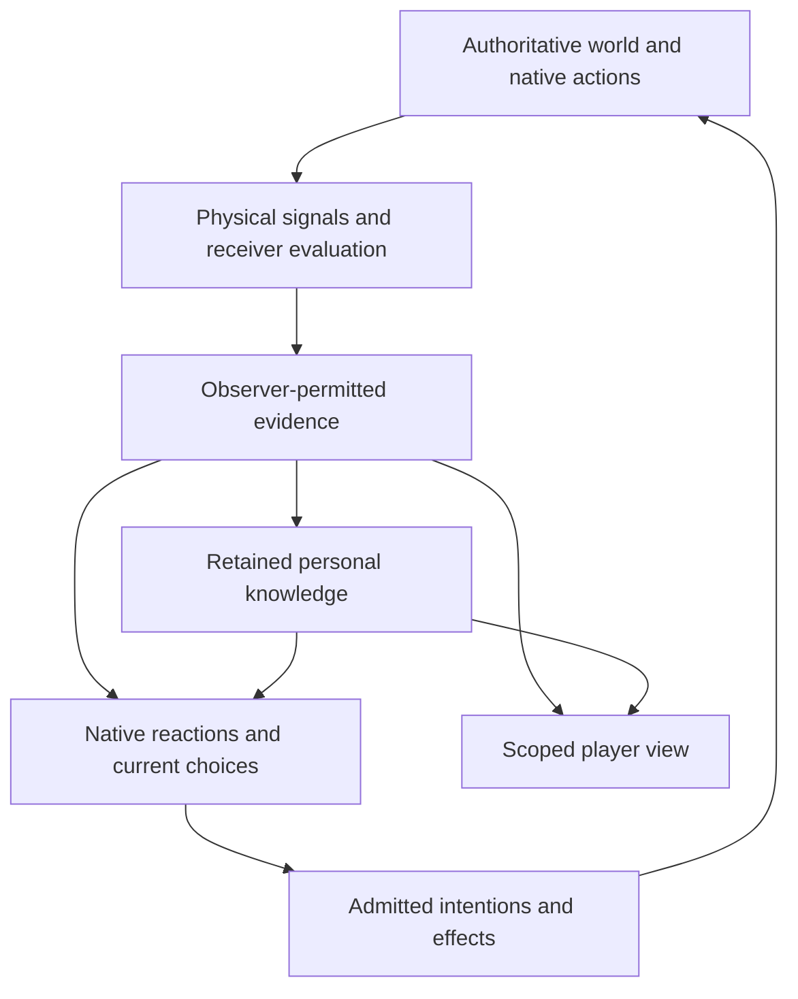

# Stealth, awareness and surprise — shared technical design

| Status      | Current progress                                                                                                                                                    | Last updated |
| ----------- | ------------------------------------------------------------------------------------------------------------------------------------------------------------------- | ------------ |
| In progress | Existing-channel personal-evidence foundation delivered; other runtime modules and integrated qualification remain open. SA-D01 selects authored player psychology. | 2026-10-27   |

Design used for scoped implementation and review: **2026-10-25 15:35 UTC**.

## Authority and scope

This document owns the **shared architecture and integration contracts** for specialties A–G. The [feature specification](stealth-awareness-feature-spec.md) owns player behavior and journeys. [SA00](../maintainers/stealth-awareness.md) owns completion of this shared design, SAD-A–SAD-G the specialist designs, and SAI work the subsequent implementation. The paired specialist designs and [A–U scenario traces](stealth-awareness-scenarios.md) complete the integrated design. Implementation and qualification remain separate work.

The existing persistent specifications remain the semantic owners of identity, observation, memory, actions, appraisals, effects, encounters, clocks, saves and projection. Their directly related target sections refer here for the cross-module composition. This document replaces incompatible earlier targets, particularly reliable canonical voice association on an unfamiliar first hearing. It does not mislabel the replacement as implemented behavior. World-specific laws remain with the selected world's definition/policy owners; TypeScript-native policy is still world policy.

The design consumes the selected shared slices of ND03, ND11, ND13, ND16 and ND19, linked from the feature specification. Those umbrella tasks retain their other work. No additional event bus, knowledge database, appraisal store, threat tracker, action system, scheduler, package hierarchy or universal probability graph is introduced.

## Inspected implementation baseline

Repository: `Macrofold/OpenLegend`. The application baseline is `86a21ce50aa0633d81b38a430b7727c0c543017e`; the shared and seven specialist branches add documentation. The owner audit below distinguishes existing mechanisms from required extensions. Source inspection does not establish runtime, provider, browser, balance or capacity qualification.

| Existing owner                                                                                                                                                                                                                                                                  | Verified source behavior                                                                                                                                                                                                                                  | Required extension or boundary                                                                                                                                                                                                                        |
| ------------------------------------------------------------------------------------------------------------------------------------------------------------------------------------------------------------------------------------------------------------------------------- | --------------------------------------------------------------------------------------------------------------------------------------------------------------------------------------------------------------------------------------------------------- | ----------------------------------------------------------------------------------------------------------------------------------------------------------------------------------------------------------------------------------------------------- |
| [Perception](../../packages/domain/src/perception.ts), [perception frame](../../packages/domain/src/perception-frame.ts), [predicted motion/sensory boundaries](../../packages/domain/src/motion-boundaries.ts), [base senses](../../packages/domain/src/worlds/base/senses.ts) | Current vision uses range and body-height obstruction samples. Spatial candidate/preparation owners and predicted sensory-crossing runs already exist.                                                                                                    | B adds actual orientation, light, posture-sensitive receiver geometry and concealment inputs; A separates independently permitted detail. Existing sight does not establish those features.                                                           |
| [Events](../../packages/domain/src/events.ts), [event observation](../../packages/domain/src/event-observation.ts), [experience](../../packages/domain/src/experience.ts)                                                                                                       | `WorldEvent` and observer `Awareness` retain scoped occurrence accounts. Felt contact can give the victim an account without identifying an unseen performer.                                                                                             | A/C extend the same typed observation path. Native receivers must not depend on writing autobiographical awareness. Required observation remains part of the native transition.                                                                       |
| Event ordering in `events.ts`                                                                                                                                                                                                                                                   | `recordEvent` assigns `WorldEvent.order` before invoking a native response callback. A non-speech `Awareness.sequence` can be assigned after nested callbacks allocate other IDs; combat observation is also updated before ordinary awareness insertion. | Preserve source occurrence order explicitly and snapshot evidence actually acquired at a cut. Never infer historical readiness from `Awareness.sequence`, event timestamps alone or a later database join.                                            |
| [Base identity/knowledge](../../packages/domain/src/worlds/base/knowledge.ts), [knowledge contract](../knowledge.md#subject-binding)                                                                                                                                            | `ObserverIdentity`, `recognizesSubject`, `subjectReferenceCurrent` and `rememberSubject` own associations. Authored acquaintances survive episodes; ordinary current associations are predominantly sighting-bound.                                       | A extends this owner for learned cross-exposure recognition/familiarity. Names, subject pads and raw IDs are not recognition evidence. No parallel voice registry.                                                                                    |
| [Speech](../../packages/domain/src/speech.ts), [hearing contract](../hearing-and-speech.md)                                                                                                                                                                                     | Listener-specific sound/words already exist; canonical speaker attribution currently depends on visual exposure. The receiver index excludes memoryless actors.                                                                                           | C/SPK separate physical receivers from retention capability. A/SPK supplies familiarity-based recognition. Reliable first-unseen-hearing identity was a target, not existing code.                                                                    |
| [Spatial state](../../packages/domain/src/spatial-state.ts), [spatial contract](../spatial-world.md)                                                                                                                                                                            | The actor's numeric body, support and heading are authoritative. Movement currently changes body heading.                                                                                                                                                 | B/C add supported active orientation/posture through the same owner, with actual motion and clearance dependencies. G cannot write a camera-derived heading.                                                                                          |
| [Personal encounters](../../packages/domain/src/combat-encounters.ts)                                                                                                                                                                                                           | `PersonalEncounter`/`PersonalEncounters` own actor-local pairs, unknown danger, observed positions, offense and deadlines. `AttackObservationReceipt` deduplicates preparation observations. `personalEncounter()` currently requires sight.              | F extends this owner for relevant warning and active preparedness, including unseen/unknown threats; the current sight-gated UI query is not the new preparedness evaluator.                                                                          |
| [Native response controller](../../packages/domain/src/native-response-controller.ts) and existing native-response modules                                                                                                                                                      | Native animals already use alarm/escape, blocked/settling behavior, exact life/region danger and ordinary movement admission.                                                                                                                             | C/E extend actual native reception and choices. They do not invent an animal prompt, require memory or call the controller wholly unimplemented. Remaining CTR qualification stays open.                                                              |
| [Appraisals](../../packages/domain/src/appraisals.ts), [base appraisal definitions](../../packages/domain/src/worlds/base/appraisals.ts)                                                                                                                                        | Private `Appraisal` records, definitions, exact cause identity, scaled/qualitative values and lifetime rules exist. Fear/anger are interpreted; injury supplies native discomfort. Current decaying-appraisal reframe refuses any changed anchored value. | D adds bodily startle outside the memory requirement and a narrow supported numerical reconsideration operation. Existing reframe must not be described as already doing this.                                                                        |
| [Prepared appraisal context](../../apps/server/src/prepared-response-appraisals.ts), [AI director](../../apps/server/src/ai-director.ts), [cognition contracts](../../apps/server/src/cognition-contracts.ts)                                                                   | Threat appraisal followed by action choice and current numerical feeling context are already connected. Independent joy and broader continuing-lives acceptance remain open.                                                                              | Reuse their cause binding, independent component admission and validity. No compulsory generation or verbal thought for native protection.                                                                                                            |
| [Status effects](../../packages/domain/src/status-effects.ts), [state contributions](../../packages/domain/src/state-contributions.ts)                                                                                                                                          | Status instances own numeric rates/periodic changes and restrictions. Independent contributions currently support capability restrictions and owned removal.                                                                                              | D/F need a narrow effective-parameter modifier through these owners. Accuracy/evasion modifiers are not already implemented by a generic contribution API.                                                                                            |
| [Actor work](../../apps/server/src/actor-work.ts), [cognition execution](../../apps/server/src/cognition-execution.ts), [decision validity](../../apps/server/src/decision-validity.ts)                                                                                         | Existing per-actor intake, bounded execution, source/life/control/revision fencing and unavailable outcomes exist.                                                                                                                                        | E/D add reasons and owned deadlines to these paths, not per-emotion queues or per-frame AI polling.                                                                                                                                                   |
| [Server view](../../apps/server/src/view.ts), [client scene](../../apps/client/src/scene.ts), [camera](../../apps/client/src/world-camera.ts)                                                                                                                                   | Dynamic entity projection already uses character sight; the camera is presentation-only. A bounded client cache retains frozen faint last-seen images with live interaction, shadows and interpolation removed.                                           | A/G add per-fact disclosure and explicit authorized historical meaning/time/precision. Entity-level visibility and faint opacity alone are insufficient. Current map serialization also needs a known/static versus changed-dynamic disclosure audit. |
| [Simulation time](../simulation-time.md), [save/load](../save-and-load.md)                                                                                                                                                                                                      | Ordered elapsed simulation, native boundaries, partial progress, life references, same-version continuation and authority-generation fences already exist.                                                                                                | New durations, evidence progress, preparation and reappraisal use these owners. No feature clock, legacy adapter or replayed provider call is added.                                                                                                  |

The source audit establishes where changes belong. It does not prove each current caller is qualified, that all existing target designs are implemented, or that the composed feature meets gameplay/performance acceptance.

## Ownership and dependencies

### Seven specialist contracts

| Specialty                                    | Owns within existing modules                                                                                                                                                         | Consumes                                                                                                              | Supplies; must not own                                                                                                                                           |
| -------------------------------------------- | ------------------------------------------------------------------------------------------------------------------------------------------------------------------------------------ | --------------------------------------------------------------------------------------------------------------------- | ---------------------------------------------------------------------------------------------------------------------------------------------------------------- |
| **A — perception, evidence and recognition** | Shared observer projection at `perception.ts`/`perception-frame.ts`/`event-observation.ts`; exposure lifecycle under EPR; association through the existing identity/knowledge owner. | B/C physical evaluation, installed sense/identity policies, permitted prior familiarity, exact source/life/time.      | Independently permitted facts, association and current detail; cannot decide emotions, hostile intent, combat result or client camera.                           |
| **B — vision and orientation**               | Supported body/sensory orientation, visual evaluation, light and concealment; `spatial-state.ts`, existing geometry queries and selected sense policy.                               | C's admitted posture/body, physical environment, compatible action-held pose.                                         | Physical receiver/source samples and detail potential to A; cannot create remembered knowledge or infer identity from a mesh.                                    |
| **C — posture and acoustics**                | Crouch/quiet movement admission and resulting body/contact; physical sound production/propagation through existing action, speech and geometry owners.                               | Body/terrain/material/equipment definitions, actual committed movement and activities, B orientation contract.        | Physical emissions and observer evaluation to A/native receptors; cannot identify a hidden emitter, force a reasoning person's turn, or run another action lane. |
| **D — bodily shock and emotion**             | Native startle through body/status/contribution owners; private appraisals and bounded reconsideration through appraisal/cognition owners; complete effective emotion reading.       | Actual eligible shock or permitted evidence, relevant physiology/traits, A evidence, existing clocks and work intake. | Current mechanical parameters/provenance to F and permitted own feedback to G; cannot decide surprise, invent causes or choose player movement.                  |
| **E — attention and autonomous response**    | Attention/urgency intake, chosen investigation/watch activities, existing native animal controller and reasoning-capable agency.                                                     | A evidence, B/C accepted pose/actions, D current own feelings, F readable encounter facts.                            | Ordinary chosen intentions and applicable active preparation evidence; cannot change perception truth, create a shared group mind or add a scheduler.            |
| **F — preparedness and surprise**            | Existing personal encounter extension, immutable attack/victim cuts, world combat evaluation, accuracy/evasion consumption and committed attack results.                             | A prior evidence, E/B/C actually active preparation, D current effective mechanics, exact contact victim.             | Native result and scoped reason facts; cannot use omniscient intentions, current camera visibility or an incoming impact as prior warning.                       |
| **G — player interaction and disclosure**    | Input mapping to ordinary intentions, server/protocol projection and client rendering/feedback, historical inspection and creator audience separation.                               | A permitted current/historical facts, accepted B/C/E work, own D feedback and permitted F results.                    | Controls and information the player can act on; cannot establish sensing, identity, world state or authority from presentation.                                  |

A–G are responsibility groups, not required new packages or services. The [specification map](../maintainers/stealth-awareness.md#specialist-design-ownership) identifies the canonical local pair and tracker for each. Changes to a shared type or phase update this owner and every affected producer/consumer together.

### Existing semantic authority

| Meaning                                          | Sole authority and consumers                                                                                                                  |
| ------------------------------------------------ | --------------------------------------------------------------------------------------------------------------------------------------------- |
| Actual fact, emission cause and occurrence order | Domain mutation/event owner; physical source attribution stays server/native-side even when the observer cannot identify it.                  |
| Sensory exposure episode                         | Existing EPR/perception episode owner; sensors contribute observations, and memory/identity consume its continuity.                           |
| Identity association and learned familiarity     | Existing observer identity/knowledge mutation owner under the installed policy; speech, vision, memory and references all call it.            |
| Active spatial/body/sensory orientation          | Existing spatial/action/pose owner; renderer and menus consume accepted pose, not another writable heading.                                   |
| Remembered information, testimony and correction | Existing experience/awareness/memory/knowledge owners, each retaining their existing distinct semantics and privacy overlays.                 |
| Personal emotional interpretation                | Existing appraisal owner; native bodily effects and generated language cannot replace its source checks.                                      |
| Bodily effect and effective modifiers            | Existing body/status/contribution mutation owners; effective totals are derived, not another saved fear meter.                                |
| Active watch/guard/investigation                 | Existing agency plan/activity and action/guard owners; personal encounters reference the actual active preparation instead of copying it.     |
| Relevant warning/continuing threat expectation   | Existing actor-local personal encounter owner, including unknown/region evidence; neither a global enemy list nor a group awareness table.    |
| Attack outcome                                   | Existing combat/contact owner; it samples the required inputs, commits once and records actual results.                                       |
| Scheduling and preservation                      | Existing simulation boundaries, ActorWork/cognition execution, world-record tree and save/load; derived indexes/notifications are disposable. |

The [engine/world boundary](../engine-and-world-boundaries.md) protects valid references, native admission, privacy, deterministic ordering and bounded execution. The world chooses sensory channels, attributes, physiology, emotion definitions, recognition/detection laws, preparation criteria, multiplier, reaction susceptibility and effect strengths. No engine validator requires humans, heads, hearing, visible light, fear or an attribute named Perception. A declared family must actually supply its supported computation; arbitrary strings and generated prose do not install it.

## Shared contracts

### SC01 — Information pipeline and distinct meanings



| Meaning            | Example                                                        | Valid use                                                                                                                    |
| ------------------ | -------------------------------------------------------------- | ---------------------------------------------------------------------------------------------------------------------------- |
| Actual world fact  | A particular person moved a spear behind a wall.               | Native physical simulation and authorized creator inspection; not automatic actor/client input.                              |
| Physical signal    | A contact emits a sound at a place with an admitted signature. | Sense evaluation using actual environment/receiver state; causal performer and physical emitter may differ.                  |
| Perceived evidence | This observer heard indistinct steps from a broad direction.   | Native response and optional cognition with exactly that precision.                                                          |
| Inferred belief    | The observer suspects those steps belong to a rival.           | Attributed interpretation through existing mind/knowledge/appraisal meaning; no new physical target or verified fact.        |
| Remembered fact    | The observer saw the rival holding a spear earlier.            | Historical account with its original freshness/support; not the rival's unseen current equipment.                            |
| Generated language | A model says the rival is approaching.                         | A proposal or attributed statement, validated against its permitted role; it never upgrades evidence by asserting certainty. |

Source association, recognition and name knowledge are independent of detection, location, classification and word intelligibility. A later fact cannot refresh a different facet. A sensory union or shared source cache grants no recipient any other observer's facts. Testimony can establish that a warning was heard; its assertion remains testimony even when the observer chooses to prepare.

### SC02 — References, time and message boundaries

The following TypeScript is **conceptual design notation**, not a claim that these APIs/types exist or an instruction to copy every wrapper into production. Reuse `WorldEvent`, `Awareness`, `DefinitionPin`, existing position/region types, appraisals, encounter records and server scope owners. New fields belong on those owners only where current fields cannot express the shared meaning.

```ts
type SimTime = number; // Existing world.simTime units, not wall seconds.
type NormalSpeedSeconds = number; // Authored duration unit; finite, nonnegative.
type ActorLifeRef = Readonly<{ actorId: string; physicalLife: number }>;
type OccurrenceRef = Readonly<{ eventId: string; at: SimTime; order: number }>;
type ExistingEvidenceFamily =
  | 'awareness'
  | 'memory'
  | 'action-result'
  | 'private-condition'
  | 'native-exposure'
  | 'native-response';
type EvidenceRef = {
  [F in ExistingEvidenceFamily]: Readonly<{
    observer: ActorLifeRef;
    family: F;
    id: string;
    revision: ExistingEvidenceRevisionByFamily[F];
  }>;
}[ExistingEvidenceFamily];
type ExposureRef = Readonly<{ observer: ActorLifeRef; episodeId: string }>;

// A native snapshot boundary, not a new event counter or a database query.
type EvidenceCut = Readonly<{
  at: SimTime;
  lastIncludedOrder: number;
  acquiredBoundary: ExistingObserverAcquisitionBoundary;
}>;
type Fact<T> = Readonly<{
  value: T;
  asOf: SimTime;
  support: readonly EvidenceRef[];
}>;

// Spatial estimates use existing supported geometry; exact hidden coordinates
// never accompany a direction/region merely to help the client draw a cue.
type LocationEvidence =
  | { kind: 'bearing'; from: Position; direction: Direction; spread: number }
  | { kind: 'region'; region: SupportedRegion }
  | { kind: 'point'; point: Position; errorRadius: number };

type SourceAssociation =
  | { kind: 'unassociated'; exposure: ExposureRef }
  | { kind: 'suspected'; exposure: ExposureRef; rememberedSubject: string }
  | { kind: 'recognized'; exposure: ExposureRef; rememberedSubject: string };

type SensoryOrigin =
  | { kind: 'occurrence'; occurrence: OccurrenceRef }
  | {
      kind: 'exposure';
      exposure: ExposureRef;
      evaluatedFrom: SimTime;
      evaluatedThrough: SimTime;
      dependencies: ExistingPhysicalPolicyDependencies;
    };

// A compact result of an existing observation owner. Facts are independently
// optional; source metadata and rememberedSubject are server bindings.
type SensoryEvidence = Readonly<{
  observer: ActorLifeRef;
  origin: SensoryOrigin;
  acquiredAt: SimTime;
  exposure: ExposureRef;
  policy: DefinitionPin;
  detection: Fact<SupportedDetection>;
  location?: Fact<LocationEvidence>;
  association?: Fact<SourceAssociation>;
  detail: readonly SupportedSensoryFact[];
}>;

type ObservationResult =
  | { kind: 'observed'; evidence: SensoryEvidence }
  | { kind: 'not-detected'; evaluatedThrough: SimTime }
  | { kind: 'unsupported' }
  | { kind: 'incomplete'; continuation: ExistingWorkReference };
```

`ExistingEvidenceRevisionByFamily` aliases the exact existing source-adapter revisions in [A's source contract](perspective-perception-tech-design.md#exact-shared-source-revisions). Personal-account revisions are string digests; other adapters retain their own representation, including native string versions where present. Keep underlying memory/summary storage kind in the opaque adapter binding, use local facet ordinals inside a source body, and attach its exact revision outside that body to avoid a self-hash cycle. No coercion, cross-family revision comparison or universal counter is permitted.

`SupportedDetection`, `SupportedSensoryFact`, `Direction` and `SupportedRegion` denote the closed admitted families in A/B/C, not open dictionaries or a universal graph. Different channels need not populate the same detail fields. `Fact` carries semantic freshness/support rather than a universal confidence percentage. A defines each family's explicit certainty/classification discriminant; location uncertainty is spatial precision and does not substitute for recognition confidence. Model confidence, measured signal quality and calibrated correctness must not be conflated.

Discrete event evidence carries its original `OccurrenceRef`. Continuous or sampled exposure retains the existing observer exposure identity, evaluated interval and physical/policy dependencies without allocating a synthetic event. Native retained support can reference the existing exposure/controller continuation through the indicated family adapter; it requires neither a human awareness record nor autobiography. A owns the concrete supported family shapes, including two personally received location samples for observed motion and bounded grounded warning testimony. Consumers use those exact payloads; hidden producer identity, velocity or intent is not evidence. `ExistingObserverAcquisitionBoundary` means the actual native acquisition boundary or suitable existing owner revision, with immutable captured membership; it is not a proposed global counter.

Stable actor identity plus the exact normalized `physicalLife` identifies a bodily participant. Historical actor references may remain after that life ends; they cannot resolve to a new life for effects or current targeting. An exposure reference is observer-local and cannot be compared across observers to reveal a hidden source. A recorded event may retain its true performer and emitter internally while all observer references omit them. Opaque public/model handles are created through the existing permitted-reference binding, never by serializing this native structure directly.

The server wraps private reads/proposals with its existing world, timeline, authority/control generation, audience and evidence/privacy revisions. Those are not new writable domain fields copied onto every fact. Recheck after asynchronous work and immediately before disclosure/commit. Definition pins bind installed meaning; memory source revision and current physical life solve different staleness problems and cannot replace one another.

`not-detected` means the supported evaluation actually completed for its stated interval; it is not proof that no physical source exists. Unsupported capabilities and incomplete work remain distinct. An incomplete physical or mechanical query cannot silently return no threat, zero fear, invisibility or surprise eligibility.

### SC03 — Physical emission, observer acquisition and storage

A native producer supplies the actual physical occurrence, emitter/location, original cause, channel/profile and covered simulation interval to the existing event/perception path. For footsteps this is the actual admitted movement/contact, not animation time or an input request. A thrown object's impact originates where it strikes; knowing its thrower is a separate inference or observation. Speech preserves its existing committed wording, listener fragments and addressing semantics.

B/C evaluate conservative physical candidates and return only physically available evidence to A's projection. A uses the installed identity/detail rules and the observer's permitted prior knowledge. All actual observation contributions pass through the one native observation/experience mutation boundary; exact acquisition is neither a model decision nor a client operation.

The compact result can feed native reception without requiring a persisted human-style `Awareness` record. Memory-capable actors retain appropriate evidence through existing awareness/private-experience owners. Native animals retain only the controller/exposure continuation their policy needs. Detection capability, participation, sleep eligibility, cognition capability and retention capability are tested separately. A dead source's released effect can continue while the dead source receives no fresh evidence.

Shared immutable source/geometry work may be reused. Observer interpretation, recognition, retained evidence and response cannot be shared merely because observers are nearby. Common source support can appear once with separate observer projections; storing the same physical event once does not make its full payload public.

### SC04 — Exposure, accumulation and recognition

EPR owns source/observer/sense exposure lifetimes. Extend its existing episode representation only for needed channels, detail transitions and saved accumulation. Episode continuity can survive a short configured gap; **current authorization cannot survive the provider-defined support ending**. B's selected sampled law can hold availability and the latest measured value until the next due sample or an actual invalidation. At that loss boundary stop current detail even when the same episode remains eligible to reconnect. Holding availability never updates the value's measurement or acquisition time.

Strong cues cross the selected detection rule at the channel's actual occurrence or due sampling boundary. They do not wait for repeated checks, semantic attention or a model. Weak cues may accumulate evidence over supported physical duration and quality. B/C own the physical samples; A owns the once-only application to an observer's exposure. Sample/publication/render frequency cannot multiply exposure, random draws or familiarity. If accumulation affects a later result, save its progress or deterministically reconstruct it through the existing episode owner.

Repeated exposure is not necessarily independent evidence. Re-rendering a cue, recalling a record, retransmitting one event or hearing a retelling of the same account cannot count as new physical exposure. Real later footsteps can contribute to continuity without emitting a new awareness record for every frame. Distinct meaningful sounds/outcomes retain their separate occurrences even if optional cognition wakeups coalesce.

Recognition uses the common observer identity owner, familiarity support, current evidence quality and installed ability/condition policy. The selected base-world recognition rule uses familiarity, actual evidence quality and the same world-authored Perception attribute as human visual detection/detail. Its raw value is 0–100, default 50; normalized p = value / 100 and B's visual gain is 0.75 + 0.5p. Install the attribute when either human visual or recognition policy requires it, independently of memory capability. A owns the separate recognition formula; C does not apply it to hearing thresholds. A world without this attribute uses its own installed policy, not an engine fallback named Perception. Other installed worlds choose their supported ability policy; the reusable engine does not require an attribute named Perception. An unfamiliar first-heard voice alone can establish an anonymous auditory exposure, words, classification or direction, never reliable canonical identity by default. A knows neither a name nor a lasting acquaintance solely from a source ID. Supported cross-sense exposure or later evidence can establish a new association through the same owner.

Keep physical target binding separate from believed identity. A suspected familiar voice can refer to an existing remembered subject as a hypothesis without resolving the current sound to that person's live body or opening their notes as if a new stranger were certainly them. Detailed disguise/false-recognition policy is not selected here. Its future implementation must preserve that separation rather than swap authoritative entities. A recognized but unseen person can remain available for permitted remembered discussion while being unavailable for a direct current-body action.

### SC05 — Per-fact freshness and remembered projection

For each retained fact preserve actual source/revision, original observer/acquisition, semantic role, original observation time, available precision, certainty/association and correction/forgetting status through awareness, cold SQL, memory adaptation, summaries, retrieval and model context. Use the existing structured-experience and source-lineage owners; a rendered sentence or source link pointing only to flattened prose cannot replace the retained meaning.

Current evidence comes only from completed provider acquisitions. A snapshot settles already admitted coverage and copies existing values/receipts; it does not trigger another physical sample. Current facets preserve `valueMeasuredFrom/Through` and `valueAcquiredAt` separately from availability. Remembered facts report their own `asOf` times; later recognition or naming may improve permitted presentation without updating unseen attributes or rewriting original evidence. A location may age into a broader inferred region if an admitted policy supports that derivation, but it must remain an estimate anchored to past evidence. It never samples the subject's hidden current path.

Corrections preserve the original occurrence and the correction relationship. Forgetting/revocation removes eligibility through current overlays, invalidates dependent association, appraisal, preparation and cached presentation as their owners require, and fences in-flight reads. Do not reuse a remembered suspicion after its sole support is revoked. A conservative existing invalidation may clear more derived knowledge; fine-grained replacement requires its own proven dependency coverage. Committed physical injury/startle is not reversed because the actor later forgets its cause.

## Physical orientation, posture and senses

### SC06 — One accepted pose and physical action owner

There is one authoritative body placement/support/orientation and one admitted description of active sensory orientation for that body. Movement direction is a trajectory; body orientation is a physical pose; sensory orientation is a supported receiver transform; camera orientation is presentation. These meanings must not be collapsed into one angle or independently writable copies.

B defines supported relative receiver orientation and its constraints. C owns posture/movement admission and the resulting body/contact. Both compose through the existing spatial/action owner. C's crouch body, B's optical patches and eye/ear transforms change atomically and remain inside the admitted body. Directional, quiet and crouch movement limits combine by the minimum cap on the same ordinary movement rate, not by multiplying penalties. Independent looking while walking supports B's compatible orient-once requests during movement and E's single reviewed Walk while watching combined start, with atomic initial admission and explicit later interruption; it does not authorize a general second physical work lane. The existing movement setter currently writes heading, and a current guard binds facing to body heading, so their consumers must be reconciled explicitly.

The shared arbitration order is: validate the exact actor/life and current action; retain non-negotiable support/clearance; apply compatible admitted look/posture intention within the body's supported freedom; evaluate action-held pose constraints; reject or explicitly replace incompatible work through the ordinary transition. No camera callback, late input or pose animation may override the accepted result. An action can constrain a relevant body part without claiming every unrelated receiver axis; B/C define the admitted degrees of freedom and E/F specify their actual requirements in their canonical pairs.

Before a posture change, evaluate the **resulting** body against actual supports, ceiling/obstacles and equipped attachments. A refused stand leaves posture, position, resources and random state unchanged. Accepted posture changes invalidate clearance/navigation, reach, sensory origins, contact/emission and relevant active work once through their owners. Direction, footprint and source revisions cannot be inferred from an image asset or species name. Restore validates the pose/action relationship in both directions.

The selected [ND38 temporary duck](action-execution-and-skill-expression-tech-design.md#32-one-finite-actual-body-pose-with-no-flight-life-immunity) composes through this same body owner with voluntary crouch and action-held pose. It derives dimensions once from the standing construction, must fit inside the accepted posture and clear the actual crossing, and returns to the retained voluntary posture only with legal clearance. Its temporary contraction grants no movement route beyond that posture's conservative envelope and cannot be erased by a new posture request. The ND38 world profile retains its own response tuning; no second body or evasion authority is introduced.

### SC07 — Physical channels and prompt cues

B owns visibility/light/concealment laws and conservative spatial evaluation. C owns physical sound/attenuation/emissions. A owns admitted detail/recognition; E owns what to attend or do about it. Concealment is a physical relationship, not an actor-wide hidden flag. One observer can see a movement another cannot, and a hidden body can emit an independently perceived signal without revealing all its facts.

Light is physical input under an installed world rule, not the brightness of the rendered pixel. Sound production uses actual actions/contact/equipment/materials, not an animation footfall loop. Posture and quiet movement can reduce some signals while leaving other channels unaffected. Known missing channels remain unsupported; the generic engine does not silently supply human sight/hearing.

Present sight and predicted sensory crossings must use the same admitted geometry and receiver transform. B/C changes reconcile `visionQuery` with [motion-boundaries.ts](../../packages/domain/src/motion-boundaries.ts)'s `SIGHT_BODY_FRACTIONS`, sight runs, `sensoryCrossingBound`, `BodyCertificate` dependencies and crossing caches. Head-only turns, posture, light, obstacles and capability changes invalidate relevant temporal preparation as well as current evaluation. Incomplete crossing preparation cannot establish absence or justify surprise. Queries consume the same admitted sampled support as progression; they do not independently remeasure hidden current state.

B's base visual law uses fixed-epoch 50 ms normal-speed cells only for affected dynamic scopes, plus actual native change boundaries that split cells without rephasing. Static dependency-complete pairs reuse their result; shared daylight coefficients are held for one normal-speed second. Existing analytic motion/sight runs may contribute an interior sample for a narrow supported geometric crossing. No general optical root solver, per-render polling or capture-time victim scan is selected. A held detection rate integrates uncovered time once; changing values retain their actual measurement times. Subcell optical flashes/gaps may be missed or held without a real native boundary or supported analytic sweep, and repeated aliasing has no claimed universal error bound. B owns the exact cadence, motion correspondence, invalidation, persistence and qualification law.

New channels declare: receiver and emitter eligibility; supported propagation/occlusion family; actual occurrence and continuous-interval semantics; relevant dirty causes; detail/precision output; strong-cue boundary and weak-accumulation inputs; same-cause deduplication; retention/native consumers; and incomplete-work behavior. Detailed thresholds, FOV, sample placement, lighting, acoustic curves and gait sounds belong to B/C/A and their world policies. C supplies the separate abrupt-acoustic qualifier and original onset/rise receipt; D owns resulting startle peak and duration. Ordinary strong detection alone does not imply startle. Full disguise mechanics remain outside this slice.

## Emotions and reconsideration

D's detailed [general emotion feature](emotional-physiology-feature-spec.md), [technical design](emotional-physiology-tech-design.md) and [EP tracker](../maintainers/emotional-physiology.md) specify these interfaces' implementation-ready internal rules. SC08/SC09 remain binding. The detailed owner supplies native reaction receipts, maximum effective fear, both melee completion paths, ranged release and fixed admitted evasion, exact same-cause reassess, finite emotional-review scheduling and current-format persistence. [Base psychological reactions](../worlds/base/psychological-reactions.md) is the sole authored tuning owner.

### SC08 — Native shock, private interpretation and effective mechanics

Native startle belongs to the existing bodily status/contribution owner and is bound to the exact affected life and actual qualifying cause. It requires no memory, autobiographical text or AI. Injury/discomfort already present in the game is not renamed into startle. The world selects eligibility, susceptibility, trait/condition effects, stacking and recovery. A genuinely distinct qualifying cause may justify another reaction; duplicate delivery of the same cause/life cannot create another onset or restart its duration.

Psychological emotion remains a private `Appraisal` under its existing definition/cause/revision/lifetime owner. Evidence of an impact can support fear without identifying its source. Fear is neither proof of external hostility nor a public facial expression. Actual expressions require separately committed supported actions/signals. Current base fear/anger and their game-hour decay are the inspected baseline; D's normal-speed authored decay/duration schema and selected policy are target extensions, with no reinterpretation of implemented units.

Effective mechanical emotion is a read-only composition over the exact body's eligible active contributions and the actor's applicable appraisals. D owns the maximum of applicable normalized contributions, preventing duplicate-cause summation; F owns consumption at declared accuracy/evasion boundaries. The selected base world uses effective fear for accuracy and evasion without an automatic running/fleeing speed reduction. No direct player-action or native-flight choice is implied by the number. Other worlds can omit the channel or choose another supported rule.

```ts
// Conceptual extensions of existing effect/appraisal owners, not new stores.
type CommittedReactionCauseRef =
  | { kind: 'physical-outcome'; cause: ExistingPhysicalCauseRef }
  | { kind: 'acquired-occurrence'; cause: OccurrenceRef }
  | { kind: 'acquired-exposure'; exposure: ExposureRef; cause: ExistingExposureTransitionRef };
type BodyReactionInput = Readonly<{
  target: ActorLifeRef;
  cause: CommittedReactionCauseRef;
  evidence?: EvidenceRef; // Physical contact can qualify without memory.
  policy: DefinitionPin;
}>;
type EffectiveMechanics =
  | {
      kind: 'complete';
      target: ActorLifeRef;
      policy: DefinitionPin;
      at: SimTime;
      values: readonly SupportedMechanicalParameter[];
      support: readonly ExistingEffectOrAppraisalRef[];
    }
  | { kind: 'not-installed' }
  | { kind: 'incomplete'; continuation: ExistingWorkReference };
```

The reaction cause identifies the original native physical contact/outcome, original acquired qualifying abrupt occurrence or trusted meaningful exposure transition. The existing trusted producer assigns or binds it before the effect commits. Melee/projectile contact currently supplies an action invocation before the enclosing contact event exists; that event cannot be a prerequisite for bodily response. Consequence records such as guarded, injury, incapacitation and enclosing contact are optional provenance for the same cause, not additional onsets. Deduplicate the qualifying reaction on original cause, reaction definition and exact target life. Preserve distinct actual contact/outcome identities when one action can produce several; neither every event wrapper nor the whole action lifetime is automatically one new shock. Contact-derived sound retains that original physical-outcome root. D reuses an existing same-cause/definition/target-life result, including terminal no-effect, across contact and acoustic wrappers; another listener has its own receiving-life key. With no prior reaction result, a later genuinely qualifying acquired sound may react at its actual acquisition. Memory or appraisal delivery does not restart the physical reaction.

A sudden eligible exposure transition uses the existing perception/episode owner's original transition identity, evaluated interval and dependencies, without requiring a synthetic world event. The exposure observer and life must match the reaction target, and the transition qualifies only when native acquisition actually occurs. Preserve its consumed cause across save/restore. A sample, publication, recall or dependency revision alone does not create another onset; deduplicate on the original transition, reaction definition and exact target life. `ExistingExposureTransitionRef` is that supported owner binding, not a new event stream.

The supported numeric modifier is a **missing mechanism** to add through the current status/contribution and combat parameter owners. Do not add a second fear field, inverse-delta cleanup, duplicated accuracy formulas or consumer-specific clamp laws. D/F agree on parameter units, saturation and composition once in the selected rule. Opposite or ending effects remove only their own contribution; they never restore an old whole-body snapshot or erase an unrelated wound.

D/F reconcile the existing [rangedAccuracy](../../packages/domain/src/ranged-policy.ts) `danger-or-return` target-condition factor before adding effective fear/evasion. It currently reads returning work or an applicable animal episode, not appraisal fear. The selected rule must state whether this represents a distinct physical circumstance or overlaps the new contribution, then combine or retire it accordingly. The same intended alarm/evasion influence cannot be counted again because it arrives through a second owner. D's [selected parameter contract](emotional-physiology-tech-design.md#ep-c06--complete-effective-fear-and-parameter-resolution) retains base conditionAdjustment none and excludes the alternate target-state heuristic when generalized fear mechanics are selected. Its exact formulas/sampling are specified; F integrates those declared consumers. Melee attempts and ranged release sample accuracy; newly admitted evasion samples its supported reach. Later effects never rewrite an already admitted path, speed or duration.

All active records needed for a native mechanical result remain in its current complete mechanical working set under the existing residency owner. A bounded hot history page is not a complete emotion reading. No synchronous impact performs SQL or waits for a model. If required active state is unavailable, existing required-work preparation/hold preserves a coherent prefix before that outcome; it does not treat missing records as zero. An absent optional installed channel has the neutral behavior declared by that world and differs from failed preparation.

### SC09 — Adaptive reconsideration of an existing cause

D extends the existing appraisal owner with one narrow reconsideration operation and review metadata, without enrolling the full-registry AppraisalProcess loop; E adapts its typed due reason into ActorWork. The saved minimum meaning is the exact appraisal/cause, expected appraisal and source revisions, installed policy, next simulation deadline, current opportunity identity and finite remaining work for unchanged causal support. Reuse existing fields where possible; do not copy this into another queue.

The opportunity can arise from a scheduled internal review, an actual relevant condition transition or permitted new evidence. Ordinary compatible cognition can host an already eligible review; it does not itself renew support or awaken dormancy. A new external event is not required. The internal review itself is not a new witnessed external cause. The response can reduce, resolve, retain, or make another supported bounded change to the same appraisal; it need not create speech, visible thought or prose.

Unchanged support cannot infinitely renew emotion or paid work. Each installed reconsideration policy must specify positive spacing, a finite per-unchanged-cause opportunity/attempt allowance, lifetime/intensity constraints, and a terminal/dormant or native-continuation result when unchanged/exhausted. A different request ID, new wording, reread memory, source alias, appraisal-changed notification or successful model completion does not replenish the allowance. A genuinely new permitted cause can begin or extend a supported episode only through the appraisal owner with explicit provenance; it cannot rewrite the original occurrence.

The current decaying-appraisal reframe refuses changed values. The required numerical operation must preserve original cause identity and the admitted lifetime/renewal bounds rather than delete/recreate the feeling or reset its curve covertly. D specifies the exact update algebra and emotion-specific finite cadence. The shared contract freezes causal boundedness, not a universal emotional model.

At provider absence, insufficient funds, no change, cancellation or stale output: native startle/recovery and existing emotion lifetime continue; no fabricated fear/calm, new cause, chosen movement or paid retry appears. Optional interpretation never blocks physical sensing/combat. After any wait, recheck actor/life/controller/authority, policy, appraisal revision and complete eligible source support before publication. Charge an already admitted external attempt according to its real result even when its gameplay proposal becomes stale.

[SA-D01](../maintainers/decisions/characters-and-evidence.md#sa-d01--psychological-fear-for-controlled-characters) selects authored native player interpretation and applicable retained appraisals. Explicit world event rules use only admitted personal evidence through the existing appraisal owner; no model creation/review runs during direct control. Control transfer preserves record meaning, lifetime and allowances, fences stale writers and rebuilds permitted own feedback. Enable this composition only after the complete authored rules, mechanics and transfer/restore path are implemented and qualified. Missing support is a feature-admission failure, never an indefinite native-combat hold or permission to treat inherited appraisals as absent. Shared NPC/native paths remain independently implementable. [D's implementation gate](emotional-physiology-feature-spec.md#implementation-gate) owns the exact enablement boundary.

## Attention, investigation and active preparation

### SC10 — One intake, distinct decision mechanisms

Physical detection and required native reactions happen before optional semantic attention. The existing actor-local intake carries exact evidence/episode references, reason, urgency and due identity. It can continue native work, offer a chosen action, coalesce optional reconsideration, defer, decline or admit cognition through current limits. It is not a duplicate evidence record and does not create one model call per cue.

Reasoning-capable people choose whether to look, investigate, warn, flee, fight or continue. A suspicious sound may make those choices available; it cannot rotate a person by itself. Native animals use `NativeDanger`/`NativeResponseEpisode` and their installed controller, independent of memory/text/LLM support. Directly controlled people retain human intentions. Optional memory/cognition/speech/physiology capabilities remain independent of these controller labels.

Watch/investigation is a chosen ordinary action or finite agency activity with subject/region, purpose, actual accepted pose/work, interruption rules and ending/review conditions. E's captured preparation port retains `currentMethodStartedAt: SimTime | null` from the actual physical work after approach. Preserve it across preparing → maintaining and harmless revision; reset on a genuine break, replacement or restart. Observation/native-alert lead starts only at actual maintained fulfillment. A guard is ready at max(currentMethodStartedAt + converted deliberate lead, guard.readyAt), with current coverage and unexpired work; its existing preparation is not charged twice. The encounter owner references that work when evaluating preparedness. A proposal, a goal sentence, a finished plan, menu selection or expired guard is not active preparation. Social watch handoffs require actual received requests, voluntary acceptance and supported acknowledgment through existing speech/commitment owners.

Investigation uses a permitted historical point/bearing/region, not a live entity-relative route to an unseen source. New evidence can update or replace the chosen work through ordinary admission. A completed search reports the supported checked area/time, not universal absence. Stale references, changed surfaces, incompatible pose, lost capability, death or control transfer produce their ordinary refusal/interruption; they do not magically find the source or leave an orphan action.

## Threat preparedness and surprise

### SC11 — Warning, expectation, preparation and defense differ

Extend `PersonalEncounters` for the minimal relevant warning/expectation that existing known-pair and unknown-region records cannot yet represent. Retain exact observer/life, permitted source references, original observation time/order, relevant threat coverage, declared expiry/review and references to actual active preparation. Do not persist a second copy of guard/action state or a global alert value. A derived preparedness query uses the encounter and current work owners; its result is not a new tracker.

Relevant prior warning may come from A's actually acquired preparation/configuration or two-sample motion facts, its timely grounded warning testimony, an earlier attack, or another explicitly installed evidence rule. A/SPK produces understood ordinary warning clauses and permitted Known-place scope with original utterance time; F consumes the completed claim and starts registration at its actual acquisition. F never parses hidden text, copies projectile velocity or infers intent from a visible body. Deliberate anticipation can prepare for a defined approach or threat class without an identified attacker or prior exact location. A qualifying warning must complete its native registration while the body remains eligible; no chosen defense or available locomotion is required. Deliberate preparation separately requires actual physical fulfillment. Current sight, familiarity, unknown identity and failed defense do not settle either path. The selected world owns preparation lead time, scope and uncertainty treatment; specialists must not reuse contextual shortcut grace as a surprise-immunity timer.

Coverage must be relevant to the attack without becoming an unlimited declaration of vigilance. A watch over an approach can cover an unknown threat there; guarding a different activity or hearing an irrelevant old noise need not. A continuously anticipated fight preserves relevant preparation across temporary loss of sight or a rearward step. Genuine disengagement, expiry and changed support can end relevant expectation through its owner. Incompatible work or a lost concrete physical requirement ends the affected deliberate method; mere busy/action/locomotion restriction does not erase registered warning. Bodily registration requires continuing general-perception, life and participation eligibility. F specifies exact world predicates and hysteresis in its specialist design: base warning registration and deliberate lead are 0.20 normal-speed seconds, expectation retention is 6 seconds and quiet settling is 2 seconds. Their world-policy owner supplies the values; a new uncredited scope earns its own lead.

### SC12 — Immutable attacker and actual-victim cuts

At irreversible melee attempt/projectile release, freeze the attacker's actually permitted targeting inputs, exact intended target/life or area, committed method/definition and mechanical inputs whose authored lifetime is release-bound. This neither predicts nor freezes every possible victim's later knowledge. A released projectile can continue after its source departs or dies under the existing contact policy.

Immediately before each actual victim's contact/attack-outcome resolution, capture an immutable snapshot of that victim's **already acquired** relevant evidence, current active preparation and complete mechanics at the ordered native boundary. The snapshot includes the cut, actor/life, exact source/order/revision support and definitions needed for the result. The cut uses simulation time plus the last included existing occurrence order; at the same time, included source order is at most that cut. No new global counter or public event is required merely to take a snapshot.

The snapshot is an acquired-state cut, not just a timestamp filter. `WorldEvent.order` preserves source order; source occurrence time differs from acquisition time. A source recorded earlier but acquired only after the snapshot is ineligible for that result. Neither later awareness insertion, a SQL reconstruction, `Awareness.sequence`, current hidden world facts nor asynchronous model interpretation can backfill it. A/F must make native warning acquisition visible to this snapshot through the existing observation/encounter owner before dependent resolution. Capture before `commitContactImpact`/body-effect mutation, not after the emitted injury record.

```ts
type VictimPreparationSnapshot = Readonly<{
  victim: ActorLifeRef;
  cut: EvidenceCut;
  warning: readonly CapturedWarningFact[];
  preparation: readonly CapturedPreparationState[];
  acquiredSupport: readonly EvidenceRef[];
  workSupport: readonly ExistingActiveWorkRef[];
  mechanics: CompleteEffectiveMechanics;
  policy: DefinitionPin;
}>;
type SurpriseDecision = Readonly<{
  attack: ExistingAttackOrFlightRef;
  victim: ActorLifeRef;
  cut: EvidenceCut;
  surprised: boolean;
  multiplier: number; // Resolved authored policy; never an engine constant.
  reason: SupportedNativeSurpriseReason;
}>;
```

At capture, resolve already acquired supports and active work into the minimal immutable warning and preparation values required by the installed rule. `CapturedWarningFact` and `CapturedPreparationState` denote those supported native values, not saved meters or unrestricted maps. Preserve source occurrence order/revision and the actual acquisition boundary or suitable owner revision that produced them. All referenced values needed by the decision are resolved synchronously; source/work references are provenance and the evaluator must not reread their later current state. The occurrence watermark alone neither defines membership nor reconstructs readiness.

These are native decision inputs/results, not client/model DTOs. F retains the compact decision/provenance through the existing action/outcome record as needed for replay/qualification; a historical source pointer is not current attack authority. The public observer receives only permitted result facts, never another actor's readiness, private warnings or an oracle preview of surprise.

Required ordering:

1. Settle physical motion, due effects, provider-admitted sensory coverage and due canonical samples through the common boundary. Commit legitimately prior warning and preparation. Contact/capture itself introduces no extra sensing sample; missing required due work holds the outcome before a usable cut exists.
2. Capture the attacker's release-bound inputs where applicable, and the actual victim's immutable cut at its outcome boundary. Read pre-existing applicable fear/effects once at each declared mechanical sampling boundary.
3. Evaluate native defense and surprise under the pinned world rule, then calculate the actual outcome. Surprise eligibility is evaluated independently of whether defense succeeds; damage multiplier applies only where a damaging result and the world rule permit it.
4. Commit contact, actual clamped/rounded harm, interruption and new eligible startle exactly once within the existing local contact transaction publication fence. Nested contact callbacks cannot publish an intermediate result or inject their evidence into this cut. **Startle created by this impact cannot affect the defense or damage resolution of this same impact.** An earlier genuinely perceived alarming cue can already have produced an effect and is handled as prior state.
5. Acquire the contact's permitted evidence, update ongoing warning/encounter continuation and notify optional cognition after required commit. Later ordered attacks may use this newly available evidence.

An actual collateral victim needs their own cut at impact, not the intended target's or the shooter's view at release. Same-time attacks follow the existing canonical native occurrence order; earlier committed warning/preparation can affect later attacks only when actually available before their cuts. Equal floating timestamps do not make all attacks simultaneous or all evidence prior. Interrupted attacks without contact produce only their real preparation/attempt/result evidence. Failed defense never retroactively establishes that the attack was unexpected.

The selected base world uses a tunable 2× multiplier on nominal direct injury before shield/protection and existing body clamping/rounding under [combat](../worlds/base/combat.md). F consumes each designated attack/victim-life opportunity at its first outcome, including miss, full block or zero harm, and owns exact applicability through the existing combat rule. No second automatic rear-attack multiplier or bonus reset on stepping behind someone is selected. Startle, fear, surprise and successful defense are distinct results and may differ for the same incident.

## Time and lifecycle

### SC13 — Author durations in their intended unit

Preserve player-facing real-time durations as **normal-speed seconds** in the authored rule. Convert them through the installed simulation-clock owner for progress and deadlines. If the selected normal rate is `r` game seconds per normal-speed second and duration is `d`, its admitted simulation duration is `d × r`. Runtime speed scales the advance of that shared clock; it must not be multiplied into the authored duration a second time.

For the current base rate `r = 60`, the provisional three-normal-second startle is 180 simulation seconds: three wall seconds at 1×, one at 3× and 0.375 at 8×. Pause freezes its progress. Speed changes partway through simply change how fast the remaining shared simulation duration advances. Browser timers, animation completion, caption reading duration and provider wall-time deadlines never expire the mechanical effect.

Store authored duration/unit and definition meaning through the existing rule, plus the admitted effect's elapsed/progress/deadline state through its existing owner. An active episode retains its admitted clock conversion/definition. A supported live rule or normal-clock conversion edit settles prior progress and explicitly revalidates/rebinds remaining work through the existing installation/time owner; it cannot silently reinterpret completed seconds. No general live-edit facility is added here. Current game-hour appraisal decay is a different authored unit, not an accidental source of normal-speed seconds.

3×/8× are principally creator/debug controls. Ordinary multiplayer users receive no speed or god-inspection authority from the presence of controls in current local tooling. G reconciles request grants, help and UI through current control owners. A future independent calendar/time design remains outside this selected clock contract.

### SC14 — Save, interruption and restoration

| State                                                                                                | Owning persistence/ending rule                                                                                                                                                                                                                                                                |
| ---------------------------------------------------------------------------------------------------- | --------------------------------------------------------------------------------------------------------------------------------------------------------------------------------------------------------------------------------------------------------------------------------------------- |
| Current pose/posture and action-held orientation                                                     | Save through spatial/action owners; validate body/support/active-work consistency. Derived geometry rebuilds.                                                                                                                                                                                 |
| Exposure continuity, accumulated weak evidence and consumed cause receipts affecting later decisions | Save in existing perception/episode owner or reconstruct deterministically without redraw. Preserve cadence anchors, pending coverage, actual measured/acquired times, latest permitted samples and consumed causes; rebaselining is not fresh acquisition or cadence rephasing.              |
| Permitted sensory history and familiarity support                                                    | Existing awareness/experience/knowledge records, source revisions and correction/forgetting overlays; no new knowledge DB.                                                                                                                                                                    |
| Native startle and other body contributions                                                          | Exact target life, source/cause, definition, active/terminal identity and remaining progress. Source disappearance does not cancel a committed fixed effect; target life ending retires it through body policy.                                                                               |
| Psychological interpretation and reconsideration allowance                                           | Existing Appraisal records plus ActorMind standalone-review spacing and durable job results; original cause, value/curve, revision, due identity and remaining finite allowance. No AppraisalProcess enrollment. Actor-level memory continuity is distinct from body-level effect continuity. |
| Watch/guard/investigation and threat preparation                                                     | Existing action/agency/encounter records with exact referenced life, episode/work and stopping conditions. Ending work invalidates only preparation depending on it.                                                                                                                          |
| Released attack/contact and captured outcome                                                         | Existing action/projectile/contact receipt owners; preserve actual source, victim, ordered decision and committed costs. Restore never re-resolves a finished hit.                                                                                                                            |
| Spatial candidates, response-ready sets, aggregate descriptors and renderer objects                  | Derived bounded indexes/caches; rebuild under a new authority/timeline scope. They are not continuation authority.                                                                                                                                                                            |
| External model work                                                                                  | Existing non-rewindable accounting and stale-result fences. No automatic resubmission, invented free result or saved callback.                                                                                                                                                                |

An effect can outlive its source while that source is no longer eligible to observe. A memory or appraisal can outlive a body without making the new body inherit unfinished physical shock. Controller change retires controller-owned pending choices through existing policy; it does not erase committed physical consequences or transfer human-private notes. Exact old-life references cannot bind to a replacement merely because actor ID/name matches.

Capture a coherent native cut containing required effects, permitted evidence and dependent progress. Restore validates the current format and required forward/reverse owner relationships before installation, applies current privacy/grants, rebuilds derived data and issues fresh scoped client baselines. Old callbacks, abandoned-future evidence and source revisions cannot publish into the restored timeline. No old-format compatibility reader, migration or duplicate schema is selected; the root development policy remains controlling.

## Scaling and incomplete work

Cost grows with changed physical sources, nearby eligible receivers, supported channels/geometry, active exposure pairs, active mechanical effects, and selected retained evidence. It must not grow as all actors × all sources × every render frame, nor as every lifetime record on each cue.

Use existing spatial candidate indexes and conservative swept bounds before exact evaluation. Share immutable source descriptors and geometry within a valid phase. Route changed sources to the union of old/new affected neighborhoods; account for moving receivers, posture/orientation/sense changes, material/light/obstacle edits, source cessation, participation and restore. Recognition/familiarity changes invalidate only affected observer interpretation where geometry remains valid. Same grid cell or unchanged entity membership is not sufficient proof of unchanged detail.

Use meaningful physical/sensory deadlines, bounded weak-exposure integration and typed change notifications. Do not write a new event, thought or DB row per frame/footfall sample. Preserve distinct actual sounds/outcomes and required observation; only replaceable preparation and optional cognition wakeups coalesce. Native animals receive their eligible cue through their own receptor/controller route without memory hydration.

Share request/phase preparation only when source fields, observer/audience, definitions, timeline and dependency revisions match. Read complete relevant active mechanics from their existing resident owners; select eligible history IDs before indexed bounded hydration for actual cognition. Do not build prompts or fetch subjective pads for every candidate visible object. One reappraisal deadline is not a mandate to enroll every actor/feeling in a polling list.

Required work uses the existing native work budget and coherent-prefix continuation. If preparation cannot finish, retain owed time and required outcomes through the existing hold/backpressure owner. Do not drop a loud cue, award extra surprise, manufacture invisibility or neutralize fear to meet a frame budget. Optional attention/inference can be skipped/deferred with its existing disposition; historical evidence is not a backlog of owed AI calls. No nearest-N audience cap may suppress physically eligible required observers. Batching does not make dense receiver work free.

The focused inventories specify state bounds, cadence, dirty-work continuation and finite appraisal allowances. They are policy/algorithm limits, not measured capacity. No unmeasured population/FPS/prompt ceiling is promised. [SA-L07](../limits/stealth-awareness.md#sa-l07--operational-bounds-and-overload) records the unqualified dimensions and required boundary behavior. A per-record cap or bounded output alone is not a bound on preselection work or total retained memory.

Qualification measures complete callers with increasing living density separately from inert world size and retained history: cold restore, warm unchanged view, moving emitters/receivers, concentrated posture/light/obstacle changes, simultaneous strong cues and deferred/cancelled cognition. Count candidate visits, exact evaluations, required progress, queue age, retained state and whole-path latency. Match input/order/RNG and pause/speed/restore outcomes. Native-only measurements do not qualify server storage, browser disclosure, 8× gameplay or uncoached enjoyment.

## Player information disclosure

G consumes A's permitted detail through the existing server `view.ts`/protocol and renderer boundary. A body can be currently authorized yet unidentified or partially detailed; its projection holds the latest permitted measured value and timestamp without interpolating another subject's hidden motion; hearing-only evidence cannot authorize its live mesh, exact position, equipment or animation. Current physical targeting uses freshly admitted body references, independently of remembered identity.

Define separate projection variants for current permitted body/detail, current or historical directional/region cues, and explicitly historical remembered people. Historical presentation uses source-appropriate wording such as **Last seen** or **Last heard**, preserving the actual observation channel, original time/precision and current source eligibility. A heard cue cannot become a witnessed visual observation. It is frozen and uses a historical inspection route; no follow, attack, current tooltip or invisible interpolation attaches to it. The current session ghost cache can remain only as a bounded render optimization of authorized historical data, not another memory store. Region-only evidence cannot become an exact body ghost.

Known static geometry can remain visible under the world's declared disclosure policy. A map asset being delivered does not justify sending later hidden dynamic changes or actor-derived geometry. Distinguish public immutable scenery, remembered geometry and currently observed changing state through the existing projection owner; the current raw map path is an implementation gap identified by G's source audit. Legitimate physical light/sound from an unseen source can be displayed only at its own permitted detail, without shipping undisclosed actor coordinates for convenience.

The same authorization applies to full snapshots, patches/removals, event/history pages, tooltips, source links, names, traits/status, equipment, action poses, particles, lights/shadows/reflections, reveal/outline effects, audio source positions, captions, map markers, selection and attack previews. A hidden obstruction can cause a physical refusal without revealing its exact identity/position. Recheck current authority and evidence after awaits; invalidation alone does not stop an already-running read from returning stale private data.

Clear revoked/future/other-character data immediately on correction/forgetting, control or body change, world/timeline transition and creator-to-player audience change, including while paused. Fence late asset loads and retained target selections so they cannot resurrect removed entities. Creator grants, explicitly selected creator audience and human-private boundaries remain distinct; possession of a grant alone never promotes an ordinary view. A god view never quietly becomes an ordinary player's knowledge.

G maps deliberate look/crouch/quiet movement/watch/investigate intentions through existing controls and admission. G's selected keys/controller/touch details preserve established bindings, text/IME focus, drag cancellation, one-layer Escape, modal isolation, reconnect and accessible non-drag alternatives. Camera orbit remains presentation while physical looking is pending or refused. Startle feedback has non-camera-shake alternatives and respects reduced motion. Ordinary UI explains noticed evidence and useful choices, not hidden detection probabilities or private AI reasoning.

## Contract acceptance and integration sequence

The feature specification's J01–J11 and [A–U complete scenario traces](stealth-awareness-scenarios.md) are the cross-module gameplay acceptance owners. The tracker owns implementation order and checkboxes. Shared review must also walk these failure cuts on paper; later implementation exercises actual callers:

| Case                                                  | Required result                                                                                                                 |
| ----------------------------------------------------- | ------------------------------------------------------------------------------------------------------------------------------- |
| Same footsteps, two observers                         | Separate evidence and native/cognitive responses; no shared identity or warning.                                                |
| First unfamiliar voice versus familiar weak voice     | Anonymous or tentative evidence remains valid; neither requires a named canonical person.                                       |
| Seen spear, later unseen voice                        | Identity may be refreshed; spear, position and activity remain historical.                                                      |
| Strong cue while optional cognition is busy           | Native detection/protection occurs at its boundary; optional interpretation cannot hold it hostage.                             |
| Repeated weak exposure across publication/save        | Same physical progress and deterministic outcomes; no extra accumulation or re-entry event from redraw/restore.                 |
| Looking while walking/guarding; standing under a beam | Supported independent orientation composes; incompatible pose/clearance refuses through one owner without duplicated work.      |
| Warning without sight; visible betrayal               | Relevant actual preparation can prevent surprise in the first case; mere visibility/familiarity cannot in the second.           |
| Projectile hits an unintended person                  | That actual victim has their own pre-contact cut and felt evidence; no inherited intended-target readiness.                     |
| Contact-induced startle and two ordered attacks       | New shock never changes its own hit; a later attack uses only already acquired preceding evidence/effects.                      |
| Fight temporarily loses sight                         | No repeated surprise merely from hiding/rear angle; explicit ending of relevant expectation/preparation is required.            |
| Fear reread/reframed/aliased repeatedly               | Same causal identity, no lifetime reset or infinite reconsideration allowance; genuinely new evidence stays distinct.           |
| No memory, no model, no fear channel                  | Native eligible sensing/reaction still works; omitted channel is explicit, failed required preparation is not zero.             |
| Source dies, target body changes, control transfers   | Released effects follow their owner; old body effects/choices do not migrate; historical evidence retains exact original roles. |
| Camera/reveal/history/late response after loss        | No live hidden data; historical marker is labeled/frozen/authorized and revocable.                                              |
| Dense cues exceed work budget                         | Coherent incomplete required work, retained time/evidence and no fabricated absence or surprise.                                |

The [implementation dependency graph](../maintainers/stealth-awareness.md#future-implementation-dependency-graph) separates shared evidence/pose foundations, parallel physical and emotional work, preparation/combat consumers and complete player/lifecycle qualification. Detailed source areas, mutation rules, bounds and positive/negative cases remain in each focused pair and tracker. Current-format consumers change together; no compatibility adapter between development iterations is selected.

## Selected player policy

**SA-D01 selects B:** authored native rules assign controlled-character psychology from admitted evidence. Compatible retained appraisals remain applicable; lifetime, source, disclosure and current-controller authority are preserved. A and C are not selected. The emotion specification and EP06–EP09 own the selected profiles and remaining qualification.

The player policy is resolved; its implementation and acceptance remain open in EP06–EP09. NPC emotion, native bodily startle, perception, chosen actions, preparedness/surprise mechanics and ordinary information disclosure also have complete contracts awaiting runtime delivery and qualification. SA-D02's exact source revisions and SA-D03's physical method start are resolved in SC02 and SC10/SC11; neither remains a technical decision gate.

## Maintained records

- Feature behavior and journeys: [Feature specification](stealth-awareness-feature-spec.md).
- Design, implementation and final-integration dependencies: [Stealth and awareness tracker](../maintainers/stealth-awareness.md).
- Limits and unqualified growth dimensions: [Shared inventory](../limits/stealth-awareness.md).
- Persistent owners: [Engine/world boundaries](../engine-and-world-boundaries.md), [events/perception](../events-perception-and-reactions.md), [memory](../memory-architecture.md), [identity](../identity-and-references.md), [knowledge](../knowledge.md), [hearing](../hearing-and-speech.md), [agency](../agent-agency.md), [action capabilities](../action-capabilities.md), [time](../simulation-time.md), [save/load](../save-and-load.md), [world presentation](../world-presentation.md) and [spatial behavior](../spatial-world.md).
