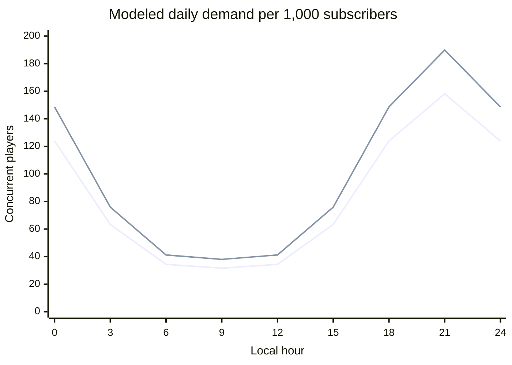
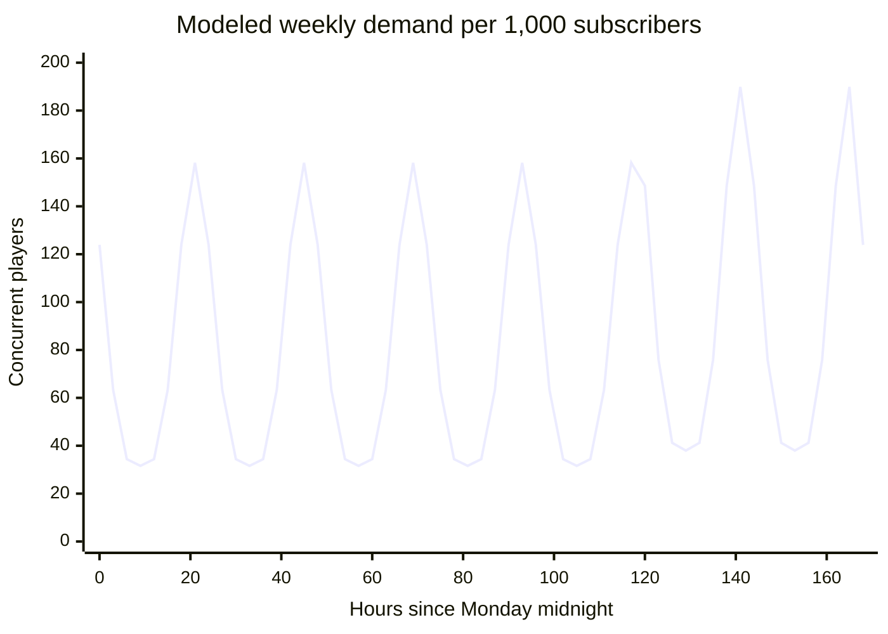

# Open Legend server costs and player demand

**Evidence reviewed: November 17, 2026 (UTC).** This is the maintained owner of Open Legend's server-cost research, economic assumptions and calculated scenarios. It is not a production capacity guarantee, a deployment decision or a spending authorization. Runtime qualification remains in the [native-core tracker](../../docs/maintainers/native-simulation-core.md); exact measurements remain in the linked benchmark records.

## Current conclusion

**Five simultaneous players per 4-vCPU instance is an unverified planning assumption.** We have measured the cost of a small, active opening. We have not established the marginal cost of each additional independently active player, or qualified five such players together at the required service quality.

**The baseline has no additional fleet reserve (`b = 1`).** The assumed players-per-instance capacity already allows for local contention and responsiveness. Adding another reserve for those same bursts would count the same allowance twice. The separate 32% reserve (`b = 1.32`) remains an optional sensitivity case for independently justified fleet needs.

At five simultaneous players per instance, 60 play-hours per subscriber and ideal scaling, baseline compute is **$2.42 per paying subscriber per 30-day month** on the measured AWS `m7i.xlarge`, priced at **$0.2016/hour ($145.152 for 720 hours)**. Keeping the middle forecast's peak fleet running all month instead costs **$5.52 per subscriber-month at 10,000 subscribers**. The optional 32% reserve raises those figures to **$3.19 elastic / $7.29 fixed**. These figures exclude database storage, external AI and other separately billed services.

The [priced hardware shortlist](#priced-hardware-shortlist) compares actual named AWS and Google Cloud machines. ARM, newer x86 and higher-RAM machines could improve cost per supported workload; none has an Open Legend capacity qualification in this research. **Real machine prices do not make the assumed 5/10/15-player capacities measured facts.**

The principal unknowns are supported players per instance, the cost of worlds without connected players, and how much capacity the persistent-world architecture can actually release as demand falls. These unknowns matter more than the arithmetic's displayed decimal places.

## Definitions and accounting boundary

All scenario currency is USD, before taxes, discounts and credits. A modeled month is exactly **30 days = 720 hours**; a calendar January has 744 hours. Do not substitute a 730-hour calculator month without recalculating.

| Term                                    | Exact meaning in this document                                                                                                                                                                                                      |
| --------------------------------------- | ----------------------------------------------------------------------------------------------------------------------------------------------------------------------------------------------------------------------------------- |
| Subscriber, `N`                         | One account with paid access throughout the modeled month. The model assumes a stable cohort and includes subscribers who never play. It does not count unique humans, registered accounts or monthly active accounts.              |
| Player-hour                             | One account connected for one real hour. Two accounts connected for half an hour produce one player-hour.                                                                                                                           |
| Mean monthly playtime, `H`              | Total paid-cohort player-hours divided by `N`, including zero-playtime subscribers. Free/trial/guest hours require separate serving capacity.                                                                                       |
| Concurrent players, `C(t)`              | Connected player accounts at real time `t`. NPCs contribute workload but never count as concurrent players or subscribers.                                                                                                          |
| Average CCU, `Cavg`                     | Player-hours divided by 720. CCU means concurrent users; here those users are player accounts.                                                                                                                                      |
| Peak CCU, `Cpeak`                       | The highest concurrency in the specified scenario and period. An ordinary modeled monthly peak is different from a launch/event peak.                                                                                               |
| Instance                                | One billable virtual machine. It is not necessarily one process, one world, one physical machine or one player.                                                                                                                     |
| Player capacity, `K`                    | Simultaneous players supported by one instance at a specified activity, population, world complexity and service quality, after allowing for contention and local CPU/RAM needs. Every `K` in the financial tables is hypothetical. |
| Instance price, `P`; monthly price, `M` | USD per running instance-hour; `M = 720 × P`. Storage and separately billed services are excluded.                                                                                                                                  |
| Additional fleet multiplier, `b`        | Provisioned player capacity divided by player demand, beyond the per-instance operating allowance already embodied in `K`. Baseline `b = 1` adds no fleet reserve; optional `b = 1.32` adds 32%.                                    |
| CPU percentage of one logical core      | `100 × process CPU seconds / elapsed real seconds`. 100% occupies one logical CPU on average; 400% occupies all four logical CPUs of the benchmark instance on average.                                                             |
| Game speed                              | Completed simulated time divided by the simulated time intended for that real duration. 100% means keeping up with the authored clock; it does not mean 100% CPU.                                                                   |

The cost tables price **running VM compute**. Co-located PostgreSQL consumes part of that purchased capacity; `K` must accommodate it. Do not add a second database-compute charge for that same CPU. A separately deployed database has its own compute bill and requires a new capacity measurement. Storage, backups and replication are separate in either arrangement.

## What Open Legend measurements establish

The standard machine is an AWS `m7i.xlarge`: **4 vCPU, 16 GiB RAM, Linux/x86-64, Ohio (`us-east-2`)**. The ordinary opening contains **one player, two human NPCs, three hares and 1,246 scenery records**. It runs movement, animal reactions, perception/history, permitted views, two controlled conversations and ordinary one-second background saves. Controlled HTTPS replies exercise real request and application paths; these runs do not measure external model generation cost or latency.

The historical **37% server CPU** shorthand comes from the [November 16 one-participant comparison](../../docs/benchmarks/native-runtime-foundations/2026/2026-11-16-runtime-foundations-continuation.md#one-participant): serial server CPU median **37.61% of one core**, with PostgreSQL separately at **1.95%**. It describes the whole opening, including shared world/service work, rather than a proven per-player increment.

A newer qualified example is the NPC-publication candidate in the [November 17 ordinary-play comparisons](../../docs/benchmarks/native-runtime-foundations/2026/2026-11-17-native-active-area-comparisons.md#isolated-ordinary-gameplay), source `79f8839b61ad5845f151dd743faaf74bdfb4f109`, campaign `1e976555-9662-47a7-a5e7-a4e68302d797`:

| Measure                                         |   Median | Arithmetic average |      p95 |
| ----------------------------------------------- | -------: | -----------------: | -------: |
| Server CPU, % of one logical core               |   39.23% |             39.34% |   39.57% |
| Exclusive PostgreSQL CPU, % of one logical core |    2.07% |              2.04% |    2.08% |
| Achieved game speed, % of intended rate         | 100.000% |           100.002% | 100.008% |
| HTTP command response, ms                       |    15.24 |              18.30 |    34.33 |
| First changed player-view receipt, ms           |    62.11 |              62.59 |    94.91 |
| Command to durable-save acknowledgement, ms     |   551.78 |             548.46 | 1,019.67 |

CPU and game-speed statistics summarize three complete 360-real-second windows; their nearest-rank p95 is the highest of three window averages, **not an instantaneous CPU peak**. Latencies summarize pooled individual command observations. The first changed view is a decoded stream receipt, not proof of a rendered browser frame. The authored clock advances 60 game-seconds per real second. Each run completes all scheduled movements and both saved replies; the recorded final debt is zero. Slightly above/below 100% reflects measurement boundaries, not a different clock setting.

Native and geometry worker threads are already included in server CPU. The separate load client consumes about 0.93% of one core and is excluded from the serving-capacity calculation. Supporting complete CPU, including that client and PostgreSQL once each, is **7.041 ms median / 7.053 ms average / 7.080 ms p95 per completed game-second**. The median sampled concurrent application/client RSS plus PostgreSQL memory peak is **1,407.64 MiB**; shared pages can be counted more than once. The **256.58 MiB** transient reservation peak is accounting admission, not an additional RAM bill. The 2 GiB reservation allowance is not observed RAM usage.

The same six-minute candidate window prepares about **56.12 MiB** of write payload, generates **39.56 MiB** of PostgreSQL recovery log (WAL), and increases database size by **14.20 MiB**, by run median. These are different quantities. A short fresh-world run does not establish their long-term retention rate or monthly storage bill. Roughly one-second save acknowledgement follows the ordinary save policy; it is not the response time a player waits before seeing movement.

Across the newer isolated comparisons, server CPU medians range roughly **34–44% of one core**. Different sources and matched campaigns are not a controlled longitudinal speed comparison. Do not select the lowest observation as production capacity. Likewise, the [25-participant observer experiment](../../docs/benchmarks/native-runtime-foundations/2026/2026-11-16-runtime-foundations-continuation.md#twenty-five-participants) used one mover at a time and only three measured moves per run; it does not qualify 25 independently active players. Both 50-participant arms missed required recipients. The [independent active-area work](../../docs/maintainers/native-simulation-core.md#current-implementation-batch) has no completed scaling qualification available for this synthesis.

## Why 46% is not an established utilization target

The earlier illustration was `5 × 0.37 / 4 = 46.25%` of total host CPU. It assumed each added workload cost exactly 0.37 core and omitted PostgreSQL. Adding the historical PostgreSQL usage puts five linear copies near **49%**; the newer example puts them near **52%**, before unmeasured host overhead. These calculations neither prove linear scaling nor determine the best operating load.

There are three separate capacity provisions:

1. **Operating allowance inside each instance:** accommodates short bursts, serial work, contention and response-time requirements. Qualifying `K` already includes this allowance. There is no additional division by 46% in the financial formulas.
2. **Extra fleet capacity, `b`:** the baseline is `b = 1`, without an additional allowance. The optional `b = 1.32` can represent separately justified placement inefficiency, delayed scale-up or demand reserve beyond `K`. It means 32% above occupied capacity, equivalent to **24.24% of provisioned capacity unoccupied**. It must not cover the same contention or short bursts already allowed for in `K`.
3. **Daily and event demand:** determines how large the fleet must become. Per-instance headroom is needed while serving the peak too. It does not replace provisioning for the peak population.

For **1,000 average and 3,000 peak CCU**, hypothetical `K = 5` requires 200 instances at average demand and 600 at peak, before extra fleet reserve. If the fleet cannot shrink, all 600 remain billable overnight. Adding a separate `b = 1.32` makes those counts 264 and 792. Applying that multiplier twice for the same contingency would double-count reserve. Redundancy must have a stated failure requirement; neither factor proves survival of a zone outage.

The acceptable CPU load must come from measured visible-response latency, simulation debt, save delay and memory at increasing activity. Spare aggregate CPU cannot unblock a saturated serial path. Higher utilization is useful when those outcomes remain acceptable. `K = 10` or `15` below represents possible future efficiency or shared-work outcomes, not permission to pack ten or fifteen unchanged copies of the measured opening onto four vCPU.

## Subscriber and concurrency research

The supplied November 16 research, _Open Legend: Player Numbers and Server Economics_, provides the historical survey and the selected traffic curve. Its source figures are retained below with their limitations. They are selected public disclosures, **not a representative sample or an industry median**.

| Historical disclosure                                                                                                                                                               | Subscribers and concurrency                                                         | Interpretation and limit                                                                                                                                                                                                                               |
| ----------------------------------------------------------------------------------------------------------------------------------------------------------------------------------- | ----------------------------------------------------------------------------------- | ------------------------------------------------------------------------------------------------------------------------------------------------------------------------------------------------------------------------------------------------------ |
| [Ultima Online, December 1998](https://www.gamespot.com/articles/uos-million-dollar-milestone/1100-2465849/)                                                                        | Over 100,000 paying; about 12,500 average and 20,000 peak                           | Roughly 8 subscribers per average CCU and 5 per peak CCU. Averaging window unspecified; [contemporaneous archive](https://www.skotos.net/articles/BTHarchives/BTHcomplete.pdf) corroborates the announcement date despite the migrated article's date. |
| [EverQuest, July 2002](https://sony.mediaroom.com/2002-07-30-EverQuest-Experiences-a-Record-Number-of-Simultaneous-Players-More-Than-100-000-EQ-Players-Swarm-Norrath-Over-Weekend) | Over 430,000 subscribers; over 100,000 simultaneous                                 | Approximately 4.3 subscribers per record-peak CCU; rounded thresholds, not an exact ratio or routine daily peak.                                                                                                                                       |
| [Dark Age of Camelot, November 2002](https://www.worthplaying.com/article/2002/11/12/news/6785-dark-age-of-camelot-shrouded-isles-goes-gold/)                                       | Well over 200,000 subscribers; over 50,000 peak                                     | Approximately 4 per peak CCU; reproduced publisher announcement, with unspecified peak window.                                                                                                                                                         |
| [World of Warcraft Europe, March 2005](https://www.tmcnet.com/usubmit/2005/Mar/1126367.htm)                                                                                         | Over 500,000 active subscribers; 230,000 record simultaneous                        | Approximately 2.2 per peak CCU, near launch. European figures match; this is not settled worldwide demand.                                                                                                                                             |
| [EVE Online, February 2009](https://community.eveonline.com/news/news-channels/press-releases/ccp-and-atari-announce-contents-of-eve-online-retail-box-1/)                          | 260,000 subscriptions; recent record 51,675 simultaneous                            | Approximately 5 per peak CCU; entitlements included prepaid/bundled access, and concurrency was not explicitly paid-only.                                                                                                                              |
| [SWTOR, February 2012, EA transcript pp. 7–9](https://s204.q4cdn.com/701424631/files/doc_financials/2012/q3/ERTS_Q3FY12_Transcript.pdf)                                             | About 1.7 million subscriptions; about 1 million daily users playing four hours/day | Inferred average CCU is `1,000,000 × 4 / 24 ≈ 166,667`, or 10.2 subscribers per average CCU. Bundled access remained included. Daily users are not simultaneous users.                                                                                 |
| [RuneScape, GDC Europe 2015, slide 6](https://media.gdcvault.com/gdceurope2015/Mansell_Phil_AnalyticsInAction.pdf)                                                                  | 600,000+ subscribers; 70,000 average and 100,000 peak CCU                           | Approximately 8.6 per average and 6 per peak CCU. Free-to-play hybrid; concurrency was not identified as paid-only or as Old School RuneScape alone.                                                                                                   |

Several reported peak ratios are around 4–6 subscribers per peak CCU. Some average ratios are around 8–10. Neither is a rule for Open Legend. Match payment status, population, period, region and platforms before forming a ratio. In particular, worldwide subscriptions divided by Steam-only concurrency is not comparable.

The reliable accounting identity for the same paying cohort is:

```text
Monthly player-hours = N × H
Average CCU = N × H / 720
```

At 36 / 60 / 90 hours per subscriber, there are respectively **20 / 12 / 8 subscribers per average CCU**. Peak concurrency needs a separate demand curve. Ten thousand subscribers with 1,000 average CCU imply **72 hours per subscriber-month**, not 60.

Historical [WoW population research](https://www.cs.du.edu/~chrisg/publications/pittman-mmm10.pdf) and [RuneScape traffic research](https://atlarge-research.com/pdfs/iosup2011poggi.pdf) support daily cycles with sustained busy periods. WoW's reported near-fivefold variation is peak-to-trough, not peak-to-average. [AWS's GameLift calculator](https://docs.aws.amazon.com/gameliftservers/latest/developerguide/gamelift-calculator.html) uses average demand at 50% of daily peak as a default, or 70% for steadier demand. These are planning inputs, not a measured MMO-wide average. Regional fleets cannot necessarily use the smoothing visible in a global traffic total.

## Traffic scenarios

The research's middle case assumes 60 monthly hours per subscriber, 22 weekdays and eight weekend days, 20% higher weekend activity, and a regional evening peak. It describes ordinary settled demand, excluding exceptional launches, events and outage recovery. The weekend uplift redistributes the fixed monthly hours; it does not add hours on top of `N × H`.

For reproducibility, with `h` the hour in the audience's principal time zone:

```text
f(h) = 1 + 0.8 cos(2π(h − 21)/24) + 0.2 cos(4π(h − 21)/24)
A = N × H / [24 × (22 + 1.2 × 8)]
Weekday CCU(h) = A × f(h)
Weekend CCU(h) = 1.2 × A × f(h)
```

The shape's daily mean is 1, maximum 2 and minimum 0.4. The modeled monthly peak is **2.27848 times whole-month average CCU**. The assumed peak is at 9 p.m.; this is not observed Open Legend traffic.

### Daily demand curve

Both lines show **modeled concurrent players per 1,000 subscribers**, at 60 hours per subscriber-month. The **lower line is a weekday; the upper line is a weekend day**. The horizontal axis is local hour in the audience's principal time zone; 24 is the following midnight. Lines connect three-hour samples rounded to one decimal; the formula above defines the exact curve. Neither line includes a capacity reserve.



### Weekly demand curve

This representative Monday–Sunday week uses those same day profiles, with the 20% uplift on Saturday and Sunday. The axis runs from **Monday midnight (hour 0) to the next Monday midnight (hour 168)**. Day boundaries are 0, 24, 48, 72, 96, 120, 144 and 168; weekend peaks occur at hours 141 and 165. It shows demand per 1,000 subscribers, not server utilization or capacity. Lines connect three-hour samples; the model changes the weekday/weekend multiplier at midnight rather than modeling a transition. The week retains the 30-day model's normalization; its five-weekday/two-weekend mix is not identical to the month's 22/8 mix.



### Demand values and scenario populations

| Per 1,000 subscribers at 60 hours/month | Weekday CCU | Weekend CCU |
| --------------------------------------- | ----------: | ----------: |
| Midnight                                |         124 |         149 |
| 3 a.m.                                  |          63 |          76 |
| 6 a.m.                                  |          34 |          41 |
| 9 a.m.                                  |          32 |          38 |
| Noon                                    |          34 |          41 |
| 3 p.m.                                  |          63 |          76 |
| 6 p.m.                                  |         124 |         149 |
| 9 p.m.                                  |         158 |         190 |

The whole-month average is **83.33 CCU**. In this curve, demand stays at or above 90% of **each day's own peak** for **3.926 hours/day**. It stays at or above 90% of the **highest monthly peak** for **31.4 hours/month**, only on weekend evenings. Those two durations use different thresholds and are not contradictory.

The following scenarios all have **10,000 subscribers**. Counts are rounded for display; calculations use unrounded values. The first three use the curve above; the final row preserves the earlier discussion's independently selected 3:1 peak/average ratio.

| Scenario                                | Hours/subscriber-month | Monthly player-hours | Average CCU | Ordinary peak CCU | Optional peak capacity with 1.32 multiplier |
| --------------------------------------- | ---------------------: | -------------------: | ----------: | ----------------: | ------------------------------------------: |
| Lower playtime                          |                     36 |              360,000 |         500 |             1,139 |                                       1,504 |
| Research middle                         |                     60 |              600,000 |      833.33 |             1,899 |                                       2,506 |
| Higher playtime                         |                     90 |              900,000 |       1,250 |             2,848 |                                       3,759 |
| Earlier 1,000-average / 3,000-peak case |                     72 |              720,000 |       1,000 |             3,000 |                                       3,960 |

These are sensitivity cases, not confidence intervals. Baseline fleet sizing uses the ordinary peak column, rounded upward to whole instances in the cost calculation. The final column is the optional 32% reserve: the middle case's roughly 2,500 capacity slots are available places, not 2,500 expected simultaneous players or subscribers. At 10,000 subscribers, 833 average / 1,899 peak and 1,000 average / 3,000 peak are different forecasts; do not mix their averages and peaks in one calculation.

## Converting demand to compute cost

The reference price is **$0.2016 per instance-hour**, or **$145.152 per 720-hour month**, for on-demand Linux `m7i.xlarge` in Ohio. AWS's Price List API returned that rate on November 17, 2026: Ohio SKU `6A8DNG8MWDXC7U23`, catalog version `20261114012926`, published November 14, effective November 1. This is a public list price, not an account-specific contract. [Official Ohio catalog](https://pricing.us-east-1.amazonaws.com/offers/v1.0/aws/AmazonEC2/20261114012926/us-east-2/index.json).

### Priced hardware shortlist

All prices below are **Linux on-demand USD/hour**, with monthly equivalents calculated as **hourly price × 720**. AWS uses shared tenancy in **Northern Virginia (`us-east-1`)**; the reference `m7i.xlarge` also has the same verified price in Ohio. Google Cloud uses **Iowa (`us-central1`)**. These regions do not imply equivalent player latency. Rates exclude disks, transfer and other separately billed services; the [GameLift comparison](#managed-hosting-and-bandwidth) has a different billing boundary.

AWS rates were retrieved directly through its Price List API on November 17, from catalog version `20261114012926`. Google rates match the official pricing page's indexed rows checked on November 17; those rows were crawled about one month earlier, so their freshness is less certain. The supplied _Server Economics and Infrastructure Recommendations_ used 730-hour months; all amounts here use 720. Recheck regional availability, quotas and prices before purchasing. Sources: [AWS regional catalog](https://pricing.us-east-1.amazonaws.com/offers/v1.0/aws/AmazonEC2/20261114012926/us-east-1/index.json), [Google published prices](https://cloud.google.com/products/compute/pricing/general-purpose?hl=en).

| Provider / machine                    | Processor                             | vCPU / physical cores | RAM, GiB |     USD/hour | USD/720 hours |
| ------------------------------------- | ------------------------------------- | --------------------: | -------: | -----------: | ------------: |
| AWS `m7i.xlarge` — measured reference | Intel Sapphire Rapids, x86            |                 4 / 2 |       16 |     $0.20160 |       $145.15 |
| AWS `c6g.2xlarge`                     | Graviton2, ARM                        |                 8 / 8 |       16 |     $0.27200 |       $195.84 |
| AWS `c7g.2xlarge`                     | Graviton3, ARM                        |                 8 / 8 |       16 |     $0.29000 |       $208.80 |
| AWS `c8g.2xlarge`                     | Graviton4, ARM                        |                 8 / 8 |       16 |     $0.31904 |       $229.71 |
| AWS `c9g.2xlarge`                     | Graviton5, ARM                        |                 8 / 8 |       16 |     $0.34776 |       $250.39 |
| AWS `m8g.2xlarge`                     | Graviton4, ARM                        |                 8 / 8 |       32 |     $0.35904 |       $258.51 |
| AWS `c8a.2xlarge`                     | AMD Zen 5, x86                        |                 8 / 8 |       16 |     $0.43108 |       $310.38 |
| AWS `m8azn.xlarge`                    | AMD Zen 5, x86; high-frequency option |                 4 / 4 |       16 |     $0.41292 |       $297.30 |
| Google `n4a-highcpu-8`                | Axion, ARM                            |                 8 / 8 |       16 |     $0.25984 |       $187.08 |
| Google `n4a-standard-8`               | Axion, ARM                            |                 8 / 8 |       32 |     $0.30800 |       $221.76 |
| Google `c4a-highcpu-8`                | Axion, ARM                            |                 8 / 8 |       16 |     $0.30304 |       $218.19 |
| Google `t2d-standard-8`               | AMD Milan, x86                        |                 8 / 8 |       32 |    $0.337968 |       $243.34 |
| Google `c4d-highcpu-8`                | AMD Turin, x86                        |                 8 / 4 |       15 | $0.317928224 |       $228.91 |

**A vCPU is not a comparable amount of work across these machines.** With default CPU settings, `m7i.xlarge` exposes two hardware threads on each of two physical cores. The listed ARM machines, C8a, M8azn and T2D expose one thread per core; C4D exposes two. Core designs also differ. Neither equal vCPU counts nor equal physical-core counts establish equal throughput or response latency. Physical-core counts do not mean dedicated tenancy. Sources: [AWS CPU options](https://docs.aws.amazon.com/AWSEC2/latest/UserGuide/cpu-options-supported-instances-values.html), [C8a specifications](https://aws.amazon.com/ec2/instance-types/c8a/), [Google vCPU definitions](https://docs.cloud.google.com/docs/compute-area/vcpus).

The consequential comparisons are:

- **ARM versus x86:** C8g/C9g and N4A/C4A are candidates for better workload-per-dollar, with C8a as a modern x86 comparison and C6g/C7g as cheaper older alternatives. Open Legend's Linux ARM64 build, native dependencies and actual gameplay performance remain unqualified here; no vendor performance percentage is applied to our measurements.
- **RAM versus compute-only sizing:** M8g doubles C8g's RAM for **$28.80 more per 720 hours (12.54%)**. N4A standard doubles N4A highcpu RAM for **$34.68 more (18.53%)**. Extra RAM is valuable if it admits more useful work or reduces costly reads; otherwise it is unused capacity. Active world state, PostgreSQL, independent consumers and runtime overhead all compete for it.
- **Newer or faster cores:** C9g costs **9.00% more than C8g**. Under the same utilization and other costs, it must deliver more than 9.00% additional useful throughput to lower compute cost per unit of work. M8azn is a candidate for an expensive serial calculation that other cores cannot accelerate, not an established economical default.

### Calculation method

Use **`b = 1` for the baseline** and `b = 1.32` only for the explicitly labeled optional scenario. For an ideal fleet that tracks demand continuously, ignoring whole-instance rounding:

```text
Average running instance equivalents = b × Cavg / K
Monthly running instance-hours = b × N × H / K
Monthly VM compute cost = b × N × H × P / K
VM compute cost per subscriber-month = b × H × P / K
```

An average instance equivalent measures billed instance-hours divided by 720; it does not mean purchasing a fraction of a VM. For a fleet retained throughout the month:

```text
Fixed instance count = ceil(b × Cpeak / K)
Monthly VM compute cost = fixed instance count × 720 × P
```

`ceil` means round upward to a whole instance. For an actual schedule, cost is `P × integral(running instance count over real hours)`. Minimum fleet size, world placement, scale-up lead time and multiple regions can prevent the ideal fleet from following demand. [AWS target-tracking guidance](https://docs.aws.amazon.com/gameliftservers/latest/developerguide/fleets-autoscaling-target.html) explains why starting instances/processes can take minutes. That session-hosting mechanism does not establish that Open Legend can move or suspend persistent world work.

### Capacity and price sensitivity

All rows assume **60 hours per subscriber-month** and **ideal elastic capacity**. Baseline **`b = 1` adds no fleet reserve**; each `K` already includes its per-instance operating allowance. The first table uses only the measured machine's actual price: **AWS `m7i.xlarge`, $0.2016/hour**. None of the capacities is qualified.

| Assumed simultaneous players/instance, `K` | Baseline USD/subscriber-month | Baseline monthly USD for 10,000 subscribers | Optional 32% reserve, USD/subscriber-month |
| ------------------------------------------ | ----------------------------: | ------------------------------------------: | -----------------------------------------: |
| 3: lower capacity case                     |                         $4.03 |                                  $40,320.00 |                                      $5.32 |
| 5: current discussion assumption           |                     **$2.42** |                              **$24,192.00** |                                      $3.19 |
| 10: higher capacity case                   |                         $1.21 |                                  $12,096.00 |                                      $1.60 |
| 15: higher capacity case                   |                         $0.81 |                                   $8,064.00 |                                      $1.06 |

The following alternatives use their actual prices above and the **same hypothetical 5/10/15 players per whole instance**, not per core. They show what a measured capacity would imply economically; they do not predict that capacity. All cells are **baseline VM compute USD per subscriber-month**, with no extra reserve:

| Machine                                        | If `K = 5` | If `K = 10` | If `K = 15` |
| ---------------------------------------------- | ---------: | ----------: | ----------: |
| AWS `m7i.xlarge` — measured hardware reference |      $2.42 |       $1.21 |       $0.81 |
| AWS `c8g.2xlarge` — ARM, 16 GiB                |      $3.83 |       $1.91 |       $1.28 |
| AWS `c9g.2xlarge` — newer ARM, 16 GiB          |      $4.17 |       $2.09 |       $1.39 |
| AWS `m8g.2xlarge` — ARM, 32 GiB                |      $4.31 |       $2.15 |       $1.44 |
| AWS `c8a.2xlarge` — x86, 16 GiB                |      $5.17 |       $2.59 |       $1.72 |
| Google `n4a-highcpu-8` — ARM, 16 GiB           |      $3.12 |       $1.56 |       $1.04 |
| Google `n4a-standard-8` — ARM, 32 GiB          |      $3.70 |       $1.85 |       $1.23 |

For 10,000 subscribers, multiply an **unrounded** per-subscriber result by 10,000. For example, C8g at hypothetical `K = 10` costs **$19,142.40/month**, versus **$24,192.00** for M7i at hypothetical `K = 5`. This is a conditional comparison, not an observed saving. To beat that M7i case on elastic compute alone, C8g needs at least **8** supported simultaneous players, M8g **9**, C8a **11**, or N4A highcpu **7**. The threshold follows `K_alternative > 5 × P_alternative / 0.2016`; each alternative must meet the same gameplay and service requirements. The optional reserve multiplies unrounded elastic costs by 1.32 only when independently justified.

For `K = 5` at the reference rate:

- Serving one occupied player-hour costs **$0.04032 in the baseline**, or **$0.0532224** with the optional reserve under ideal scaling.
- A subscriber playing 60 hours costs **$2.4192 in the baseline**, or **$3.193344** with the optional reserve.
- One player connected continuously for all 720 hours is allocated **$29.0304 in the baseline**, or **$38.320128** with the optional reserve, under the same ideal fleet model.

The last line allocates total fleet cost in proportion to each account's connected hours; it is not the price of a dedicated VM for one player. These figures differ because they price different amounts of service. Never use the unqualified expression “cost per player per month.”

### Traffic and deployment sensitivity at 10,000 subscribers

The baseline rows use hypothetical **`K = 5`**, **$0.2016/hour**, and **`b = 1`**. “Fixed” means the entire peak-sized fleet runs for all 720 hours. “Elastic” means ideal proportional scaling, without rounding or a minimum world-service floor. Average elastic instance counts are rounded for display; costs use unrounded values.

| Traffic scenario                        | Baseline elastic average instances | Baseline elastic monthly compute | Baseline elastic compute/subscriber-month | Baseline fixed instances | Baseline fixed monthly compute | Baseline fixed compute/subscriber-month |
| --------------------------------------- | ---------------------------------: | -------------------------------: | ----------------------------------------: | -----------------------: | -----------------------------: | --------------------------------------: |
| Lower playtime                          |                                100 |                       $14,515.20 |                                     $1.45 |                      228 |                     $33,094.66 |                                   $3.31 |
| Research middle                         |                             166.67 |                       $24,192.00 |                                     $2.42 |                      380 |                     $55,157.76 |                                   $5.52 |
| Higher playtime                         |                                250 |                       $36,288.00 |                                     $3.63 |                      570 |                     $82,736.64 |                                   $8.27 |
| Earlier 1,000-average / 3,000-peak case |                                200 |                       $29,030.40 |                                     $2.90 |                      600 |                     $87,091.20 |                                   $8.71 |

For comparison, the **optional 32% additional fleet reserve (`b = 1.32`)** produces the following costs. The fixed fleet then covers peak demand plus that extra reserve throughout the month. Whole-instance rounding means its cost need not be exactly 1.32 times the rounded fixed baseline.

| Traffic scenario                        | Optional-reserve elastic average instances | Optional-reserve elastic monthly compute | Optional-reserve elastic compute/subscriber-month | Optional-reserve fixed instances | Optional-reserve fixed monthly compute | Optional-reserve fixed compute/subscriber-month |
| --------------------------------------- | -----------------------------------------: | ---------------------------------------: | ------------------------------------------------: | -------------------------------: | -------------------------------------: | ----------------------------------------------: |
| Lower playtime                          |                                        132 |                               $19,160.06 |                                             $1.92 |                              301 |                             $43,690.75 |                                           $4.37 |
| Research middle                         |                                        220 |                               $31,933.44 |                                             $3.19 |                              502 |                             $72,866.30 |                                           $7.29 |
| Higher playtime                         |                                        330 |                               $47,900.16 |                                             $4.79 |                              752 |                            $109,154.30 |                                          $10.92 |
| Earlier 1,000-average / 3,000-peak case |                                        264 |                               $38,320.13 |                                             $3.83 |                              792 |                            $114,960.38 |                                          $11.50 |

Under ideal scaling, changing only the shape or height of the peak while preserving monthly player-hours changes the largest fleet required, but not the instance-hours formula. It changes cost when capacity must remain running, cannot be placed efficiently, or needs advance provisioning. The “divide peak cost by three” shortcut from the supplied research works only for its chosen rounded 250-slot capacity versus 83.33 average CCU, before a continuous extra reserve. Do not divide by three after already calculating cost from player-hours.

To express compute as a share of revenue, divide compute per subscriber-month by the actual subscription price. No subscription price is selected here. Revenue remaining after compute is not profit; other operating costs and revenue deductions still apply.

### Managed hosting and bandwidth

Managed GameLift has higher quoted instance rates than ordinary EC2, but includes eligible game-server network transfer. That can reverse the compute-only ranking. These are Northern Virginia Linux on-demand prices verified through AWS's Price List API on November 17; GameLift catalog version `20261110171128`, published November 10. [Official GameLift catalog](https://pricing.us-east-1.amazonaws.com/offers/v1.0/aws/AmazonGameLift/20261110171128/us-east-1/index.json).

| Machine               | EC2 USD/hour | Managed GameLift USD/hour | EC2 USD/720 hours | GameLift USD/720 hours | GameLift instance-rate premium per 720 hours |
| --------------------- | -----------: | ------------------------: | ----------------: | ---------------------: | -------------------------------------------: |
| `c8g.2xlarge`, 16 GiB |     $0.31904 |                  $0.39000 |           $229.71 |                $280.80 |                                       $51.09 |
| `m8g.2xlarge`, 32 GiB |     $0.35904 |                  $0.43800 |           $258.51 |                $315.36 |                                       $56.85 |

For the same useful capacity and running hours, GameLift's included transfer offsets its C8g instance-rate premium once the **otherwise-billed eligible network transfer exceeds $51.0912 per 720 instance-hours**; the M8g threshold is **$56.8512**. These are dollar thresholds, not assumed traffic volumes. Calculate the avoided bill from actual bytes, applicable tiers and allowances. Include any differences in disk and backend charges before declaring either total cheaper. The listed GameLift products include 50 GB of instance storage; ordinary EC2 prices exclude EBS storage.

AWS's policy covers generation 6 and later managed GameLift instances, on-demand and Spot, in supported regions except China. It does not make ordinary EC2/ECS traffic or separately hosted backend traffic free. [Bandwidth policy](https://aws.amazon.com/about-aws/whats-new/2026/06/amazon-gamelift-servers-free-network-bandwidth/).

Service fit remains unqualified. GameLift permits long-running sessions, but its built-in session management supports up to 200 players; larger sessions require custom management. AWS also identifies additional access work for databases in private VPC subnets and recommends custom EC2/ECS/EKS arrangements for large partitioned MMOs. Its session manager does not implement Open Legend's world partitioning, privacy or persistence. [GameLift FAQ](https://aws.amazon.com/gamelift/servers/faqs/).

Ordinary **ECS on self-managed EC2 adds no ECS orchestration fee**; EC2 and supporting services remain billable. ECS Managed Instances adds a management fee, and Fargate bills requested resources under a different price model. These are distinct hosting options, not interchangeable names for the same price. [ECS pricing](https://aws.amazon.com/ecs/pricing/). Kubernetes/Agones can schedule server processes but does not by itself distribute one authoritative world. No platform switch is adopted here.

Use on-demand prices for comparable initial measurements. Commitments can reduce the cost of a demonstrated persistent baseline; they also create a payment obligation when demand falls. Spot requires demonstrated interruption/recovery handling. Unquoted bare-metal offers, blanket discount percentages and untested players-per-core claims are not forecast inputs.

## External hosting comparisons

There is no established public MMO-only median for comparable server compute per subscriber. Cost per occupied player-hour at specified gameplay and service quality is more transferable than raw players per instance.

The following [AWS GameLift worked examples](https://aws.amazon.com/gamelift/servers/pricing/) are recalculated using their explicit hourly price and occupied capacity, with **our 60 hours, no extra reserve in the baseline, and a separate optional 32% reserve**. AWS's own example buffer is replaced, not added again:

| Vendor-modeled workload                           | Instance price/hour | Occupied players/instance | Baseline compute per 60 occupied player-hours | Optional-reserve compute per 60 occupied player-hours |
| ------------------------------------------------- | ------------------: | ------------------------: | --------------------------------------------: | ----------------------------------------------------: |
| 5v5 shooter: eight 10-player sessions             |              $0.741 |                        80 |                                         $0.56 |                                                 $0.73 |
| Fighting game: twenty-four 2-player sessions      |              $0.741 |                        48 |                                         $0.93 |                                                 $1.22 |
| Battle royale: four sessions averaging 30 players |              $0.823 |                       120 |                                         $0.41 |                                                 $0.54 |

These are vendor examples for session games, not measured Open Legend capacity or MMO financial statements. The formula is `P / occupied players × 60 × b`, with baseline `b = 1` or optional `b = 1.32`; inconsistent vendor summary totals are not used. Compare cost per occupied player-hour at equivalent gameplay requirements, not raw players per machine. Included bandwidth under eligible GameLift terms does not establish free egress for ordinary EC2 hosting.

The supplied research also records Homecoming's **January 2020 hosting bill of $4,820.39** and **1,787 average CCU**. Dividing by `1,787 × 744` player-hours gives **$0.003626/player-hour**, or about **$0.22 per 60 hours**. This is historical donation-funded hosting, not a subscriber charge or modern MMO target. Its actual spare capacity is already in the bill; do not add a hypothetical reserve again. The [operator's finance post](https://forums.homecomingservers.com/topic/14562-february-2020-donations-finances/?comment=153662&do=findComment) and [population post](https://forums.homecomingservers.com/topic/16094-homecoming-statistics-march-2020/) are retained as source references; access returned HTTP 403 during this review, so those figures remain attributed to the supplied research rather than independently reverified here.

## Costs still outside the forecast

| Cost or constraint                           | How it changes the model                                                                                                                                                                         |
| -------------------------------------------- | ------------------------------------------------------------------------------------------------------------------------------------------------------------------------------------------------ |
| Worlds/NPCs active without connected players | Establish a minimum running fleet or background workload. Do not assume server compute falls to zero with CCU. Do not add this cost twice if representative `K` already includes the same work.  |
| Database storage, I/O, backups and replicas  | Price retained state/history, write volume and recovery requirements separately. Co-located database CPU is already inside the VM capacity calculation; separate database hosts are additional.  |
| Network and supporting services              | Add applicable outbound/inter-region traffic, load balancers, public IPs, logs, metrics, authentication and object storage. Prepared JSON bytes are not a measurement of billed network traffic. |
| External AI generation                       | Model player-triggered requests/tokens per player-hour plus autonomous NPC demand. Controlled-response benchmarks provide no inference bill, live-provider latency or model-quality evidence.    |
| Redundancy, regions and placement            | Account for the chosen failure tolerance and capacity that cannot serve another region/world. Spare CPU alone is not a failover design.                                                          |
| Revenue deductions and operations            | Payment/platform fees, refunds, applicable taxes, support, development and operations are needed for business margins, even when excluded from a hosting comparison.                             |

For a fixed world population and policy, `world CPU ≈ background CPU + incremental player-driven CPU` is a useful hypothesis to measure, not an established linear law. Crowds can create additional interactions; separated players can share world overhead. Storing a persistent object does not itself require continuously simulating it. Shared work and offline behavior must be measured under the actual authored rules.

Persistent storage, resident RAM and active CPU are separate budgets. Long-lived structures and individual NPC histories can accumulate storage without requiring every record in every process's RAM or a calculation on every clock step. However, unloading data or reducing update frequency is not automatically behavior-preserving: physical interactions, private knowledge and committed consequences retain their rules. The [memory residency contract](../../docs/memory-architecture.md#residency-and-maintenance-inputs) establishes history handling, not general area streaming. Conventional world simulation uses CPU/RAM; a rendering GPU is not assumed. Model inference is a separate workload, and a shared model serving private NPC contexts does not imply one model copy per NPC.

## Replacing assumptions with evidence

Keep implementation and qualification work in the existing [native-core tracker](../../docs/maintainers/native-simulation-core.md#current-implementation-batch) and [capacity research](../mmorpg-foundations/02-cost-model-and-failure-modes.md). This document owns their economic interpretation, not a parallel engineering backlog.

| Unknown                                  | Evidence needed before treating it as a forecast input                                                                                                                                                                                       |
| ---------------------------------------- | -------------------------------------------------------------------------------------------------------------------------------------------------------------------------------------------------------------------------------------------- |
| Players supported per purchased instance | Complete independent active-area and crowd workloads, with fixed world population/activity, actual CPU/RAM, commands, visible delivery, saves and debt. One, two and four comparable active areas separate fixed and incremental costs.      |
| Operating utilization                    | Find the instance load at which the selected response/progression/save requirements still pass, including bursts and held consumers. Do not preselect 46% as a permanent ceiling.                                                            |
| Alternative hardware and host packing    | Qualify Linux ARM64 dependencies and compare complete gameplay on named machines, including PostgreSQL, RAM and several active workloads sharing a host. Measure `P / K` at matching service quality; core counts alone cannot establish it. |
| Monthly billed capacity                  | Establish the minimum world-service floor, actual placement constraints, startup lead time and safe consolidation behavior. Until then, keep elastic and fixed-fleet cases separate.                                                         |
| Subscriber traffic                       | Measure paid-cohort hours, ordinary regional peaks and exceptional events with matched account definitions. Replace the 60-hour and weekend assumptions when data exists.                                                                    |
| Total service cost                       | Add observed AI usage, storage growth/retention, network and supporting services under a chosen production topology.                                                                                                                         |

When updating this owner, name each workload and source revision, label measured values versus assumptions, preserve meaningful failure evidence, and recalculate all dependent tables. Report server and PostgreSQL CPU separately as percentages of one logical core, achieved game speed, and median/average/p95 with sample definitions. Link exact benchmark evidence rather than importing its full implementation history. A new optimization or a newer commit does not by itself change `K` or qualify production capacity.
